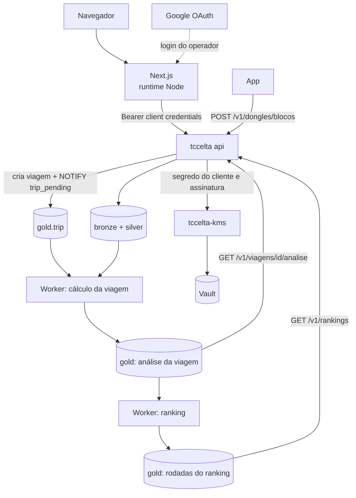

# 04 — Arquitetura da análise de viagem e do ranking

> **Status: especificação de algo a desenvolver.** Este documento define como as specs [`01`](01-tela-mapa-velocidade.md), [`02`](02-calculos-e-contrato-json.md) e [`03`](03-rankings-de-motoristas.md) viram sistema: processos, tabelas, filas, endpoints e autenticação. O passo a passo de cada entrega está em [`entregas/`](entregas/).

## Contexto

Na feira, o visitante faz uma viagem. O operador abre a tela de processar, informa motorista, combustível, categoria e a viagem (boot ou intervalo), e a análise aparece em segundos. O ranking é atualizado a cada viagem. O dongle é informado na requisição, mas é fixo na feira.

As specs 01, 02 e 03 continuam sendo a fonte da verdade da tela, dos cálculos e dos rankings. `tools/trip-analyzer` é só material de apoio: em caso de divergência, vale a spec.

## Visão geral



**Fluxo da viagem:**

1. O `POST /v1/viagens` grava `gold.trip` com status `pending`, envia `NOTIFY trip_pending` e responde `202` com `viagem_id`.
2. O worker espera os dados chegarem, calcula e grava a análise na gold.
3. A tela consulta o status a cada 1 s e mostra a análise quando ela fica pronta.

**Fluxo do ranking (implementação futura):**

1. A mesma transação que grava a análise marca `gold.ranking_state.pending`.
2. O worker do ranking recalcula a rodada inteira a partir da gold.
3. A tela de ranking consulta a última rodada por polling e mostra o horário dela.

## Decisões

| Tema | Decisão | Motivo |
|---|---|---|
| Processamento da viagem | Assíncrono, no `tccelta worker` | Precisa esperar dados, recalcular quando chegam atrasados e não disputar recursos com a ingestão |
| Armazenamento | Schema `gold`, com tabelas estruturadas | Continua o medalhão `raw_block` → `reading`/`position` → gold |
| Parâmetros do cálculo | Padrões da spec 02, mais o combustível da viagem | Ajustes e seleção de trecho ficam fora desta versão |
| Código do cálculo | Pacote Go puro, sem acesso a banco | Testável com viagens de exemplo e reutilizável quando Ajustes entrarem |
| Ranking | Materializado, em rodadas completas | `p5` e `p95` dependem do grupo, então cada viagem pode mudar o índice de todos |
| Motorista | Colunas em `gold.trip`, sem tabela própria | Cada nome tem uma viagem só; o `motorista.id` do contrato é o `viagem_id` |
| Quem dirige de novo | Outra viagem, com outro nome | A spec 03 exige exatamente uma viagem por motorista |
| Nome único | Dentro de `trip_category`, sem diferença de maiúsculas e espaços nas pontas | Testes não ocupam nomes da feira |
| Identificador da viagem | UUID | Evita percorrer viagens de outros visitantes pela URL |
| Idioma | Banco e código em inglês; rotas e JSON em português | Segue a invariante 12 de `.spec/README.md`. Identificadores das specs (`mais_economico`, `consumo_subestimado`) ficam como estão |
| Frontend | Next.js no runtime Node | O segredo do cliente fica no servidor, e o navegador nunca recebe o token |
| Login do operador | Google via NextAuth, só com e-mails USP liberados | A API vê todo pedido como vindo do Next.js, então a proteção do operador fica nele |
| Autenticação na API | Client credentials, com segredo e chave de assinatura no KMS e JWKS público | Mantém a API sem credencial do Vault |

## Viagem

### Estados

| `gold.trip.status` | Na API | Significado |
|---|---|---|
| `pending` | `pendente` | Criada, ainda não avaliada pelo worker |
| `waiting_data` | `aguardando_dados` | Aguardando os blocos chegarem |
| `ready` | `pronta` | Análise gravada |
| `failed` | `falhou` | Erro no cálculo; libera o nome do motorista |

Durante um recálculo, a viagem continua `ready`, com o resultado anterior visível até o novo ser confirmado.

### Espera pelos dados

O caminho dos dados é dongle → BLE → buffer do app → HTTPS, então o clique em processar pode chegar antes dos últimos blocos.

`dongle_state.head_seq` é o `HEAD_seq` do último handshake ou o maior `seq` recebido. Como ele avança com o que chega, `contiguous_seq = head_seq` não prova que tudo chegou: pode haver blocos ainda no dongle ou no app.

Ao criar a viagem, a API congela `target_seq = dongle_state.head_seq`. O worker calcula quando `contiguous_seq ≥ target_seq` e uma destas condições vale, ou quando o limite final é atingido:

| Condição | Caso |
|---|---|
| Chegou bloco com hora absoluta ≥ `t1`, e o boot tem conversão de hora | `intervalo`, com o dongle ligado |
| Passaram ~10 s sem lote novo (`dongle_state.last_ack_at`) | `boot`, ou dongle desligado. Valor a calibrar |
| **Passaram 20 s desde a criação** (limite final, independe de `contiguous_seq`) | Qualquer caso. Calcula com o que houver e adiciona o aviso `dados_parciais` |

**Cuidado na feira:** com a entrada `boot`, se o dongle não reiniciar entre visitantes, o boot mistura as viagens deles. Nesse caso, use `intervalo` ou reinicie o dongle a cada visitante.

### Dados atrasados

O `contiguous_seq` nunca regride e só passa de um bloco depois que ele chega ou é declarado perdido. Isso permite provar que uma viagem está completa:

- **Completa (`provisional = false`):** `contiguous_seq` alcançou um bloco posterior ao fim da viagem, ou um boot seguinte já começou. Ela não é mais verificada, salvo em reprocessamento.
- **Provisória (`provisional = true`):** calculada por tempo sem lotes ou pelo limite final. Um ticker do worker marca `recalc_pending` em dois casos:
  - `contiguous_seq` passou de `calculated_through_seq`, e há blocos novos dentro da viagem.
  - A viagem tem o aviso `boot_sem_hora`, e o boot ganhou conversão de hora.

Se a prova de completude aparecer sem dados novos, o ticker limpa `provisional`, sem recalcular.

`boot.gold_pending` é removida: ela marca o boot inteiro a cada lote, enquanto uma viagem pode ser só um intervalo dentro dele. O `tccelta worker reprocess` passa a marcar `recalc_pending` nas viagens cuja faixa `[first_seq, last_seq]` cruza a faixa reprocessada.

**Limite aceito:** uma âncora nova muda a conversão de hora de um boot e pode mover levemente quais dados entram em um `intervalo`. Isso não dispara recálculo em viagem completa. A resposta traz `relogio.incerteza_ms`.

**Viagem vazia:** uma viagem que sai sem dados aos 20 s fica `ready` e `provisional`, sempre com `sem_leituras` e também com `boot_sem_hora` quando essa for a causa. A tela mostra "Aguardando dados" enquanto ela estiver provisória, e "Sem dados para esta viagem" depois disso.

### Transação do cálculo

O trabalho segue o padrão de `TakePendingBoot`: `FOR UPDATE SKIP LOCKED` na linha da viagem, leitura da silver, cálculo, gravação e commit. A avaliação de "os dados já chegaram?" fica fora dessa transação, em um ticker curto, para não manter transação aberta durante a espera.

Um recálculo troca as linhas da análise em uma transação. Quando o ranking existir, o `UPDATE` em `gold.ranking_state` é o último comando dela.

## Tabelas da gold

```sql
CREATE TABLE gold.trip (
  trip_id                uuid PRIMARY KEY DEFAULT gen_random_uuid(),
  trip_category          text NOT NULL,
  driver_name            text NOT NULL,
  driver_name_normalized text NOT NULL,
  fuel                   text NOT NULL,   -- preset da spec 02; "personalizado" fica fora desta versão
  dongle_id              integer NOT NULL REFERENCES dongle,
  entry_type             text NOT NULL CHECK (entry_type IN ('boot', 'interval')),
  boot_generation        integer NULL,
  boot_id                integer NULL,
  interval_start         timestamptz NULL,
  interval_end           timestamptz NULL,
  status                 text NOT NULL CHECK (status IN ('pending', 'waiting_data', 'ready', 'failed')),
  target_seq             bigint NOT NULL,
  first_seq              bigint NULL,
  last_seq               bigint NULL,
  calculated_through_seq bigint NULL,
  provisional            boolean NOT NULL DEFAULT false,
  recalc_pending         boolean NOT NULL DEFAULT false,
  calculation_version    text NULL,
  created_at             timestamptz NOT NULL DEFAULT now(),
  calculated_at          timestamptz NULL,
  excluded_at            timestamptz NULL
);
CREATE UNIQUE INDEX trip_driver_name_unique
  ON gold.trip (trip_category, driver_name_normalized)
  WHERE excluded_at IS NULL AND status <> 'failed';
```

| Dado do contrato (spec 02) | Formato | Tabela |
|---|---|---|
| Partes da viagem | Linhas | `gold.trip_part` |
| Resumo, condutor, motor, qualidade, marcha lenta, indicadores de troca, avisos, parâmetros, relógio | Colunas, com `jsonb` em avisos e parâmetros. Inclui `intake_air_g`, que o ranking usa | `gold.trip_summary` (1:1) |
| Faixas de velocidade | Linhas | `gold.trip_speed_band` |
| Eventos | Linhas | `gold.trip_event` |
| Paradas | Linhas | `gold.trip_stop` |
| Patamares de marcha | Linhas | `gold.trip_gear` |
| Trocas de marcha | Linhas | `gold.trip_gear_shift` |
| Séries, séries lentas, rota, distribuições | `jsonb`; o volume não justifica uma linha por ponto, e as séries têm `null` por elemento | `gold.trip_series` (1:1) |

`intake_air_g` é o ar admitido na viagem. Como `km/L = distância × AFR × densidade / ar`, o ranking calcula km/L em qualquer preset sem recalcular a viagem.

### Permissões

| Papel | Permissão |
|---|---|
| `tccelta_worker` | `SELECT` em `reading`, `position`; `SELECT, INSERT, UPDATE, DELETE` nas tabelas da gold |
| `tccelta_api` | `SELECT, INSERT` em `gold.trip`; `SELECT` no restante da gold |
| `tccelta_reader` | `SELECT` na gold |

## Ranking (implementação futura)

Esta seção guarda o desenho do ranking. Nenhuma entrega atual o implementa.

**Materializado** significa que o resultado fica gravado em tabelas: o worker calcula uma vez por mudança, e o endpoint só lê. Cada cálculo gera uma **rodada**, uma fotografia completa do ranking. As rodadas antigas ficam guardadas, o que permite mostrar algo como "subiu 3 posições".

```sql
CREATE TABLE gold.ranking_state (
  id            smallint PRIMARY KEY CHECK (id = 1),
  pending       boolean NOT NULL DEFAULT false,
  pending_since timestamptz NULL
);

CREATE TABLE gold.ranking_run (
  run_id              bigint GENERATED ALWAYS AS IDENTITY PRIMARY KEY,
  calculated_at       timestamptz NOT NULL DEFAULT now(),
  calculation_version text  NOT NULL,
  parameters          jsonb NOT NULL,
  categories          jsonb NOT NULL   -- por categoria: n_trips, avisos, p5/p95
);

-- Quem ficou classificado em cada lista
CREATE TABLE gold.ranking_placement (
  run_id                  bigint NOT NULL REFERENCES gold.ranking_run,
  trip_category           text   NOT NULL,
  context                 text   NOT NULL,   -- todos | cidade | estrada
  ranking_id              text   NOT NULL,   -- mais_economico, cafe_sem_derramar, ...
  trip_id                 uuid   NOT NULL REFERENCES gold.trip,
  position                int    NOT NULL,   -- empate exato: 1, 2, 2, 4
  display_order           int    NOT NULL,
  value                   double precision NOT NULL,
  distance_km             double precision NULL,
  fuel_l                  double precision NULL,  -- calculado com o preset do ranking
  gap_to_leader           double precision NULL,
  lead_over_next          double precision NULL,
  gap_to_leader_l_100km   double precision NULL,
  technical_tie_with_prev boolean NOT NULL,
  components              jsonb NULL,
  PRIMARY KEY (run_id, trip_category, context, ranking_id, trip_id)
);

-- Quem ficou de fora de cada lista, com o motivo
CREATE TABLE gold.ranking_exclusion (
  run_id        bigint NOT NULL REFERENCES gold.ranking_run,
  trip_category text   NOT NULL,
  context       text   NOT NULL,
  ranking_id    text   NOT NULL,
  trip_id       uuid   NOT NULL REFERENCES gold.trip,
  reason        text   NOT NULL,
  PRIMARY KEY (run_id, trip_category, context, ranking_id, trip_id)
);
```

`components` existe só em `cafe_sem_derramar` e `mais_esportivo`, que são índices. Guarda cada medida usada, com o valor real e os pontos (`{ "id", "value", "points" }`), para o detalhe da spec 03. É sempre lido com a linha e nunca filtrado.

### Regras

- **Recálculo completo:** cada rodada é calculada do zero a partir da gold, sem atualização incremental.
- **Gatilhos:** viagem nova, recálculo de viagem, exclusão de viagem e mudança de `versao_calculo`. Cada um marca `ranking_state.pending` na própria transação.
- **Agrupamento:** cada `trip_category` tem listas e `p5`/`p95` próprios, e uma rodada cobre todas as categorias. `context` é um filtro dentro da categoria e não muda `p5` e `p95`. "Pé pesado" só tem o contexto `todos`.
- **Combustível (por enquanto):** preset único por configuração. Uma viagem com outro combustível fica fora só de `mais_economico`, com o motivo `combustivel_diferente`.
- **Falha:** a viagem fica pronta sem esperar o ranking. Se o ranking falhar, a rodada anterior continua valendo.
- **Polling:** a tela consulta `GET /v1/rankings?categoria=&contexto=` e mostra `calculated_at` como última atualização.

### Concorrência

A linha de `ranking_state` é a marca de pendente e a trava:

```sql
-- Quem altera uma viagem (último comando da transação)
UPDATE gold.ranking_state SET pending = true, pending_since = now() WHERE id = 1;
SELECT pg_notify('ranking_pending', '');
COMMIT;

-- Worker do ranking
BEGIN;
SELECT 1 FROM gold.ranking_state WHERE id = 1 AND pending FOR UPDATE SKIP LOCKED;
-- sem linha: nada pendente, ou outro cálculo em andamento; encerra
-- lê a gold, calcula e grava a nova rodada
UPDATE gold.ranking_state SET pending = false WHERE id = 1;
COMMIT;
```

| Situação | O que acontece |
|---|---|
| Dois cálculos ao mesmo tempo | O segundo não obtém a linha e encerra |
| Viagem confirmada antes da trava | O cálculo a enxerga, pois lê depois de obter o lock |
| Viagem terminando durante o cálculo | O `UPDATE` dela espera a trava. Depois, `pending` volta a `true`, e roda outro cálculo |
| Worker cai no meio | A transação é desfeita, a rodada anterior continua valendo, e `pending` segue `true` |

Use `READ COMMITTED`. Faça o cálculo pesado da viagem antes de abrir a transação de gravação do ranking, deixando esse `UPDATE` por último. Se houver `lock_timeout`, a viagem tenta de novo em vez de virar `failed`.

## Endpoints

Os erros seguem o formato atual de `internal/http/problem.go`. A exceção é `POST /v1/auth/token`, que segue a RFC 6749 (ver API3).

| Rota | Função | Entrega |
|---|---|---|
| `POST /v1/viagens` | Cria a viagem e responde `202` | API2 |
| `GET /v1/viagens/{id}` | Status | API2 |
| `GET /v1/viagens/{id}/analise` | Contrato da spec 02, montado a partir da gold | API2 |
| `POST /v1/auth/token` | Emite o token | API3 |
| `GET /.well-known/jwks.json` | Chaves públicas da chave nova | API3 |
| `DELETE /v1/viagens/{id}` | Exclui a viagem, preenchendo `excluded_at`, e libera o nome | Futura |
| `GET /v1/dongles/{id}/boots` | Boots recentes, para o operador escolher | Futura |
| `GET /v1/rankings?categoria=&contexto=` | Última rodada | Futura |

### `POST /v1/viagens`

```json
{
  "motorista": { "nome": "João" },
  "categoria_viagem": "feira",
  "combustivel": "gasolina_e30",
  "entrada": { "tipo": "boot", "dongle_id": 1, "boot_id": 8, "boot_generation": 0 }
}
```

`entrada` aceita também `{ "tipo": "intervalo", "dongle_id": 1, "t0": "...", "t1": "..." }`, como na spec 02. `boot_generation` é opcional: sem ela, vale a geração mais recente com aquele `boot_id`. Se o boot ainda não existir, a coluna fica nula, e o worker a preenche quando ele chegar.

| Resposta | Caso |
|---|---|
| `202` com `{ "viagem_id": "<uuid>", "status": "pendente" }` | Criada |
| `400 entrada_invalida` | Duas entradas, nenhuma, `t1 ≤ t0`, combustível desconhecido, nome ou categoria vazios |
| `404 dongle_desconhecido` | Dongle não existe |
| `409 motorista_repetido` | Nome já usado na categoria |

### `GET /v1/viagens/{id}`

Responde `200` com `viagem_id`, `status`, `provisoria`, `motorista`, `categoria_viagem`, `combustivel`, `entrada`, `criada_em` e `calculada_em`, ou `404 viagem_desconhecida`.

### `GET /v1/viagens/{id}/analise`

Responde `200` com o JSON da spec 02, acrescido em `viagem` de `motorista` (`{ "id": "<viagem_id>", "nome": "..." }`) e `categoria_viagem`. Responde `409 analise_indisponivel` com `viagem_status` se a viagem não estiver pronta, ou `404 viagem_desconhecida`.

## Autenticação

São duas camadas independentes:

```text
Operador ─► login Google (NextAuth) ─► sessão no Next.js
Next.js  ─► confere a sessão no servidor ─► chama a API com o token client credentials
```

### Login do operador

- **Rotas protegidas:** todo o front, inclusive análise e ranking. Só a tela de login e as rotas do NextAuth ficam abertas. O visitante vê a própria viagem na tela do estande, com a sessão do operador.
- **Liberação:** o callback `signIn` só aceita conta com `email_verified`, domínio `usp.br` e e-mail na lista `OPERATOR_EMAILS`, lida em runtime. O parâmetro `hd` do Google só orienta a tela de login e não protege nada.
- **Verificação:** a sessão é conferida dentro de cada route handler ou server action, não só no middleware.
- **Riscos para testar antes da feira:**
  - O administrador do Google Workspace da USP pode bloquear apps externos.
  - O login exige internet no estande e um endereço fixo em HTTPS, cadastrado como redirect URI.

### Client credentials

- **Quem usa:** o servidor do Next.js, com o segredo em variável de ambiente lida em runtime, sem o prefixo `NEXT_PUBLIC_`. Ele obtém, guarda em memória e renova o token. O navegador nunca recebe o segredo nem o token.
- **Token:** JWT Ed25519 com `iss`, `aud = tccelta-analise`, `sub = client_id`, `jti`, `iat`, `nbf`, `exp` e `kid` próprio (`cli-v<n>`).
- **Chave:** própria no Vault, com rotação própria. **A interface do JWT do app não muda:** `POST /v1/jwt/sign`, `GET /v1/jwt/keys`, claims e `kid` `jwt-v<n>` continuam iguais, e a chave nova ganha rotas separadas no KMS.
- **Segredo:** o Vault guarda só o hash, e o KMS faz a verificação. A API não tem credencial do Vault (invariante 12).
- **JWKS:** a API publica só a chave nova. Ela valida os tokens com as chaves do KMS, então o JWKS serve a consumidores externos.

### Bloqueio progressivo

Protege `POST /v1/auth/token` contra tentativas de adivinhar o segredo.

- **Chave do contador:** `(client_id, IP)`. Não há bloqueio só por `client_id`, para que um atacante não consiga travar o Next.js da feira a partir de outro IP. Um contador por IP limita a troca de `client_id`.
- **Progressão:** a spec da API3 define os valores. O tempo de bloqueio cresce a cada falha até um teto, e o contador zera após sucesso ou após um período sem falhas.
- **Durante o bloqueio:** responde `429` com `Retry-After`, sem chamar o KMS.
- **Resposta de falha:** a mesma para cliente desconhecido e segredo errado.

### Rotas abertas enquanto API3 e INT2 não chegam

As entregas API2 e INT1 expõem as rotas sem autenticação. Por isso, a variável `ANALISE_SEM_AUTH` controla esse modo:

| Entrega | `ANALISE_SEM_AUTH=true` | Sem a variável |
|---|---|---|
| API2 | Rotas de viagem abertas | Rotas de viagem não registradas |
| API3 | Rotas de viagem abertas | Rotas de viagem exigem Bearer |
| INT2 | Removida do ambiente e do código | Rotas de viagem exigem Bearer |

A configuração é inválida com `ANALISE_SEM_AUTH=true` em `AMBIENTE=producao`, como já acontece com `PERMITIR_PERFIL_NONE`.

## Frontend

- **Local:** `frontend/`, na raiz do repositório.
- **Tela:** a análise segue a spec 01, exceto Ajustes e seleção de trecho, que ficam fora desta versão.
- **Identidade visual:** design system "OBD2 Cockpit" (`App OBD2 design brief.zip`).
- **Acesso aos dados:** o navegador só fala com o Next.js. As rotas do servidor do Next.js falam com a API, o que faz da INT2 só a inclusão do Bearer.
- **Polling:** 1 s na tela de espera da viagem.

## Complementos às specs existentes

As specs 01 e 02 não foram editadas. Estes complementos valem para as entregas:

| Spec | Complemento |
|---|---|
| 01 | Sem botão Ajustes e sem seleção de trecho; os critérios 9 (parte de seleção) e 10 ficam fora desta versão |
| 01 | Novo estado "Aguardando dados" para viagem provisória sem dados |
| 02 | Novo aviso `dados_parciais`: a viagem foi calculada pelo limite final de 20 s |
| 02 | `de_t_ms`, `ate_t_ms` e parâmetros na requisição ficam fora desta versão; o combustível vem da criação da viagem, só por preset |
| 03 | Categoria, `combustivel_diferente` e nome único: aplicar quando o ranking for implementado |

## Entregas

| Entrega | Conteúdo | Depende de |
|---|---|---|
| [FE1](entregas/FE1-front-mockado.md) | Front com login USP e tela completa, com dados mockados | — |
| [API1](entregas/API1-worker-gold.md) | Gold, cálculo em Go e worker | — |
| [API2](entregas/API2-endpoints-viagem.md) | Endpoints de viagem sem autenticação | API1 |
| [INT1](entregas/INT1-front-integrado.md) | Front ligado à API, sem client credentials | FE1, API2 |
| [API3](entregas/API3-client-credentials.md) | Client credentials, JWKS, assinatura no KMS e bloqueio progressivo | API2 |
| [INT2](entregas/INT2-front-client-credentials.md) | Front usando o token e fim do modo sem autenticação | INT1, API3 |

**Fora destas entregas:** ranking, exclusão de viagem, lista de boots, Ajustes e seleção de trecho.

## Follow-ups

- **Alinhar o texto do TCC:** `latex/aux-docs/server-implementation/server-specification.md` descreve outra gold (`amostra_alinhada`, `viagem_metricas`).
- **Calibrar os tempos:** os ~10 s sem lote e os 20 s finais, com dados de bancada.