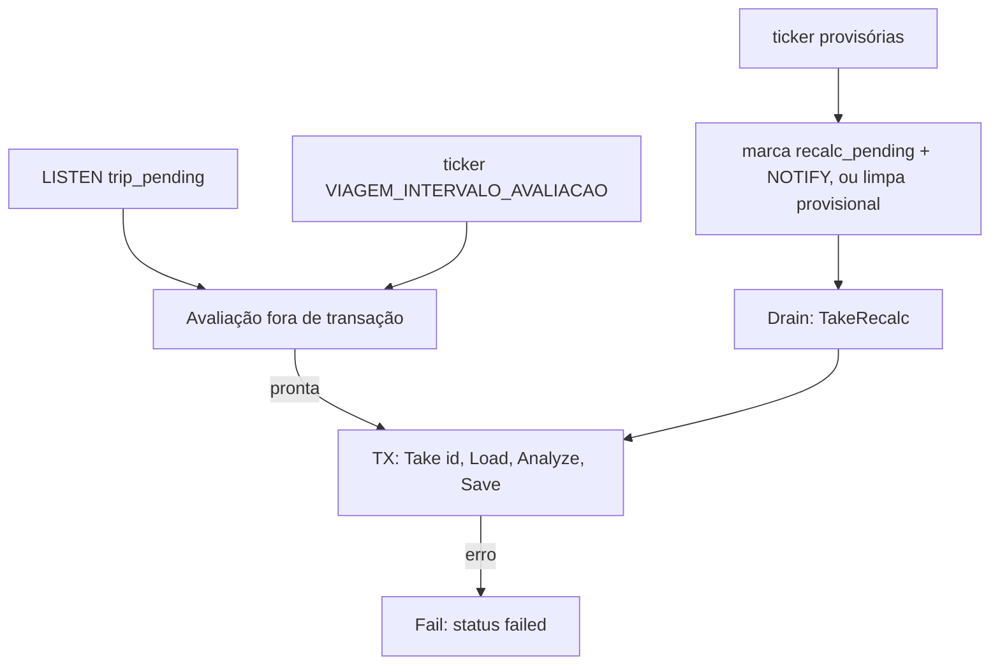

# API1 — Worker de cálculo da viagem e gold

> **Status: especificação de algo a desenvolver.** Entrega da [`04-arquitetura.md`](../04-arquitetura.md): schema `gold`, pacote Go do cálculo da [`02`](../02-calculos-e-contrato-json.md) e worker que grava a análise. Não há endpoint HTTP (API2) nem ranking.

## Objetivo

Dado um registro em `gold.trip`, o `tccelta worker` espera os dados chegarem, calcula a análise a partir de `reading` e `position` e grava o resultado na gold. Recalcula quando chegam dados atrasados ou quando o `reprocess` troca as linhas da silver.

## Escopo e fora de escopo

| Dentro | Fora |
|---|---|
| Migrations `00009` (gold) e `00010` (remove `boot.gold_pending`) | Rotas `POST/GET /v1/viagens` (API2) e autenticação (API3) |
| Pacote `internal/domain/tripanalysis` com todos os cálculos da spec 02 | Ranking: nenhuma tabela `ranking_*`, nenhum `ranking_state`, nenhum `pg_notify('ranking_pending')` |
| Caso de uso `internal/usecase/tripcalc` e fila `trip_pending` no worker | Ajustes e trecho (`de_t_ms`, `ate_t_ms`), `combustivel = personalizado`, parâmetros vindos da requisição |
| Remoção de `gold_pending`; o `reprocess` marca `recalc_pending` | Recalcular viagens prontas quando `versao_calculo` mudar (gatilho do ranking futuro) |

**Ponto do ranking:** o `UPDATE gold.ranking_state SET pending = true …` entrará como último comando da transação de `Save` (seção Worker) e da marcação do `reprocess`. Hoje esse ponto é o comentário `// ranking: UPDATE aqui` em `tripcalc` e em `Trips.MarkRecalcByRange`.

## Dependências

- [`04`](../04-arquitetura.md) (decisões fechadas), [`02`](../02-calculos-e-contrato-json.md) (cálculos), [`fase-3-servidor/06`](../../fase-3-servidor/06-worker-assincrono.md), [`02-banco`](../../fase-3-servidor/02-banco-migrations.md), [`03`](../../fase-3-servidor/03-api-go-arquitetura.md).
- Código reaproveitado: `internal/worker/worker.go` (LISTEN, poll, drenagem), `internal/usecase/boottime` (padrão de transação), `internal/domain/timeline` (`Uncertainty`, reta `a_ms + (1 + b) · t_ms`), `port.Transactor`, `port.Notifications`.
- `tools/trip-analyzer/analysis.js` é só apoio.

## Banco

### Migrations (nunca editar as `00001`–`00008`)

| Arquivo | Conteúdo |
|---|---|
| `00009_gold.sql` | `CREATE SCHEMA gold`; `gold.trip` (DDL da spec 04, mais os itens abaixo); `trip_part`, `trip_summary`, `trip_speed_band`, `trip_event`, `trip_stop`, `trip_gear`, `trip_gear_shift`, `trip_series` (todas com `trip_id uuid REFERENCES gold.trip ON DELETE CASCADE`); funções de apoio; permissões |
| `00010_drop_gold_pending.sql` | `ALTER TABLE boot DROP COLUMN gold_pending`. O `Down` recria a coluna (`boolean NOT NULL DEFAULT false`) |

Acréscimos à DDL de `gold.trip` da spec 04 (aditivos, decididos aqui):

- `CHECK` de coerência: `boot` exige `boot_id` e proíbe `interval_*` (`boot_generation` pode ficar nula até o boot chegar, ver "`boot_generation` nula"); `interval` exige `interval_start < interval_end` e proíbe `boot_*`. Cobre o critério 14 da spec 02 também no banco.
- `CHECK (fuel IN ('gasolina_e30','gasolina_e32','gasolina_e27','gasolina_pura','etanol_hidratado','diesel'))`, os presets da spec 02.
- Índices parciais: `trip_queue (created_at) WHERE status IN ('pending','waiting_data') OR recalc_pending` e `trip_provisional (dongle_id) WHERE status = 'ready' AND provisional`.
- `calculation_version` e `calculated_at` ficam em `gold.trip`; `versao_calculo` do contrato vem dali.

### Colunas e mapeamento do contrato

`t_ms` é sempre o eixo da spec 02 ("Eixo de tempo"). Nomes em inglês; valores enumerados (`subida`, `aceleracao_brusca`, `falha_gps`) ficam como na spec, como diz a spec 04.

**`gold.trip_part`** (PK `trip_id, part_no`; `part_no smallint`, ordem cronológica)

| Coluna | Tipo | Contrato |
|---|---|---|
| `boot_generation`, `boot_id` | integer | `viagem.partes[].boot_generation`, `.boot_id` |
| `data_start_t_ms`, `data_end_t_ms` | bigint | `dados_inicio_t_ms`, `dados_fim_t_ms` |
| `start_t_ms`, `end_t_ms` | bigint NULL | `inicio_t_ms`, `fim_t_ms` (nulos se a parte não teve motor ligado; ela continua listada) |
| `clock_a_ms`, `clock_b`, `clock_uncertainty_ms` | double, double, integer NULL | Reta e incerteza usadas na parte (rastreio; não estão no contrato) |

**`gold.trip_summary`** (PK `trip_id`)

| Coluna(s) | Contrato |
|---|---|
| `start_t_ms`, `end_t_ms`, `started_at`, `ended_at` (timestamptz NULL) | `viagem.inicio_t_ms`, `fim_t_ms`, `inicio_em`, `fim_em` |
| `clock_offset_ms` bigint NULL, `clock_uncertainty_ms` integer NULL | `viagem.relogio.deslocamento_ms`, `incerteza_ms` |
| `warnings jsonb`, `parameters jsonb` | `avisos` (itens `{codigo, detalhe}`, chaves do contrato), `parametros` (todos os efetivos, inclusive `afr`, `densidade_g_l`) |
| `distance_km`, `duration_s`, `no_data_s`, `moving_s`, `stopped_s`, `avg_speed_kmh`, `max_speed_kmh`, `engine_on_s`, `idle_s`, `idle_pct` | `resumo.distancia_km`, `duracao_s`, `sem_dados_s`, `em_movimento_s`, `parado_s`, `velocidade_media_kmh`, `velocidade_maxima_kmh`, `motor_ligado_s`, `marcha_lenta_s`, `marcha_lenta_pct` |
| `fuel_l`, `km_per_l`, `n_hard_accel`, `n_hard_brake`, `hard_accel_per_100km`, `hard_brake_per_100km` | `combustivel_l`, `km_por_l`, `n_acel_bruscas`, `n_fren_bruscas`, `acel_por_100km`, `fren_por_100km` |
| `intake_air_g` | Fora do contrato JSON; usado pelo ranking (spec 04) |
| `pedal_mean_pct`, `pedal_high_s`, `pedal_rate_p95_pct_s`, `engine_brake_pct`, `accel_rms_ms2`, `cruise_s` | `condutor.*` (`pedal_medio_pct`, `pedal_alto_s`, `pedal_variacao_p95_pct_s`, `freio_motor_pct`, `aceleracao_rms_ms2`, `cruzeiro_s`) |
| `warmup_s`, `max_coolant_c`, `cold_load_s` | `motor.aquecimento_s`, `temperatura_maxima_c`, `esforco_frio_s` |
| `idle_rpm`, `idle_rpm_origin` (`informada`/`estimada`/`reserva`), `idle_margin_rpm`, `neutral_clutch_s` | `marchas.marcha_lenta.*`, `ponto_morto_embreagem_s` |
| `upshift_rpm_median/_p25/_p75/_n`, `downshift_rpm_median/_n` | `marchas.subida_rpm`, `reducao_rpm` |
| `n_readings`, `readings_per_s`, `pid_periods_ms jsonb`, `fuel_coverage_pct` | `qualidade.leituras_total`, `leituras_por_s`, `periodos_mediana_ms`, `combustivel_cobertura_pct` |
| `gps_period_s`, `gps_coverage_pct`, `gps_n_gaps`, `gps_max_gap_s`, `gps_distance_km`, `gps_distance_diff_pct` | `qualidade.gps.*` |

Todos os valores calculados são `NULL`-áveis (ausência é `null`, nunca `0`).

**Linhas** (PK `trip_id` + chave própria)

| Tabela | Chave | Colunas → contrato |
|---|---|---|
| `trip_speed_band` | `band_id` | `from_kmh`, `to_kmh` NULL, `time_s`, `distance_km`, `distance_pct` NULL → `faixas_velocidade[].id`, `de_kmh`, `ate_kmh`, `tempo_s`, `distancia_km`, `distancia_pct` |
| `trip_event` | `event_no int` | `type`, `start_t_ms`, `duration_s`, `peak`, `peak_unit`, `start_speed_kmh`, `end_speed_kmh`, `lat`, `lon` → `eventos[]` (`tipo`, `t_inicio_ms`, `duracao_s`, `pico`, `pico_unidade`, `velocidade_inicial_kmh`, `velocidade_final_kmh`, `lat`, `lon`) |
| `trip_stop` | `stop_no int` | `start_t_ms`, `duration_s`, `engine_on bool`, `lat`, `lon` → `paradas[]` |
| `trip_gear` | `gear smallint` | `rpm_per_kmh`, `time_s`, `time_pct` → `marchas.patamares[]` |
| `trip_gear_shift` | `shift_no int` | `t_ms`, `direction`, `from_gear`, `to_gear`, `rpm_before`, `rpm_after`, `speed_kmh` → `marchas.trocas[]` |

**`gold.trip_series`** (PK `trip_id`). **Decisão:** séries em `jsonb` e não em `float8[]`, porque as séries têm `null` (pontos sem dado e separadores entre partes) e o `sqlc` gera `[]float64` para `float8[]`, que não carrega `NULL` por elemento. O `jsonb` guarda os arrays paralelos exatamente como o contrato.

| Coluna | Contrato |
|---|---|
| `step_ms`, `exposure_step_ms` integer | `series.passo_ms`, `exposicao_passo_ms` |
| `series jsonb` | `series` sem os dois passos (`t_ms`, `velocidade_kmh`, `rpm`, `rpm_por_kmh`, `marcha`, `pedal_pct`, `aceleracao_ms2`, `carga_pct`, `consumo_l_h`, `combustivel_acumulado_l`, `distancia_acumulada_km`) |
| `slow_series jsonb` | `series_lentas` |
| `route jsonb` | `rota` (`t_ms`, `lat`, `lon`, `segmentos`) |
| `rpm_distribution`, `pedal_distribution`, `rpm_pedal_matrix` jsonb | `distribuicoes.rotacao`, `.pedal`, `.rotacao_pedal` |

### Permissões

| Papel | Concessão em `00009` |
|---|---|
| todos abaixo | `USAGE ON SCHEMA gold` |
| `tccelta_worker` | `SELECT, INSERT, UPDATE, DELETE` nas tabelas da gold. **Novo na silver:** `SELECT ON reading, position`. A `00008` não concede isso (só `raw_block`, `boot`, `dongle_state`, `anchor_group` e outras) |
| `tccelta_api` | `SELECT, INSERT ON gold.trip`; `SELECT` no restante da gold |
| `tccelta_reader` | `SELECT ON ALL TABLES IN SCHEMA gold` |
| `tccelta_owner` | dono das tabelas (a `migrar` roda com ele: `compose.yaml`, serviço `migrar`); não precisa de `GRANT` |

**`tccelta_reader` precisa de complemento.** A `00008` usa `GRANT SELECT ON ALL TABLES IN SCHEMA public`, que vale só para o schema `public` e só para tabelas existentes naquele momento; nada cobre `gold`. A `00009` concede `SELECT` nas tabelas criadas nela e executa `ALTER DEFAULT PRIVILEGES IN SCHEMA gold GRANT SELECT ON TABLES TO tccelta_reader` (sem `FOR ROLE`, vale para quem migra) para as próximas.

**`sqlc.yaml` não muda.** `schema: internal/database/migrations` já lê todas as migrations; as consultas usam `gold.trip` etc., e o gerador cria os modelos com prefixo (esperado: `GoldTrip`). `CREATE SCHEMA`, `GRANT` e `ALTER DEFAULT PRIVILEGES` são aceitos ou ignorados; confirmar com `make sqlc-check` na CI (job `lint`). O `sqlc` não conhece funções do PostGIS, então a `00009` cria `position_lon(geography)` e `position_lat(geography)` (`LANGUAGE sql IMMUTABLE`, corpo com `ST_X/ST_Y(geom::geometry)`) e as consultas as chamam.

## Cálculo

### Pacote `internal/domain/tripanalysis`

Puro: sem banco, sem relógio, sem `map` na ordem de saída (critério 13 da spec 02). Segue `domain/timeline`: tipos próprios, sem dependência de `port`.

| Arquivo | Conteúdo |
|---|---|
| `params.go` | `Params` (todos os da spec 02, exceto `de_t_ms`/`ate_t_ms`), `DefaultParams()`, `FuelPresets`, `WithFuel(id)`; `ErrInvalidParams` (por exemplo `afr` ausente em `personalizado`) |
| `input.go` | `Entry` (tipo, dongle, boot ou `t0`/`t1`; `Validate()` cobre o critério 14 da spec 02), `Sample{TMs, Value}`, `PartInput{BootGeneration, BootID, Readings map→slices por PID ordenadas por PID, Positions, Clock}`, `Input{Entry, Parts, Params, EntryWarnings, Partial}` |
| `analyze.go` | `Analyze(Input) (Result, error)`: orquestra; `CalculationVersion = "1"` |
| `grid.go` | pré-processamento: séries, passo, grade, reamostragem, janela da parte e da viagem, partes e sobreposição |
| `summary.go`, `bands.go`, `route.go`, `stops.go`, `events.go`, `gears.go`, `pedal.go`, `cruise.go`, `fuel.go`, `engine.go`, `quality.go`, `warnings.go`, `expose.go` | um por seção "Cálculos" da spec 02; `expose.go` reduz as séries a `serie_max_pontos` e insere os separadores entre partes |
| `result.go` | `Result` espelha a seção Banco acima (campos em inglês, ponteiros para `NULL`), incluindo `IntakeAirG` |

Regras de projeto:

- **Parâmetros como argumento.** `Analyze` recebe `Params` em `Input`; a API1 sempre passa `DefaultParams().WithFuel(trip.fuel)`. Ajustes e trecho entrarão passando outro `Params` e um `Range` opcional, sem refatorar.
- **Eixo único.** A entrada já chega no eixo da spec 02: o chamador converte a hora (seção Conversão de hora). O domínio não conhece `timeline`.
- **Sobreposição de partes (spec 02 não fecha o limite).** A parte anterior termina no início da seguinte quando as estimativas pontuais se cruzam. O aviso `partes_sobrepostas` sai quando elas se cruzam estendidas pelas incertezas (`PartInput.Clock.UncertaintyMs`).
- **Avisos.** Os da spec 02, mais `dados_parciais` (`Input.Partial`). `boot_sem_hora` chega em `EntryWarnings`, porque só o carregador sabe quais boots ficaram de fora.
- **`intake_air_g`** = `Σ MAF × dt` (g) nos pontos com MAF, a mesma cobertura dos litros. `km/L = distância × AFR × densidade / ar`.
- **Picos do histograma de marchas.** A spec 02 diz "máximos locais" sem tratar platôs. Segue o `analysis.js`: `sm[b] ≥ sm[b−1]` e `sm[b] ≥ sm[b+1]`; o passo 5 (separação de 0,09) elimina os duplicados.
- **`relogio` na entrada `boot` com `b ≠ 0`.** `inicio_em`/`fim_em` usam a reta inteira; `deslocamento_ms` guarda só `a_ms` (a diferença é de dezenas de ms por hora, dentro da incerteza).

### Divergências em relação a `tools/trip-analyzer/analysis.js` (vale a spec 02)

| Tema | `analysis.js` | Spec 02 |
|---|---|---|
| Partes, janela e `sem_dados_s` | Uma série só; usa todos os dados (`t0` a `t1`) | Partes, janela do motor ligado, `duracao_s` e `sem_dados_s` |
| Duração, distância, `aquecimento_s` | Medidos desde o primeiro dado | Medidos na janela da viagem |
| Marcha lenta, ponto morto | Sem `marcha = 0`; marcha lenta é "parado com motor ligado" sem estimar rpm | Rotação de marcha lenta (informada/estimada/reserva), margem de 150 rpm, `marcha = 0` |
| Trocas | Só detecta com ≥ 2 patamares | Sem esse mínimo |
| Combustível | Padrão 14,7/745; presets sem E30/E32 | Padrão `gasolina_e30` (13,0/750); seis presets |
| Freio-motor | Segundos | `% do tempo em movimento` |
| `parado_s`, faixas de velocidade, rota, paradas, GPS, qualidade, cruzeiro, aceleração RMS, `pedal_alto` como aviso, séries expostas | Ausentes | Especificados |
| Passo da grade | Fallback 250 ms | 1000 ms sem PIDs rápidos |

### Conversão de hora e seleção dos dados (`internal/usecase/tripcalc`, loader)

`reading` e `position` guardam `t_ms` por boot (`00006_silver.sql`). Eixo da análise:

| Entrada | Procedimento |
|---|---|
| `boot` | Eixo = relógio do boot; sem conversão. `a_ms`/`b` do `boot`, se houver, só alimentam `relogio`, `inicio_em`, `fim_em`. Sem `time_source`: aviso `sem_hora_absoluta` |
| `intervalo` | Para cada boot do dongle com `time_source` e sobreposição, `hora(t) = a_ms + (1 + b) · t`; `t_axis = round(hora(t) − t0_ms)`. Mantém linhas com `0 ≤ t_axis < t1 − t0`. Os boots candidatos vêm de uma consulta em `boot` (tabela pequena) com `a_ms + (1+b)·last_t_ms ≥ t0 − folga` e `a_ms + (1+b)·first_t_ms < t1 + folga`, `folga = 5 s` |

- **Incerteza da parte:** `timeline.Uncertainty(t, groups, cfg)` com os grupos de `anchor_group` (a porta `AnchorGroups` hoje só tem `Delete` e `Copy`; ganha `List`, e a consulta `ListBootAnchorGroups` já existe em `worker.sql`). Vale o maior valor entre o primeiro e o último dado da parte (a função é em V). Boot com `time_source = 'neighbors'` não tem grupos: usa `base_uncertainty_ms`. `relogio.incerteza_ms` é o maior valor entre as partes.
- **Boot sem conversão (`boot_sem_hora`):** candidatos são os boots com `time_source IS NULL`, `max_offset_ms + last_t_ms ≥ t0` (a hora real é no máximo o recebimento, então não dá para excluí-los) e `first_seq` entre o último boot convertido que termina antes de `t0` e o primeiro que começa em ou depois de `t1`. Cada um gera `boot_sem_hora` com `detalhe` = `{boot_generation, boot_id}` e fica fora.
- **Consulta eficiente:** `reading` é hypertable por `received_at`, então toda consulta leva um intervalo de `received_at`, senão percorre todos os chunks (comprimidos ou não). O loader obtém o intervalo em `raw_block` (`min/max(received_at)` com `dongle_id`, `seq BETWEEN boot.first_seq AND boot.last_seq`, `boot_id`, `boot_generation`; a PK `(dongle_id, seq)` e a partição por `dongle_id` resolvem). Isso é exato, pois o `reprocess` regrava `received_at` do bloco (`CopyReadingsAt`). Depois:
  `SELECT t_ms, pid, value FROM reading WHERE dongle_id = $1 AND boot_generation = $2 AND boot_id = $3 AND pid = ANY($4) AND received_at BETWEEN $5 AND $6 [AND t_ms BETWEEN $7 AND $8] ORDER BY pid, t_ms`.
  O índice `reading_trip` cobre o prefixo e a ordem. Nos chunks comprimidos, `segmentby dongle_id, pid` e `orderby boot_generation, boot_id, t_ms` permitem pular lotes. No `intervalo`, o filtro de `t_ms` usa a inversa da reta com a mesma folga. `position` usa o mesmo desenho (`position_trip`, `position_lon/lat`). `value IS NULL` (fora da faixa) é descartado.
- **`first_seq`/`last_seq` da viagem:** `boot` copia os do boot; `intervalo` usa o menor `first_seq` e o maior `last_seq` dos boots das partes (conservador para o `reprocess`).

## Worker

### Portas novas (`internal/port`)

`Repositories` ganha `Trips` e `TripSources`; `States` ganha `ReadProgress` (`contiguous_seq`, `head_seq`, `last_ack_at`). `MetricsWorker` ganha as métricas abaixo (e `porttest.Nop` as implementa). Adaptadores: `adapter/postgres` (consultas em `queries/trip.sql`, `sqlc`) e `adapter/memory` (tabelas em memória, como `BootRows`).

| Porta | Métodos |
|---|---|
| `Trips` | `ListWaiting`, `MarkWaiting`, `ResolveGeneration`, `Take(id)` e `TakeRecalc` (`FOR UPDATE SKIP LOCKED`), `Save` (apaga e regrava as filhas e atualiza `gold.trip`), `Fail`, `ListProvisional`, `MarkRecalc(ids)`, `ClearProvisional`, `MarkRecalcByRange`, `Notify`, `CountQueue` |
| `TripSources` | `IntervalBoots`, `UnconvertedBoots`, `ReceivedRange`, `LoadReadings`, `LoadPositions`, `NextBootStart`, `MaxBlockT0` |

### Fluxo

`internal/worker` ganha `trip.go`: escuta `trip_pending`, roda o avaliador, as `WORKER_CONCORRENCIA` goroutines de cálculo (compartilhadas com o dreno de `recalc_pending`) e os tickers. `Worker.Run` inicia os dois fluxos (boots e viagens); a saúde e as métricas não mudam. O `NOTIFY` acorda; o ticker é a rede de segurança (como `WORKER_INTERVALO_POLL`).

### Regra de espera (avaliação fora de transação)

Lê `gold.trip` com `status IN ('pending','waiting_data')`, sem lock. A primeira avaliação grava `waiting_data`. A viagem está **pronta** se, com `agora` do `port.Clock`:

`agora − created_at ≥ VIAGEM_LIMITE_FINAL` **ou** (`contiguous_seq ≥ target_seq` **e** uma de:)

| Condição | Aplica-se a |
|---|---|
| Existe bloco com `seq ≤ contiguous_seq` cujo `t0_ms` convertido (reta do boot) é ≥ `t1` e o boot tem conversão (`MaxBlockT0`) | `intervalo` |
| `agora − dongle_state.last_ack_at ≥ VIAGEM_ESPERA_SEM_LOTE` (ou `last_ack_at` nulo) | `boot`, ou dongle desligado |

Ao ficar pronta, chama a transação de cálculo. Dois avaliadores simultâneos são inofensivos: o segundo não acha `status` em `pending/waiting_data` e sai. Relógios: a espera compara `created_at` (banco) com `last_ack_at` (API); supõe-se o mesmo host ou NTP, como no restante do projeto.

**`boot_generation` nula.** A API2 grava `NULL` quando o boot ainda não existe no servidor. O avaliador e o ticker de provisórias procuram a maior geração com aquele `boot_id` e, ao achar, gravam em `gold.trip` (`ResolveGeneration`). Enquanto for nula, a viagem não tem dados: aos 20 s, fica vazia e provisória. Quando o boot aparece, o ticker marca `recalc_pending`.

### Transação do cálculo

`Take(id)` com `FOR UPDATE SKIP LOCKED` e `statement_timeout = VIAGEM_TIMEOUT_CALCULO` (60 s; o padrão de 10 s do `boottime` não basta para viagens longas). Dentro dela, nesta ordem:

1. `ReadProgress` primeiro: o `contiguous_seq` lido vira `calculated_through_seq`. Vale porque a ingestão grava blocos e estado na mesma transação.
2. Carrega boots e dados, monta `Input`. `Partial = (limite final atingido nesta avaliação) OU (contiguous_seq < target_seq)`. O recálculo posterior limpa o aviso se os blocos chegaram.
3. `Analyze`; `Save` troca as linhas filhas e atualiza `gold.trip`: `status = 'ready'`, `calculation_version`, `calculated_at`, `first_seq`, `last_seq`, `calculated_through_seq`, `provisional`, `recalc_pending = false`. A viagem anterior fica visível até o commit (MVCC). Aqui entra o `UPDATE gold.ranking_state` futuro, como último comando.

**`provisional`** = não há prova de completude no `contiguous_seq` lido. Há prova quando: `boot` — existe boot do dongle com `first_seq` maior que o `last_seq` do boot e `≤ contiguous_seq`; `intervalo` — isso para o último boot da viagem **ou** `MaxBlockT0` ≥ `t1` (evidência acima, já com o boot inteiro até `contiguous_seq`). Viagem vazia: `ready` e `provisional`, sempre com `sem_leituras` e também com `boot_sem_hora` quando essa for a causa, salvo prova.

**Falha:** erro de `Analyze`/`Save` (exceto `port.ErrDatabaseBusy`, que tenta de novo no próximo ciclo), ou pânico recuperado, desfaz a transação e roda `Fail` em outra transação curta: `status = 'failed'`, `recalc_pending = false`, o que libera o nome do motorista pelo índice único. Falha de um recálculo de viagem `ready` mantém o resultado anterior e registra o erro, sem virar `failed`.

### Ticker de viagens provisórias (`VIAGEM_INTERVALO_PROVISORIAS`)

Para cada viagem `ready` e `provisional` (índice `trip_provisional`):

| Caso | Ação |
|---|---|
| `contiguous_seq > calculated_through_seq` e algum boot da viagem (ou, no `intervalo`, convertido e sobreposto a `[t0, t1)`) tem `last_seq > calculated_through_seq` | `recalc_pending = true` + `NOTIFY trip_pending` |
| Tem `boot_sem_hora` (em `warnings`) e algum boot candidato ganhou `time_source` | idem |
| Entrada `boot` com `boot_generation` nula, e o boot apareceu | Grava a geração e faz o mesmo que as linhas acima |
| Há prova de completude e nenhum dado novo | `provisional = false`, sem recalcular |

Isto é o caso de `boot_sem_hora`: a hora de um boot pode chegar depois (âncora nova ou vizinhos), então a viagem fica provisória até lá. Limite aceito da spec 04: âncora nova em viagem completa não dispara recálculo.

### Métricas e logs (padrão de `backend/docs/metricas.md`)

| Série | Tipo | Rótulos |
|---|---|---|
| `tccelta_worker_trips_total` | contador | `result` = `ready`, `recalculated`, `failed` |
| `tccelta_worker_trip_partial_total` | contador | (viagens com `dados_parciais`) |
| `tccelta_worker_trip_provisional_total` | contador | `action` = `recalc_marked`, `completed` |
| `tccelta_worker_trip_duration_seconds` | histograma | tempo da transação de cálculo |
| `tccelta_worker_trip_wait_seconds` | histograma | `created_at` até `calculated_at` |
| `tccelta_worker_trip_queue` | gauge | `state` = `waiting`, `recalc` (atualizado no ticker de 15 s existente) |

Logs: `worker.viagem_calculada` (`trip_id`, `dongle_id`, `entrada`, `partes`, `leituras`, `provisoria`, `dados_parciais`, `calculated_through_seq`, `duracao_ms`), `worker.viagem_falhou` (`erro`), `worker.viagem_recalculo_marcado`. Atualizar `docs/metricas.md`.

## Remoção de `gold_pending`

| Arquivo | Mudança |
|---|---|
| `database/queries/blocks.sql` (`UpdateIngestionBoots`) | Tira `gold_pending` das colunas do `INSERT`, do `SELECT` e do `DO UPDATE` |
| `database/queries/reprocess.sql` | Remove `MarkGoldBoots`; a marcação passa a ser a consulta `MarkTripsRecalc` em `trip.sql`: `UPDATE gold.trip SET recalc_pending = true WHERE dongle_id = $1 AND status = 'ready' AND first_seq <= $to AND last_seq >= $from` |
| `database/dbgen/*` | Regenerar com `make sqlc` |
| `port/repository.go` | Remove `Boots.MarkGold`; o `reprocess` usa `Trips.MarkRecalcByRange` + `Trips.Notify` |
| `adapter/postgres/boots.go`, `adapter/memory/worker.go` | Remove `MarkGold` e o campo `Boot.GoldPending`; o `memory` ganha a tabela de viagens |
| `usecase/reprocess/reprocess.go` | Troca a última linha da transação por `MarkRecalcByRange(ctx, DongleID, a, b)` e o `NOTIFY`; é a mesma transação que regrava a silver |
| `usecase/reprocess/reprocess_test.go` | `TestApplyReplacesRowsAndMarksGold` vira `…MarksTripsRecalc`: duas viagens `ready`, uma cruzando `[a, b]` e outra não; só a primeira fica `recalc_pending`; viagem `pending` e sem faixa (`first_seq` nulo) não é marcada |

**Papel do `reprocess`:** roda como `tccelta_owner` (`ADMIN_BANCO_URL`, `cmd/tccelta/worker.go`), que é dono das tabelas da gold (a `migrar` as cria com ele), então o `UPDATE` em `gold.trip` e o `pg_notify` funcionam sem `GRANT`. Confirmar no e2e com a pilha de teste.

**Ordem de deploy.** A API antiga grava `gold_pending` em `UpdateIngestionBoots`; sem a coluna, todo lote falha com erro de SQL. Em `compose.yaml` a `migrar` roda antes de `api` e `worker` (`depends_on … service_completed_successfully`), então um `up` único aplicaria a `00010` com réplicas antigas vivas. Regra: (1) publicar o binário novo (sem `gold_pending`) com a `00009`; a coluna ainda existe e tem `DEFAULT false`, então nada quebra; (2) só depois de nenhuma réplica antiga, aplicar a `00010`. Por isso ela é arquivo separado e entra no segundo passo da publicação. Na pilha de teste (`down -v`) não há réplica antiga. A imagem `ferramentas` (`reprocess`) também precisa ser a nova.

**Documentos a atualizar:**

| Documento | Ajuste |
|---|---|
| `.spec/fase-3-servidor/02-banco-migrations.md` | Linha da `boot` sem `gold_pending`; lista de migrations com `00009` e `00010`; schema `gold`; papéis `tccelta_worker` (SELECT em `reading`/`position`, DML na gold), `tccelta_api`, `tccelta_reader` |
| `.spec/fase-3-servidor/05-endpoint-ingestao-blocos.md` (linha 103, `reprocess`) | Troca "marca `gold_pending` nos boots afetados" por "marca `recalc_pending` nas viagens da gold cuja faixa cruza a reprocessada" |
| `.spec/fase-3-servidor/DESVIOS-E-MELHORIAS.md` (linha 18) | Remove o desvio do `gold_pending` ("gancho sem consumidor") |
| `.spec/fase-3-servidor/06-worker-assincrono.md` | Seção do worker de viagem: fila `trip_pending`, regra de espera, ticker, permissões, métricas, variáveis |
| `backend/docs/metricas.md`, `backend/docs/cenarios-simulador.md`, `.spec/fase-3-servidor/10-simulador-e-testes-de-carga.md`, `.env.example` | Métricas, cenário `trip`, variáveis novas |

## Configuração

Em `config.WorkerConfig`, lidas em `config.LoadFrom` como as atuais (`l.dur`, `l.integer`):

| Variável | Padrão | Uso |
|---|---|---|
| `VIAGEM_ESPERA_SEM_LOTE` | `10s` | Silêncio de lotes que libera o cálculo (a calibrar, spec 04) |
| `VIAGEM_LIMITE_FINAL` | `20s` | Limite final desde `created_at` (a calibrar) |
| `VIAGEM_INTERVALO_AVALIACAO` | `1s` | Ticker da avaliação de "dados chegaram" |
| `VIAGEM_INTERVALO_PROVISORIAS` | `5s` | Ticker das viagens provisórias |
| `VIAGEM_TIMEOUT_CALCULO` | `60s` | `statement_timeout` da transação de cálculo |

Inválido: valor `≤ 0`, ou `VIAGEM_LIMITE_FINAL ≤ VIAGEM_ESPERA_SEM_LOTE`, ou `VIAGEM_INTERVALO_AVALIACAO > VIAGEM_ESPERA_SEM_LOTE`. Concorrência: `WORKER_CONCORRENCIA`. Compose: as variáveis chegam ao `worker` em `compose.yaml`, `compose.test.yaml` (no e2e, valores curtos, por exemplo 3 s e 8 s) e `.env.example`.

## Testes

| Nível | O que cobre |
|---|---|
| Unidade, `tripanalysis` | Viagens sintéticas geradas no teste, com resultado calculado à mão (rampas de velocidade, rotação constante por marcha, MAF fixo). Tabelas por critério. Inclui determinismo (rodar duas vezes e comparar) e `Entry.Validate` |
| Unidade, `tripcalc` com `adapter/memory` e `porttest` | Regra de espera (`AdjustableClock`: silêncio de 10 s, hora ≥ `t1`, limite de 20 s com `dados_parciais`); `provisional`; ticker nos três casos, inclusive `boot_sem_hora` ganhando conversão; falha vira `failed` e libera o nome; recálculo mantém o resultado anterior em caso de erro; seleção de `intervalo` com um e dois boots, boot sem hora, incerteza maior que a sobreposição. `porttest.Nop` implementa as métricas novas. Não existe suíte de contrato de portas hoje; `FOR UPDATE SKIP LOCKED` só é exercitado no e2e |
| Configuração | `config_test.go`: padrões e as três combinações inválidas |
| `reprocess` | Teste atualizado (seção anterior) |
| e2e | Cenário `trip` do simulador (`make scenario C=trip`, incluído em `make e2e`): dongle virtual gera 200 blocos (PIDs `0x0C`, `0x0D`, `0x04`, mais GPS); o cenário insere duas viagens (`boot` e `intervalo` em torno da hora das âncoras) em `gold.trip` com o papel owner e espera `ready` em até 30 s; confere uma `trip_part`, `distance_km > 0`, `engine_on_s > 0` e que o `worker` (papel `tccelta_worker`) leu `reading` sem erro de permissão. Para isso, o `Inspector` ganha `TripStatus` e uma porta separada `TripSeeder` faz o `INSERT` (o `Inspector` continua só leitura) |

## Critérios de aceite

Os critérios 1 a 23 da spec 02 aplicam-se como abaixo; o 12 e as variações por requisição ficam fora.

1. **Spec 02, critérios 1–11, 13, 19–23:** passam em teste de unidade de `tripanalysis`, com viagens sintéticas.
2. **Ponto morto:** em uma viagem sintética, rotação de 800 rpm a 20 km/h cai em `ponto_morto_embreagem_s` e não vira marcha nem troca.
3. **Critério 12 (trecho):** fora; `Analyze` aceita `Params` por argumento, e há um teste que passa `Params` alterados (`marcha_lenta_rpm`, `gps_falha_s`) sem tocar no código.
4. **Critério 14:** `Entry.Validate` rejeita duas entradas, nenhuma e `t1 ≤ t0`; os `CHECK` de `gold.trip` rejeitam as mesmas linhas por `INSERT` direto.
5. **Critérios 15–18:** passam em `tripcalc` com `adapter/memory`: intervalo em um boot (`t_ms` desde `t0`); dois boots (duas partes, `sem_dados_s` igual ao intervalo entre elas); `partes_sobrepostas`; boot sem hora (`boot_sem_hora`) e entrada `boot` sem hora (`sem_hora_absoluta`).
6. **Migrations:** `make migrate` aplica `00009` e `00010` num banco novo e `migrate down-to 8` desfaz; `make sqlc-check` passa.
7. **Permissões:** com `tccelta_worker` há `SELECT` em `reading`/`position` e DML na gold; `tccelta_api` não faz `UPDATE` em `gold.trip`; `tccelta_reader` faz `SELECT` em `gold.trip` e numa tabela criada depois da `00009` no schema `gold`.
8. **Espera:** viagem sem lote há 10 s e `contiguous_seq ≥ target_seq` é calculada; viagem com lotes contínuos e `contiguous_seq < target_seq` é calculada aos 20 s com `dados_parciais`; `intervalo` com bloco de hora ≥ `t1` é calculado sem esperar 10 s.
9. **Estados:** a viagem passa por `pending`, `waiting_data` e `ready`; erro no cálculo deixa `failed` e o mesmo nome pode ser usado de novo; o recálculo mantém o resultado anterior legível até o commit.
10. **Dados atrasados:** bloco novo dentro da viagem provisória gera `recalc_pending` e o recálculo atualiza `calculated_through_seq`; prova de completude sem dado novo limpa `provisional` sem recalcular; viagem completa não é recalculada por âncora nova.
11. **Viagem vazia:** aos 20 s sem dados fica `ready`, `provisional`, com `sem_leituras` (e `boot_sem_hora`, se for a causa); vira `provisional = false` com prova de completude. Uma viagem com `boot_generation` nula resolve a geração quando o boot chega e é recalculada.
12. **`boot_sem_hora`:** quando o boot ganha `time_source`, o ticker marca `recalc_pending` e o recálculo inclui o boot.
13. **Remoção:** não resta referência a `gold_pending`, `MarkGold` ou `GoldPending` no repositório (`grep`); o `reprocess --apply` marca `recalc_pending` só nas viagens `ready` cuja faixa cruza a reprocessada, e o worker as recalcula.
14. **Consulta:** o `EXPLAIN` do `LoadReadings` numa base com vários dias de chunks mostra exclusão de chunks por `received_at` e uso de `reading_trip`.
15. **Configuração e métricas:** as cinco variáveis têm padrão e validação; as séries da tabela existem em `/metricas`; `docs/metricas.md` e `cenarios-simulador.md` estão atualizados.
16. **e2e:** `make e2e` inclui o cenário `trip` e passa com as duas viagens `ready`.
17. **Sem ranking:** nenhuma tabela `ranking_*`; o único vestígio é o comentário do ponto de entrada em `tripcalc` e `MarkRecalcByRange`.

## Decisões novas desta spec

| Decisão | Motivo |
|---|---|
| Séries e rota em `jsonb`, não `float8[]` | `NULL` por elemento não passa pelo `sqlc` |
| `00010` separada e publicada depois | A API antiga grava a coluna removida |
| `CHECK`s extras em `gold.trip`, índices parciais | Critério 14 da spec 02 no banco; filas sem varredura |
| Conversão de hora para o eixo no loader, não no domínio | Domínio puro e reutilizável |
| `position_lon/lat` como funções SQL | `sqlc` não conhece o PostGIS |
| Limite de sobreposição de partes: corta no cruzamento pontual, avisa com incerteza | A spec 02 não fecha o limite |
| `Partial` também vale quando `contiguous_seq < target_seq` num recálculo | O aviso some quando os blocos chegam |
| Parte sem motor ligado continua em `trip_part` com janela nula | Preserva `dados_*` do contrato |
| `VIAGEM_TIMEOUT_CALCULO` de 60 s | O `statement_timeout` de 10 s não cabe numa viagem longa |
