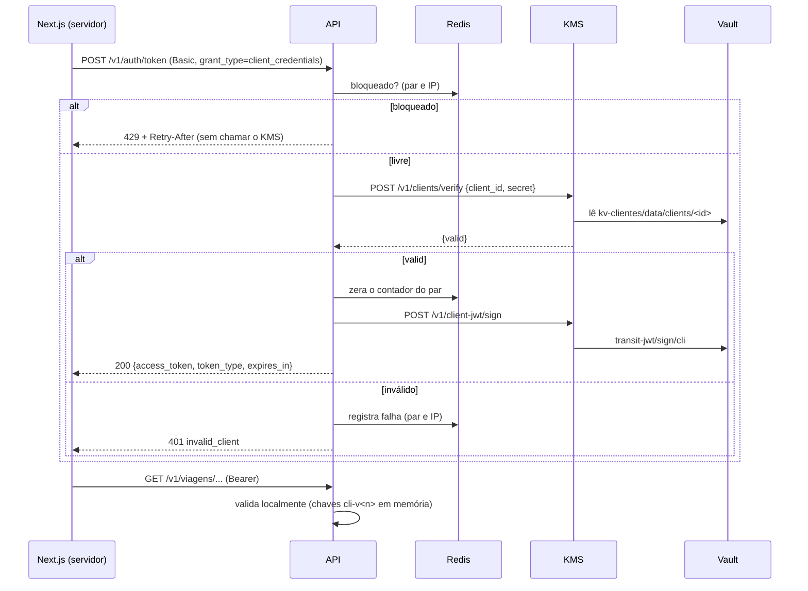

# API3 — Client credentials, JWKS e bloqueio progressivo

> **Status: especificação de algo a desenvolver.** Esta entrega põe autenticação nas rotas de viagem da API2. Decisões de base em [`../04-arquitetura.md`](../04-arquitetura.md) (seções "Client credentials", "Bloqueio progressivo" e "Rotas abertas enquanto API3 e INT2 não chegam"). Não as rediscuta aqui.

## Objetivo

Fazer o servidor do Next.js obter um JWT com `POST /v1/auth/token` e usá-lo como Bearer nas rotas de viagem. O segredo do cliente e a chave de assinatura ficam no KMS/Vault. A API continua sem credencial do Vault (invariante 12 de `.spec/README.md`).

## Escopo e fora de escopo

| Dentro | Fora |
|---|---|
| `POST /v1/auth/token` (RFC 6749 §4.4) | Uso do token no front (INT2) |
| Segredo em hash no Vault, verificação pelo KMS | Escopos por rota além de `aud` |
| Chave Ed25519 própria `cli-v<n>`, rotas novas e rotação própria no KMS | Ranking, exclusão de viagem |
| `GET /.well-known/jwks.json` | Usuários humanos (o login Google fica no Next.js) |
| Bearer nas rotas de viagem; `ANALISE_SEM_AUTH` | Revogação de token já emitido |
| Bloqueio progressivo no Redis | |

## Dependências

- API2 (rotas `/v1/viagens*`). Esta entrega só envolve essas rotas no middleware de autenticação.
- KMS, Vault, Redis e `internal/http` como estão hoje. A INT2 depende desta entrega.

## Fluxo



## Decisões desta entrega

| Tema | Decisão | Motivo |
|---|---|---|
| Envio das credenciais | Só HTTP Basic (RFC 6749 §2.3.1). `client_id`/`client_secret` no corpo são ignorados | Um único caminho; o RFC só obriga Basic. O segredo não cai em log de corpo |
| Formato de erro | RFC 6749 §5.2: `{"error","error_description"}` em `application/json`, mais `codigo`. Só nesta rota | Bibliotecas OAuth leem `error`. O `codigo` mantém a convenção do projeto. As demais rotas seguem `problem.go` |
| Segredo | 32 bytes de `crypto/rand`, em base64url sem padding (43 caracteres) | 256 bits: hash rápido basta, sem KDF lento |
| Hash | `SHA-256(salt ‖ secret)`, salt de 16 B por cliente | Vazamento do Vault não revela o segredo; sem pepper, pela entropia |
| Onde fica o hash | KV v2 novo, mount `kv-clientes` | O Transit não guarda dados arbitrários; hoje só há `transit-auth`, `transit-rec` e `transit-jwt` (`deploy/kms/vault/scripts/bootstrap.sh`) |
| Chave de assinatura | `transit-jwt/keys/cli`, Ed25519, `exportable=false`, no mount já existente | Evita um mount novo; o nome separa as políticas |
| Validade do token | `CLI_JWT_VALIDADE`, 30 min | Curta, porque não há revogação. O Next.js renova antes de vencer |
| Rotação da chave | Subcomando `tccelta-kms clientjwt` e serviço `jwt-cli-rotacao`, mesmo AppRole do `jwt-rotacao` com a política estendida | Reaproveita `vault.Rotator` (já recebe `Mount` e `Key`) sem novo AppRole |
| Validador | Tipo novo `ClientValidator` em `internal/adapter/jwt/client_validator.go` | O `Validator` atual não é configurável: fixa o prefixo `jwt-v`, exige `sub` com 16 hex e `cs` (`validator.go`). Não mexer nele |
| Redis fora | Falha aberta, com contador em memória por réplica como reserva | Ver "Bloqueio progressivo" |

## KMS e Vault

### Rotas novas no KMS

Seguem as convenções do contrato (`kms-http-contract.md`): JSON, mesma cadeia de middlewares do `base` em `internal/kms/server/router.go` (mTLS e CN, limite de corpo, métricas), erros `problem+json`.

| Rota | Corpo | Resposta |
|---|---|---|
| `POST /v1/clients/verify` | `{"client_id":"next-feira","secret":"<texto>"}` | `200 {"valid":true}` ou `{"valid":false}` |
| `POST /v1/client-jwt/sign` | `{"input":"<base64>"}` | `200 {"signature":"<b64, 64 B>","version":2}` |
| `GET /v1/client-jwt/keys` | — | `200 {"2":"<b64, 32 B>"}` |

- `secret` é texto (o valor ASCII de 43 caracteres), exceção à regra "binário em base64", e tem de 1 a 128 caracteres. `client_id` segue `^[a-z0-9][a-z0-9-]{2,63}$`; fora disso, `400 entradas_invalidas`.
- **Tempo constante:** o KMS lê o registro, calcula `SHA-256(salt ‖ secret)` e compara com `subtle.ConstantTimeCompare`. Cliente inexistente ou revogado compara contra um registro-fantasma fixo, para executar o mesmo trabalho. Segredo errado, cliente desconhecido e cliente revogado dão o mesmo `valid:false`.
- `kms_indisponivel` (503) para falha do Vault, como nas outras rotas. Sem cache de registro no KMS: troca e revogação valem na hora.
- A interface do app não muda: `POST /v1/jwt/sign`, `GET /v1/jwt/keys`, claims e `kid` `jwt-v<n>` ficam idênticos. A interface `Vault` (`router.go`) e o `vaulttest/fake.go` ganham `VerifyClient`, `SignClient` e `ClientPublicKeys`. `vault.go` generaliza `Sign` e `PublicKeys` por nome de chave, sem mudar o comportamento de `jwt`.

### Registro no Vault

Caminho `kv-clientes/data/clients/<client_id>`:

```json
{"algo":"sha256-v1","salt":"<b64 16 B>","hash":"<b64 32 B>","status":"active","created_at":"..."}
```

Revogar grava `status: revoked` e apaga `hash` e `salt`. O histórico fica nas versões do KV.

### Políticas e papéis

| Política | Mudança |
|---|---|
| `tccelta-kms` (`policies/tccelta-kms.hcl`) | Mais `transit-jwt/sign/cli` (`update`), `transit-jwt/keys/cli` (`read`) e `kv-clientes/data/clients/*` (`read`). Negações novas: `transit-jwt/keys/cli/*`, `kv-clientes/metadata/*`, `kv-clientes/delete/*` |
| `tccelta-rotacao-jwt` (`policies/tccelta-jwt-rotation.hcl`) | Mais `keys/cli` (`read`), `keys/cli/rotate` e `keys/cli/config` (`update`) |
| `tccelta-provisionador` (`policies/tccelta-provisioner.hcl`) | Mais `kv-clientes/data/clients/*` (`create`, `update`, `read`). Sem `delete` |

Os papéis AppRole `tccelta-kms` e `tccelta-rotacao-jwt` **não mudam**: cada um tem uma única política (`bootstrap.sh`), então basta reescrever as políticas. O bootstrap passa a: habilitar `kv-clientes` (`-version=2 kv`, com função `montar_kv` ao lado de `montar`), criar `transit-jwt/keys/cli` como a `jwt`, e gravar as políticas. É idempotente, então vale rodá-lo de novo em ambientes existentes. Em produção, aplicar as políticas à mão.

### Comandos de `tccelta-kms`

Em inglês, como o resto da CLI. Usam o token do provisionador (`VAULT_TOKEN_ARQUIVO`), como `provision`.

| Comando | Efeito |
|---|---|
| `client create --id ID [--out FILE]` | Gera o segredo, grava o registro (falha se já existe, via `cas=0`). Imprime o segredo **uma vez** ou o grava em `FILE` (modo 0400) |
| `client rotate --id ID [--out FILE]` | Novo segredo e novo salt; o antigo deixa de valer na hora. Exige cliente ativo |
| `client revoke --id ID` | Marca `revoked`. Idempotente |
| `clientjwt rotate [--now]` / `clientjwt schedule` | Como `jwt rotate|schedule`, sobre `transit-jwt/keys/cli`, com `CLI_JWT_ROTACAO_PERIODO` e `CLI_JWT_VALIDADE` |

O segredo nunca vai a log, a métrica nem a mensagem de erro.

### Provisionamento

| Ambiente | Como |
|---|---|
| dev | `make seed-client`: sobe o bootstrap, roda `client create --id next-dev` no serviço `ferramentas` e grava o segredo em `deploy/segredos/analise_cliente_secret` (arquivo fora do git). Idempotente: se o arquivo existe, não recria |
| prodlike | Mesmo alvo. O `kms-ferramentas` ainda não foi ajustado ao Vault em TLS (`docs/ambientes.md`): ajustar `VAULT_ADDR`, `VAULT_CACERT` e `VAULT_CLIENT_*` do comando é parte desta entrega |
| produção | `client create` no host do KMS, com o token do provisionador. O operador entrega o segredo ao Next.js como variável de ambiente de runtime |

## Endpoints

### `POST /v1/auth/token`

Requisição: `Authorization: Basic base64(client_id:client_secret)`, `Content-Type: application/x-www-form-urlencoded`, corpo `grant_type=client_credentials` (até 1 KiB). `scope` presente responde `400 invalid_scope`.

Sucesso, `200`, com `Cache-Control: no-store` e `Pragma: no-cache` (em **todas** as respostas desta rota):

```json
{"access_token":"<jwt>","token_type":"Bearer","expires_in":1800}
```

| Status | `error` | `codigo` | Quando |
|---|---|---|---|
| 400 | `invalid_request` | `requisicao_invalida` | Corpo ou `Content-Type` fora do formato |
| 400 | `unsupported_grant_type` | `grant_invalido` | `grant_type` ausente ou diferente |
| 400 | `invalid_scope` | `escopo_invalido` | `scope` informado |
| 401 | `invalid_client` | `cliente_invalido` | Sem Basic, cliente desconhecido, revogado ou segredo errado. Corpo e cabeçalhos idênticos nos casos; `WWW-Authenticate: Basic realm="tccelta"` |
| 429 | `temporarily_unavailable` | `bloqueado` | Bloqueio ativo; com `Retry-After` |
| 503 | `temporarily_unavailable` | `kms_indisponivel` | KMS fora (mesmo mapeamento de `d.err`); com `Retry-After` |

Erros 400 não chamam o KMS nem contam como falha. O 503 também não conta.

**Token:** header `{"alg":"EdDSA","typ":"JWT","kid":"cli-v<n>"}`; claims `iss` (`JWT_EMISSOR`), `aud` = `JWT_AUDIENCIA_ANALISE` (`tccelta-analise`), `sub` = `client_id`, `jti` (UUID), `iat`, `nbf`, `exp`. Sem `cs`. O emissor novo `ClientIssuer` repete a lógica de `Issuer` (usa a versão devolvida pelo KMS no `kid` e refaz uma vez se a versão mudar), com uma porta nova `port.ClientSigner` que `adapter/kmsclient` implementa.

### `GET /.well-known/jwks.json`

Sem autenticação, só `limitIP`. Responde `200` `application/jwk-set+json`:

```json
{"keys":[{"kty":"OKP","crv":"Ed25519","alg":"EdDSA","use":"sig","kid":"cli-v2","x":"<base64url, 32 B>"}]}
```

- Só as chaves `cli-v<n>`; nunca `jwt-v<n>`.
- Servido do cache em memória da API (o mesmo que o `ClientValidator` usa), carregado de `GET /v1/client-jwt/keys` no boot, a cada 10 min e por `kid` desconhecido (no máximo a cada 30 s), como em `validator.go`. Sem chaves carregadas: `503`.
- `Cache-Control: public, max-age=300`. É menor que o ciclo de recarga e bem menor que a validade do token, então uma chave nova é aceita por consumidores externos que recarregam ao ver um `kid` novo.

## Validação do Bearer nas rotas de viagem

O middleware `authenticateAnalise` (arquivo novo em `internal/http`; `authenticateJWT` não muda) envolve `/v1/viagens*`. Respostas iguais às de `authentication.go`: `401 token_ausente`, `token_expirado`, `token_invalido`, com `WWW-Authenticate`.

O `ClientValidator` exige: `alg` EdDSA (só), `kid` presente e no mapa `cli-v<n>`, `iss` = `JWT_EMISSOR`, `aud` = `tccelta-analise`, `exp` obrigatório (folga `JWT_FOLGA`), `sub` não vazio com o formato de `client_id` e `jti` UUID. A chave vem do mapa em memória; não chama o KMS por requisição.

**Isolamento entre os dois tokens:**

- Token do app na rota de viagem: `kid` `jwt-v<n>` não está no mapa do `ClientValidator` e `aud` é `tccelta-ingestao`. Rejeitado.
- Token de cliente na ingestão: `kid` `cli-v<n>` não está no mapa do `Validator`, `aud` é outro, `sub` não tem 16 hex e falta `cs`. Rejeitado em `/v1/dongles/*`.
- Os dois mapas de chaves vêm de rotas diferentes do KMS e nunca se misturam.

### `ANALISE_SEM_AUTH`

| Valor | Comportamento nesta entrega |
|---|---|
| `true` | Rotas de viagem abertas; o Bearer, mesmo presente, não é conferido. Log `aviso` na partida |
| ausente | Rotas de viagem exigem Bearer válido |

Inválida com `AMBIENTE=producao`, no mesmo ponto de `config.go` que trata `PERMITIR_PERFIL_NONE`. Segue existindo até a INT2 removê-la. `POST /v1/auth/token` e o JWKS existem nos dois modos.

## Bloqueio progressivo

Protege `POST /v1/auth/token`. O estado fica no Redis já deployado (`REDIS_ENDERECO`, o mesmo do limite de taxa), sem serviço novo, e é visto pelas `API_REPLICAS` réplicas (2 por padrão em `compose.yaml`).

### Regras

- **Contadores:** um por par `(client_id, IP)` e um por IP. Não há contador só por `client_id`: de outro IP, um atacante não trava o Next.js.
- **O que conta como falha:** resposta `401 invalid_client` (inclusive sem Basic ou `client_id` malformado, que contam só no IP). Não contam: 400, 503, sucesso.
- **Progressão:** passada a tolerância `T`, a falha de número `n` bloqueia por `min(INICIAL × FATOR^(n−T−1), TETO)`.

| Parâmetro | Par | IP |
|---|---|---|
| Tolerância (`T`) | 5 | 20 |
| Tempo inicial | 30 s | 30 s |
| Fator | 2 | 2 |
| Teto | 15 min | 15 min |
| Esquecimento | 30 min sem falha | 30 min sem falha |

Com o par: falhas 1 a 5 sem bloqueio; 6ª, 30 s; 7ª, 60 s; 8ª, 120 s; 9ª, 240 s; 10ª, 480 s; 11ª em diante, 15 min. O esquecimento é um `PEXPIRE` de `bloqueio restante + ESQUECER`, renovado a cada falha. São limiares do projeto, não vêm de norma.

- **Durante o bloqueio:** a API responde `429` com `Retry-After` (o maior restante entre par e IP) **antes** de chamar o KMS. Tentativas bloqueadas não incrementam nem prolongam o bloqueio.
- **Sucesso:** apaga só o contador do par. O do IP segue, para que uma credencial válida não apague o histórico de tentativas daquele IP contra outros `client_id`.
- **Resposta uniforme:** cliente desconhecido, revogado e segredo errado têm mesmo status, corpo, cabeçalhos e uma chamada ao KMS cada. Os contadores só guardam o par, e o estado é igual quando o `client_id` existe ou não.

### Atomicidade

Dois scripts Lua (padrão de `luaIncr` em `internal/http/ratelimit/ratelimit.go`), cada um uma só ida ao Redis, com o relógio do `TIME` do Redis (as réplicas não dependem do relógio uma da outra):

1. `check(par, ip)` devolve o tempo restante de bloqueio de cada chave.
2. `fail(par, ip)` faz o incremento, calcula o novo `until` e renova o TTL. Sem corrida de leitura e escrita entre réplicas.

Entre `check` e `fail` há a chamada ao KMS, então requisições simultâneas podem passar pelo `check` antes da falha anterior ser contada. O excesso é limitado pelas requisições em voo (o `limitIP` de 120/min e `KMS_MAX_CONCORRENCIA` de 32 restringem isso). Aceito.

### Redis fora do ar

**Falha aberta**, com reserva local: o mesmo algoritmo roda num mapa em memória por réplica (limitado a 10 mil chaves). Motivo: o segredo tem 256 bits, então adivinhá-lo é inviável e o bloqueio é defesa em profundidade; falhar fechado derrubaria o login da análise na feira por um soluço do Redis. Hoje `LimiterWithFallback` já faz fail-open, mas **sem** estado local para esse caso (`ratelimit.go`); por isso a reserva é parte desta entrega. Conta `tccelta_auth_block_store_failures_total`. Observações:

- O Redis do `compose.yaml` tem `--save ''` e `allkeys-lru` com 64 MB: reiniciar ou pressão de memória apaga bloqueios. Aceito; as chaves são minúsculas.
- Sem `REDIS_ENDERECO` (dev simples), só vale o estado local.

### IP do cliente

Usar `ipFrom` (`internal/http/middleware.go`): só aceita `X-Real-IP` se a conexão vier de `PROXIES_CONFIAVEIS` (`172.30.10.0/24`, rede `borda`). O Caddy sobrescreve o cabeçalho (`header_up X-Real-IP {remote_host}`; atrás do túnel, `{header.Cf-Connecting-Ip}`), então o cliente não o forja. Duas lacunas, tratadas aqui sem alterar `ipFrom`:

- `ipFrom` não valida o conteúdo do cabeçalho. O handler novo `clientIP` roda `netip.ParseAddr`; se falhar, usa o host de `RemoteAddr`. Converte IPv4 mapeado e agrupa IPv6 por `/64`.
- Se `Cf-Connecting-Ip` vier vazio atrás do túnel, `X-Real-IP` fica vazio e todos caem no IP do Caddy: um atacante bloquearia todos pelo contador de IP. Verificar na feira com um teste de ponta a ponta.

**Na feira:** o IP que a API enxerga do Next.js precisa ser estável, ou o contador do par se perde a cada troca de rede. O Next.js deve chamar a API sempre pelo mesmo caminho (Caddy ou túnel). Atrás de NAT compartilhado, quem estiver no mesmo IP divide o contador por IP.

### Métricas (`docs/metricas.md`, a atualizar)

| Série | Tipo | Rótulos |
|---|---|---|
| `tccelta_auth_token_requests_total` | contador | `result`: `issued`, `invalid_client`, `blocked`, `invalid_request`, `kms_unavailable` |
| `tccelta_auth_blocks_total` | contador | `scope`: `pair`, `ip` (bloqueios novos) |
| `tccelta_auth_block_store_failures_total` | contador | — |
| `tccelta_kmssvc_client_verify_total` | contador | `result`: `valid`, `invalid` |

Nenhum rótulo usa `client_id` ou IP. O log (`http.acesso` mais um evento `auth.falha`) registra `client_id` só se casar com a regex, o IP e o `n`.

## Configuração

| Variável | Padrão | Onde | Uso |
|---|---|---|---|
| `ANALISE_SEM_AUTH` | ausente | API | Ver acima; inválida em `producao` |
| `JWT_AUDIENCIA_ANALISE` | `tccelta-analise` | API | `aud` do token de cliente |
| `CLI_JWT_VALIDADE` | `30m` | API e KMS | Validade; no KMS, só para o expurgo |
| `CLI_JWT_ROTACAO_PERIODO` | `720h` | KMS | Rotação da chave `cli` |
| `TOKEN_BLOQUEIO_TOLERANCIA_PAR`, `_TOLERANCIA_IP` | `5`, `20` | API | Falhas sem bloqueio |
| `TOKEN_BLOQUEIO_INICIAL`, `_FATOR`, `_TETO`, `_ESQUECER` | `30s`, `2`, `15m`, `30m` | API | Progressão |
| `VAULT_MOUNT_CLIENTES`, `VAULT_CHAVE_CLI` | `kv-clientes`, `cli` | KMS | Mount do KV e nome da chave |

A API recusa partida com fator < 1, teto < inicial ou tolerância < 1. Atualizar `docs/kms.md` (variáveis, comandos, layout), `docs/kms-http-contract.md`, `.spec/fase-3-servidor/07` e `08` e a invariante 12 de `.spec/README.md`, que hoje fala só em Vault Transit e passa a incluir o KV.

## Operação

- **Item a fazer em `docs/kms-http-contract.md`:** documentar as três rotas novas, a exceção de `secret` em texto e a nova política; o mesmo PR muda `adapter/kmsclient` (DTOs e testes) e `kms/server`, como o documento exige.
- **Desbloqueio manual:** `DEL` das chaves `tccelta:tok:*` no Redis. Documentar o comando.
- **Troca do segredo:** `client rotate` e reinício do Next.js com o novo valor. Tokens já emitidos valem até `exp`.
- **Compose:** serviço `jwt-cli-rotacao` copiado de `jwt-rotacao`, com `command: ["clientjwt","schedule"]` e healthcheck próprio (porta `KMS_SAUDE_ROTACAO` distinta se rodar no mesmo host).
- **Rotação:** `Validity` do `Rotator` da chave `cli` é `CLI_JWT_VALIDADE + JWT_FOLGA + 10 min`.

## Testes

- `kms/server` e `kms/vault` (com `vaulttest`): verify com segredo certo, errado, cliente inexistente e revogado; `valid:false` idêntico; assinatura e chaves da `cli`; `jwt` intacta.
- `kms/vault`: `Rotator` sobre a chave `cli` com a mesma tabela de casos da `jwt`.
- `provisioning`/CLI: `create` recusa duplicado, `rotate` invalida o antigo, `revoke` idempotente, o segredo não aparece em log.
- Testes negativos de política no Vault real (CI): o papel `kms` não escreve em `kv-clientes`, não lê `metadata`, não faz `rotate` na `cli`.
- `adapter/jwt`: `ClientIssuer` e `ClientValidator` (algoritmo `none`/HS256, `aud` errada, `iss` errada, `exp`, `kid` desconhecido e recarga); cruzamento app × cliente nos dois sentidos.
- `http`: tabela de `POST /v1/auth/token` (Basic ausente ou inválido, `grant_type`, `scope`, cabeçalhos `no-store`); progressão 5/30 s/60 s/…/teto; `429` sem chamada ao KMS (fake com contador); sucesso zera só o par; IPs diferentes; réplicas simuladas com dois handlers sobre um Redis (miniredis); Redis fora cai na reserva local; `ipFrom` com cabeçalho inválido.
- Medição de custo uniforme: cliente desconhecido e segredo errado, uma chamada ao KMS cada.
- `config`: `ANALISE_SEM_AUTH=true` com `AMBIENTE=producao` falha.

## Critérios de aceite

1. `POST /v1/auth/token` com Basic válido e `grant_type=client_credentials` responde `200` com `access_token`, `token_type` `Bearer` e `expires_in` igual a `CLI_JWT_VALIDADE` em segundos; todas as respostas da rota trazem `Cache-Control: no-store`.
2. O JWT emitido tem `kid` `cli-v<n>`, `alg` EdDSA, `aud` `tccelta-analise`, `sub` = `client_id` e verifica com a chave do JWKS.
3. Segredo errado, cliente desconhecido, cliente revogado e Basic ausente dão `401 invalid_client` com corpo e cabeçalhos idênticos e `WWW-Authenticate`.
4. O Vault só contém `SHA-256(salt ‖ segredo)`; o segredo não aparece em log, métrica, erro nem no Vault. A API não tem variável nem rota para o Vault.
5. `client create`, `rotate` e `revoke` funcionam; após `rotate` o segredo antigo falha; após `revoke` nenhum token novo é emitido; `create` repetido falha.
6. `make seed-client` provisiona o cliente de dev; o procedimento de prodlike e de produção está documentado e o de prodlike foi executado.
7. `POST /v1/jwt/sign`, `GET /v1/jwt/keys`, as claims e o `kid` `jwt-v<n>` do app são byte a byte os de antes; os testes existentes passam sem edição.
8. As políticas `tccelta-kms`, `-rotacao-jwt` e `-provisionador` foram estendidas como na tabela; o teste negativo confirma que o `kms` não lê `kv-clientes/metadata`, não escreve no KV e não rotaciona `cli`.
9. `clientjwt rotate --now` cria `cli-v<n+1>`; tokens da versão anterior continuam válidos até `exp`; a versão antiga é expurgada depois de `CLI_JWT_VALIDADE` + folga + 10 min; `jwt-cli-rotacao` roda no compose.
10. `GET /.well-known/jwks.json` devolve `kty: OKP`, `crv: Ed25519`, `kid` `cli-v<n>`, só chaves `cli`, com `Cache-Control: public, max-age=300`; após uma rotação, a chave nova aparece sem reiniciar a API.
11. Com `ANALISE_SEM_AUTH` ausente, `/v1/viagens*` responde `401 token_ausente`, `token_invalido` e `token_expirado` nos casos correspondentes e `200`/`202` com token válido.
12. Um token do app é recusado nas rotas de viagem e um token de cliente é recusado em `/v1/dongles/blocos` e `/v1/dongles/{id}/confirmacao`; testes cobrem os dois sentidos.
13. `ANALISE_SEM_AUTH=true` abre as rotas de viagem; com `AMBIENTE=producao` a API não inicia.
14. Com 5 falhas seguidas do mesmo par, a 6ª é `401` e a 7ª tentativa é `429` com `Retry-After` entre 1 e 30; a falha seguinte após o fim do bloqueio gera 60 s, e assim até 15 min.
15. Durante o bloqueio, o KMS não recebe chamada (contador do fake em 0) e o bloqueio não é prolongado por novas tentativas.
16. 21 falhas de um IP com `client_id` variados bloqueiam esse IP, mesmo que nenhum par passe da tolerância; outro IP continua obtendo token.
17. Um bloqueio do par `(a, IP1)` não impede `(a, IP2)` de obter token.
18. Sucesso zera o contador do par e deixa o do IP intacto.
19. Duas réplicas da API compartilham o estado: falhas somadas nas duas bloqueiam ambas.
20. Com o Redis fora, `POST /v1/auth/token` continua respondendo, o bloqueio passa a valer por réplica e `tccelta_auth_block_store_failures_total` cresce.
21. `X-Real-IP` com texto que não é IP é ignorado; vindo de fora de `PROXIES_CONFIAVEIS`, é ignorado; IPv6 do mesmo `/64` divide o contador.
22. As métricas da tabela existem e nenhuma tem `client_id` ou IP como rótulo.
23. `docs/kms-http-contract.md`, `docs/kms.md`, `docs/metricas.md` e `.spec/fase-3-servidor/07` e `08` descrevem as mudanças.
