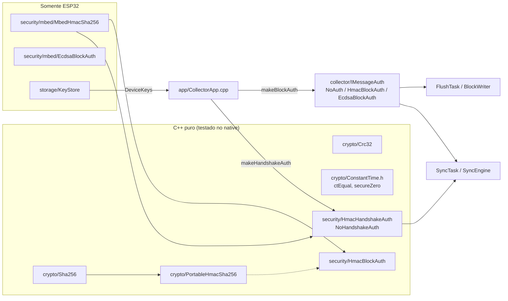
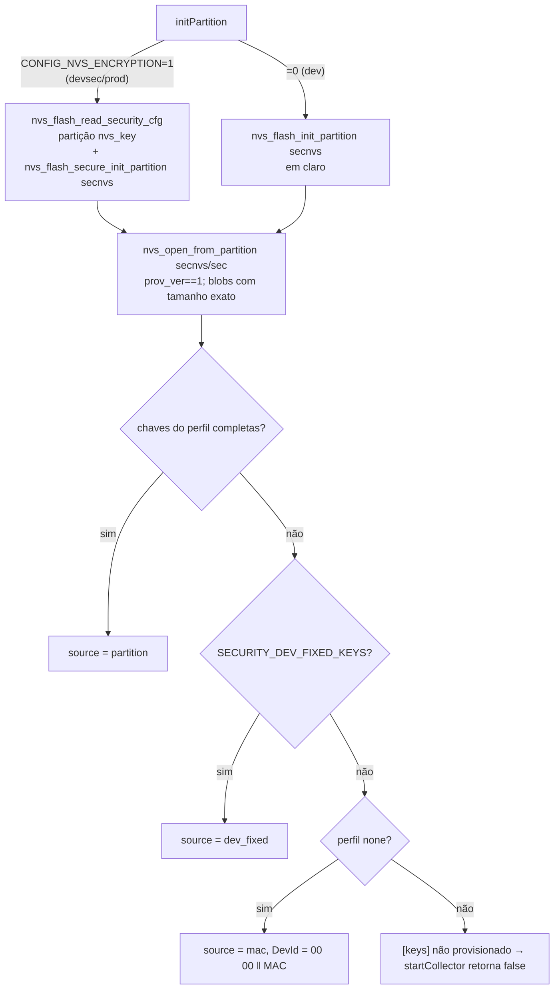
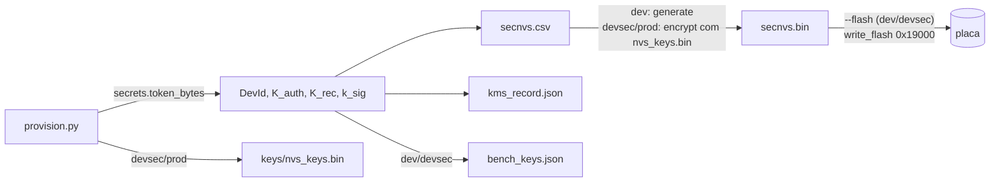

# 01 — Firmware: chaves, perfis de segurança e autenticação

Estado implementado da identidade criptográfica do dongle (`DevId`, `K_auth`,
`K_rec`, `k_sig`), das primitivas, da autenticação de blocos e de handshake e
do build único (Arduino como componente do ESP-IDF) em `esp32-firmware/`.

## Componentes



| Componente | Arquivo | Responsabilidade |
|---|---|---|
| `crypto::Sha256`, `PortableHmacSha256` | `src/crypto/Sha256.*`, `HmacSha256.*` | SHA-256 (FIPS 180-4) e HMAC (RFC 2104) portáveis; `IHmacSha256` com `begin/update/finish`. |
| `crypto::crc32` | `src/crypto/Crc32.*` | CRC-32/ISO-HDLC encadeável (`crc32(p, n, previous)`); tabela de meio byte (16 entradas). |
| `ctEqual`, `secureZero` | `src/crypto/ConstantTime.h` | Comparação em tempo constante; zeragem que o compilador não remove. |
| `MbedHmacSha256` | `src/security/mbed/` | HMAC-SHA256 do mbedTLS (SHA em hardware); chave carregada uma vez por instância. |
| `IMessageAuth`, `NoAuth` | `src/collector/IMessageAuth.h` | Tag do bloco: `tagSize()`, `sign`, `verify`. |
| `HmacBlockAuth` | `src/security/BlockAuth.*` | Perfil `hmac` (32 B). |
| `EcdsaBlockAuth` | `src/security/mbed/EcdsaBlockAuth.*` | Perfil `asym` (64 B), ECDSA P-256 determinística (`mbedtls_ecdsa_sign_det_ext`) com cegamento por `esp_fill_random`; falha de assinatura grava tag de zeros. |
| `IHandshakeAuth` | `src/security/HandshakeAuth.*` | Tag de 16 B das mensagens 0x01/0x02/0x04: `HmacHandshakeAuth` e `NoHandshakeAuth` (16 zeros, `verify` sempre `true`). |
| `KeyStore` | `src/storage/KeyStore.*` | Lê as chaves da partição `secnvs`; imprime a linha `[sec]`. |
| `DeviceKeys.h` | `src/security/DeviceKeys.h` | `DeviceKeys`, `KeySource`, rótulo `kDomainLabel`, tipos `kType*`, chaves fixas de bancada. |

Cada tarefa tem as suas instâncias (nada é reentrante): `CollectorApp.cpp`
cria uma `IMessageAuth` para o `FlushTask`, outra para o `SyncTask` e uma
`IHandshakeAuth`. `DeviceKeys` é `static` (nunca na pilha).

## Perfis de segurança (`SECURITY_PROFILE`)

`src/security/SecurityProfile.h`; padrão `hmac`. Só a tag do **bloco** muda; a
do handshake é sempre de 16 B (`security::kHandshakeTagSize`).

| Perfil | Valor | Tag do bloco | Tag do handshake | Chaves exigidas no `KeyStore` |
|---|---|---|---|---|
| `none` | 0 | 0 B (`NoAuth`) | 16 B zerados, nunca verificados | `dev_id` (senão `0x0000 ‖ MAC Wi-Fi`) |
| `hmac` | 1 | 32 B HMAC-SHA256 `K_rec` | 16 B HMAC-SHA256 `K_auth` truncado | `dev_id`, `k_auth`, `k_rec` |
| `asym` | 2 | 64 B ECDSA P-256 `r‖s` (big-endian) | igual ao `hmac` | `dev_id`, `k_auth`, `k_sig` |

Quem precisa do tamanho da tag em tempo de execução usa `IMessageAuth::tagSize()`;
a macro só escolhe instâncias (`makeBlockAuth`/`makeHandshakeAuth` em
`CollectorApp.cpp`) e o buffer máximo (64 B).

## Formatos de autenticação

Rótulo de domínio: ASCII `MALCONG` (7 B, sem terminador). Tipos: `0x01`
desafio, `0x02` resposta, `0x03` bloco, `0x04` ACK.

| Tag | Entrada | Chave | Saída |
|---|---|---|---|
| Bloco (`hmac`) | `"MALCONG"(7) ‖ 0x03 ‖ DevId(8) ‖ dados(tamanho)` | `K_rec` | HMAC-SHA256 completo, 32 B |
| Bloco (`asym`) | `SHA-256("MALCONG" ‖ 0x03 ‖ DevId ‖ dados)` | `k_sig` | `r(32) ‖ s(32)`, inteiros big-endian |
| Handshake | `"MALCONG" ‖ tipo(1) ‖ DevId(8) ‖ payload` | `K_auth` | HMAC-SHA256 truncado a 16 B |

`dados` = área de dados do bloco (cabeçalho de 12 B + registros, ver `02`).
`payload` = campos da mensagem sem a tag de 16 B finais (`L` e `T` do TLV não
entram):

| Tipo | `payload` | Bytes |
|---|---|---|
| 0x01 Desafio | `c_S ‖ N_S ‖ ACK_seq ‖ c_conf ‖ flags [‖ diag_min]` | 29 ou 31 |
| 0x02 Resposta | `c_S ‖ N_S ‖ TAIL_seq ‖ HEAD_seq ‖ boot_id ‖ t_ms` | 34 |
| 0x04 ACK | `ACK_seq ‖ c_conf ‖ flags` | 9 |

Contrato de assinatura em `HmacBlockAuth::sign`:

```cpp
_hmac.begin();
_hmac.update(kDomainLabel, 7); _hmac.update(&type /*0x03*/, 1);
_hmac.update(_devId, 8);       _hmac.update(data, len);
_hmac.finish(tagOut);
```

## Material de chaves

| Item | Tamanho | Uso |
|---|---|---|
| `DevId` | 8 B | Identidade; entra em toda tag. |
| `K_auth` | 32 B | Tag das mensagens 0x01/0x02/0x04. |
| `K_rec` | 32 B | Tag dos blocos (perfil `hmac`). |
| `k_sig` | 32 B (escalar P-256) | Assinatura dos blocos (perfil `asym`); o servidor só recebe a pública (65 B, `04‖X‖Y`). |

Partição `secnvs` (NVS, namespace `sec`):

| Chave NVS | Tipo | Conteúdo |
|---|---|---|
| `prov_ver` | `u8` | Deve ser `1`; ausente = não provisionado. |
| `dev_id` | blob | 8 B |
| `k_auth` | blob | 32 B |
| `k_rec` | blob | 32 B |
| `k_sig` | blob | 32 B (só `asym`) |
| `prof` | `u8` | Perfil do provisionamento (informativo; o firmware não lê). |

Chaves fixas de bancada (`-DSECURITY_DEV_FIXED_KEYS`, ligado em `[debug]`):
`DevId` `544343454C544101` (`"TCCELTA\x01"`), `K_auth` `01..20`, `K_rec`
`21..40`, `k_sig` = `0x11` × 32. São as mesmas do servidor de bancada do app e
dos vetores de teste.

## `KeyStore::load`



- Usa a API C da NVS, nunca `Preferences::begin(…, "secnvs")` (abriria em claro).
- `nvs_key` ausente, corrompida ou não inicializada em `devsec`/`prod` imprime `[keys] ...` e falha.
- Sem chaves nos perfis `hmac`/`asym` não há modo degradado: o firmware não sobe.
- Guarda de compilação (`CONFIG_SECURE_FLASH_ENCRYPTION_MODE_RELEASE`): exige `hmac` e proíbe `SECURITY_DEV_FIXED_KEYS`.
- `printBootLine()` imprime, em todos os envs e antes de `load`:
  `[sec] fe=<off|dev|release> sb=<0|1> jtag_off=<0|1> dl_off=<0|1> crypt_cnt=<n> nvs_enc=<0|1>`
  (é a verificação de eFuse em `prod`, onde o `espefuse.py` não alcança mais a placa).
- Evento `KEYS` (`profile`, `source`, `dev_id`, `tag_len`, `fe`, `sb`, `load_us`); nenhum log imprime chave.

## Build único e perfis de hardware

Todos os envs herdam de `[base]` em `platformio.ini`: `framework = arduino, espidf`
(ESP-IDF 4.4.7 via `platform_packages = framework-espidf @ ~3.40407.0`),
`board_build.filesystem = littlefs`, `-DCONFIG_BT_NIMBLE_MSYS1_BLOCK_COUNT=24`.
`CMakeLists.txt` (raiz) é o mínimo do `project.cmake` do IDF; `src/CMakeLists.txt`
registra `src/*` como componente (o `build_src_filter` do PlatformIO não vale,
então arquivos específicos de env ficam sob `#if`, ex. `USE_MCP2515`).

| Perfil de hardware | Env | `sdkconfig` | NVS encryption | Flash enc. | Secure Boot V2 | eFuse |
|---|---|---|---|---|---|---|
| `dev` | `collector_*`, `*_debug*`, `*_bench_*` | `sdkconfig.defaults` | não (`secnvs` e `nvs` em claro) | não | não | nenhum |
| `devsec` | `collector_mock_devsec`, `collector_mock_devsec_asym` | `+ sdkconfig.devsec.defaults` | sim | modo desenvolvimento | sim (`SECURE_BOOT_INSECURE`, `ALLOW_JTAG`) | parcial; download pela UART livre |
| `prod` | `collector_twai_prod`, `collector_twai_prod_asym` | `+ sdkconfig.prod.defaults` | sim | modo *release* | sim | tudo, irreversível (`SECURE_DISABLE_ROM_DL_MODE`) |

`devsec` e `prod` diferem do env de origem só por `board_build.cmake_extra_args`
(`-DSDKCONFIG_DEFAULTS="a;b"`); `devsec` acrescenta `board_build.encryption_key`.
`ESP32_REV_MIN_3` só existe nos dois perfis com Secure Boot. Core dump em flash
no `dev`, desligado em `devsec`/`prod`. Cada env tem seu `sdkconfig.<env>`
gerado e ignorado no git; depois de editar um `*.defaults`, apagar o
`sdkconfig.<env>` correspondente.

`sdkconfig.defaults` (comum): `FREERTOS_HZ=1000`, `AUTOSTART_ARDUINO`,
Bluedroid ligado e NimBLE do IDF desligado (o NimBLE-Arduino traz a própria
pilha e os `-DCONFIG_BT_NIMBLE_*`), flash de 4 MB, tabela customizada em
`0x10000`, core dump em flash.

### Partições (`partitions_collector.csv`, única para os três perfis)

| Nome | Tipo | Offset | Tamanho | Observação |
|---|---|---|---|---|
| (tabela) | — | `0x10000` | — | `CONFIG_PARTITION_TABLE_OFFSET`; bootloader em `0x1000–0x10000`. |
| `nvs` | data/nvs | `0x12000` | `0x5000` | Namespaces `collector` e `nimble_bond`. |
| `nvs_key` | data/nvs_keys | `0x17000` | `0x1000` | `encrypted`; usada só em `devsec`/`prod`. |
| `phy_init` | data/phy | `0x18000` | `0x1000` | |
| `secnvs` | data/nvs | `0x19000` | `0x3000` | Namespace `sec` (chaves). |
| `factory` | app | `0x20000` | `0x1D0000` | Sem OTA. |
| `spiffs` | data/spiffs | `0x1F0000` | `0x200000` | LittleFS (log de blocos, em claro; integridade pela tag). |
| `coredump` | data/coredump | `0x3F0000` | `0x10000` | |

## Provisionamento (`esp32-firmware/tools/provision/`)

`provision.py --profile {dev,devsec,prod} [--security {hmac,asym,none}] [--dev-id HEX16] [--out DIR] [--kms-wrapping FILE] [--nvs-key {auto,new,board}] [--fe-key FILE] [--port COMx] [--flash] [--yes] [--import secnvs.csv]`



Saída em `<out>/<DevId>/`: `secnvs.csv`, `secnvs.bin`, `kms_record.json`,
`bench_keys.json` (dev/devsec; `dev_id`, `k_auth`, `k_rec` em hex),
`keys/nvs_keys.bin` (devsec/prod). `prod` não aceita `--flash` nem o perfil
`none` (fase-4/`DESVIOS-E-MELHORIAS.md`: `prod` com `asym` passou a ser aceito
depois que o servidor verifica blocos `asym` localmente). Offset e tamanho da
`secnvs` vêm de `partitions_collector.csv`.

`kms_record.json` (contrato consumido pela Fase 3):

```json
{
  "schema": "tccelta.kms.v1", "dev_id": "544343454C544101", "security_profile": "hmac",
  "created_at": "2026-10-26T12:00:00Z",
  "k_auth": { "alg": "vault-byok-rsa-oaep-sha256-aes-kwp", "kid": "<sha256 da wrapping key>", "ciphertext_b64": "..." },
  "k_rec":  { "alg": "...", "kid": "...", "ciphertext_b64": "..." },
  "k_sig_public": "04…"
}
```

Sem `--kms-wrapping` (JSON `{auth, rec}` com PEMs das wrapping keys), os campos
saem com `"alg": "none"` e o material em claro, com aviso. `k_sig_public` (65 B,
hex) só aparece no perfil `asym`.

## Vetores de teste

`tools/provision/vectors.py` (só biblioteca padrão) gera `vectors.json`;
`--emit-header` gera `esp32-firmware/test/support/vectors.h`, `--emit-dart`
gera `mobile-app/test/support/sync_vectors.dart` e `--check` falha se algo
gerado divergir. Os testes de firmware (`test_crypto`), do app
(`bench_crypto_test.dart`) e do backend consomem o mesmo `vectors.json`.
Cobrem: desafio (com e sem `diag_min`), resposta, ACK, blocos BOOT e LOSS,
SHA-256 da entrada ECDSA, CRC-32 de `"123456789"` (`CBF43926`), SHA-256 e
RFC 4231 (casos 1, 2, 6).

## Testes

`pio test -e native -f test_crypto` (`esp32-firmware/test/test_crypto/test_main.cpp`):
SHA-256 (vetores, 1 000 000 × `a`, pedaços), HMAC RFC 4231 (casos 1, 2, 6) e
reuso de `begin()`, CRC-32, `ctEqual`, vetores de handshake e de bloco,
`NoAuth`/`NoHandshakeAuth`, tamanhos de tag por perfil. Código mbedTLS
(`MbedHmacSha256`, `EcdsaBlockAuth`) e `KeyStore` não rodam no native.

## Procedimentos de eFuse

`devsec` (placa descartável) e `prod` (irreversível) seguem o fluxo: conferir o
chip (`ESP32-D0WD-V3`, rev. v3.0+, para Secure Boot V2), `provision.py`,
`erase_flash`, gravar bootloader assinado, tabela, `nvs_keys.bin`, `secnvs.bin`
e app **antes do primeiro boot** (a `nvs_key` precisa existir antes, ou o
dongle gera outra), primeiro boot sem desligar, e conferir a linha `[sec]`
(`fe=dev|release sb=1`; em `prod`, `jtag_off=1 dl_off=1`). Em Secure Boot o
`pio run -t upload` não grava o bootloader: usar o `esptool.py` explícito.
`devsec` regrava o app com `-t encrypt` (`board_build.encryption_key`). Sem OTA:
`prod` é só demonstração e a placa não é mais atualizável.
