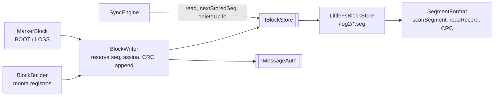
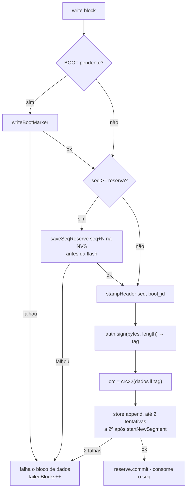

# 02 — Firmware: formato do bloco, marcadores e log autenticado na flash

Estado implementado do bloco (Figs. 8–11 do documento de segurança), dos
marcadores BOOT/LOSS, da gravação autenticada (`BlockWriter`) e do log em
LittleFS (`IBlockStore` v2). Endianness: little-endian em tudo (exceto a tag
ECDSA, ver `01`).

## Componentes

| Peça | Arquivo | Responsabilidade |
|---|---|---|
| `BlockFormat.h` | `src/collector/` | Constantes do layout, `Block`, `stampHeader`, `blockSeq`. |
| `BlockBuilder` | `src/collector/` | Abre o bloco no 1º registro, calcula Δt, fecha preenchendo `t_ms` inicial e `tamanho`. |
| `MarkerBlock` | `src/collector/` | `buildBootMarker`, `buildLossMarker`, `parseMarker`. |
| `SegmentFormat` | `src/collector/` | Codec do cabeçalho do segmento, `computeCrc`/`crcMatches`, `scanSegment`, `readRecord`, `IByteSource`. |
| `BlockWriter` | `src/collector/` | Ordem de gravação (abaixo), `WriteReport` com durações. |
| `IBlockStore` | `src/collector/` | Contrato do log. |
| `LittleFsBlockStore` | `src/storage/` | Implementação em LittleFS com índice em RAM. |

## Área de dados do bloco (Fig. 10)

| Offset | Campo | Tipo | Observação |
|---|---|---|---|
| 0 | `seq` | u32 | Carimbado por `stampHeader` no `BlockWriter`. |
| 4 | `boot_id` | u16 | 0 no LOSS. |
| 6 | `t_ms` inicial | u32 | ms desde o boot do 1º registro; 0 no LOSS. |
| 10 | `tamanho` | u16 | Bytes da área de dados, **cabeçalho incluído** (`kBlockSize` = 1024 no máximo). |
| 12 | registros | — | Até 1012 B. |

## Registros (Fig. 11)

Δt é **u16 sem sinal**, em ms a partir do `t_ms` inicial do bloco.

| Registro | Byte 0 | Layout | Tamanho |
|---|---|---|---|
| Leitura de PID | `0x00`–`0xFC` (código do PID) | `tipo ‖ Δt u16 ‖ A u8 ‖ B u8` (B = 0 em PID de 1 byte) | 5 |
| Marcador LOSS | `0xFD` | `0xFD ‖ Δt u16 ‖ from_seq u32 ‖ to_seq u32` | 11 |
| Marcador BOOT | `0xFE` | `0xFE ‖ Δt u16 ‖ from_seq u32 ‖ to_seq u32` | 11 |
| Posição GPS | `0xFF` | `0xFF ‖ Δt u16 ‖ lat i32 (°×10⁷) ‖ lon i32 (°×10⁷) ‖ alt i32 (mm)` | 15 |

- `validate(CollectorConfig)` e `setPid` rejeitam PID > `kPidRecordTypeMax` (0xFC) com `ConfigError::InvalidPid`.
- `BlockBuilder::deltaFor` recusa `tMs < t_ms inicial` e `tMs − t_ms inicial > 65 535`. `addPid`/`addGps` devolvem `false` e o `Collector` fecha o bloco e abre outro com `t_ms` inicial = `tMs` do registro recusado. Consequência para o servidor: o `t_ms` inicial **não é crescente** entre blocos consecutivos.

## Blocos marcadores

Bloco 0x03 comum com **um único** registro de 11 B (`tamanho` = `kMarkerBlockLength` = 23). Recebe `seq`, tag e CRC como qualquer bloco.

| Offset | Campo | BOOT | LOSS |
|---|---|---|---|
| 0 | `seq` | `R` (reserva lida da NVS) | `from_seq` (1º bloco perdido) |
| 4 | `boot_id` | `boot_id` do boot atual | 0 |
| 6 | `t_ms` | `clock.nowMs()` ao montar | 0 |
| 10 | `tamanho` | 23 | 23 |
| 12 | tipo | `0xFE` | `0xFD` |
| 13 | Δt | 0 | 0 |
| 15 | `from_seq` | último `seq` na flash + 1 | 1º `seq` da faixa perdida |
| 19 | `to_seq` | `R − 1` | último `seq` da faixa perdida |
| — | Na flash | sim, gravado como bloco comum (abre segmento novo) | não: montado e assinado a cada envio (`05`) |

`parseMarker(block)` devolve `MarkerKind::{None,Boot,Loss}` com `fromSeq`/`toSeq`
(exige `tamanho == 23` e tipo 0xFD/0xFE).

## Registro na flash (Fig. 8) e `Block`

`Block { bytes[1024]; length; tag[kMaxTagSize=64]; tagLength; crc }`. Tamanho do
registro: `recordSize(length, tagLen) = length + tagLen + 4`.

| Perfil | `T` | `L` do TLV 0x03 (`04`) |
|---|---|---|
| `none` | 0 | `tamanho` |
| `hmac` | 32 | `tamanho + 32` |
| `asym` | 64 | `tamanho + 64` |

## Segmento v2

Diretório `/log2`, arquivos `/log2/<firstSeq %010lu>.seg`.

| Offset | Campo | Valor |
|---|---|---|
| 0 | magia | `54 43 53 32` (`"TCS2"`) |
| 4 | versão | `2` |
| 5 | `tag_len` | 0, 32 ou 64 (vale para todo o arquivo) |
| 6 | reservado | u16 = 0 |
| 8 | registros | concatenados |

Invariantes:

- **I1** `seq` contíguo no segmento (k-ésimo registro = `firstSeq + k`). O BOOT abre sempre segmento novo e uma gravação que falha sela o segmento.
- **I2** um só `tag_len` por segmento; trocar de perfil abre segmento novo.
- **I3** até `kBlocksPerSegment` = 64 registros.

O `/log` legado (v1) é apagado inteiro no primeiro boot (evento `LOG_MIGRATE`).

## `BlockWriter`

Assina e calcula o CRC uma vez; a nova tentativa grava os mesmos bytes.
`writeBootMarker` chama `store.startNewSegment()` antes de gravar. `WriteReport`:
`seq`, `ok`, `boot`, `attempts`, `reserved`, `reserveUs`, `signUs`, `crcUs`, `writeUs`.

## `IBlockStore`

| Método | Contrato |
|---|---|
| `append(block)` | Grava `dados ‖ tag ‖ crc`; `true` só após sincronizar. |
| `read(seq, out)` | `ReadStatus::{Ok, NotFound, Corrupt}`; **não** confere o CRC (quem lê confere, o `SyncEngine`). |
| `nextStoredSeq(from)` | Menor `seq` guardado ≥ `from`; 0 = nenhum. |
| `deleteUpTo(upTo)` | Remove segmentos inteiros com `lastSeq ≤ upTo`; devolve quantos. Mantém o mais novo. |
| `startNewSegment()` | O próximo `append` abre arquivo novo. |
| `empty`, `oldestSeq` (TAIL), `newestSeq` (HEAD), `lostBlocks` | Estado do log (0 = vazio). |
| `overflowUpTo()` | Maior `seq` já descartado por falta de espaço (0 = nunca). |
| `usagePermille()` | Ocupação 0–1000 em cache. |
| `corrupt(seq)` | Bancada (`AT#CORRUPT`, só `COLLECTOR_EVENTS`): inverte um byte de dados do registro. |

## `LittleFsBlockStore`

- Índice em RAM de até `kMaxSegments` = 256 segmentos (`firstSeq`, `lastSeq`, `count`, `bytes`, `tagLen`, `sealed`); mutex interno.
- `begin(wipe)`: apaga `/log` legado (`LOG_MIGRATE removed=n`); `wipe` formata; varre `/log2/*.seg` com `scanSegment`: cabeçalho inválido ou 0 registros ⇒ apaga o arquivo; varredura parou antes do fim ⇒ `sealed`; 64 registros ⇒ `sealed`.
- `append` abre segmento novo se: índice vazio, mais novo cheio/selado, `tagLen` diferente, ou `startNewSegment()` pendente. Escrita incompleta sela o segmento e devolve `false`.
- `ensureSpace(n)`: `while (_count > 1 && livre < n + kReserveBytes (8 KB)) discardOldest()`. `discardOldest` conta `lostBlocks`, sobe `overflowUpTo` e emite `SEG_DROP`. Em bancada, `-DBLOCK_LOG_LIMIT_BYTES=n` limita o log (sem folga de 8 KB).
- `read` varre os registros do segmento pelo `tamanho` de cada um (linear); sem cursor de leitura em cache.

## Eventos

`FLUSH` (v2, ver `06`), `MARKER`, `LOG_MIGRATE`, `SEG_DROP`. `Events.h`:
`kLargeCapacity` = 2600 (cabe um FLUSH com 1 KB de dados e 64 B de tag em hexa).

## Testes

`pio test -e native -f test_block_format` (`esp32-firmware/test/test_block_format/test_main.cpp`):
bytes de BOOT/LOSS, `parseMarker`, tag e CRC do BOOT de exemplo, cabeçalho do
segmento (ida e volta, rejeições), `scanSegment` (íntegro para T = 0/32/64,
cauda truncada, `seq` fora de ordem, `tamanho` inválido, só cabeçalho),
`readRecord`, `BlockWriter` (assina com `length` exato, mesmos bytes na 2ª
tentativa, falha dupla não consome `seq`, BOOT pendente bloqueia dados,
durações). `InvalidPid` é testado em `test_acquisition`. `LittleFsBlockStore`
não tem teste nativo (só em placa).
