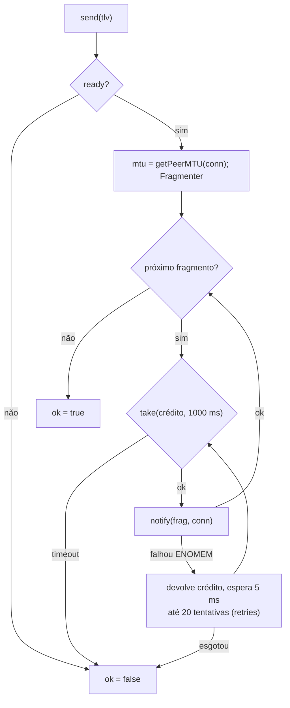

# 04 — Firmware: serviço BLE SYNC (TLV, fragmentação e transporte)

Estado implementado do serviço GATT **SYNC** (separado do NUS), do formato de
fio das mensagens 0x01–0x07, da fragmentação e do transporte com controle de
fluxo. A semântica de cada mensagem (o que o dongle faz) está em `05`. O
namespace do código é `datasync` (não `sync`: colide com `sync()` do POSIX).

## Componentes

```mermaid
sequenceDiagram
    participant NB as NimBLE host
    participant L as BleSyncLink
    participant Q as fila syncRx (8 x SyncInput)
    participant S as SyncTask
    participant F as FlushTask
    NB->>L: onConnected / onDisconnected / onSubscribed / onMtuChange / onRx
    L->>Q: SyncInput{Connected|Disconnected|Subscribed|Unsubscribed|Rx}
    F->>Q: SyncInput{Flushed, seq} (timeout 0; cheia => noticePending)
    Q->>S: xQueueReceive
    S->>S: SyncEngine (05)
    S->>L: send(TLV) - fragmenta e notifica
    L->>NB: notify(fragmento) consumindo 1 crédito
    NB-->>L: onNotifyStatus(code) devolve o crédito
```

| Peça | Arquivo | Responsabilidade |
|---|---|---|
| `SyncProtocol` | `src/sync/SyncProtocol.{h,cpp}` | Codec puro: `parseTlv`, `decodeChallenge`, `encodeResponsePayload`, `decodeAck`, `encodeAckPayload`, `decodeBatchRequest`, `encodeNotice`. |
| `Fragmenter` | `src/sync/Fragmenter.h` | Enquadramento do `SYNC_TX` (header-only, puro). |
| `ISyncLink`, `SendStats` | `src/sync/ISyncLink.h` | Saída de TLVs do `SyncEngine`: `send`, `ready`, `mtu`. |
| `BleSyncLink` | `src/connectivity/ble/BleSyncLink.{h,cpp}` | `ISyncLink` sobre NimBLE com janela de créditos; ponte NimBLE → fila `syncRx`. |
| `BleConnectivity` | `src/connectivity/ble/BleConnectivity.{h,cpp}` | Cria o serviço SYNC, `NimBLEDevice::setMTU(517)`, repassa callbacks ao `BleSyncLink`; evento `SYNC_MTU`. |
| `CollectorContext` | `src/rtos/CollectorContext.{h,cpp}` | Fila `syncRx` (`kSyncRxDepth` = 8), `noticePending`, `Counters::syncRxDropped`, bits `APP_CONNECTED`, `INTERNET` (informativo), `DIAG_MODE`. |

## GATT

| Item | UUID | Propriedades (`BleSecurity.h`) | Observação |
|---|---|---|---|
| Serviço SYNC | `7A3C0001-9B1E-4F2A-8C5D-2E6F1A0B3C4D` | primário | Criado depois do NUS, no mesmo servidor, só se há `BleSyncLink`. |
| `SYNC_RX` | `7A3C0002-9B1E-4F2A-8C5D-2E6F1A0B3C4D` | `WRITE`, `WRITE_NR`, `WRITE_ENC` (`kSecureRxProps`) | App → dongle; valor máx. 64 B; um TLV por escrita. |
| `SYNC_TX` | `7A3C0003-9B1E-4F2A-8C5D-2E6F1A0B3C4D` | `NOTIFY`, `READ_ENC` (`kSecureTxProps`) | Dongle → app; `C` + pedaço do TLV. |

O SYNC não vai no anúncio (só o UUID do NUS, o nome na *scan response* e os
dados de fabricante da Fase 2); o app descobre o SYNC na conexão. As
exigências de enlace cifrado (`*_ENC`) pertencem à Fase 2 (`fase-2/01`).
MTU: `NimBLEDevice::setMTU(517)` (preferido); o efetivo é lido a cada
mensagem com `getPeerMTU`. Sem DLE nem PHY 2M.

## TLV

| Offset | Campo | Tipo | Tamanho |
|---|---|---|---|
| 0 | `T` | u8 | 1 |
| 1 | `L` (comprimento de `V`) | u16 LE | 2 |
| 3 | `V` | bytes | `L` |

| T | Mensagem | Sentido | `L` válido |
|---|---|---|---|
| 0x01 | Desafio | app → dongle | 45 (`flags` bit 0 = 0) ou 47 (bit 0 = 1) |
| 0x02 | Resposta | dongle → app | 50 |
| 0x03 | Bloco | dongle → app | `tamanho + T_tag`; dados `17 + T … 1024 + T`, marcador `23 + T`, máx. 1088 |
| 0x04 | ACK | app → dongle | 25 |
| 0x05 | Pedido de lote | app → dongle | 2 (`K` u16 LE; 0 ignorado) |
| 0x06 | Erro | ambos | 1 (código) |
| 0x07 | Aviso de novo bloco | dongle → app | 13 |

Constantes: `kMaxBlockValueLen` = 1088, `kMaxTxMessage` = 1091, `kSyncRxMax` = 64.

### 0x01 Desafio (`V` = 45/47 B)

| Offset | Campo | Tipo | Tam. |
|---|---|---|---|
| 0 | `c_S` | u32 | 4 |
| 4 | `N_S` | bytes | 16 |
| 20 | `ACK_seq` | u32 | 4 |
| 24 | `c_conf` | u32 | 4 |
| 28 | `flags_c` | u8 (bit 0 = diagnóstico) | 1 |
| 29 | `diag_min` | u16 (só se `flags_c` bit 0) | 2 |
| 29 ou 31 | `tag` | HMAC `K_auth` truncado | 16 |

### 0x02 Resposta (`V` = 50 B)

| Offset | Campo | Tipo | Tam. |
|---|---|---|---|
| 0 | `c_S` (eco) | u32 | 4 |
| 4 | `N_S` (eco) | bytes | 16 |
| 20 | `TAIL_seq` | u32 | 4 |
| 24 | `HEAD_seq` | u32 | 4 |
| 28 | `boot_id` | u16 | 2 |
| 30 | `t_ms` | u32 | 4 |
| 34 | `tag` | HMAC `K_auth` truncado | 16 |

### 0x03 Bloco (`V` = dados ‖ tag, sem o CRC)

Ver `02`. `L = tamanho + T`, `T` do perfil.

### 0x04 ACK (`V` = 25 B)

| Offset | Campo | Tipo | Tam. |
|---|---|---|---|
| 0 | `ACK_seq` | u32 | 4 |
| 4 | `c_conf` | u32 | 4 |
| 8 | `flags_a` | u8 (bit 0 = âncora falhou) | 1 |
| 9 | `tag` | HMAC `K_auth` truncado | 16 |

### 0x07 Aviso de novo bloco (`V` = 13 B, sem tag)

| Offset | Campo | Tipo | Tam. |
|---|---|---|---|
| 0 | `HEAD_seq` | u32 | 4 |
| 4 | `flags` | u8 | 1 |
| 5 | `DevId` | bytes | 8 |

Bits de `flags`: `0x01` sem handshake nesta conexão (`kNoticeNoHandshakeConn`),
`0x02` sem handshake neste boot (`kNoticeNoHandshakeBoot`), `0x04` flash acima
de 80 % (`kNoticeFlashHigh`).

Bits reservados são sempre zerados por quem envia e **ignorados** por quem
recebe (a tag continua valendo). A entrada de cada tag está em `01`.

Exemplos (chaves fixas): ACK `ACK_seq=130, c_conf=7` →
`04 1900 82000000 07000000 00 84EB2C1203B2720E492DB89E04F1FAE7`; aviso
`HEAD=130, flags=0x03` → `07 0D00 82000000 03 544343454C544101`.

## Recepção (`SYNC_RX`)

1. O callback do NimBLE só copia até 64 B para um `SyncInput` e faz `xQueueSend(ctx.syncRx, …, 0)`; fila cheia ⇒ descarta e incrementa `ctx.counters.syncRxDropped` (a `SyncTask` emite `SYNC_RX reason=queue_full`). Nenhum evento é emitido no callback.
2. A `SyncTask`/`SyncEngine` valida `len ≥ 3`, `L == len − 3` e `T ∈ {0x01, 0x04, 0x05, 0x06}`; mensagem malformada é descartada com `SYNC_RX ok=0 reason=...` (sem resposta; o app se recupera por *timeout*). Desafio/ACK com `L` inválido recebe erro 0x01.

`SyncInput` (`rtos/CollectorContext.h`): `kind` ∈ {`Connected`, `Disconnected`,
`Subscribed`, `Unsubscribed`, `Rx`, `Flushed`, `InjectAck`}, `len`, `connHandle`,
`value` (seq em `Flushed`, ACK em `InjectAck`, senão a geração `ctx.connections`),
`tUs`, `data[64]`.

## Enquadramento (`SYNC_TX`, Fig. 7)

Byte de controle `C`:

| Bits | Significado |
|---|---|
| 7 | 1 no primeiro fragmento da mensagem |
| 6..0 | contador: 0 no primeiro, +1 por fragmento, `mod 128` |

`chunk = max(mtu, 23) − 4`; cada notificação é `C ‖ pedaço` com até `MTU − 3`
bytes. Uma mensagem sempre começa num fragmento novo. Exemplos: resposta de 53 B
com MTU 23 ⇒ 3 fragmentos; bloco de 1059 B (`hmac`) com MTU 247 ⇒ 5 fragmentos.

## `BleSyncLink::send`



- `onNotifyStatus` (qualquer código) devolve um crédito; só a sobrecarga nova de `onStatus` é sobrescrita (a antiga devolveria dois).
- Conexão, desconexão e cada mudança de MTU recriam a janela (`resetWindow`).
- `credits(mtu) = clamp((poolBlocks − 4) / blocksPerFragment(mtu), 1, kMaxCredits)`, com `blocksPerFragment = ceil((mtu − 3 + 20) / 236)`, `poolBlocks = CONFIG_BT_NIMBLE_MSYS1_BLOCK_COUNT` (24 no `[base]`) e `kMaxCredits = SYNC_TX_MAX_CREDITS` (padrão 4).
- Constantes: `kCreditTimeoutMs` = 1000 (menor que os 2 s do app), `kNotifyRetries` = 20, `kNotifyRetryMs` = 5.
- Uma conexão por vez no SYNC: `_conn` guarda a última conexão.

## Codec (`SyncProtocol.h`)

`MsgType`: `Challenge`=0x01, `Response`, `Block`, `Ack`, `BatchRequest`, `Error`, `Notice`=0x07.
`ErrorCode`: `InvalidTag`=0x01, `StaleChallenge`=0x02, `InvalidAckSeq`=0x03,
`Incomplete`=0x04, `NoSession`=0x05, `ResendFromBoundary`=0x07. Flags:
`kChallengeFlagDiag`, `kAckFlagAnchorFailed`, `kNotice*`. `decodeChallenge`
aceita 45 B com bit 0 = 0 ou 47 B com bit 0 = 1 (outras combinações são
recusadas).

## Testes

`pio test -e native -f test_sync_protocol` (`esp32-firmware/test/test_sync_protocol/test_main.cpp`):
`parseTlv`, comprimentos e flags do desafio, payload da resposta contra o
vetor, ida e volta do ACK e do aviso, exemplos de fio, exemplo do
`Fragmenter` byte a byte, limites de `chunk` e contador cíclico. `BleSyncLink`
e `BleConnectivity` só são exercitados em placa.
