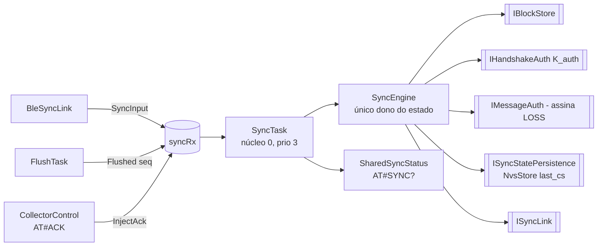
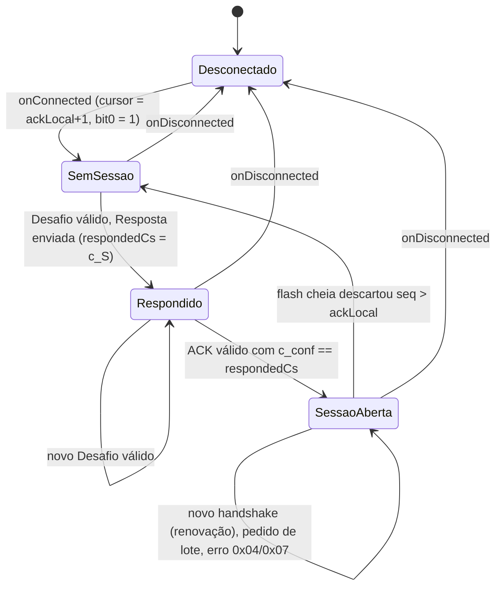
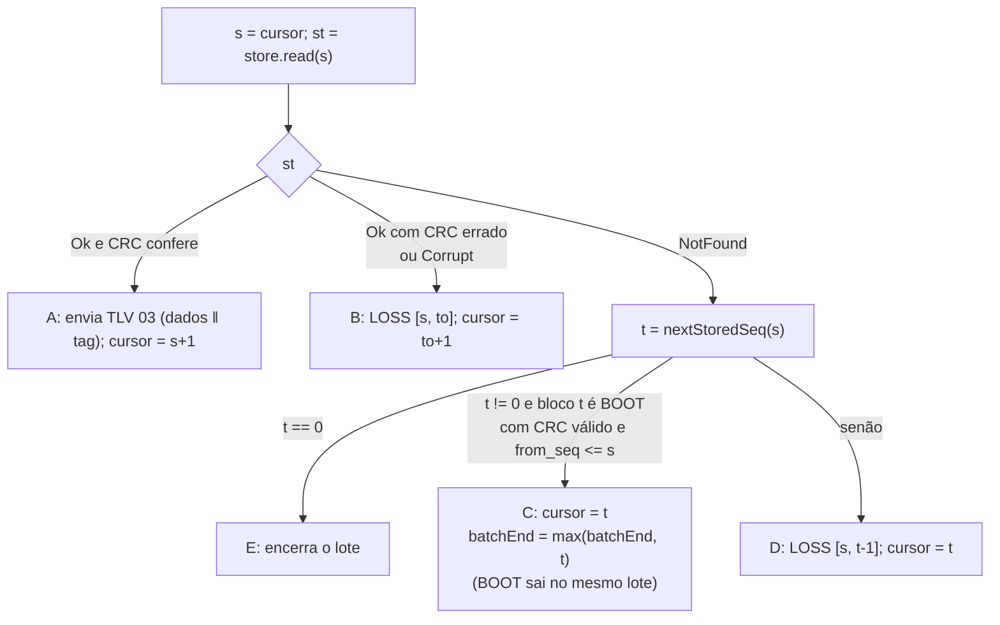

# 05 — Firmware: handshake (lado dongle), cursor de envio, lotes, avisos e erros

Estado implementado do lado dongle do protocolo: desafio 0x01 → resposta
0x02 → ACK 0x04, cursor de envio que não espera ACK, pedidos de lote 0x05,
aviso 0x07, erros da Tabela 5, LOSS gerado na hora, salto de lacuna de BOOT,
invalidação da sessão por flash cheia. Namespace `datasync`.

## Componentes



| Peça | Arquivo | Responsabilidade |
|---|---|---|
| `SyncEngine`, `SyncDeps`, `SyncStatus` | `src/sync/SyncEngine.{h,cpp}` | Todo o protocolo; C++ puro, testado no native. Emite os eventos de `06`. |
| `ISyncStatePersistence`, `IDiagGate` | `src/sync/SyncEngine.h` | `loadLastAcceptedCs/saveLastAcceptedCs`; gancho de diagnóstico (`nullptr` hoje). |
| `SyncTask` | `src/tasks/SyncTask.{h,cpp}` | Casca FreeRTOS: núcleo 0, prioridade 3, pilha 8 KB (12 KB no `asym`), tick de 1 s. |
| `SharedSyncStatus` | `src/rtos/SharedSyncStatus.h` | Cópia de `SyncStatus` com mutex, lida por `AT#SYNC?`. |

Loop da `SyncTask`: espera `syncRx` (0 se há lote ativo, senão até o próximo
tick), drena a fila despachando cada `SyncInput`, repete o aviso se
`noticePending`, envia no máximo um bloco se `batchActive`, chama `tick()` a
cada `kTickMs` = 1000 ms (e reporta descartes da fila). Uma escrita de uma
geração de conexão que o motor ainda não viu abre a conexão primeiro.

## Estado do `SyncEngine`

| Variável | Persistência | Início | Significado |
|---|---|---|---|
| `ackLocal` | RAM | `begin()`: `effectiveTail() − 1` | Último `ACK_seq` válido conhecido; corrigido no 1º handshake. |
| `cursor` | RAM | `ackLocal + 1` a cada conexão | Próximo `seq` a enviar. |
| `batchEnd`, `batchActive` | RAM | — | Fim do lote ativo. |
| `lastAcceptedCs` | NVS `last_cs` | `begin()` | Maior `c_S` aceito. |
| `respondedCs`, `hasResponded` | RAM, zerados por conexão | — | `c_S` da última Resposta desta conexão. |
| `sessionOpen` | RAM, falso por conexão | — | Pedido de lote só com `true`. |
| `noHsConn` (bit 0), `noHsBoot` (bit 1) | RAM | `true` | Flags do aviso. |
| `flashHigh` (bit 2) | RAM | `usagePermille > 800` | Liga acima de 800 ‰, desliga abaixo de 780 ‰. |
| `overflowSeen` | RAM | `store.overflowUpTo()` | Último descarte já tratado. |

## Sessão por conexão



## Handshake (Fig. 5)

```mermaid
sequenceDiagram
    participant A as App
    participant D as SyncEngine
    participant N as NVS
    D-->>A: 0x07 aviso (flags 0x03) ao assinar SYNC_TX
    A->>D: 0x01 Desafio (c_S, N_S, ACK_seq, c_conf, flags)
    D->>D: verify tag K_auth (tempo constante)
    alt tag errada ou L incoerente
        D-->>A: 0x06 erro 0x01
    else c_S <= last_cs
        D-->>A: 0x06 erro 0x02
    else
        D->>N: save last_cs = c_S (antes de responder)
        D->>D: se ackLocal < ACK_seq <= HEAD: advanceAck (libera flash)
        D-->>A: 0x02 Resposta (eco c_S/N_S, TAIL efetivo, HEAD, boot_id, t_ms, tag)
    end
    A->>D: 0x04 ACK (ACK_seq, c_conf, flags_a)
    D->>D: verify tag; ACK_seq em [ackLocal, HEAD]
    D->>D: c_conf == respondedCs: sessionOpen, bit0 = 0, bit1 = 0 se flags_a bit0 = 0
    D-->>A: 0x07 aviso com as flags novas
```

Pontos do desafio (`handleChallenge`): se a gravação de `last_cs` falha, não
responde (evento `result=nvs_fail`); `c_conf` do desafio só é registrado;
`flags_c` bit 0 chama `diagGate->grant(diag_min)` se houver gancho (hoje
`nullptr`: formato pronto, sem efeito); `t_ms = clock.nowMs()` é lido
imediatamente antes da tag.

Pontos do ACK (`handleAck`): `ACK_seq < ackLocal` ou `> HEAD` ⇒ erro 0x03 sem
mudar estado; `ACK_seq > ackLocal` ⇒ `advanceAck`; `flags_a` bit 0 (âncora
falhou) abre a sessão mas mantém o bit 1 do aviso ligado.

### TAIL efetivo

`effectiveTail()`: flash vazia ⇒ `HEAD + 1`; senão lê o bloco mais antigo e, se
ele for um BOOT com CRC válido, devolve o `from_seq` dele; senão
`store.oldestSeq()`. Um BOOT corrompido não conta como marcador. Assim a lacuna
de boot nunca é declarada como OVERFLOW pelo servidor.

## Erros (Tabela 5)

TLV `06 0100 <código>` (4 B); evento `SYNC_ERR dir=tx|rx`.

| Sentido | Código | Condição |
|---|---|---|
| dongle → app | `0x01` tag inválida | Tag errada ou `L` inválido em desafio/ACK |
| dongle → app | `0x02` `c_S` antigo | `c_S ≤ last_cs` |
| dongle → app | `0x03` `ACK_seq` inválido | `ACK_seq < ackLocal` ou `> HEAD` |
| dongle → app | `0x05` sem sessão | Pedido de lote com `sessionOpen = false` |
| app → dongle | `0x04` incompleta / `0x07` reenviar desde a fronteira | `cursor = ackLocal + 1`, lote encerrado, aviso `reason=resync` (informativo) |

Tipos `0x02`, `0x03`, `0x07` ou desconhecidos vindos do app são descartados
(`SYNC_RX ok=0 reason=unexpected`).

## Cursor e lotes

`advanceAck(a)`: `ackLocal = a`; `store.deleteUpTo(a)` (evento `SYNC_FREE`);
`cursor = max(cursor, a + 1)`; encerra o lote se `batchEnd < cursor`.

| Regra | Implementação |
|---|---|
| Nova conexão ⇒ `cursor = ackLocal + 1` | `onConnected` |
| Bloco enviado ⇒ cursor avança 1 (só se `link.send` ok) | `sendNextBlock` |
| Pedido de lote ⇒ envia de `cursor` até `min(cursor + K − 1, HEAD)`; pedido novo substitui o fim | `handleBatchRequest` |
| ACK/desafio com `ACK_seq` maior ⇒ libera flash; cursor `max(cursor, ACK+1)` | `advanceAck` |
| Erro 0x04/0x07 do app ⇒ `cursor = ackLocal + 1` | `handleAppError` |
| LOSS enviado cobrindo `[a, b]` ⇒ cursor `b + 1` | `sendNextBlock` |
| Lacuna de BOOT ⇒ cursor salta para o `seq` do BOOT | `sendNextBlock` |

O dongle não espera ACK para avançar; blocos só saem da flash com ACK.

### `sendNextBlock`

Pré-condição: `batchActive && connected && subscribed && sessionOpen && cursor ≤ batchEnd`;
`checkOverflow()` antes de ler.



LOSS (`sendLoss`): `to` estende-se enquanto o bloco seguinte também está
corrompido, até `kMaxLossRun` = 64 registros (faixas maiores viram LOSS
consecutivos, cada um com `seq = from_seq`). `buildLossMarker` + `lossAuth.sign`
sobre 23 B; não é gravado na flash (reenvio recalcula). Eventos
`MARKER kind=loss reason=crc|missing` e `SYNC_BLOCK kind=loss`. Um BOOT
corrompido cai nos casos D e B (nunca é tratado como marcador).

## Avisos 0x07

`sendNotice(reason)` quando `connected && subscribed`: `HEAD = store.newestSeq()`,
`flags = noHsConn | noHsBoot<<1 | flashHigh<<2`, `DevId`. Razões
(`NoticeReason`): `Subscribe`, `Flush`, `Ack`, `Resync`, `Overflow`, `Flash`,
`Retry`. `tick()` reenvia o aviso a cada `kNoticeRetryMs` = 15 000 ms só
enquanto `noHsConn` (cobre aviso perdido na assinatura) e recalcula `flashHigh`.

## Flash cheia com sessão aberta

`checkOverflow()` (em `onFlushed`, `tick` e antes de cada leitura): se
`store.overflowUpTo()` passou de `overflowSeen` **e** de `ackLocal`, fecha a
sessão (`sessionOpen = false`, `noHsConn = true`, lote encerrado), emite
`SYNC_OVERFLOW` e `SYNC_SESSION open=0 reason=overflow` e envia aviso. O
próximo pedido de lote recebe 0x05; o app refaz o handshake e a Resposta traz o
`TAIL_seq` novo.

## Comandos de bancada (só `COLLECTOR_EVENTS`)

| Comando | Efeito |
|---|---|
| `AT#ACK n` | `SyncInput{InjectAck, n}`: monta um ACK com tag válida (`c_conf = respondedCs`) e o processa como se viesse do app. |
| `AT#SYNC?` | Linha `SYNC conn= sub= open= ack= cur= end= head= tail= cs= rcs= flags= mtu= rsv=` a partir do `SharedSyncStatus`. |
| `AT#CORRUPT n` | `store.corrupt(n)` (inverte um byte do registro). |
| `AT#WIPE` | `wipe_req = 1` e reinicia; no boot seguinte faz o *wipe* (ver `03`). |

`AT#DIAG 1` continua sempre aceito. `tools/sync-bench/sync_bench.py` (Python +
`bleak`) faz o papel de app e servidor com as chaves fixas; cenários
(`--scenario`): `handshake`, `stream`, `replay`, `badtag`, `nosession`,
`badack`, `incomplete`, `corrupt`.

## Testes

`pio test -e native -f test_sync_engine` (`esp32-firmware/test/test_sync_engine/test_main.cpp`,
dublês em `test/support/SyncFakes.h`): aviso na assinatura (`flags=03`);
handshake feliz (`last_cs` salvo antes da resposta, flash liberada); resposta
byte a byte igual ao vetor; ACK abre a sessão e limpa os bits (e com
`flags_a=1` mantém o bit 1); erros 0x01/0x02/0x03/0x05; falha de NVS sem
resposta; lotes na ordem com `L = tamanho + T`; cursor não espera ACK e ACK não
recua; rewind por 0x04/0x07; LOSS único com tag válida para blocos corrompidos;
salto de BOOT no mesmo lote; faixa ausente sem BOOT vira LOSS; BOOT corrompido
não é marcador; LOSS longo em runs de 64; overflow fecha a sessão e o
handshake recupera; histerese de 80 %; reenvio do aviso a cada 15 s; falha do
link não avança o cursor; tamanho de tag por perfil; TAIL efetivo; sequência
de eventos e campos `*_us`.
