# 05 — Firmware: handshake (lado dongle), cursor de envio, lotes, avisos e erros

## Objetivo

Implementar no dongle o lado BLE do protocolo do documento de segurança:
processar o **Desafio 0x01** e devolver a **Resposta 0x02** (Fig. 5, Tabela 2),
processar o **ACK 0x04** (liberar flash, abrir sessão, desligar flags),
atender **Pedidos de lote 0x05** a partir de um **cursor de envio** que não
espera ACK (tabela "Regras do cursor"), enviar o **Aviso de novo bloco 0x07**
com as flags da Tabela 4, emitir/processar os **erros da Tabela 5**, trocar
blocos corrompidos por **LOSS** gerado na hora, saltar lacunas de **BOOT** e
invalidar a sessão quando a **flash cheia** descartar blocos não confirmados.
Substitui `SessionTask` (Cristian) e `UploadTask`/`UploadCursor` (janela com
*timeout*).

## Escopo

**Dentro:** `SyncEngine` (C++ puro, testado no native), `SyncTask` (casca
FreeRTOS), estado persistente (`last_cs`, via spec 03), comandos de bancada
`AT#ACK`, `AT#SYNC?`, `AT#CORRUPT`, remoção de `SessionTask`, `UploadTask`,
`UploadCursor`, `TimeSync`, ferramenta de bancada `sync_bench.py`.

**Fora:** formato de fio e transporte (spec 04), primitivas e chaves (spec 01),
formato da flash (spec 02), catálogo de eventos (spec 06 — aqui só onde cada
um é emitido), servidor (Fase 3), app (specs 07–09). Ativação do modo
diagnóstico pelo desafio fica só como gancho (ver §11).

## Estado atual (verificado no código)

| Peça | Onde | Hoje |
|---|---|---|
| Sessão | `src/tasks/SessionTask.{h,cpp}` | Espera `APP_CONNECTED\|INTERNET`, liga `SESSION_OK` sem handshake (`TODO(segurança)`), faz Cristian (`TIME_REQ`→`TIME_RESP`→`TIME_REPORT`). |
| Upload | `src/tasks/UploadTask.{h,cpp}` | Espera os 4 bits; `UploadCursor` com janela de 8 e *timeout* de ACK de 5 s; `BATCH(oldestSeq, bloco)`; `ACK(n)` → `deleteUpTo(n)`; `UP_SEND/UP_ACK/UP_REWIND`. |
| Cursor | `src/collector/UploadCursor.{h,cpp}` | `resync(oldest)`, `canSend`, `takeNext`, `onAck`, `timedOut`, `rewind`. |
| Hora | `src/collector/TimeSync.{h,cpp}` | Lado dongle do Cristian. |
| Bancada | `src/rtos/CollectorControl.cpp:101` | `injectAck(seq)` codifica um ACK sem tag (`NoAuth`) e põe em `uploadRx`; `AT#ACK n` em `Elm327.cpp:239`. |
| Testes | `test/test_persistence/test_main.cpp` | Casos de `UploadCursor`, `DataProtocol`, `TimeSync`, `AT#ACK`. |

## Design

### 1. Peças e dependências

```cpp
namespace sync {
class ISyncStatePersistence {                 // NvsStore (spec 03)
public:
    virtual ~ISyncStatePersistence() = default;
    virtual uint32_t loadLastAcceptedCs() = 0;
    virtual bool     saveLastAcceptedCs(uint32_t cs) = 0;
};

class IDiagGate {                             // gancho do modo diagnóstico (§11)
public:
    virtual ~IDiagGate() = default;
    virtual void grant(uint16_t minutes) = 0;
};

struct SyncDeps {
    collector::IBlockStore&    store;
    ISyncStatePersistence&     persistence;
    security::IHandshakeAuth&  handshakeAuth;   // K_auth (spec 01)
    collector::IMessageAuth&   lossAuth;        // K_rec/k_sig/none — assina LOSS
    ISyncLink&                 link;            // spec 04
    const collector::IClock&   clock;           // nowMs/nowUs
    const uint8_t*             devId;           // 8 B
    uint16_t                   bootId;
    IDiagGate*                 diagGate;        // nullptr na Fase 1
};

struct SyncStatus {
    bool     connected, subscribed, sessionOpen, batchActive;
    uint32_t ackLocal, cursor, batchEnd, head, tail;
    uint32_t lastAcceptedCs, respondedCs;
    uint8_t  flags;
    uint16_t mtu;
};

class SyncEngine {
public:
    explicit SyncEngine(const SyncDeps& deps);
    void begin();                                         // carrega last_cs; ackLocal = TAIL − 1
    void onConnected(uint32_t generation);
    void onDisconnected();
    void onSubscribed(bool on);
    void onFlushed(uint32_t seq);                         // seq = 0: só repetir o aviso (noticePending)
    void onMessage(const uint8_t* tlv, size_t len, uint32_t queuedUs);
    bool sendNextBlock();                                 // envia no máximo 1 mensagem de bloco
    void tick();                                          // a cada ~1 s
    bool       batchActive() const;
    uint32_t   generation() const;
    SyncStatus status() const;
    void injectAck(uint32_t ackSeq);                      // só COLLECTOR_EVENTS (AT#ACK)
};
}
```

O `SyncEngine` é o **único dono** de todo o estado do protocolo; só a
`SyncTask` o chama. Ele emite os eventos da spec 06 diretamente (como o
`Collector` já faz), então os testes nativos conferem a sequência de eventos.

### 2. Estado

| Variável | Tipo | Persistência | Início | Significado |
|---|---|---|---|---|
| `ackLocal` | u32 | RAM | `begin()`: `effectiveTail() − 1` (§4) | Último `ACK_seq` válido conhecido. Conservador após boot: o 1º handshake corrige. |
| `cursor` | u32 | RAM | `ackLocal + 1` a cada conexão | Próximo `seq` a enviar. |
| `batchEnd` | u32 | RAM | — | Último `seq` do lote ativo (`batchActive`). |
| `lastAcceptedCs` | u32 | NVS `last_cs` | `begin()` | Maior `c_S` aceito. |
| `respondedCs` / `hasResponded` | u32/bool | RAM, zerados por conexão | — | `c_S` da última Resposta enviada **nesta conexão**. |
| `sessionOpen` | bool | RAM | `false` por conexão | ACK de abertura recebido nesta conexão e sem descarte por flash cheia depois. Pedido de lote só com `true`. |
| `noHsConn` (bit 0) | bool | RAM | `true` a cada conexão | Tabela 4. |
| `noHsBoot` (bit 1) | bool | RAM | `true` no boot | Tabela 4. |
| `flashHigh` (bit 2) | bool | RAM | calculado | `store.usagePermille() > 800` (desliga `< 780`). |
| `overflowSeen` | u32 | RAM | `store.overflowUpTo()` no `begin()` | Último valor de `overflowUpTo` já tratado. |
| `connected`, `subscribed`, `generation` | — | RAM | — | Espelho do `BleSyncLink`/`SyncInput`. |

**[Decisão] `ackLocal` não é persistido.** Depois de um boot ele vale
`TAIL − 1` (pode ser menor que o ACK real do servidor, porque o
`deleteUpTo` só apaga segmentos inteiros); como nenhuma sessão abre sem
handshake e o desafio/ACK trazem o `ACK_seq` do servidor, ele é corrigido
antes do primeiro bloco. Valores menores só tornam a detecção de "descarte
acima do ACK local" mais conservadora (invalida a sessão e pede handshake).

### 3. Sessão por conexão

```mermaid
stateDiagram-v2
    [*] --> Desconectado
    Desconectado --> SemSessao: onConnected (cursor = ackLocal+1, bit0 = 1)
    SemSessao --> Respondido: Desafio válido → Resposta 0x02 (respondedCs = c_S)
    Respondido --> Respondido: novo Desafio válido (respondedCs atualizado)
    Respondido --> SessaoAberta: ACK válido com c_conf == respondedCs (bit0 = 0; bit1 = 0 se flags_a bit0 = 0)
    SessaoAberta --> SessaoAberta: Desafio/ACK/Pedido de lote/Erro 0x04-0x07
    SessaoAberta --> SemSessao: flash cheia descartou seq > ackLocal (bit0 = 1)
    SemSessao --> Desconectado: onDisconnected
    Respondido --> Desconectado: onDisconnected
    SessaoAberta --> Desconectado: onDisconnected
```



Um novo handshake com a sessão aberta (renovação de token, âncora) **não**
fecha a sessão: só atualiza `respondedCs` e, no ACK, `noHsBoot`.

### 4. Handlers

`onConnected(gen)`: `connected = true; subscribed = false; generation = gen;
sessionOpen = false; hasResponded = false; noHsConn = true; batchActive = false;
cursor = ackLocal + 1` → eventos `SYNC_SESSION open=0 reason=connect`,
`SYNC_CURSOR reason=connect`.

`onDisconnected()`: `connected = subscribed = sessionOpen = batchActive = false`.

`onSubscribed(on)`: `subscribed = on`; se `on` → `sendNotice(reason=subscribe)`.

`onMessage(tlv, len, queuedUs)`: `parseTlv` (spec 04 §4); despacha:

**Desafio 0x01** — `handleChallenge(v, L)`:
1. `decodeChallenge`; falha (`L` incoerente com `flags`) → erro 0x01.
2. `handshakeAuth.verify(0x01, v, payloadLen, tag)`; falha → erro 0x01.
3. `c_S ≤ lastAcceptedCs` → erro 0x02.
4. `persistence.saveLastAcceptedCs(c_S)`; falha → **não responde**
   (evento `result=nvs_fail`; o app repete por *timeout*). `lastAcceptedCs = c_S`.
   **[Decisão]** gravar antes de responder: uma resposta só existe para um
   `c_S` já protegido contra *replay* mesmo que o dongle reinicie logo depois.
5. Se `ackLocal < ACK_seq ≤ HEAD` → `advanceAck(ACK_seq)` (§5). Outros casos
   são ignorados aqui (não é erro no desafio). `c_conf` é só registrado no
   evento. **[Decisão]** `c_conf` do desafio não é conferido: ele é o `c_S` do
   último handshake aceito *pelo servidor*, que pode ser menor que o último
   respondido pelo dongle (resposta que não chegou ao servidor).
6. `flags_c` bit 0 → `diagGate->grant(diag_min)` se houver gancho (§11).
7. Montar a Resposta: `c_S` e `N_S` ecoados; `HEAD = store.newestSeq()`;
   `TAIL = effectiveTail()` (abaixo); `boot_id`;
   `t_ms = clock.nowMs()` **lido imediatamente antes** de calcular a tag;
   `tag = handshakeAuth.tag(0x02, payload34)`; enviar TLV de 53 B.
8. `respondedCs = c_S; hasResponded = true` → evento `HS_RESPONSE`.

**TAIL efetivo.** `effectiveTail()`: flash vazia → `HEAD + 1`; senão
`o = store.oldestSeq()`; se o bloco `o` é lido com `Ok`, CRC válido, e é um
BOOT (`parseMarker`, uma leitura) → `from_seq` desse BOOT; senão `o` (BOOT
corrompido não conta como marcador, ver §6). **[Decisão]** Um BOOT "representa" a
faixa `[from_seq, seq]`: os `seq` da lacuna de boot nunca existiram, então
não são "blocos descartados". Sem essa regra, depois que um ACK apaga tudo o
que vinha antes de um BOOT, o `TAIL` seria o próprio `seq` do BOOT e o
servidor classificaria a lacuna de boot como OVERFLOW. Como o boot sempre
abre segmento novo (spec 02, I1), o BOOT é sempre o primeiro registro do seu
segmento. O mesmo vale para o `ackLocal` inicial em `begin()`:
`effectiveTail() − 1`. Exemplo completo no §5 da spec 06.

**ACK 0x04** — `handleAck(v, L)`:
1. `decodeAck` (L = 25) senão erro 0x01; `verify(0x04, v, 9, tag)` senão erro 0x01.
2. `ACK_seq < ackLocal` ou `ACK_seq > HEAD` → erro 0x03, **nenhuma** mudança
   de estado (nem abertura de sessão). **[Decisão]** um ACK fora da faixa não
   abre a sessão: o app reescreve o ACK de abertura ou refaz o handshake
   quando receber 0x05 no pedido de lote.
3. `ACK_seq > ackLocal` → `advanceAck(ACK_seq)`.
4. `hasResponded && c_conf == respondedCs` → `sessionOpen = true`,
   `noHsConn = false`; se `flags_a` bit 0 = 0 → `noHsBoot = false`
   (**[Decisão]** com bit 0 = 1 a âncora falhou: a sessão abre, mas o bit 1
   continua ligado para o app repetir o handshake e o boot ganhar âncora);
   `sendNotice(reason=ack)`.
5. Evento `HS_ACK`.

**Pedido de lote 0x05** — `handleBatchRequest(v, L)`:
1. `L ≠ 2` → descarta. `!sessionOpen` → erro 0x05.
2. `K == 0` → nada. `head = store.newestSeq()`; `cursor > head` → nada
   (`SYNC_REQ result=empty`).
3. `batchEnd = min(cursor + K − 1, head)` (aritmética em 64 bits);
   `batchActive = true`. Um pedido novo durante um lote **substitui** o fim.

**Erro 0x06 vindo do app** — `handleAppError(v, L)`:
- `0x04` (mensagem incompleta) ou `0x07` (reenviar desde a fronteira) →
  `cursor = ackLocal + 1`, `batchActive = false` →
  `sendNotice(reason=resync)`. O próximo pedido de lote recomeça em
  `ackLocal + 1`. Como as escritas no SYNC_RX são processadas em ordem, um
  0x05 escrito pelo app logo depois do 0x04/0x07 já vê o cursor reposto. O
  aviso `reason=resync` é **informativo** (atualiza `HEAD`/flags): ele não
  serve de fronteira, porque um aviso de *flush* já enfileirado pode sair
  antes de o 0x04 ser processado. A fronteira do lado do app é o primeiro
  bloco com `seq = ACK_seq + 1` (spec 07 §7).
- Outros códigos → só evento `SYNC_ERR dir=rx`.

Tipos `0x02`, `0x03`, `0x07` ou desconhecidos vindos do app → descartados com
evento `SYNC_RX ok=0 reason=unexpected`.

`onFlushed(seq)`: primeiro `checkOverflow()` (§9); depois
`sendNotice(reason=flush)`.

`tick()`: `checkOverflow()`; recalcula `flashHigh` e, se mudou,
`sendNotice(reason=flash)`; se `connected && subscribed && noHsConn` e o
último aviso tem mais de `kNoticeRetryMs = 15 000` ms → `sendNotice(reason=retry)`.
**[Decisão]** O reenvio periódico só enquanto não há sessão cobre um aviso
perdido no momento da assinatura (o app pode ainda não estar escutando);
com sessão aberta, avisos só saem a cada *flush*, como no documento.

`sendNotice(reason)`: se `connected && subscribed` → TLV 0x07 com
`HEAD = store.newestSeq()`, `flags = noHsConn | noHsBoot<<1 | flashHigh<<2`,
`DevId` → evento `SYNC_NOTICE`.

### 5. `advanceAck(a)` e regras do cursor

`advanceAck(a)`: `ackLocal = a`; `segs = store.deleteUpTo(a)` (medido →
`SYNC_FREE`); `if (cursor < a + 1) cursor = a + 1` (→ `SYNC_CURSOR reason=ack`);
se `batchActive && batchEnd < cursor` → encerra o lote.

| Regra do documento | Implementação |
|---|---|
| Início de sessão (nova conexão BLE) ⇒ `cursor = ACK_seq + 1` | `onConnected`: `cursor = ackLocal + 1` |
| Envio de um bloco ao app ⇒ cursor avança 1 | `sendNextBlock`: `cursor = seq + 1` **só se** `link.send` devolveu `ok` |
| Pedido de lote ⇒ envia de `cursor` até `min(cursor + K − 1, HEAD)` | `handleBatchRequest` + `sendNextBlock` |
| ACK ou desafio com `ACK_seq` maior ⇒ libera flash; `cursor = max(cursor, ACK_seq + 1)` | `advanceAck` |
| Erro 0x04 ou 0x07 do app ⇒ `cursor = ACK_seq + 1` | `handleAppError` |
| LOSS enviado cobrindo `[a, b]` ⇒ cursor vai para `b + 1` (§4.3 do documento) | `sendNextBlock` |
| *(extra)* lacuna de BOOT ⇒ cursor salta para o `seq` do BOOT | `sendNextBlock` (§6) |

O dongle **não espera ACK** para avançar: o app tem *buffer* (Fig. 13);
blocos só saem da flash com ACK.

### 6. `sendNextBlock()` — escolha do próximo bloco

Pré-condições (senão `batchActive = false`, retorna `false`):
`batchActive && connected && subscribed && sessionOpen && cursor ≤ batchEnd`.
Antes de ler, `checkOverflow()`; se a sessão caiu, retorna.

`s = cursor`; `st = store.read(s, _blk)` (medido: `read_us`):

| Caso | Condição | Ação | Cursor depois |
|---|---|---|---|
| A | `st == Ok` e `crcMatches(_blk)` (medido: `crc_us`) | TLV `03 \| L = length + tagLength \| dados \| tag` | `s + 1` |
| B | `st == Ok` e CRC falhou, **ou** `st == Corrupt` | LOSS a partir de `s` (§7) | `to + 1` |
| C | `st == NotFound`, `t = store.nextStoredSeq(s)`, `t ≠ 0`, bloco `t` lido com `Ok` **e CRC válido** e é BOOT (`parseMarker`) com `from_seq ≤ s` | Não envia nada agora (`SYNC_CURSOR reason=boot_gap`); `batchEnd = max(batchEnd, t)` para o BOOT sair no mesmo lote | `t` |
| D | `st == NotFound`, `t ≠ 0`, caso C não se aplica | LOSS `[s, t − 1]` | `t` |
| E | `st == NotFound`, `t == 0` | Encerra o lote (nada guardado ≥ `s`) | — |

`s < store.oldestSeq()` nunca chega aqui: é descarte por flash cheia acima
do `ackLocal` e o `checkOverflow()` já fechou a sessão.

**Um BOOT corrompido não é marcador.** Se o CRC do BOOT falhar, o caso C
não se aplica: vale o caso D (LOSS `[s, t−1]`) e depois o caso B (LOSS
`[t, t]`). Tratar um BOOT corrompido como marcador levaria o cursor para `t`
e geraria um LOSS com `seq = t ≠ ACK_seq + 1`, que o servidor nunca aceita —
o dongle ficaria travado para sempre. **[Decisão]** No caso C o `batchEnd`
é estendido até o BOOT: ele representa o `s` pedido; sem isso o lote
terminaria vazio e o app só repediria após o `kBatchStallTimeout`.

O caso C existe porque os `seq` de `[último antes do boot + 1, R − 1]`
nunca foram gravados: o BOOT os declara; o servidor aceita o BOOT com
`from_seq = ACK_seq + 1` ou, depois de um OVERFLOW, como bloco em ordem
(`seq = ACK_seq + 1`) — ver Riscos.

### 7. Geração do LOSS

1. Achar o fim da faixa contígua corrompida: `to = s`; enquanto
   `to + 1 ≤ HEAD` (`store.newestSeq()`) e `to + 1 − s < kMaxLossRun (64)`
   e o bloco `to + 1` também está corrompido (`Corrupt` ou `Ok` com CRC
   errado; `NotFound` encerra a faixa) → `to++`. No caso D, `to = t − 1`
   (limitado a `s + kMaxLossRun − 1`; o resto vira outro LOSS no próximo passo).
2. `buildLossMarker(_loss, s, to)`; `lossAuth.sign(_loss.bytes, 23, _loss.tag)`
   (medido: `sign_us`). Não grava na flash; em reenvio, é recalculado.
3. Envia como bloco 0x03 (`L = 23 + tagSize`). Eventos `MARKER kind=loss reason=crc|missing`
   e `SYNC_BLOCK kind=loss`.

**[Decisão]** `kMaxLossRun = 64` (um segmento) limita o tempo da varredura
dentro de uma chamada; faixas maiores viram LOSS consecutivos, cada um com
`seq = from_seq` e aceito pelo servidor em sequência.

### 8. Erros (Tabela 5) no dongle

| Sentido | Código | O dongle envia/faz quando… |
|---|---|---|
| Dongle → app | `0x01` tag inválida | Desafio ou ACK com tag errada ou `L` inválido |
| Dongle → app | `0x02` `c_S` antigo | `c_S ≤ last_cs` |
| Dongle → app | `0x03` `ACK_seq` inválido | ACK com `ACK_seq < ackLocal` ou `> HEAD` |
| Dongle → app | `0x05` sem sessão | Pedido de lote com `sessionOpen = false` (antes do ACK de abertura ou depois de descarte por flash cheia) |
| App → dongle | `0x04` mensagem incompleta | `cursor = ackLocal + 1` + aviso `reason=resync` (informativo) |
| App → dongle | `0x07` reenviar desde a fronteira | idem |

Mensagem de erro: TLV `06 0100 <código>` (4 B). Evento `SYNC_ERR dir=tx|rx code=…`.

### 9. Flash cheia durante a sessão

`checkOverflow()`: `up = store.overflowUpTo()`; se `up > overflowSeen`:
`overflowSeen = up`; se `up > ackLocal` (descartou bloco não confirmado):
`sessionOpen = false; noHsConn = true; batchActive = false` →
`SYNC_OVERFLOW upto=… ack=…`, `SYNC_SESSION open=0 reason=overflow`,
`sendNotice(reason=overflow)`. O próximo pedido de lote recebe 0x05; o app
refaz o handshake; a Resposta traz o `TAIL_seq` novo; o servidor registra
OVERFLOW e devolve `ACK_seq = TAIL − 1`; `advanceAck` leva o cursor para
`max(cursor, TAIL)`.

Chamado em `onFlushed` (o descarte acontece dentro do `append` da Flush, que
posta `Flushed` logo depois), em `tick` e antes de cada leitura.

### 10. `SyncTask` (`src/tasks/SyncTask.{h,cpp}`)

| Item | Valor |
|---|---|
| Núcleo / prioridade | 0 / 3 (a do antigo `Session`; abaixo do `Elm327Task` = 5 e da tarefa do NimBLE) |
| Pilha | 8 KB (`none`/`hmac`); 12 KB (`asym`, ECDSA no LOSS) — conferir `STACK task=sync` |
| Buffers | `_blk`, `_loss` (`Block`, ~1,1 KB cada) e `_tx[1091]` como membros estáticos do `SyncEngine`; nada grande na pilha |
| Espera | `xQueueReceive(syncRx, …)` com 0 se há lote ativo, senão até o próximo `tick` (≤ 1 s) |

```cpp
void SyncTask::run() {
    _engine.begin();
    uint32_t lastTick = millis();
    rtos::SyncInput in;
    for (;;) {
        const TickType_t wait = _engine.batchActive() ? 0 : pdMS_TO_TICKS(remaining(millis(), lastTick + 1000));
        if (xQueueReceive(_ctx.syncRx, &in, wait) == pdTRUE) {
            do { dispatch(in); } while (xQueueReceive(_ctx.syncRx, &in, 0) == pdTRUE);  // drena antes do próximo bloco
        }
        if (_ctx.noticePending.exchange(false)) _engine.onFlushed(0);
        if (_engine.batchActive()) _engine.sendNextBlock();
        if (reached(millis(), lastTick + 1000)) { _engine.tick(); lastTick = millis(); }
        _status.set(_engine.status());     // SharedSyncStatus (mutex), lido pelo AT#SYNC?
    }
}

void SyncTask::dispatch(const rtos::SyncInput& in) {
    // Conexão que o SyncEngine ainda não viu (Connected perdido na fila): abre primeiro.
    if ((in.kind == Rx || in.kind == Subscribed) && in.value != _engine.generation()) _engine.onConnected(in.value);
    switch (in.kind) {
        case Connected:    _engine.onConnected(in.value); break;
        case Disconnected: _engine.onDisconnected(); break;
        case Subscribed:   _engine.onSubscribed(true); break;
        case Unsubscribed: _engine.onSubscribed(false); break;
        case Rx:           _engine.onMessage(in.data, in.len, nowUs32() - in.tUs); break;
        case Flushed:      _engine.onFlushed(in.value); break;
        case InjectAck:    _engine.injectAck(in.value); break;
    }
}
```

Ordem no callback de conexão (spec 04 §8): primeiro `++ctx.connections`
(existente, em `CollectorApp::onConnection`), depois
`BleSyncLink::onConnected`, que posta `Connected` com `value = ctx.connections`;
`onRx`/`onSubscribed` postam a geração atual. Assim uma escrita nunca é
processada no estado da conexão anterior.

Concorrência: o `SyncEngine` só roda na `SyncTask`; o `IBlockStore` tem mutex
interno (Flush grava enquanto a Sync lê/apaga); `NvsStore` é seguro entre
tarefas (spec 03); as instâncias de HMAC/ECDSA são exclusivas da tarefa
(spec 01 §6); o `BleSyncLink` usa atômicos e um semáforo (spec 04 §7).

### 11. Modo diagnóstico pelo desafio

`flags_c` bit 0 + `diag_min` são lidos, validados pela tag e registrados
(`HS_CHALLENGE flags=01 diag_min=30`). **[Aberto]** Aplicar de fato
(entrar em diagnóstico por `diag_min` minutos e voltar ao coletor) muda a
regra atual de que `AT#DIAG 1` é sempre aceito (decisão de demonstração da
Investigação §2.1). **Recomendação:** na Fase 1, `diagGate = nullptr`; uma
implementação `CollectorDiagGate` (chama `ICollectorControl::setDiagMode` e
agenda a volta) entra quando o autor decidir exigir o token do servidor
para o diagnóstico.

### 12. Comandos de bancada (só builds com `COLLECTOR_EVENTS`)

| Comando | Efeito | Resposta |
|---|---|---|
| `AT#ACK n` (existente, nova semântica) | `SyncInput{InjectAck, n}`: o `SyncEngine` monta um ACK **com tag válida** (`handshakeAuth.tag(0x04, …)`), `c_conf = respondedCs` (ou `lastAcceptedCs`), `flags = 0`, e o processa como se viesse do app (pode abrir a sessão) | `OK` / `?` |
| `AT#SYNC?` | Lê o `SharedSyncStatus` | `SYNC conn=1 sub=1 open=1 ack=130 cur=131 end=140 head=140 tail=65 cs=7 rcs=7 flags=00 mtu=247 rsv=192` |
| `AT#CORRUPT n` | `store.corrupt(n)` (spec 02 §10) | `OK` / `?` |
| `AT#WIPE` | Grava `wipe_req = 1` na NVS e reinicia; no boot seguinte faz o mesmo que `COLLECTOR_WIPE_ON_BOOT` (spec 03 §7, inclusive zerar `last_cs`) e apaga `wipe_req` | (reinicia) |

`AtHashParser` ganha `Kind::SyncStatus` (`AT#SYNC?`), `Kind::Corrupt`
(`AT#CORRUPT n`) e `Kind::Wipe` (`AT#WIPE`); `ICollectorControl` ganha `syncStatusLine(char*, size_t)`
e `corruptBlock(uint32_t)`; `injectAck` muda para postar em `syncRx`.

### 13. Ferramenta de bancada `sync_bench.py` (recomendada)

`esp32-firmware/tools/sync-bench/sync_bench.py` (Python 3.11 + `bleak`),
fazendo o papel de app + servidor com as chaves fixas (ou `bench_keys.json`
da spec 01), para validar o firmware sem o app:

| Cenário (`--scenario`) | Passos | Esperado |
|---|---|---|
| `handshake` | Assina SYNC_TX; recebe aviso (bits 0,1); envia desafio `c_S = epoch_s`; recebe resposta; confere tag/eco; envia ACK (`ACK_seq = TAIL − 1`) | Aviso seguinte com `flags=00` |
| `stream` | Handshake; a cada aviso pede `K = HEAD − lido`; remonta blocos; confere tag `K_rec` e CRC implícito; a cada `--tlat` s "posta" (aceita em ordem, regras BOOT/LOSS) e escreve ACK | Flash do dongle cai (`SYNC_FREE`); nenhum furo |
| `replay` | Reenvia o desafio anterior | Erro `0x02` |
| `badtag` | Desafio com 1 bit trocado na tag | Erro `0x01` |
| `nosession` | Pedido de lote antes do ACK | Erro `0x05` |
| `badack` | ACK com `ACK_seq = HEAD + 1` | Erro `0x03` |
| `incomplete` | Durante um lote, envia erro `0x04` | Aviso `reason=resync`; o próximo lote recomeça em `ACK + 1` |
| `corrupt` | `AT#CORRUPT n` pelo NUS e pede o lote que contém `n` | Bloco LOSS `seq = n`, `[n, n]`, tag válida |
| `reboot` | Pede ao operador para desligar/religar; reconecta | Primeiro bloco novo é BOOT com a faixa certa |

Saída: CSV com tempos do lado "app" (handshake ponta a ponta, vazão por MTU)
para cruzar com os eventos do dongle (spec 06).

### 14. Remoções

`src/tasks/SessionTask.{h,cpp}`, `src/tasks/UploadTask.{h,cpp}`,
`src/collector/UploadCursor.{h,cpp}`, `src/collector/TimeSync.{h,cpp}`;
casos correspondentes em `test/test_persistence`. A âncora de tempo passa a
vir do handshake (`t_ms` na Resposta + S1/S2 no servidor).

## Plano arquivo por arquivo

| Ação | Arquivo | Mudança |
|---|---|---|
| Criar | `src/sync/SyncEngine.{h,cpp}` | §1–9. |
| Criar | `src/sync/ISyncStatePersistence.h`, `src/sync/IDiagGate.h` | §1. |
| Criar | `src/tasks/SyncTask.{h,cpp}` | §10. |
| Criar | `src/rtos/SharedSyncStatus.h` | `set/get` com mutex (como `SharedTmaxReport`). |
| Alterar | `src/app/CollectorApp.cpp` | Cria `SyncEngine`/`SyncTask` com as instâncias da spec 01; `eventLog.watch("sync", …)`; remove `SessionTask`/`UploadTask`/`DataProtocol`/`SerialDataChannel`. |
| Alterar | `src/rtos/CollectorControl.{h,cpp}`, `src/collector/ICollectorControl.h` | `injectAck` → `syncRx`; `syncStatusLine`; `corruptBlock`; remove dependência de `DataProtocol`. |
| Alterar | `src/collector/AtHashParser.{h,cpp}`, `src/elm327/Elm327.cpp` | `AT#SYNC?`, `AT#CORRUPT n`. |
| Alterar | `src/rtos/SerialEventLog` (enum de tarefas do `STACK`) | `session`, `upload` → `sync`. |
| Remover | §14 | — |
| Criar | `test/test_sync_engine/test_main.cpp` + `test/support/SyncFakes.h` | `FakeSyncLink` (grava TLVs enviados, `ready`, falha programável), `FakeSyncPersistence`, `FakeHandshakeAuth` reaproveitando `HmacHandshakeAuth` com chaves fixas. |
| Criar | `tools/sync-bench/sync_bench.py`, `requirements.txt`, `README.md` | §13. |

## Testes

Nativos (`pio test -e native -f test_sync_engine`), com `MemoryBlockStore`
v2, `FakeSyncLink`, `HmacHandshakeAuth`/`HmacBlockAuth` (chaves fixas) e
`FakeClock`:

1. **Conexão:** `onConnected` + `onSubscribed(true)` → um aviso `flags=03`
   com `HEAD` e `DevId` corretos.
2. **Handshake feliz:** desafio do vetor (spec 01: `c_S=7`, `ACK_seq=100`)
   com `last_cs = 6`, store com `[65..130]`, `boot_id=3` → `last_cs = 7`
   salvo **antes** do envio (ordem registrada pelos dublês); blocos ≤ 100
   apagados (o `MemoryBlockStore` apaga por bloco, logo `TAIL = 101`);
   Resposta com eco de `c_S`/`N_S`, `TAIL=101`, `HEAD=130`, `boot_id=3`,
   `t_ms` do `FakeClock` e tag igual à recalculada com `HmacHandshakeAuth`;
   `cursor = 101`. (O vetor fixo da Resposta, com `TAIL=65`, é coberto no
   teste de codec da spec 04.) Variante com desafio montado no teste com
   `ACK_seq = 60` (≤ `ackLocal = 64`; tag calculada pelo próprio teste):
   nada apagado, `TAIL = 65`, e a Resposta sai byte a byte igual ao vetor da
   spec 01 quando o `FakeClock` marca `123456` ms.
3. **ACK de abertura:** ACK do vetor (`ACK_seq=130, c_conf=7`) → sessão aberta,
   aviso `flags=00`; com `flags_a=1` → aviso `flags=02`.
4. **Erros:** tag trocada (0x01), `c_S` repetido (0x02), ACK `HEAD+1` e
   `ackLocal−1` (0x03, sem abrir sessão), pedido de lote sem sessão (0x05),
   desafio de 46 B (0x01), `saveLastAcceptedCs` falhando (sem resposta).
5. **Lote:** sessão aberta, `cursor=131`, `HEAD=140`, pedido `K=5` → envia
   131–135 (TLVs com `L = tamanho + 32`), cursor 136; novo pedido `K=100` →
   136–140; pedido com `cursor > HEAD` → nada.
6. **Sem esperar ACK:** dois pedidos seguidos sem ACK entre eles avançam o
   cursor; ACK 133 depois não recua o cursor.
7. **Rewind:** erro 0x04 do app → `cursor = ackLocal + 1`, lote encerrado,
   aviso `reason=resync`; idem 0x07; 0x04 seguido de 0x05 na mesma rajada da
   fila → o lote novo começa em `ackLocal + 1`.
8. **CRC/LOSS:** corromper 133 e 134 no `MemoryBlockStore` → bloco LOSS
   `seq=133 [133,134]`, tag = `HmacBlockAuth` do marcador, cursor 135;
   reenvio (após rewind) gera o mesmo LOSS.
9. **Lacuna de boot:** store com `[..130]` e BOOT `seq=192 [131,191]`,
   cursor 131, pedido com `K = 1` → salta para 192 e envia o BOOT **no mesmo
   lote**; com `[..130]` e bloco 192 que **não** é BOOT → LOSS `[131,191]`.
   9b. BOOT 192 com CRC errado → LOSS `[131,191]` e depois LOSS `[192,192]`
   (nunca LOSS com `seq = 192` antes do `[131,191]`); `effectiveTail()` não
   usa o `from_seq` desse BOOT.
10. **LOSS longo:** faixa ausente de 150 → três LOSS de 64, 64, 22.
11. **Flash cheia:** `overflowUpTo` passa de `ackLocal` → sessão fecha,
    aviso `flags` com bit 0, próximo pedido → 0x05; novo handshake com
    `TAIL` novo e ACK `TAIL−1` → cursor `TAIL`.
12. **Flash > 80 %:** `usagePermille` 801 → aviso com bit 2; 790 → mantém;
    779 → desliga.
13. **Reenvio do aviso sem sessão:** 15 s de `tick` sem handshake → novo aviso.
14. **Link caindo no meio:** `FakeSyncLink` falha no 3º bloco → cursor não
    avança nesse bloco, lote encerrado.
15. **Perfis:** mesmos casos 5 e 8 com `NoAuth` (`L = tamanho`) e com um
    `IMessageAuth` falso de 64 B (`L = tamanho + 64`).
16. **TAIL efetivo:** store `[65..130]` + BOOT `192 [131,191]`; desafio com
    `ACK_seq = 130` → blocos ≤ 130 apagados, Resposta com `TAIL = 131`
    (não 192); store só com o BOOT desde o boot → `ackLocal` inicial = 130.
17. **Eventos:** sequência `HS_CHALLENGE → HS_RESPONSE`, `HS_ACK opened=1`,
    `SYNC_BLOCK` por bloco com `dur_us` dos `FakeClock` (spec 06), via sink de teste.

Em placa: cenários do §13 com `sync_bench.py` contra `collector_mock_debug`
(`hmac`), e repetição de `handshake`/`stream` com `_none` e `_asym`.

## Passos de implementação

1. Interfaces + `SyncEngine` com conexão, aviso e erros simples (casos 1, 4
   parcial). *Checkpoint:* testes 1 e 4 verdes.
2. Handshake (desafio/resposta/ACK, `last_cs`). *Checkpoint:* 2–4 verdes.
3. Lote e cursor (5–7). *Checkpoint:* verdes.
4. LOSS, BOOT gap, overflow, flash alta (8–13). *Checkpoint:* verdes.
5. `SyncTask` + `CollectorApp` + remoções. *Checkpoint:* `pio run` em todos
   os envs; nRF Connect mostra aviso e erro 0x05 (spec 04).
6. Comandos de bancada + `sync_bench.py`. *Checkpoint:* todos os cenários do
   §13 passam em `collector_mock_debug`.
7. Ensaio de 1 h com o app (spec 07) ou `sync_bench.py --scenario stream`:
   nenhum `STACK` abaixo de 1 KB livre, nenhum `LOG_DROP`, flash estável.

## Critérios de aceite

- Desafio com tag 16 B verificada em tempo constante, `c_S > last_cs`
  persistido antes da Resposta; Resposta 0x02 de 50 B com `TAIL`/`HEAD`/
  `boot_id`/`t_ms` e tag `K_auth`.
- ACK verificado; libera flash; abre a sessão só com `c_conf == c_S`
  respondido nesta conexão; desliga bits 0 (e 1, se a âncora valeu).
- Cursor segue a tabela do documento, sem *timeout* de ACK; LOSS gerado no
  lugar de bloco corrompido/ausente e nunca gravado; BOOT gap saltado.
- Erros 0x01/0x02/0x03/0x05 emitidos e 0x04/0x07 processados conforme a
  Tabela 5.
- Aviso 0x07 a cada *flush*, na assinatura, após ACK, em mudança de bit 2 e
  em descarte por flash cheia.
- `SessionTask`, `UploadTask`, `UploadCursor`, `TimeSync` removidos.
- Cenários do `sync_bench.py` (ou do app, roteiro do README) passam.

## Riscos e decisões em aberto

| Risco / ponto | Impacto | Recomendação |
|---|---|---|
| Marcador com faixa que começa abaixo de `ACK_seq + 1` (BOOT cujo `from_seq` já foi coberto por um OVERFLOW declarado em outro handshake) — **resolvido com a Fase 3** | Servidor poderia rejeitar e travar | O TAIL efetivo (§4) evita o caso comum; a Fase 3 (spec 05) aceita BOOT com `from ≤ ACK + 1` e `to = seq − 1`, registrando só a parte `> ACK`, aceita BOOT de faixa vazia sem lacuna, LOSS com `from = ACK + 1` e `from ≤ seq ≤ to`, ignora `seq ≤ ACK` no lote e sempre aceita `seq = ACK + 1`. |
| **[Aberto]** Faixa vazia no BOOT (`to = from − 1`) | Servidor | Ver spec 03; registrar como "sem lacuna". |
| App que não envia ACK de propósito (A3.2) | Flash enche; dongle descarta e declara via `TAIL_seq` | Comportamento esperado pelo documento. |
| `save last_cs` lento (NVS ~ms) | Aumenta o RTT do handshake (âncora menos precisa) | Medido em `HS_RESPONSE nvs_us`; aceitável (âncora tolera ±2 s). |
| Leitura da flash concorrente com a gravação (mutex do store) | Envio de bloco espera um `append` em curso | Medido em `read_us`; esperado < 50 ms. |
| ECDSA no LOSS (perfil `asym`) na `SyncTask` | Pilha e latência maiores | Pilha de 12 KB; LOSS é raro. |
| **[Aberto]** Diagnóstico via desafio | Regra de produto | §11. |
