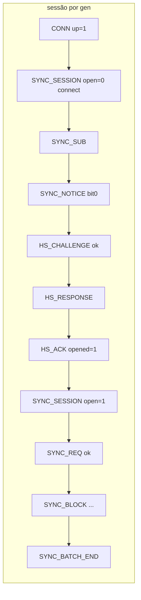

# 06 — Firmware: eventos de depuração (v2) e benchmark com e sem segurança

Estado implementado dos eventos de segurança/sincronização com duração
medida e das ferramentas de benchmark do perfil `none`/`hmac`/`asym`. Os
catálogos completos dos eventos estão em `esp32-firmware/docs/eventos.md`
(catálogo atual, em português) e `docs/debug-events.md` (especificação do
formato v2, em inglês); esta spec não os duplica.

## Convenções

- `FORMAT v=2` (`kFormatVersion = 2` em `src/rtos/SerialEventLog.cpp`), emitido ao abrir o log. Eventos só existem com `COLLECTOR_EVENTS`; sem a flag a classe `Event` é vazia.
- Durações de segurança e sincronização em **microssegundos**, em campos com sufixo `_us` (`Event::us`, `esp_timer_get_time()` via `IClock::nowUs()`; `rtos::ArduinoClock::nowUs()`). O campo `dur` (ms) dos eventos v1 não mudou. O intervalo medido termina antes de montar o evento: formatação e fila do logger nunca entram em `_us`.
- `crc` em hex de 8 dígitos (u32, mais significativo primeiro); tags em hex de 64/128 dígitos.
- `COLLECTOR_EVENTS_NO_HEX` (`kEventsHexEnabled = false`, seção `[bench]`) tira `hex` e `tag` do `FLUSH`. `Events.h`: `kLargeCapacity` = 2600.
- Linha que não cabe no buffer não é emitida.

## Eventos por origem

| Origem | Eventos |
|---|---|
| `CollectorApp.cpp` | `KEYS`, `BOOT`, `MARKER kind=boot`, `CONN` (`up`, `gen`) |
| `FlushTask::emitFlush` | `FLUSH` (`kind` data\|boot, `tag_len`, `reserved`, `reserve_us`, `sign_us`, `crc_us`, `write_us`, `dur`, `crc`, `hex`, `tag`) |
| `LittleFsBlockStore` | `LOG_MIGRATE`, `SEG_NEW` (`reason` first, full, boot, sealed, tag_len), `SEG_SEAL` (`write_fail`, `scan_tail`), `SEG_DROP` |
| `BleConnectivity` | `SYNC_MTU` |
| `SyncEngine` | `SYNC_SUB`, `SYNC_RX`, `SYNC_TX`, `SYNC_ERR`, `HS_CHALLENGE`, `HS_RESPONSE`, `HS_ACK`, `SYNC_SESSION`, `SYNC_NOTICE`, `SYNC_REQ`, `SYNC_BLOCK`, `SYNC_BATCH_END`, `SYNC_CURSOR`, `SYNC_FREE`, `SYNC_OVERFLOW`, `MARKER kind=loss` |
| `SyncTask` | `SYNC_RX reason=queue_full` (a partir de `syncRxDropped`) |
| `SerialEventLog` | `STACK` (tarefas `flush`, `acquisition`, `elm327`, `sync`, `pairing`), `HEAP`, `LOG_DROP` |

Removidos em relação à v1: `UP_SEND`, `UP_ACK`, `UP_REWIND`, `TIME_REQ`,
`TIME_RESP`, `TIME_REPORT` (substituídos por `SYNC_BLOCK`, `HS_ACK` +
`SYNC_FREE`, `SYNC_CURSOR` e `HS_RESPONSE`). `NET` permanece (informativo).
`KEYS.source` ∈ {`partition`, `dev_fixed`, `mac`, `missing`}.

## Reconstruções a partir do log

- **Sessão:** todo `HS_RESPONSE` tem `c_s` > `last_cs` do `HS_CHALLENGE` anterior; nenhum `SYNC_BLOCK` antes de `SYNC_SESSION open=1` da mesma `gen`; todo `SYNC_REQ result=no_session` é seguido de `SYNC_ERR dir=tx code=05`.
- **Cursor:** começa em `ack + 1` do `SYNC_CURSOR reason=connect`; cada `SYNC_BLOCK` tem `seq` = cursor e `cursor` = `seq + 1` (ou `to + 1` do `MARKER kind=loss` anterior); saltos só com `SYNC_CURSOR`.
- **Auditoria de `seq`:** `FLUSH ok=1` e `BOOT` estritamente crescentes; todo inteiro de 1 ao último `seq` está num `FLUSH ok=1`, numa faixa `[from,to]` de BOOT ou de `MARKER kind=loss`. (Não há script `seq_audit`; a conferência é manual ou pelo viewer.)

## Benchmark

Envs (`platformio.ini`), todos do perfil de hardware `dev` (NVS em claro, então `reserve_us`/`nvs_us` não incluem AES-XTS):

| Env | Base | Flags |
|---|---|---|
| `collector_mock_bench_{none,hmac,asym}` | `collector_mock_debug` | `-DSECURITY_PROFILE=0\|1\|2` + `-DCOLLECTOR_EVENTS_NO_HEX` |
| `collector_twai_bench_{none,hmac,asym}` | `collector_twai_debug` | idem |
| `collector_mock_debug_{none,asym}` | `collector_mock_debug` | só o perfil, com hex completo |

Seções `[sec_none]`, `[sec_hmac]`, `[sec_asym]`, `[bench]`. Variáveis de vazão a
registrar: `CONFIG_BT_NIMBLE_MSYS1_BLOCK_COUNT` (24) e `SYNC_TX_MAX_CREDITS` (4).

Ferramentas:

| Ferramenta | Função |
|---|---|
| `esp32-firmware/tools/event-bench/capture.py` | Captura da serial (921 600 baud) só das linhas `EV`, com carimbo do PC. |
| `esp32-firmware/tools/event-bench/bench_report.py` | Lê logs e gera `bench.csv`/`bench.md` (média, p50, p95, máx., n); fixture `tools/event-bench/tests/sample.log`. |
| `esp32-firmware/tools/sync-bench/sync_bench.py` | Cliente BLE de bancada (ver `05`). |
| `tools/event-viewer/` (raiz do repo) | Viewer HTML do log; `flash-impact.js`. |

Métricas calculadas por `bench_report.py`:

| # | Métrica | Fonte |
|---|---|---|
| B1 | custo de assinatura por bloco e por byte | `FLUSH.sign_us`, `len` |
| B2 | custo do CRC (gravação e leitura) | `FLUSH.crc_us`, `SYNC_BLOCK.crc_us` |
| B3 | duração do flush e soma `reserve+sign+crc+write` | `FLUSH.dur`, `*_us` |
| B4 | handshake no dongle | `HS_RESPONSE.total_us`/`nvs_us`, `HS_CHALLENGE.verify_us`, `HS_ACK.verify_us` |
| B6 | vazão do lote (kB/s) | `SYNC_BATCH_END.bytes / dur_us` |
| B8 | leitura + validação | `SYNC_BLOCK.read_us + crc_us` |
| B9 | custo de segurança por bloco | `sign_us + crc_us (+ crc_us do envio)` |
| B10 | latência de confirmação | `FLUSH seq` → primeiro `HS_ACK` com `ack ≥ seq` |
| B11 | descartes | contagem de `SEG_DROP` / `SYNC_OVERFLOW` |
| B12 | pilha/heap mínimos | `STACK`, `HEAP` |

## Testes

`test_events` cobre o formato por tipo de valor, tempo explícito, linha que
não cabe e eventos do `Collector`; `test_sync_engine` e `test_block_format`
afirmam linhas e campos `*_us` com `FakeClock` (`us` controlável). Não há teste
de `bench_report.py` além da fixture `sample.log`.
