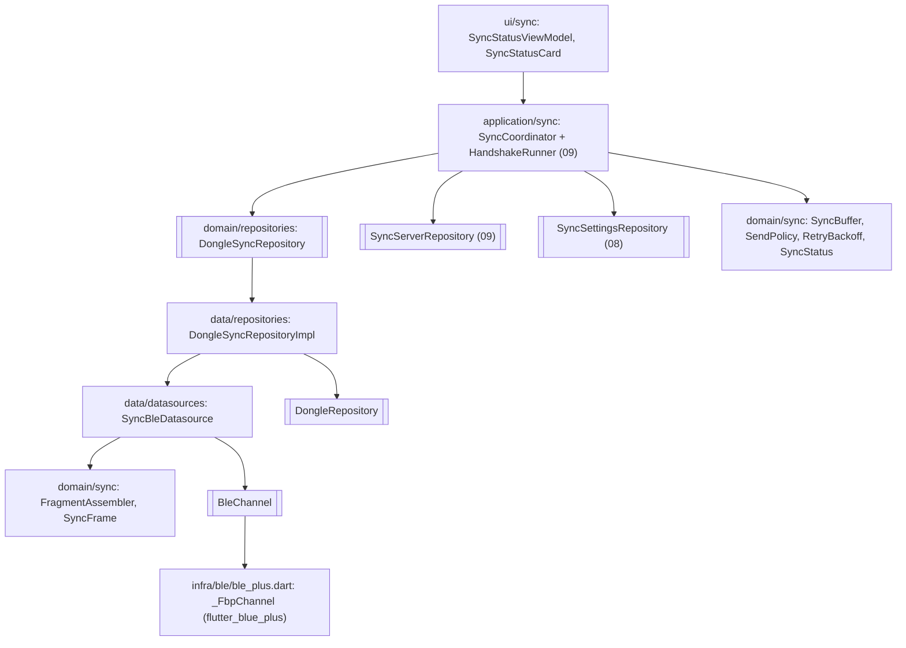
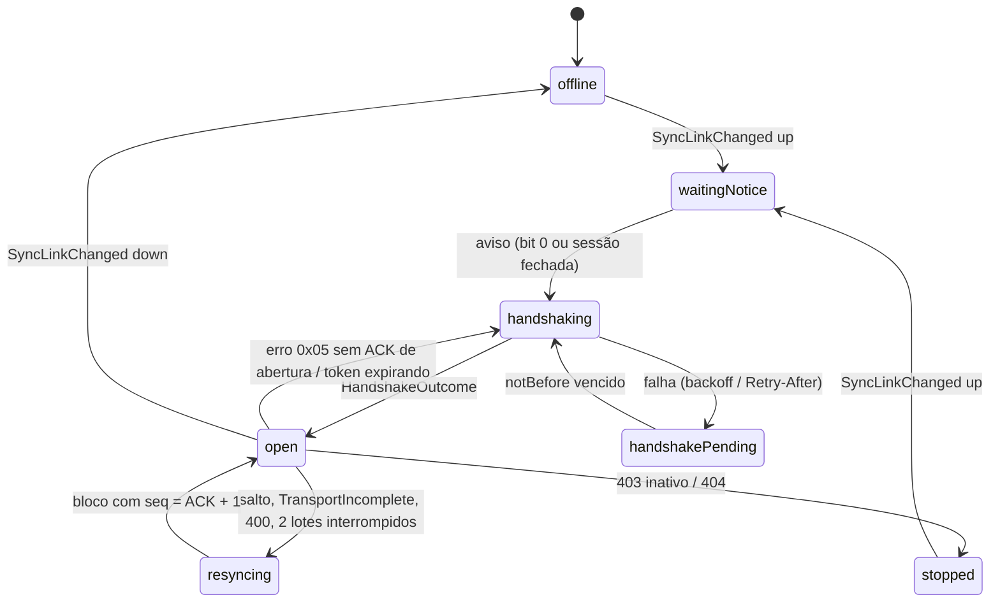

# 07 — App: canal SYNC, remontagem, buffer de blocos e coordenação da leitura contínua

Estado implementado no app Flutter (`mobile-app/lib/src/`): canal BLE SYNC
sobre o mesmo link do NUS, remontagem de fragmentos, buffer de blocos,
regra de envio, espelho do cursor do dongle e o `SyncCoordinator` que
orquestra a leitura contínua (Fig. 15) e o aviso de novo bloco (Fig. 14).
O lado servidor passa pelo port da `09`. A camada PSK/AES-GCM legada foi
apagada (histórico na tag `versao-custom-secure-ble`).

## Camadas



## Port e adapter BLE

| Peça | Arquivo | Contrato |
|---|---|---|
| `BleChannelSpec` | `services/ble/ble_service.dart` | `serviceUuid`, `rxUuid`, `txUuid`, `writeWithResponse` (padrão `true`). |
| `BleService.connect` | idem | Parâmetros `deviceId`, `serviceUuid`, `rxUuid`, `txUuid`, `extraChannels`, `mtu`, `securingTimeout` (Fase 2). |
| `BleConnection.channel(serviceUuid)`, `.mtu` | `domain/ble/ble_connection.dart` | Canal extra pedido no `connect` ou `null`; MTU ATT (23 enquanto desconhecido). |
| `BleChannel` | idem | `incoming` (estável entre reconexões), `isReady`, `write`. |
| `_FbpChannel` | `infra/ble/ble_plus.dart` | Um `StreamController` *broadcast* criado no construtor da conexão; `onValueReceived.listen` **antes** de `setNotifyValue(true)` (o aviso 0x07 pode chegar dentro do `onSubscribe`); `write(..., withoutResponse: !writeWithResponse, allowLongWrite: writeWithResponse)`. Serviço ausente ⇒ `isReady = false` sem derrubar o NUS. |
| `SyncConfig` | `data/datasources/dongle_datasource.dart` | UUIDs `7A3C0001/0002/0003-9B1E-4F2A-8C5D-2E6F1A0B3C4D`; o `connect` passa o canal SYNC em `extraChannels`. |

## Domínio puro (`domain/sync/`)

| Arquivo | Conteúdo |
|---|---|
| `sync_protocol.dart` | `SyncMessageType`, `SyncErrorCode` (0x01–0x05, 0x07); constantes: `kMaxSyncValueLength` 1088, `kMaxBlocksPerPost` 32, `kFragmentTimeout` 2 s, `kHandshakeStepTimeout` 5 s, `kBatchStallTimeout` 3 s, `kTokenRenewMargin` 5 min, `kRetryMin` 1 s, `kRetryMax` 5 min. |
| `sync_frame.dart` | `SyncFrame {type, value}`, `toTlv()`, `parseTlv` (exige `L == len − 3`, `FormatException`), fábricas `batchRequest`, `error`. |
| `dev_id.dart` | `DevId` (8 B, hex maiúsculo). |
| `new_block_notice.dart` | `NoticeFlags {noHandshakeConnection, noHandshakeBoot, flashHigh}` (bits 0–2), `NewBlockNotice {headSeq, flags, devId}` (13 B). |
| `sync_block.dart` | `SyncBlock` (`seq`, `bootId`, `tMs`, `length`, `marker`, `fromSeq`, `toSeq`, `frame`, `lastCoveredSeq`); lê só o cabeçalho e o marcador, **não valida a tag**. |
| `handshake_messages.dart` | `ChallengeInfo`, `ResponseInfo`, `AckInfo` (só campos públicos). |
| `fragment_assembler.dart` | Remontagem (abaixo). |
| `sync_buffer.dart` | `SyncBuffer` e `BufferedBlock {block, readAt}`. |
| `send_policy.dart` | `SendPolicy.lotSize`. |
| `retry_backoff.dart` | 1 s, 2 s, 4 s ... teto 5 min, *jitter* de ±10 %, `reset()`. |
| `sync_status.dart` | `SyncPhase {offline, waitingNotice, handshaking, handshakePending, open, resyncing, stopped}`, `LatencySource {local, server}`, `SyncStatus` (inclui `bufferCapacity`, `effectiveLatency`, `latencySource`, `serverMode`, `postsOk`, `postsFailed`, `nextAttemptAt`, `lastError`). |
| `core/time/monotonic_clock.dart` | `MonotonicClock.now()` e `SystemMonotonicClock` (`Stopwatch`). |

### `FragmentAssembler`

`add(fragment, now)` devolve uma lista de `AssemblyOutcome`
(`AssemblyPending`, `AssemblyComplete(tlv)`, `AssemblyError(kind)`);
`checkTimeout(now)`; `assembling`.

| Situação | Resultado |
|---|---|
| Fragmento vazio | ignorado |
| Bit 7 = 1, ocioso | começa; contador ≠ 0 ⇒ `counterGap`; `L > maxValueLength` ⇒ `tooLong` |
| Bit 7 = 1 durante montagem | `startWhileAssembling` e começa a nova mensagem (duas saídas) |
| Bit 7 = 0, ocioso | `continuationWithoutStart` |
| Contador ≠ anterior + 1 (mod 128) | `counterGap`; descarta |
| Bytes > `3 + L` | `overflow` |
| Bytes = `3 + L` | `AssemblyComplete` |
| ≥ 2 s sem fragmento durante montagem | `timeout` |

## Repositório do dongle

`SyncBleDatasource` (`data/datasources/sync_ble_datasource.dart`) remonta o
`incoming` do canal (emite `InboundFrame` ou `InboundIncomplete`; um
`Timer.periodic(500 ms)` verifica o *timeout* só enquanto monta) e escreve
TLVs (`send`). Tipo desconhecido remontado é descartado com log, sem erro 0x04.

`DongleSyncRepository` (`domain/repositories/dongle_sync_repository.dart`):

| Membro | Descrição |
|---|---|
| `events` | `SyncLinkChanged(up, generation)`, `NoticeReceived`, `BlockReceived`, `ResponseReceived`, `DongleErrorReceived`, `TransportIncomplete` |
| `isLinkUp`, `linkGeneration`, `mtu` | estado do link |
| `sendChallenge(frame)` | exige tipo 0x01, `L` 45/47 |
| `sendAck(frame)` | exige tipo 0x04, `L` 25 |
| `requestBatch(k)` | 1..65 535 |
| `sendError(code)` | só 0x04 e 0x07 |

`DongleSyncRepositoryImpl(DongleRepository)` (`data/repositories/`) liga o
datasource à conexão pela **identidade** da conexão a cada fase: em `ready` com
canal pronto emite `up` com geração nova; em `reconnecting`, `disconnected` ou
`failed` emite `down`. Falhas de escrita viram `SyncLinkFailure`
(`core/errors/sync_failure.dart`).

## Buffer e regra de envio

`SyncBuffer` (ordenado por `seq`): `capacity` (`B_max`), `length`, `freeSlots`,
`inFlightCount`, `pendingCount`, `oldestPending`, `add` (falso se duplicado ou
cheio), `takeForPost(max)` (marca em voo, em ordem), `releaseInFlight`,
`removeUpTo(ack)`, `dropPending`.

`SendPolicy.lotSize` devolve 0 se há POST em voo, não há pendentes ou
`now < notBefore`; senão, se `pendentes ≥ maxPerPost` **ou** `flashHigh` **ou**
`now − oldestPending.readAt ≥ tLat`, devolve `min(pendentes, currentLotLimit, maxPerPost)`.

`T_lat` efetivo = `min(local, sugerido pelo servidor)` (`_effectiveLatency`); o
valor sugerido vem do `HandshakeOutcome` e vale até o próximo handshake.

## `SyncCoordinator` (`application/sync/sync_coordinator.dart`)

Construtor: `dongle`, `server`, `settings`, `handshake`, `clock`, `tickInterval`
(1 s), `wallClock`, `backoff`. API: `status`, `current`, `start()`, `dispose()`,
`forceHandshake()`.

### Fluxo de leitura contínua

```mermaid
sequenceDiagram
    participant D as Dongle (BleSyncLink)
    participant C as SyncCoordinator
    participant H as HandshakeRunner
    participant S as SyncServerRepository
    D-->>C: NoticeReceived (HEAD, flags)
    alt flags bit0 ou sessão fechada
        C->>C: drainThenHandshake (posta pendentes se o token vale)
        C->>H: run(devId, generation)
        H-->>C: outcome (ack de abertura, t_lat sugerido)
        C->>D: ACK já escrito pelo runner; session = open
    end
    C->>D: requestBatch(k = min(HEAD - lastRead, freeSlots, 65535))
    D-->>C: BlockReceived (seq = lastRead + 1) ...
    C->>C: buffer.add; evaluateSend a cada bloco/tick/aviso
    C->>S: postBlocks(até 32) quando T_lat vence, 32 pendentes ou flashHigh
    S-->>C: BlocksAccepted(ack)
    C->>D: sendAck(ack) (guardado se o link está caído)
    C->>C: buffer.removeUpTo(ack)
```

### Espelho do cursor e ressincronização

`expected = lastRead + 1`.

| Bloco recebido | Ação |
|---|---|
| `session ≠ open` | descarta |
| `seq == expected` | aceita; `lastRead = lastCoveredSeq` (`toSeq` no LOSS) |
| BOOT com `fromSeq == expected` e `seq > expected` | aceita (lacuna de boot) |
| `seq ≤ lastRead` | duplicata, ignora |
| outro salto | `resync(incompleteMessage)` |
| `resyncing` | só o bloco aceitável encerra a ressincronização; os demais são descartados sem novo erro |
| buffer cheio | log `BUFFER_FULL` e `resync(incompleteMessage)` |

`_resync(code)`: no máximo um erro por ressincronização; `sendError(code)`,
`buffer.dropPending()`, `lastRead = appAck ?? lastRead`, depois pedido de lote.
Sem bloco aceitável em `kBatchStallTimeout` o pedido é repetido.



### Eventos do dongle e resultados do POST

| Evento | Ação |
|---|---|
| `SyncLinkChanged(up)` | zera sessão, resync, lote, `openingAck`; `dropPending`; `lastRead = appAck`; fase `waitingNotice`. `down`: fase `offline`; o POST em voo continua e o ACK que voltar é guardado (`_heldAck`) para o próximo `up`. |
| erro 0x01 / 0x02 | `ensureHandshake` com *backoff* (se não há handshake em curso). |
| erro 0x03 | só log (não reescreve aquele ACK). |
| erro 0x05 | `session = none`; reescreve o ACK de abertura uma vez; senão `drainThenHandshake`. |
| `TransportIncomplete` | `resync(incompleteMessage)` se a sessão está aberta. |
| *tick* (1 s) | `evaluateSend`; lote parado ⇒ repete o pedido; handshake pendente vencido ⇒ `ensureHandshake`. |

| Resultado de `postBlocks` | Ação |
|---|---|
| `BlocksAccepted(ack)` | `onAck`; `releaseInFlight`; se `ack < último coberto do lote`: 2 interrupções seguidas no mesmo ACK ⇒ `resync(resendFromBoundary)` e espera de *backoff*; senão `lotLimit = 32`, `backoff.reset()`. |
| `Unauthorized` / `Forbidden` | `server.clearToken()`; `ensureHandshake(unauthorized)`. |
| `DongleBlocked` | fase `stopped`, `lastError`; não repete até reconectar ou ação manual. |
| `RateLimited(retryAfter)` | `notBefore = now + retryAfter`; `lotLimit` pela metade. |
| `PostUnavailable(retryAfter?)` | `notBefore = now + max(backoff.next(), retryAfter)`; `lotLimit` pela metade. |
| `MalformedRequest(code)` | `lastError`; `resync(resendFromBoundary)`. |

`ensureHandshake` reaproveita o `Future` em curso, respeita `notBefore`, captura
a `generation` e **descarta** o resultado se a geração mudou (`HS_DISCARDED`).
Falhas: `DongleBlockedFailure` ⇒ `stopped`; `RateLimitedFailure` ⇒ `retryAfter`;
`ChallengeUnavailable`/`ServerUnavailableFailure` ⇒ `max(backoff, retryAfter)`;
demais ⇒ `backoff.next()`.
`drainThenHandshake`: posta os pendentes (lotes até `lotLimit`) enquanto o
token vale, e só depois refaz o handshake (evita perder no OVERFLOW o que o app
já leu). Antes de cada POST, `server.needsHandshake(now, kTokenRenewMargin)`
dispara handshake.

Log: `debugPrint('SYNC <ms> <EVENTO> k=v ...')` só em `kDebugMode`
(`LINK`, `NOTICE`, `BLOCK`, `BATCH_REQ`, `RESYNC`, `POST`, `HS_OPEN`, ...).

## DI e UI

`ui/sync/sync_providers.dart`: `dongleSyncRepositoryProvider`,
`handshakeRunnerProvider`, `syncCoordinatorProvider` (cria, `start()`,
`ref.onDispose(dispose)`; observado pelo `ConnectionGuard`),
`syncStatusViewModelProvider`. `ui/sync/widgets/sync_status_card.dart` é o
cartão da aba "Mais" (abre a tela de configurações, ver `08`).

## Testes (`mobile-app/test/`)

| Arquivo | Cobre |
|---|---|
| `domain/sync/sync_frame_test.dart`, `fragment_assembler_test.dart`, `sync_block_test.dart`, `sync_buffer_test.dart`, `retry_backoff_test.dart`, `sync_settings_test.dart` | TLV, remontagem (vetor de 3 fragmentos, gaps, timeout, contador cíclico), marcadores, buffer, *backoff* |
| `data/datasources/sync_ble_datasource_test.dart` | frames, timeout 2 s, `send` |
| `data/repositories/dongle_sync_repository_impl_test.dart` | aviso antes do `setNotifyValue`, `up`/`down` por geração, canal ausente |
| `application/sync/sync_coordinator_test.dart` | handshake, lotes, POST, ressincronização, erros do dongle, 401/429/5xx, reconexão, geração antiga descartada, token expirando, drain |
| `application/sync/handshake_runner_test.dart` | ver `09` |
| `support/fake_ble_channel.dart`, `fake_dongle.dart`, `fake_monotonic_clock.dart`, `fake_sync_server_repository.dart` | dublês |
