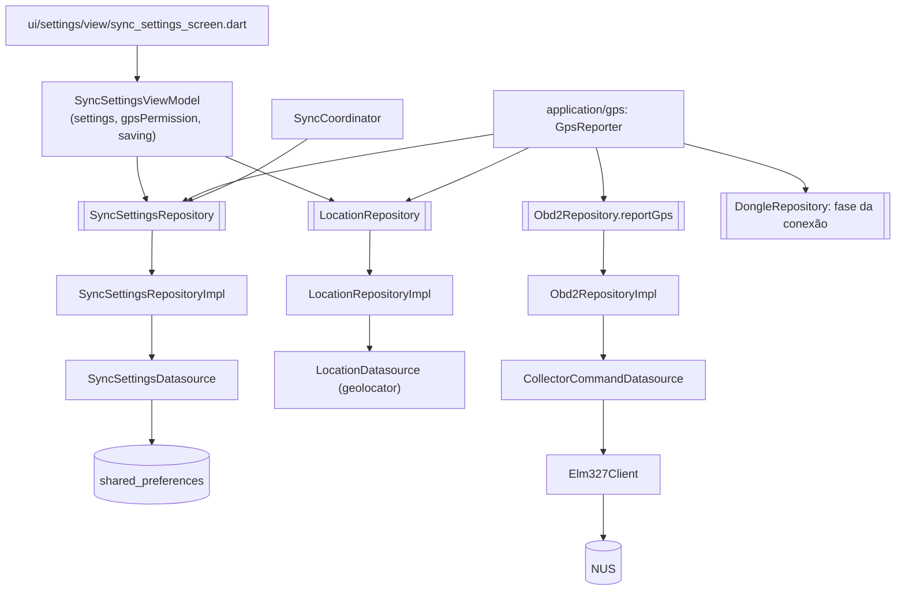
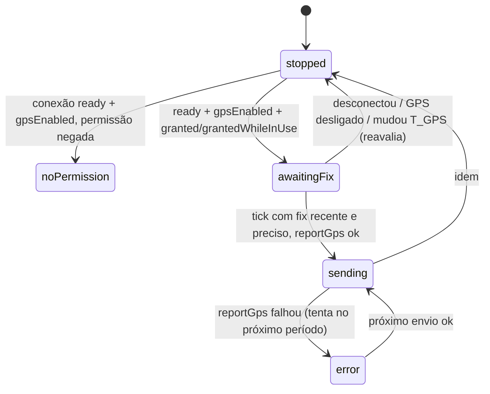

# 08 — App: configurações de sincronização (`T_lat`, `B_max`, `T_GPS`) e envio periódico de GPS

Estado implementado no app: tela "Sincronização" (aba "Mais") com os
parâmetros do envio com buffer, persistência em `shared_preferences`, e o
`GpsReporter` que envia `AT#GPS lat lon alt` ao dongle pelo NUS a cada
`T_GPS`, também em segundo plano.

## Componentes

| Camada | Arquivo (`mobile-app/lib/src/`) |
|---|---|
| Modelo | `domain/sync/sync_settings.dart` |
| Datasource | `data/datasources/sync_settings_datasource.dart` (`readInt/readBool/writeInt/writeBool`, sem conhecer o modelo) |
| Repository | `domain/repositories/sync_settings_repository.dart` (`current`, `watch()`, `save`), `data/repositories/sync_settings_repository_impl.dart` (monta o modelo, `clamped()`, erro de escrita ⇒ `SettingsWriteFailure`) |
| View model / tela | `ui/settings/view_model/sync_settings_view_model.dart`, `ui/settings/view/sync_settings_screen.dart`, `ui/settings/settings_providers.dart` |
| Localização | `domain/location/gps_fix.dart`, `domain/repositories/location_repository.dart`, `data/datasources/location_datasource.dart` (único arquivo que importa `geolocator ^14.1.2`), `data/repositories/location_repository_impl.dart`, `core/errors/location_failure.dart` |
| Envio | `data/datasources/collector_command_datasource.dart`, `Obd2Repository.reportGps`, `application/gps/gps_reporter.dart`, `ui/gps/gps_providers.dart` |

## Parâmetros

| Parâmetro | Chave `shared_preferences` | Padrão | Faixa / passo na tela |
|---|---|---|---|
| `T_lat` | `sync_t_lat_s` | 60 s | 10–300 s, passo 10 |
| `B_max` | `sync_b_max` | 64 | 64–512, passo 32 |
| `T_GPS` | `gps_period_s` | 1 s | 1–60 s, passo 1 |
| GPS ligado | `gps_enabled` | `true` | — |
| Espera entre tentativas | constante (`kRetryMin`/`kRetryMax`) | 1 s a 5 min | não editável |

`SyncSettings.clamped()` ajusta valores fora da faixa (lidos do
armazenamento) e o repository os regrava. `B_max` mínimo 64 = 2 × 32 (lote
máximo por POST).

Efeito ao mudar: o `SyncCoordinator` assina `settings.watch()` e atualiza a
capacidade do buffer e reavalia envio e pedido de lote imediatamente; o
`GpsReporter` reinicia se `gpsEnabled` ou `gpsPeriod` mudam.

## Tela `SyncSettingsScreen` (rota `/sync-settings`)

| Seção | Conteúdo |
|---|---|
| "Envio ao servidor" | `NumberStepper` "Latência máxima (T_lat)" e "Buffer (B_max)"; `Callout` com as novas tentativas fixas. |
| "Posição (GPS)" | `SegmentedToggle` ligado/desligado, `NumberStepper` "Período (T_GPS)", estado da permissão e botão para pedir (rótulo "Permitir também em segundo plano" com `grantedWhileInUse`). |
| "Estado" | Resumo do `SyncStatus` (`SyncStatusCard`). |
| "Depuração" (só `kDebugMode`) | "Forçar handshake" e "Esquecer estado no servidor de bancada". |

A aba "Mais" (`ui/more/view/more_screen.dart`) tem um `CardButton`
"Sincronização" (subtítulo vindo de `syncSettingsSummaryProvider`) e o
`SyncStatusCard` logo abaixo; ambos levam a `AppRoutes.syncSettings`.

## Localização

`GpsFix` (`latE7`, `lonE7`, `altMm`, `accuracyM`, `at` monotônico):
`fromDegrees` faz `round` e `clamp` às faixas do parser do firmware (lat
±900 000 000, lon ±1 800 000 000, alt int32); `toAtCommand()` =
`'AT#GPS $latE7 $lonE7 $altMm'`.

`LocationPermissionState`: `granted` ("o tempo todo"), `grantedWhileInUse`,
`denied`, `deniedForever`, `serviceDisabled`.

`LocationRepository`: `permission()`, `requestPermission()`,
`fixes({interval, background = false})`. Com `background` (permissão
`granted`) o datasource ativa `allowBackgroundLocationUpdates` e
`showBackgroundLocationIndicator` no iOS e `foregroundNotificationConfig`
(serviço em primeiro plano) no Android.

Plataformas:

| Plataforma | Declarado |
|---|---|
| Android `AndroidManifest.xml` | `ACCESS_FINE_LOCATION`, `ACCESS_COARSE_LOCATION`, `ACCESS_BACKGROUND_LOCATION`, `FOREGROUND_SERVICE`, `FOREGROUND_SERVICE_LOCATION`, `POST_NOTIFICATIONS` e o `<service>` do `geolocator` |
| iOS `Info.plist` | `NSLocationWhenInUseUsageDescription`, `NSLocationAlwaysAndWhenInUseUsageDescription`, `UIBackgroundModes`: `location`, `bluetooth-central` |

O app só pede permissão a partir da UI; o `GpsReporter` nunca abre diálogo.

## `reportGps` e `GpsReporter`

`Obd2RepositoryImpl.reportGps(fix)` usa o mesmo `Elm327Client` da telemetria e
do DTC (dois clientes na mesma conexão capturariam respostas um do outro) por
meio de `CollectorCommandDatasource.sendGps`: `command('AT#GPS …', timeout: 2 s)`;
resposta sem `OK` ⇒ `ObdCommandFailure`; sem conexão pronta ⇒ `ObdCommandFailure`.

`GpsReporter` (`GpsReportPhase`: `stopped`, `noPermission`, `awaitingFix`,
`sending`, `error`):

- Reavalia (`_reevaluate`) a cada mudança de fase da conexão e de `gpsEnabled`/`gpsPeriod`; cancela fluxo e timer antes.
- Assina `fixes(interval: T_GPS, background: permissão == granted)` e guarda o último *fix*; `Timer.periodic(T_GPS)`.
- No tick só envia se não há envio em curso, `age ≤ 2 × T_GPS` e `accuracyM ≤ kGpsMaxAccuracyM` (100 m).
- Falha do comando ⇒ status `error` e nova tentativa no período seguinte (sem *backoff*).
- `gpsReporterProvider` é observado pelo `ConnectionGuard` junto com o `syncCoordinatorProvider`.

Lado dongle: `AT#GPS` aceita no máximo 1 posição por segundo e descarta no
modo diagnóstico (`GPS_DROP`); eventos `CMD`, `GPS`, `REC kind=gps`.

## Testes

| Arquivo | Cobre |
|---|---|
| `test/domain/sync/sync_settings_test.dart` | padrões e `clamped()` |
| `test/data/repositories/sync_settings_repository_impl_test.dart` | padrões, releitura, ajuste e regravação, `watch` |
| `test/ui/settings/sync_settings_view_model_test.dart` | setters persistem, permissão |
| `test/application/gps/gps_reporter_test.dart` | conversão `GpsFix`, envio periódico com *fix* recente/preciso, sem permissão, GPS desligado/conexão fora de `ready` |
| `test/data/repositories/obd2_repository_impl_test.dart` | inclui `reportGps` |
| `test/support/fake_location_repository.dart` | dublê |
