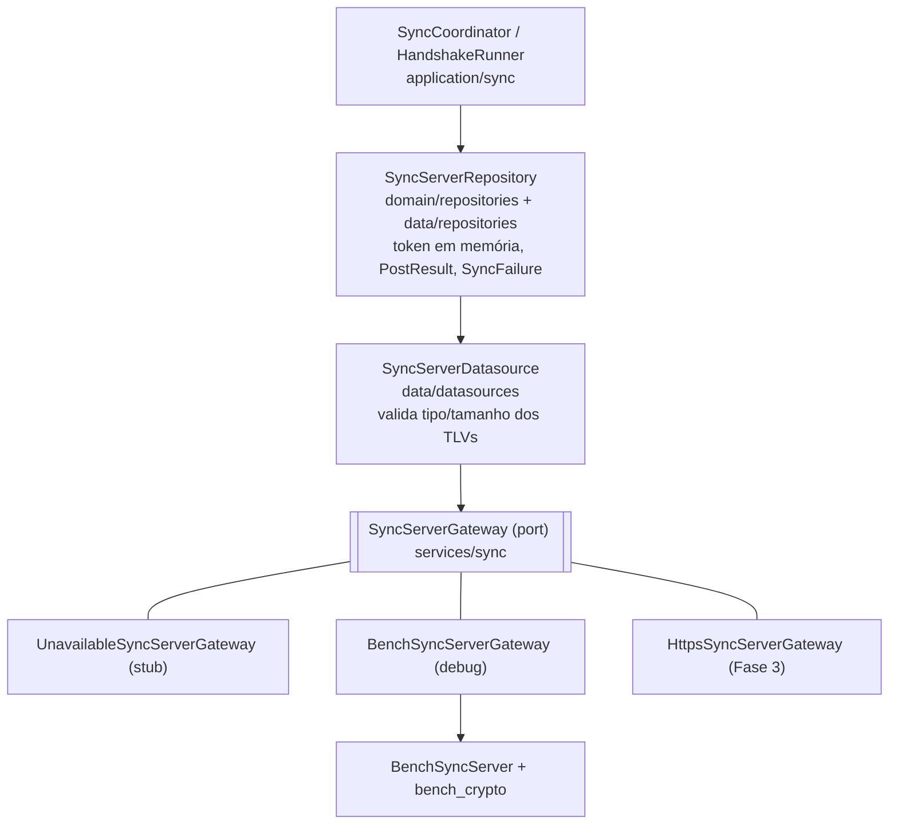
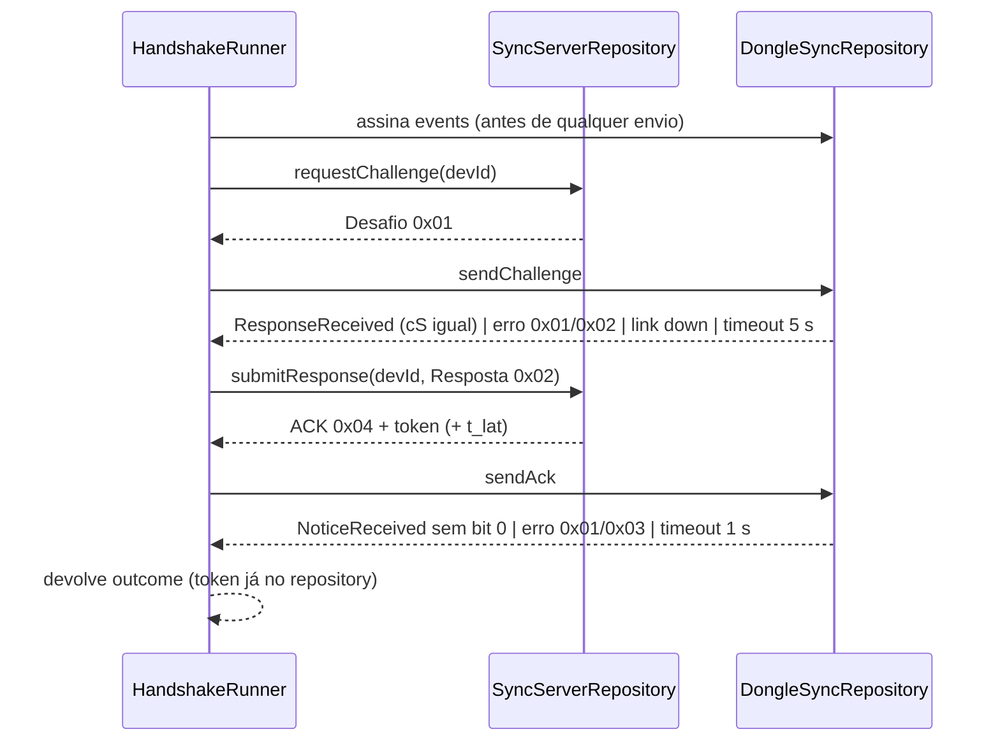

# 09 — App: port do servidor, handshake e servidor de bancada

Estado implementado no app da perna "servidor" do protocolo: o port
`SyncServerGateway` (contrato HTTP definido na Fase 3), as camadas
datasource/repository, o `HandshakeRunner` (perna BLE do handshake, Fig. 5) e
as implementações do port usadas em desenvolvimento (stub e servidor de
bancada). O gateway HTTPS real (`HttpsSyncServerGateway`) pertence à Fase 3.

## Camadas

Trocar de implementação é trocar um provider (`syncServerGatewayProvider`, em
`ui/sync/sync_providers.dart`).

## Port `SyncServerGateway` (`services/sync/sync_server_gateway.dart`)

| Método | HTTP (Fase 3) | Retorno |
|---|---|---|
| `mode` | — | `'stub'`, `'bench'` ou `'https'` (exibido na UI) |
| `requestChallenge(DevId)` | `POST /v1/dongles/{devId}/desafio` | `ChallengeEnvelope {challenge (TLV 0x01), expiresAt?}` |
| `submitResponse(DevId, SyncFrame)` | `POST /v1/dongles/{devId}/desafio/resposta` | `HandshakeEnvelope {ack (TLV 0x04), token, tokenExpiresAt, suggestedLatency?}` |
| `postBlocks(token, blocks)` | `POST /v1/dongles/blocos` (`Bearer`, `application/octet-stream`) | `SyncFrame` ACK 0x04 |
| `latestConfirmation(DevId, token)` | `GET /v1/dongles/{devId}/confirmacao` | `SyncFrame?` (o app não chama) |

O app transporta TLVs sem interpretá-los. Exceções do port
(`services/sync/sync_server_exceptions.dart`, base `SyncServerException`):

| Exceção | HTTP / `codigo` |
|---|---|
| `ServerUnauthorized(code)` | 401 `token_ausente`/`token_invalido`/`token_expirado` |
| `ServerForbiddenOtherDongle` | 403 `token_outro_dongle` |
| `ServerDongleBlocked(reason)` | 403 `dongle_inativo` / 404 `dongle_desconhecido` |
| `ServerNoConfirmation` | 404 `sem_confirmacao` |
| `ServerChallengeRejected(code)` | 409 `desafio_invalido`, `c_s_antigo` |
| `ServerResponseRejected(inconsistent)` | 422 `tag_invalida` / `resposta_inconsistente` |
| `ServerBatchNoProgress(ack)` | 422 `lote_sem_progresso` (corpo = TLV 0x04) |
| `ServerRateLimited(retryAfter)` | 429 |
| `ServerUnavailable(retryAfter?)` | 5xx, *timeout*, sem rede |
| `ServerMalformed(code)` | 400 / 413 / 415 |

`Base64Bytes` (`core/encoding/base64_bytes.dart`): base64 padrão RFC 4648 §4 com
*padding*; `decode` rejeita alfabeto URL-safe, falta de *padding* e tamanho não
múltiplo de 4 (`FormatException`).

## Datasource e repository

`SyncServerDatasource(SyncServerGateway)` repassa as chamadas e valida o que
volta (desafio: tipo 0x01 com `L` 45/47; ACK: tipo 0x04 com `L` 25), lançando
`ServerMalformed` fora do contrato.

`SyncServerRepository`:

| Membro | Descrição |
|---|---|
| `mode`, `token` | `SyncToken {value, expiresAt}` guardado só em memória |
| `needsHandshake(now, margin)` | token nulo ou expira em menos que `margin` |
| `requestChallenge(devId)` | lança `SyncFailure` |
| `submitResponse(devId, response)` | guarda o token; devolve `HandshakeOutcome {ack, token, suggestedLatency}` |
| `postBlocks(blocks)` | usa o token guardado; devolve `PostResult` |
| `clearToken()` | |

`PostResult`: `BlocksAccepted(ack)` (200 e 422 `lote_sem_progresso`),
`Unauthorized`, `Forbidden`, `DongleBlocked(reason)`, `RateLimited(retryAfter)`,
`PostUnavailable(retryAfter?)`, `MalformedRequest(code)`.
`SyncFailure` (`core/errors/sync_failure.dart`): `SyncLinkFailure`,
`ChallengeUnavailable`, `ChallengeRejected`, `ResponseRejected`,
`DongleBlockedFailure`, `RateLimitedFailure`, `ServerUnavailableFailure`,
`ServerContractFailure`, `HandshakeRejectedByDongle`, `HandshakeAckRejected`,
`HandshakeLinkLost`, `HandshakeTimeout`.

## `HandshakeRunner` (`application/sync/handshake_runner.dart`)

`run(devId, trigger:, generation:)` → `HandshakeOutcome`. `HandshakeTrigger`:
`noticeNoSession`, `noticeNoBootAnchor`, `tokenExpiring`, `unauthorized`,
`dongleNoSession`, `dongleRejected`, `anchorFailed`, `manual`. Parâmetros:
`stepTimeout` = `kHandshakeStepTimeout` (5 s), `confirmTimeout` = 1 s.

Falhas: erro 0x01/0x02 do dongle ⇒ `HandshakeRejectedByDongle`; queda do link ou
geração diferente em qualquer espera ⇒ `HandshakeLinkLost`; sem resposta em
5 s ⇒ `HandshakeTimeout`; erro 0x01/0x03 após o ACK ⇒ `HandshakeAckRejected`;
sem confirmação em 1 s o handshake conclui mesmo assim (um 0x05 no pedido de
lote corrige). Cada passo vai ao log `SYNC <ms> HS_STEP n=… trigger=…` (só em
`kDebugMode`).

## Implementações do port

### Seleção (`ui/sync/sync_providers.dart`)

`kSyncServerMode = String.fromEnvironment('SYNC_SERVER', defaultValue: 'https')`.

| Condição | Gateway |
|---|---|
| `kDebugMode` e `SYNC_SERVER=bench` | `BenchSyncServerGateway(BenchSyncServer(store: SharedPreferencesBenchStateStore), faults: BenchFaults.fromEnvironment())` |
| `kDebugMode` e `SYNC_SERVER=stub` | `UnavailableSyncServerGateway` |
| demais (inclui *release*) | `HttpsSyncServerGateway(SyncApiClient(syncDioProvider))` |

### Stub (`infra/sync/unavailable_sync_server_gateway.dart`)

`mode = 'stub'`; todos os métodos falham com `ServerUnavailable`. O
coordenador fica em `handshakePending` e o dongle segue gravando na flash.

### Servidor de bancada (`infra/sync/bench/`)

Arquivos: `bench_sync_server.dart` (lógica pura), `bench_sync_server_gateway.dart`
(`mode = 'bench'`, aplica atraso e falhas), `bench_crypto.dart` (HMAC-SHA256
com o pacote `crypto`, tags truncadas), `bench_keys.dart`, `bench_faults.dart`,
`bench_state_store.dart`.

| Item | Comportamento |
|---|---|
| Chaves | `DevId`/`K_auth`/`K_rec` fixos de bancada (`01`), ou `--dart-define=SYNC_BENCH_KAUTH=<hex64>` / `SYNC_BENCH_KREC=<hex64>`. |
| Estado | Por `DevId`: `lastAcceptedCs`, `ackSeq`, `head`; global: `lastIssuedCs`, lacunas (`BenchGap`: `from`, `to`, causa boot/loss/overflow), contadores. **Persistido** em `shared_preferences` (`bench_sync_server_state`, versão 1) e restaurado no início. `forgetDongles()` zera tudo menos `lastIssuedCs`. |
| Desafio | `cS = max(lastIssuedCs + 1, segundos Unix) & 0xFFFFFFFF`; `N_S` com `Random.secure()`; `ACK_seq = ackSeq`; `c_conf = lastAcceptedCs`; `flags = 0`; validade 60 s (`challengeValidity`). |
| Resposta | Confere a tag; `cS`/`N_S` desconhecidos, usados ou vencidos ⇒ `ServerChallengeRejected`; `TAIL > HEAD + 1` ou `HEAD` menor que o salvo ⇒ `ServerResponseRejected(inconsistent: true)`; `TAIL > ackSeq + 1` ⇒ lacuna OVERFLOW `[ackSeq+1, TAIL−1]` e `ackSeq = TAIL − 1`; `flags_a` = 1 se o desafio tem mais de 2 s (`anchorTolerance`). Token `bench.<devId>.<cS>` válido 1 h (`tokenValidity`); não preenche `suggestedLatency`. |
| Lote | Token válido (senão `ServerUnauthorized`/`token_expirado`); mais de 32 blocos ⇒ `ServerRateLimited(1 s)`; por bloco, em ordem: confere `L = tamanho + T`, `T ∈ {0, 32, 64}`; verifica a tag `K_rec` só quando `T` é o do perfil esperado (`blockTagLength`); `seq ≤ ackSeq` é ignorado sem interromper; `seq == ackSeq + 1` aceito (dados ⇒ `ackSeq = seq`; LOSS exige `from = seq` e avança para `to`; BOOT registra lacuna se `to ≥ from`); BOOT com `to == seq − 1` e `from ≤ ackSeq + 1` também aceito; qualquer outro interrompe. Sem progresso ⇒ `ServerBatchNoProgress(ack)`. Blocos sem tag verificada (`T` diferente do perfil) são contados como "não verificados". |
| Falhas injetáveis | `SYNC_BENCH_DELAY_MS`, `SYNC_BENCH_FAIL_503_EVERY`, `SYNC_BENCH_FAIL_401_EVERY`, `SYNC_BENCH_FAIL_429_EVERY` (a cada N chamadas). |

A tela de configurações (modo debug) tem "Esquecer estado no servidor de
bancada" (`SyncStatusViewModel` chama `benchSyncServerProvider.forgetDongles()`).
Não há verificação ECDSA no servidor de bancada.

## Testes

| Arquivo | Cobre |
|---|---|
| `test/core/encoding/base64_bytes_test.dart` | ida e volta; rejeita URL-safe e sem *padding* |
| `test/infra/sync/bench/bench_crypto_test.dart` | tags dos vetores (desafio, resposta, ACK, BOOT/LOSS) |
| `test/infra/sync/bench/bench_sync_server_test.dart` | desafio, resposta, TAIL/OVERFLOW, âncora, lotes, LOSS/BOOT, fora de ordem, tag errada, 429, token expirado |
| `test/data/repositories/sync_server_repository_impl_test.dart` | token e `needsHandshake`, mapeamento de exceções, validação do datasource |
| `test/application/sync/handshake_runner_test.dart` | fluxo feliz, rejeição 0x02, `cS` diferente, queda do link, geração diferente, ACK rejeitado, sem confirmação, servidor indisponível |
| `test/infra/sync/https_sync_server_gateway_test.dart` | gateway HTTPS (Fase 3) |
