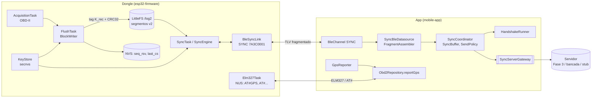

# Fase 1 — Firmware + App: segurança e telemetria via BLE (dongle ↔ app)

Documentação do estado implementado do trecho **dongle ↔ app** do documento
de segurança (`latex/aux-docs/seguranca-dongle-server/segunraca-dongle-server.tex`,
§4–5), com o app pronto para o servidor da Fase 3. Código em
`esp32-firmware/` e `mobile-app/`. Divergências em relação ao plano original:
[`DESVIOS-E-MELHORIAS.md`](DESVIOS-E-MELHORIAS.md).

## O que a fase entrega

| Entrega | Onde |
|---|---|
| Build único Arduino + ESP-IDF 4.4.7 para `dev`, `devsec` e `prod` (mesma tabela de partições; diferem só por `sdkconfig.*.defaults` e procedimento de eFuse) | `01` |
| Identidade e chaves (`DevId`, `K_auth`, `K_rec`, `k_sig`) na partição `secnvs`; perfis de bloco `none`/`hmac`/`asym` atrás de `IMessageAuth`; tag de handshake de 16 B | `01` |
| Bloco autenticado (Figs. 8–11): dados + tag + CRC32, marcadores BOOT/LOSS, log em segmentos v2 no LittleFS | `02` |
| Reserva de `seq` na NVS e BOOT em todo boot | `03` |
| Serviço BLE SYNC: TLV, byte de controle, fragmentação por MTU, créditos de notificação | `04` |
| Lado dongle do handshake (Fig. 5), cursor sem espera de ACK, lotes, aviso 0x07, erros da Tabela 5 | `05` |
| Eventos com duração `_us` e ferramentas de benchmark com e sem segurança | `06` |
| App: canal SYNC, remontagem, buffer, regra de envio, `SyncCoordinator` (Fig. 14/15) | `07` |
| App: configurações (`T_lat`, `B_max`, `T_GPS`) e GPS periódico (inclusive em segundo plano) | `08` |
| App: port do servidor, `HandshakeRunner`, stub e servidor de bancada | `09` |

## Arquitetura



Fluxos cobertos: **leitura contínua** (Fig. 15: aviso → pedido de lote →
blocos → buffer → POST → ACK → escrita do ACK no dongle → liberação da flash) e
**handshake app ↔ dongle** (Fig. 5: desafio do servidor repassado ao dongle,
resposta, ACK).

## Índice

| # | Documento | Conteúdo |
|---|---|---|
| 01 | [`01-firmware-chaves-e-autenticacao.md`](01-firmware-chaves-e-autenticacao.md) | Build único, perfis de segurança e de hardware, primitivas, `IMessageAuth`/`IHandshakeAuth`, `KeyStore`, partições, provisionamento, vetores |
| 02 | [`02-firmware-formato-bloco-flash.md`](02-firmware-formato-bloco-flash.md) | Bloco, registros, marcadores, segmento v2, `BlockWriter`, `IBlockStore` |
| 03 | [`03-firmware-nvs-seq-boot-loss.md`](03-firmware-nvs-seq-boot-loss.md) | `SeqReserve`, BOOT, `last_cs`, quedas de energia, *wipe* |
| 04 | [`04-firmware-servico-sync-ble.md`](04-firmware-servico-sync-ble.md) | GATT SYNC, layouts 0x01–0x07, fragmentação, `BleSyncLink` |
| 05 | [`05-firmware-handshake-e-cursor.md`](05-firmware-handshake-e-cursor.md) | `SyncEngine`/`SyncTask`: sessão, handshake, cursor, LOSS, BOOT gap, flash cheia |
| 06 | [`06-firmware-eventos-benchmark.md`](06-firmware-eventos-benchmark.md) | Eventos v2, perfis de benchmark, ferramentas |
| 07 | [`07-app-sync-ble-e-buffer.md`](07-app-sync-ble-e-buffer.md) | Canal SYNC no app, remontagem, buffer, `SyncCoordinator` |
| 08 | [`08-app-configuracoes-e-gps.md`](08-app-configuracoes-e-gps.md) | Configurações e `GpsReporter` |
| 09 | [`09-app-molde-handshake.md`](09-app-molde-handshake.md) | Port do servidor, `HandshakeRunner`, stub e servidor de bancada |
| — | [`DESVIOS-E-MELHORIAS.md`](DESVIOS-E-MELHORIAS.md) | Desvios do plano e melhorias possíveis |

Decisões e contratos transversais: [`../README.md`](../README.md). Eventos do
firmware: `esp32-firmware/docs/eventos.md` e `docs/debug-events.md`.

## Como verificar

```
cd esp32-firmware && pio test -e native      # test_crypto, test_block_format, test_seq_reserve,
                                             # test_sync_protocol, test_sync_engine, test_events, ...
cd mobile-app && fvm flutter test            # domain/sync, data, application, ui
```

Em bancada: firmware `collector_mock_debug` e app em *debug* com
`--dart-define=SYNC_SERVER=bench` (servidor de bancada embutido, ver `09`);
logs com `tools/event-bench/capture.py` e `tools/sync-bench/sync_bench.py`.
