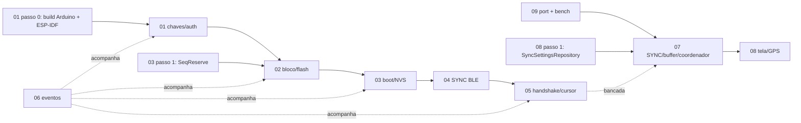

# Fase 1 — Firmware + App: integração de segurança e telemetria via BLE

## Objetivo

Levar ao firmware do dongle e ao app tudo o que o documento de segurança
(`latex/aux-docs/seguranca-dongle-server/segunraca-dongle-server.tex`, §4–5)
especifica para o trecho **dongle ↔ app**, deixando o app pronto para o
servidor da Fase 3:

- **passo 0:** firmware inteiro migrado para Arduino como componente do
  ESP-IDF, para que **o mesmo código, o mesmo *build* e a mesma tabela de
  partições** sirvam a desenvolvimento, ensaio (`devsec`) e produção — a
  diferença entre eles é só um arquivo de *defaults* do `sdkconfig` e o
  procedimento de gravação/queima de eFuse;
- identidade e chaves do dongle (`DevId`, `K_auth`, `K_rec`) em NVS
  encriptada nos três perfis, com as camadas de *flash encryption*, Secure
  Boot V2 e eFuse ensaiadas no `devsec` e documentadas para o `prod`;
- bloco de dados no formato das Figs. 8–11, autenticado na gravação
  (HMAC-SHA256 com `K_rec` + CRC32), atrás de uma interface genérica com
  perfis `none`/`hmac`/`asym` para benchmark;
- reserva de `seq` na NVS e blocos marcadores BOOT (gravado) e LOSS (gerado
  no envio);
- serviço BLE **SYNC** (TLV, byte de controle, fragmentação por MTU);
- lado dongle do handshake (desafio → resposta → ACK), cursor de envio sem
  espera de ACK, pedido de lote, aviso de novo bloco, erros da Tabela 5;
- no app: canal SYNC, remontagem, buffer com `T_lat`/`B_max`, espelho do
  cursor, erros, configurações, GPS periódico, e o **molde** do handshake
  com o servidor (port + stub + servidor de bancada);
- eventos de depuração com duração para o **benchmark com e sem segurança**.

## Entregas

| Entrega | Figura do documento | Onde |
|---|---|---|
| **Leitura contínua**: aviso → pedido de lote → blocos fragmentados → buffer → POST por `T_lat`/32 → ACK → flash liberada | Fig. 15 (e Fig. 14 para o ramo do aviso/handshake pendente) | specs 04, 05, 07 (+ servidor de bancada da 09) |
| **Handshake, só a parte app ↔ dongle**: Desafio 0x01 repassado ao dongle → Resposta 0x02 → ACK 0x04 escrito no dongle, com o servidor atrás de um port | Fig. 5 | specs 05, 09 |

"Pronto" para a fase = os dois fluxos funcionando na bancada com o dongle
real (ou `collector_mock_debug`) e o app usando o servidor de bancada
embutido, mais os testes nativos e do Flutter verdes.

## Specs

| # | Spec | Resumo |
|---|---|---|
| 01 | [`01-firmware-chaves-e-autenticacao.md`](01-firmware-chaves-e-autenticacao.md) | **Passo 0: build único Arduino + ESP-IDF** (§9); perfis `SECURITY_PROFILE`, primitivas (SHA-256, HMAC, CRC32, tempo constante), `IMessageAuth` (`NoAuth`/`HmacBlockAuth`/`EcdsaBlockAuth`), `IHandshakeAuth`, `KeyStore` na partição `secnvs` sempre por NVS encryption, perfis de hardware `dev`/`devsec`/`prod` (mesmo firmware, diferença = `sdkconfig.*.defaults` + procedimento), tabela de partições única, passo a passo com `espsecure`/`espefuse`/`nvs_partition_gen`, `provision.py`, vetores de teste. |
| 02 | [`02-firmware-formato-bloco-flash.md`](02-firmware-formato-bloco-flash.md) | Área de dados (Fig. 10), registros e marcadores (Fig. 11), `Block` com tag/CRC, registro na flash `dados\|tag\|CRC`, segmento v2 versionado, `BlockWriter` (assina + CRC), `IBlockStore` v2, `LittleFsBlockStore` v2 e migração. |
| 03 | [`03-firmware-nvs-seq-boot-loss.md`](03-firmware-nvs-seq-boot-loss.md) | `SeqReserve` (`seq + N` a cada N), recuperação no boot, bloco BOOT em todo boot, `last_cs`, `boot_id` sem zero, migração de `last_seq`, quedas de energia. |
| 04 | [`04-firmware-servico-sync-ble.md`](04-firmware-servico-sync-ble.md) | GATT SYNC, layouts byte a byte das mensagens 0x01–0x07, TLV, byte de controle e fragmentação, `BleSyncLink` com créditos de notificação, fila `syncRx`, remoção do canal antigo. |
| 05 | [`05-firmware-handshake-e-cursor.md`](05-firmware-handshake-e-cursor.md) | `SyncEngine` + `SyncTask`: desafio/resposta/ACK, sessão por conexão, cursor, lotes, LOSS/BOOT gap, TAIL efetivo, flash cheia, avisos, erros, comandos de bancada, `sync_bench.py`. |
| 06 | [`06-firmware-eventos-benchmark.md`](06-firmware-eventos-benchmark.md) | Catálogo de eventos v2 (µs em `_us`), eventos removidos, plano do `docs/debug-events.md` v2, reconstruções, envs e protocolo de benchmark, métricas B1–B12, scripts. |
| 07 | [`07-app-sync-ble-e-buffer.md`](07-app-sync-ble-e-buffer.md) | Port/adapter BLE com canais extras, `domain/sync` puro (TLV, remontagem, buffer, regra de envio), `SyncBleDatasource`, `DongleSyncRepository`, `SyncCoordinator`, UI de estado, PSK legado desligado. |
| 08 | [`08-app-configuracoes-e-gps.md`](08-app-configuracoes-e-gps.md) | Tela "Sincronização" (`T_lat`, `B_max`, `T_GPS`), persistência, `geolocator`, permissões, `reportGps` (`AT#GPS`), `GpsReporter`. |
| 09 | [`09-app-molde-handshake.md`](09-app-molde-handshake.md) | Port `SyncServerGateway` (contrato da Fase 3), exceções HTTP, base64, `SyncServerRepository`, `HandshakeRunner`, stub e servidor de bancada. |

## Ordem de implementação e dependências

Firmware (um engenheiro):
0. **01 passo 0** (spec 01 §9.5): todos os envs em `framework = arduino, espidf`,
   tabela de partições única, `CMakeLists.txt`/`sdkconfig.defaults` e o ajuste
   do `nvs_flash` (§9.3). *Timebox* de ~2 dias; *checkpoint*: o firmware atual
   compila e roda sobre Arduino + ESP-IDF — coleta, NUS BLE, LittleFS, NVS —
   **antes de qualquer código de segurança**; senão, planos B1/B2 do §9.5.
   Toda placa de bancada passa por `erase_flash` uma vez.
1. **01** passos 1–4 (primitivas, interfaces, mbedTLS, `KeyStore`, provisionamento dev).
2. **03** passo 1 (`SeqReserve`) → **02** passos 1–5 (com **03** passos 2–4 junto do `BlockWriter`).
3. **04** passos 1–3 (codec, fila, `BleSyncLink`).
4. **05** passos 1–7 (motor, tarefa, bancada).
5. **06** passos 3–5 (documento v2, scripts de benchmark, viewer) — os eventos em si entram em cada spec.
6. **01** passos 5–7 (perfil `asym`, ensaio `devsec` em placa descartável e,
   opcionalmente, `prod` de demonstração) — pode correr em paralelo a partir
   do passo 3.

App (outro engenheiro, em paralelo; usa os vetores da spec 01 e dublês até o firmware ficar pronto):
1. **07** passos 1–2 (port/adapter com canais; PSK legado desligado).
2. **07** passos 3–4 (`domain/sync`, datasource, repository).
3. **09** passos 1–3 (port, repository, servidor de bancada, `HandshakeRunner`).
4. **08** passo 1 (modelo + datasource + repository de configurações — o
   coordenador depende do `SyncSettingsRepository`).
5. **07** passos 5–6 (coordenador, providers, UI) e **09** passo 4.
6. **08** passos 2–5 (tela; depois GPS).

Dependências entre lados: só os **formatos** (specs 01 §12, 02 §3, 04 §3–5),
fixados antes de qualquer código. O app pode ser desenvolvido inteiro contra
o `FakeDongle`; a validação ponta a ponta exige o firmware até a spec 05.

## Critérios de aceite da fase

1. `pio test -e native` verde, com as suítes novas `test_crypto`,
   `test_block_format`, `test_seq_reserve`, `test_sync_protocol`,
   `test_sync_engine` e `test_events` atualizada; `pio run` verde em todos os
   envs (`collector_*`, `*_debug`, `*_bench_*`, `collector_mock_devsec`,
   `collector_twai_prod`), **todos** com `framework = arduino, espidf` e a
   mesma `partitions_collector.csv`; `devsec`/`prod` diferem do env de origem
   só por `board_build.cmake_extra_args`.
2. `fvm dart format --output=none --set-exit-if-changed .`,
   `fvm flutter analyze` ("No issues found!") e `fvm flutter test` verdes.
3. Roteiro de bancada abaixo (E0–E12) executado e registrado (logs de
   eventos guardados em `esp32-firmware/logs/fase1/`).
4. Auditoria `seq_audit` e reconstrução de cursor (spec 06 §6) sem
   divergência num log de 1 h de leitura contínua.
5. Benchmark (spec 06 §7) com os três perfis e relatório `bench.md` gerado.
6. `docs/debug-events.md` v2 e `esp32-firmware/src/connectivity/README.md`
   atualizados; `docs/plano-coleta.md` com nota de substituição.
7. Ensaio `devsec` em placa descartável (spec 01 §10.2) com `espefuse.py
   summary` antes/depois registrado **ou** limitação registrada conforme os
   planos B da spec 01 §9.5; `prod` documentado (§10.3) e, se houver placa
   dedicada, demonstrado.
8. Passo 0 concluído: firmware atual validado sobre Arduino + ESP-IDF
   (spec 01 §9.5) antes do código de segurança.

## Roteiro de validação ponta a ponta (bancada)

Montagem: dongle com `collector_mock_debug` (perfil de hardware `dev`,
`SECURITY_PROFILE` `hmac`, chaves fixas de bancada) ou `collector_twai_debug`
+ ECUSim, gravado depois de um `erase_flash` (passo 0); serial a 921 600 baud capturada
com `tools/event-bench/capture.py`; app em *debug* com
`fvm flutter run --dart-define=SYNC_SERVER=bench`; na tela Sincronização,
`T_lat = 10 s` para encurtar o roteiro.

| # | Cenário | Como | Esperado (eventos do dongle / app) |
|---|---|---|---|
| E0 | Build único (passo 0) | Firmware atual sobre Arduino + ESP-IDF, `erase_flash` + `upload` | Coleta, NUS, LittleFS e NVS como antes da migração; com o código da spec 01: `[sec] fe=off sb=0 … nvs_enc=1`. |
| E1 | Boot limpo | `COLLECTOR_WIPE_ON_BOOT` uma vez | `FORMAT v=2`, `KEYS source=dev_fixed fe=off sb=0`, `MARKER kind=boot seq=1 from=1 to=0`, `FLUSH kind=boot`. |
| E2 | Coleta offline | 2 min sem app | `FLUSH kind=data tag_len=32` a cada ≤ 10 s; nenhum `SYNC_*`. |
| E3 | Handshake (Fig. 5) | Abrir o app e conectar | `CONN up=1`, `SYNC_SUB`, `SYNC_NOTICE flags=03`, `HS_CHALLENGE result=ok`, `HS_RESPONSE`, `HS_ACK opened=1`, `SYNC_NOTICE flags=00`; app em fase `open`. |
| E4 | Leitura contínua (Fig. 15) | Deixar 5 min | `SYNC_REQ` após cada aviso; `SYNC_BLOCK` em ordem; a cada ~`T_lat` um `HS_ACK advanced=1` + `SYNC_FREE`; cartão do app com `ACK` acompanhando `HEAD` com atraso ≤ `T_lat + 10 s + RTT`. |
| E5 | GPS | Permissão concedida, `T_GPS = 1 s` | `CMD txt="AT#GPS …"`, `GPS`, `REC kind=gps` ~1/s; nenhum `GPS_DROP reason=rate`. |
| E6 | Reconexão | Desligar e ligar o Bluetooth do celular | Novo `CONN`, `SYNC_CURSOR reason=connect`, novo handshake; servidor de bancada sem blocos rejeitados. |
| E7 | Queda de energia | Desligar o dongle no meio do fluxo e religar | `BOOT` com `[último + 1, R − 1]`, `FLUSH kind=boot`; servidor de bancada registra lacuna BOOT e o ACK segue. |
| E8 | Corrompimento | App desconectado; `AT#CORRUPT n` (via app de terminal BLE ou `sync_bench.py`); reconectar | `MARKER kind=loss reason=crc seq=n`, `SYNC_BLOCK kind=loss`; lacuna LOSS no servidor de bancada; ACK passa de `n`. |
| E9 | Mensagem incompleta e erros | `sync_bench.py --scenario` `incomplete`, `replay`, `badtag`, `nosession`, `badack` | Lote seguinte recomeça em `ACK + 1`; erros 0x02, 0x01, 0x05, 0x03 respectivamente. |
| E10 | Flash cheia com sessão aberta | Build com `-DBLOCK_LOG_LIMIT_BYTES=65536`, `AT#FLUSH 1000`, app com `SYNC_BENCH_FAIL_503_EVERY=1` | `SEG_DROP`, `SYNC_OVERFLOW`, aviso com bit 0, `SYNC_REQ result=no_session` + erro 0x05; novo handshake com `TAIL` maior; servidor registra OVERFLOW. |
| E11 | Flash > 80 % | Mesmo build, app desconectado | Ao reconectar, aviso com bit 2; app posta sem esperar `T_lat`. |
| E12 | Servidor indisponível | `--dart-define=SYNC_SERVER=stub` | App em "handshake pendente" com espera 1 s → 5 min; nenhum pedido de lote; dongle segue gravando (Fig. 14, ramo sem conexão). |

## Decisões principais (detalhe nas specs)

| Decisão | Spec |
|---|---|
| Mesmo firmware em dev, `devsec` e prod: todos os envs em Arduino como componente do ESP-IDF (o Arduino 2.0.17 pré-compilado não tem NVS encryption, *flash encryption* nem Secure Boot); diferença entre perfis = `sdkconfig.devsec.defaults`/`sdkconfig.prod.defaults` via `board_build.cmake_extra_args` + procedimento de eFuse; migração é o passo 0 da fase | 01 |
| Tabela de partições única (tabela em `0x10000`, `nvs`, `nvs_key`, `secnvs`, app de 1,8 MB alinhado a 64 KB, 2 MB de LittleFS); `partitions_collector_prod.csv` não existe | 01 |
| NVS encryption nos três perfis (`KeyStore` com um só caminho); no `dev` a `nvs_key` fica legível — sem proteção real, só valida o código; `Preferences`/`NvsStore` e *bonds* na `nvs` ficam cifrados sem mudança de código | 01 |
| Chaves em partição NVS própria (`secnvs`), separada do estado do protocolo | 01 |
| Perfil `asym` = ECDSA P-256 determinística, `r‖s` de 64 B (mbedTLS 2.28 não tem Ed25519); handshake sempre HMAC de 16 B | 01 |
| LittleFS não cifrado (integridade pela tag) | 01 |
| Segmento v2 com cabeçalho (`tag_len`), `seq` contíguo por segmento, BOOT abre segmento novo, falha de escrita sela | 02 |
| CRC conferido por quem lê (motor de envio), não pelo store | 02 |
| Todo boot grava BOOT (inclusive o 1º, faixa vazia); reserva gravada antes do bloco que a consome; `boot_id` pula 0 | 03 |
| `SYNC_RX` só `WRITE` com resposta, um TLV por escrita (≤ 64 B); janela de 4 notificações em voo | 04 |
| `ackLocal` só em RAM; TAIL efetivo considera a faixa do BOOT mais antigo | 05 |
| Ressincronização após 0x04/0x07: o app manda o erro e logo um pedido de lote; a fronteira é o primeiro bloco com `seq = ACK + 1` (no máximo um erro por ressincronização) | 05, 07 |
| BOOT só conta como marcador (salto de cursor, TAIL efetivo) se o CRC dele conferir; senão vira LOSS | 05 |
| Janela de notificações derivada do MTU; pool de *mbufs* do NimBLE em 24 (`CONFIG_BT_NIMBLE_MSYS1_BLOCK_COUNT`) | 04 |
| Vetores de teste gerados por script versionado e consumidos pelos testes do firmware e do app | 01 |
| *Wipe* de bancada (`COLLECTOR_WIPE_ON_BOOT`/`AT#WIPE`) também zera `last_cs` | 03, 05 |
| Durações novas em µs (`*_us`), `dur` antigo continua em ms | 06 |
| App espelha o cursor lendo só cabeçalho/marcador; aceita salto só de LOSS/BOOT | 07 |
| Transporte PSK legado desligado por padrão (`LEGACY_PSK_TRANSPORT`) | 07 |
| Servidor de bancada embutido no app (*debug*) para validar Fig. 15 sem a Fase 3 | 09 |

Correção em relação ao pedido original (`PLAN_PROMPT.md`): o pedido fala em
"verificar HMAC de 32 bytes do desafio"; pelo documento (Tabelas 2–3, Fig. 6)
a tag do desafio tem **16 bytes** (HMAC-SHA256 truncado). As specs seguem o
documento.

## Pontos em aberto (consolidados)

| Ponto | Recomendação | Spec |
|---|---|---|
| Migração do *build* para Arduino + ESP-IDF — agora **passo 0** da fase, para todos os envs | *Timebox* de ~2 dias com *checkpoint* (firmware atual rodando); planos B1 (NVS encryption só onde o `sdkconfig` liga) e B2 (Arduino puro + projeto IDF mínimo para demonstrar as camadas de hardware) | 01 §9.5 |
| NVS encryption no `dev` sem *flash encryption* (no IDF 4.4 `CONFIG_NVS_ENCRYPTION` depende de FE) | Ajuste do componente `nvs_flash` no `CMakeLists.txt` raiz, com *checkpoint* [verificar]; senão plano B1 | 01 §9.3 |
| Sem OTA na tabela | Bancada em `dev`/`devsec`; `prod` só como demonstração; decidir antes de queimar `prod` se adota dois *slots* de 896 KB (cabem com o app atual de ~630 KB) | 01 §9.6 |
| Envelope de registro no KMS — **resolvido** | `kms_record.json` no formato BYOK do Vault Transit; `tccelta provisionar importar-registro` (Fase 3) consome | 01 §11 |
| Faixa vazia no BOOT e regra de robustez "`seq = ACK + 1` sempre aceito" — **resolvido** | A ingestão da Fase 3 (spec 05) aceita BOOT de faixa vazia sem lacuna, BOOT com `from ≤ ACK + 1`, LOSS com `from ≤ seq ≤ to`, ignora `seq ≤ ACK` e sempre aceita `seq = ACK + 1` | 03, 05 |
| Ativação do diagnóstico pelo desafio (`flags_c`, `diag_min`) | Gancho `IDiagGate` vazio na Fase 1 | 05 §11 |
| Desligar o PSK legado por padrão até a Fase 2 | Aceitar; Fase 2 decide | 07 §1 |
| GPS em segundo plano | Fora da fase | 08 |
| `T_lat` sugerido pelo servidor | `min(local, servidor)` quando houver Fase 3 | 08, 09 |
| ECDSA no servidor de bancada | Opcional | 09 |
| Divergência com a Fase 3 sobre a tag de handshake nos perfis — **resolvido** | A Fase 3 (spec 03 §Perfis) passou a fixar `TamTagAuth = 16` nos três perfis; só a tag de bloco varia (0/32/64); `asym` = ECDSA P-256 nas duas fases | 01 |
| `c_S` emitido pelo servidor real × `last_cs` deixado pelo servidor de bancada (época Unix) — **resolvido** | Fase 3 (spec 04) emite `c_S = max(ultimo_c_s + 1, segundos Unix)`; *wipe* de bancada zera `last_cs` | 03, 09 |
| Servidor (Fase 3) com bloco `seq ≤ ACK` dentro do lote — **resolvido** | A Fase 3 (spec 05) ignora como duplicado sem interromper o lote (o servidor de bancada já faz) | 07, 09 |
| Data Length Extension / PHY 2M no benchmark | Variável extra se sobrar tempo | 04 |

## Interfaces consumidas pelas outras fases

- **Fase 2 (LESC):** pontos de `createCharacteristic` do NUS e do SYNC
  (spec 04 §1, dentro de `BleConnectivity`) para as permissões cifradas;
  `BleSyncLink`/`SyncEngine` reiniciam a sessão a cada conexão (spec 05 §4),
  o que continua valendo com *bonds*; o SYNC não vai no anúncio (spec 04 §1),
  como a Fase 2 exige; `BleConnectivity` não registra `setCustomGapHandler`
  (a Fase 2 é a única dona do *listener* de GAP). O transporte PSK legado
  do app fica atrás de `LEGACY_PSK_TRANSPORT` (spec 07 §1) como **estado
  intermediário**: a remoção dos arquivos é da Fase 2 (spec 04 §5.7, A8);
  esta fase não apaga nada.
- **NVS:** nos três perfis de hardware (spec 01 §7–§8) a NVS encryption
  cobre `secnvs` **e** a `nvs` padrão, o que inclui os *bonds* do NimBLE
  (Fase 2, spec 01 §6). No `dev` a chave XTS (`nvs_key`) fica legível na
  flash, então a cifra não protege nada ali; no `devsec`/`prod` ela é
  protegida pela *flash encryption*. A `nvs` fica em `0x12000` (20 KB) na
  tabela única.
- **Fase 3 (servidor + HTTPS):** formatos de fio (spec 04 §3) e de bloco
  (spec 02 §1–3, §5) — idênticos ao contrato já descrito em
  `.spec/fase-3-servidor/03-api-go-arquitetura.md`; vetores de teste (spec 01
  §12); `kms_record.json` (spec 01 §11); port `SyncServerGateway` e tabela
  de exceções (spec 09 §2, §9); servidor de bancada como oráculo de contrato.

## Revisão do advisor

O rascunho foi revisado por um subagente no papel de arquiteto sênior de
firmware embarcado + Flutter, conferindo as specs contra o documento de
segurança, os `.puml`, o código atual (firmware, NimBLE-Arduino 2.5.0 instalada em `.pio/libdeps` — o `platformio.ini` pede 2.5.1 —,
`sdkconfig` do Arduino 2.0.17, app) e a spec HTTP da Fase 3. Achados e o que
mudou:

| Sev. | Achado do advisor | Resultado |
|---|---|---|
| Crítico | Vetores HMAC da spec 01 §12 não batiam com a definição | **Causa:** erro de digitação no hexa do `DevId` (`5443434554544101` em vez de `544343454C544101` = `"TCCELTA\x01"`); os vetores foram recalculados e conferem com o `DevId` correto. Hexa corrigido em todas as specs; gerador de vetores passa a ser código versionado consumido pelos testes dos dois lados (01 §12). |
| Alto | BOOT com CRC inválido tratado como marcador travaria o dongle (LOSS com `seq ≠ ACK + 1`) | BOOT só vale como marcador com CRC conferido, no salto e no TAIL efetivo; teste 9b (05 §6). |
| Alto | Aviso enviado no `onSubscribe` perdido (app assina `onValueReceived` depois do `setNotifyValue`; fase `connecting` não chega ao repository) | Adapter assina antes de habilitar notify; repository vincula pela identidade da conexão em qualquer fase (07 §1, §4). |
| Alto | 4 notificações de 514 B esgotam o pool de 12 *mbufs*; nome do macro errado | Janela derivada do MTU, pool em 24 com o macro certo `CONFIG_BT_NIMBLE_MSYS1_BLOCK_COUNT` (04 §7). |
| Alto | Tamanho da tag de handshake nos perfis `none`/`asym` diverge da spec da Fase 3 | Registrado como ponto para a Fase 3 (esta fase não edita a pasta dela). |
| Alto | `c_S` por época no servidor de bancada envenena `last_cs` para o servidor real | *Wipe* zera `last_cs`, `AT#WIPE`, recomendação de `c_S` para a Fase 3 (03 §7, 05 §12). |
| Médio | Aviso 0x07 como fronteira de ressincronização é ambíguo (aviso de *flush* já na fila) | Fronteira passa a ser o 1º bloco `seq = ACK + 1`; app manda 0x04 + pedido de lote; no máximo um erro por ressincronização (05 §4, 07 §7). |
| Médio | Salto para o BOOT terminava o lote sem enviá-lo | `batchEnd = max(batchEnd, t)` (05 §6). |
| Médio | Overflow descartava blocos que o app já tinha lido | `drainThenHandshake()`: posta pendentes antes do handshake; servidor ignora `seq ≤ ACK` no lote (07 §7, 09 §7). |
| Médio | Handshake de geração BLE anterior abriria sessão fantasma | `run(generation:)` e descarte de resultado de outra geração (07 §7, 09 §5). |
| Médio | Timeout de crédito igual ao do app; `onStatus` com duas sobrecargas | Crédito em 1 s; só a sobrecarga nova é sobrescrita (04 §7). |
| Médio | Ordem: coordenador (07) depende do repository de configurações (08) | 08 passo 1 antes de 07 passo 5 (acima). |
| Médio | Furo com flash vazia declarado por LOSS, não BOOT | Documentado (03 §4); `seq_audit` aceita LOSS como cobertura (06 §6.8). |
| Baixo | `L` mínimo do bloco (17 + T), comentário de `SyncInput.value`, evento no callback do NimBLE, espera cega de 1 s no handshake, base64 URL-safe, `token_validade_s`, bits reservados, NUS em *broadcast*, chave pública de `k_sig` não conferida, dívida repository→repository | Todos incorporados nas specs 01, 04, 06, 07, 09. Além disso, `\|` dentro de código em tabelas foi escapado (quebrava as tabelas GFM). |

O advisor confirmou como corretos: layouts byte a byte (batem com o
documento e com a Fase 3), regras do cursor, TAIL efetivo, `ackLocal` só em
RAM, reserva de `seq` antes do bloco e invariantes R1–R3, CRC conferido por
quem lê, `SyncEngine` como dono único alimentado por fila, uso das APIs do
NimBLE 2.5.x e do mbedTLS (`sign_det_ext` disponível), a análise do Arduino
puro (sem NVS encryption/Secure Boot/FE) e a arquitetura do app.
