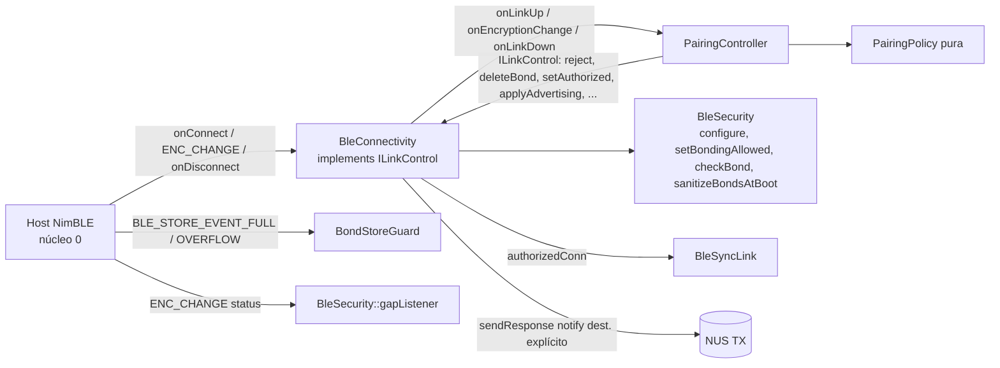

# 01 — Firmware: segurança de enlace LESC no NimBLE

Estado implementado do enlace BLE com **LE Secure Connections Just Works** e
bond: o dongle só entrega dados do NUS e do SYNC a uma conexão **autorizada**
(cifrada + bond LESC válido). Código em `esp32-firmware/src/connectivity/ble/`
(`BleSecurity`, `BleConnectivity`, `BleSyncLink`). A decisão de autorizar
vem da política pura `pairing::PairingPolicy` (ver `02`).

## Componentes



| Peça | Arquivo | Responsabilidade |
|---|---|---|
| `BleSecurity` | `connectivity/ble/BleSecurity.{h,cpp}` | Configura o Security Manager, gate de bond (`sm_bonding`), leitura do bond no store, apagamento/recuperação, listener de GAP, dados de fabricante. |
| `BondStoreGuard` | idem | `NimBLEDeviceCallbacks::onStoreStatus`: recusa pareamento fora da janela e nunca despeja o bond existente. |
| `BleConnectivity` | `connectivity/ble/BleConnectivity.{h,cpp}` | Servidor GATT (NUS + SYNC), callbacks de conexão, gate de aplicação, anúncio; implementa `pairing::ILinkControl`. |
| `BleSyncLink` | `connectivity/ble/BleSyncLink.{h,cpp}` | Notifica o SYNC só à conexão autorizada (`04`). |

## Configuração do Security Manager (`BleSecurity::configure`)

Chamada logo após `NimBLEDevice::init()` e antes de criar servidor/serviços ou anunciar.

| Chamada | Valor | Motivo |
|---|---|---|
| `setSecurityAuth(false, false, true)` | bond **desligado**, MITM não, SC sim | O bond só liga com a janela aberta; Just Works não autentica; `sc` faz o dongle oferecer LESC. |
| `setSecurityIOCap(BLE_HS_IO_NO_INPUT_OUTPUT)` | `0x03` | Sem E/S ⇒ Just Works. |
| `setSecurityInitKey` / `setSecurityRespKey` | `ENC \| ID` | LTK e IRK (o IRK do celular permite resolver o RPA na reconexão). |
| `ble_hs_cfg.sm_sc_only` | fica 0 | Ligado, o ATT exigiria enlace autenticado (MITM) e Just Works nunca é. "LESC-only" é verificado no bond (`sc == 1`, chave de 16 B). |
| `ble_gatts_set_clt_cfg_perm_flags(READ \| WRITE \| READ_ENC \| WRITE_ENC)` | `0x27` | Escrever o CCCD exige enlace cifrado. Declarada `extern "C"` (header privado da NimBLE). |
| `setDeviceCallbacks(&BondStoreGuard)` | — | Gate do store. |
| `setCustomGapHandler(&BleSecurity::gapListener)` | — | Captura o `status` do `ENC_CHANGE` (único listener de GAP do dispositivo; o SYNC não registra outro). |
| `advertiseOnDisconnect(false)` (em `BleConnectivity::begin`) | — | O anúncio é controlado pela política. |
| `-DCONFIG_BT_NIMBLE_MAX_BONDS=1`, `-DMYNEWT_VAL_BLE_SM_MAX_PROCS=3` | `[pairing]` no `platformio.ini` | Um bond por vez (`static_assert` em `BleSecurity.cpp`); reforço contra um peer segurar o único procedimento do SM. |

`BleConnectivity::begin` também faz `setMTU(517)`, `setPower(ESP_PWR_LVL_P9)` e
imprime `[BLE] NimBLE <versão>, LESC Just Works, bonds=<n>, MAX_BONDS=1`.

## Gate de criação de bond

`BleSecurity::setBondingAllowed(bool)` grava `ble_hs_cfg.sm_bonding` sob um
`portMUX_TYPE` (os campos `sm_*` são *bitfields* da mesma palavra). É ligado
só quando a janela abre e desligado quando ela fecha (`PairingPolicy`).

| Janela | `sm_bonding` | Store com bond | Efeito num Pairing Request |
|---|---|---|---|
| Fechada, com bond | 0 | `FULL` recusado | *Pairing Failed* imediato; nada é apagado nem gravado. |
| Fechada, sem bond | 0 | — | O par cifra (LESC) mas sem bond ⇒ conexão recusada (`0x05`). |
| Aberta (bonds apagados) | 1 | — | LESC Just Works com bond; o primeiro bond fecha a janela. |

## Flags das características (`BleSecurity.h`)

```cpp
constexpr uint32_t kSecureRxProps = WRITE | WRITE_NR | WRITE_ENC;  // app -> dongle
constexpr uint32_t kSecureTxProps = NOTIFY | READ_ENC;             // dongle -> app (READ_ENC só documenta)
```

Usadas no NUS RX/TX (`6E400002/3-…`) e no SYNC RX/TX (`7A3C0002/3-…`). Não se
usa `*_AUTHEN` (exige MITM) nem `*_AUTHOR` (o `NimBLEServer` não trata
`BLE_GAP_EVENT_AUTHORIZE`).

| Operação do cliente | Sem cifra | Cifrado sem bond | Autorizado |
|---|---|---|---|
| Descobrir serviços | permitido | permitido | permitido |
| Escrever no RX | ATT `0x05` (ou `0x0F` se há LTK) | `onWrite` descarta (`WRITE_DROP`) e a conexão cai | entregue |
| Inscrever no TX (CCCD) | ATT `0x05`/`0x0F` | aceita no ATT, nada é notificado | aceita |
| Receber notificação | nunca | nunca | sim |

## Autorização por conexão

A decisão é tomada **no `ENC_CHANGE`** (`onAuthenticationComplete`), nunca no
`onConnect`.

| Callback | O que faz |
|---|---|
| `onConnect` | Evento `LINK_UP`; `pairing->onLinkUp(handle)`; **só se** o peer já tem bond (`NimBLEDevice::isBonded(idAddress)`): `startSecurity(handle)`. Peer desconhecido não recebe *Security Request*. Não liga `APP_CONNECTED`. |
| `onAuthenticationComplete` | Monta `EncryptionInfo {status (do gapListener), encrypted, bonded, keySize, lesc, persisted}` (`lesc`/`persisted` de `BleSecurity::checkBond`: `sc == 1 && key_size == 16`, `ltk_present`) e chama `pairing->onEncryptionChange`. |
| `onDisconnect` | Evento `LINK_DOWN` (`rc`, `hci = rc − 0x200`, `auth`, `dur`); `clearEncStatus`; `pairing->onLinkDown`. |
| `onWrite` (NUS RX e SYNC RX) | `!isAuthorized(handle)` ⇒ `WRITE_DROP chr=nus_rx\|sync_rx`. |
| `onSubscribe` | NUS: guarda a conexão inscrita (`_nusSubscribedConn`); SYNC TX: só repassa ao `BleSyncLink` se autorizada. |
| `sendResponse` | Notifica com destino explícito (`_authorizedConn`) e só se essa conexão se inscreveu. |

Efeitos de `setAuthorized(conn)` (via `ILinkControl`): grava `_authorizedConn`,
chama o callback `onConnection(true)` do `CollectorApp` (incrementa
`ctx.connections`, liga `APP_CONNECTED`, evento `CONN up=1`) **e depois**
`BleSyncLink::onConnected`. `clearAuthorized(conn)` faz o inverso se `conn` é a
autorizada. Assim `APP_CONNECTED`/`CONN` significam "sessão autorizada".

Motivos de desconexão enviados pelo dongle (`pairing::kHci*`):

| Situação | HCI | Constante |
|---|---|---|
| Recusa (sem bond, legado, cifra falhou, *timeout*, chave curta, bond não gravado) | `0x05` | `kHciAuthFailure` |
| Recusa transitória (já há sessão autorizada, ou bonds sendo apagados) | `0x09` | `kHciConnLimit` |
| Botão derruba todas as conexões | `0x13` | `kHciRemoteUser` |

## Anúncio

`BleConnectivity::applyAdvertising(mode, windowOpen, hasBond)` para o anúncio,
reconstrói os dados do zero (`clearData` → `setName` → UUID do NUS →
`setManufacturerData`; o nome vai no *scan response*) e religa se `mode != Off`.
Emite `ADV` quando algo muda.

| Modo (`pairing::AdvMode`) | Condição | Intervalo (`BleSecurity.h`) |
|---|---|---|
| `Off` | bonds sendo apagados, **há** conexão autorizada, ou conexões ≥ `CONFIG_BT_NIMBLE_MAX_CONNECTIONS` | — |
| `Pairing` | janela aberta | `kAdvItvlPairing` = 338 × 0,625 ms = 211,25 ms |
| `Normal` | demais | `kAdvItvlNormal` = 874 × 0,625 ms = 546,25 ms |

Dados de fabricante (4 bytes):

| Byte | Valor | Significado |
|---|---|---|
| 0–1 | `FF FF` | Company ID `kCompanyId` = `0xFFFF` |
| 2 | `0x01` | `kAdvFormatVersion` |
| 3 | `flags` | bit 0 = janela aberta; bit 1 = há bond |

É só dica de UX (clonável). O SYNC não vai no anúncio (pacote de 31 B: flags
3 B + UUID do NUS 18 B + fabricante 6 B).

## Armazenamento de bonds (`BondStoreGuard`)

| Evento do store | Condição | Retorno | Evento |
|---|---|---|---|
| `BLE_STORE_EVENT_FULL` (todo Pairing Request com bond gravado) | janela fechada | `BLE_HS_ESTORE_CAP` | `BOND_FULL event=full action=reject` |
| idem | janela aberta | `0` | `BOND_FULL event=full action=allow` |
| `BLE_STORE_EVENT_OVERFLOW` (`OUR_SEC`/`PEER_SEC`) | — | `BLE_HS_ESTORE_CAP` | `BOND_FULL event=overflow action=reject` |
| demais | — | `ble_store_util_status_rr` | — |

Como o `FULL` vem antes do tratamento de `REPEAT_PAIRING`, o bond legítimo
nunca é apagado por quem forja a identidade do celular.

Funções de `BleSecurity`:

| Função | Efeito |
|---|---|
| `checkBond(idAddress)` | `ble_store_read_peer_sec` ⇒ `BondCheck {found, lesc, persisted}` |
| `deleteAllBonds(durMs)` | `NimBLEDevice::deleteAllBonds` (usa `deleteBond`; não derruba conexões) |
| `eraseBondStoreAndRestart()` | Recuperação: `nvs_erase_all("nimble_bond")` + `esp_restart()` (`BOND_DELETE reason=recover`) |
| `sanitizeBondsAtBoot()` | Emite `NVS free/used/total`; se há mais de 1 bond ou algum não LESC, apaga todos (`BOND_DELETE reason=policy`) |
| `lastEncStatus` / `clearEncStatus` | Tabela de 4 posições `{handle, status}` atômicas preenchida pelo `gapListener` |
| `manufacturerData(windowOpen, hasBond, out)` | Monta `FF FF 01 flags` |

A verificação de gravação do bond novo (`BOND_VERIFY`) é feita pela
`PairingPolicy` com `persisted`.

## Bonds na NVS

| Dono | Partição | Namespace |
|---|---|---|
| NimBLE (bonds, CCCDs, IRK local) | `nvs` | `nimble_bond` |
| Coleta e protocolo (`02`/`03` da Fase 1) | `nvs` | `collector` |
| Chaves (Fase 1 `01`) | `secnvs` | `sec` |

Em `devsec`/`prod` a `nvs` é cifrada pela NVS encryption (sem código nesta
fase); no `dev` fica em claro, então os bonds são legíveis na flash (risco
residual aceito, perfil só de bancada).

## Modelo de segurança

| Propriedade | Situação |
|---|---|
| Escuta passiva (A1.1) e replay (A1.2) | Protegidos (ECDH P-256 + AES-CCM; LTK não derivável da captura) |
| Acesso direto sem bond (A1.4) | Bloqueado: conexão derrubada, escrita descartada, nada notificado |
| MITM no 1º pareamento (A1.3) | Não: Just Works não autentica; mitigado pela janela de 45 s aberta por botão físico |
| DoS (A1.5) | Parcial: sem *Security Request* a desconhecidos, `FULL` recusa estranhos fora da janela, anúncio segue com conexões pendentes; dentro da janela um pareamento travado segura o SM até 30 s |
| Autenticar o app / forward secrecy | Não |
