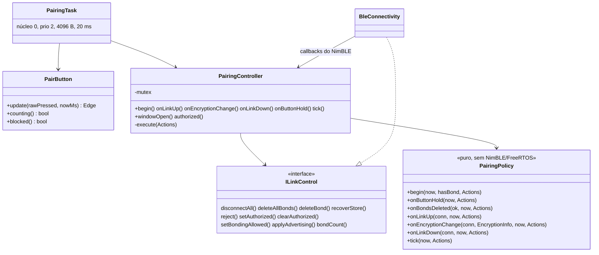
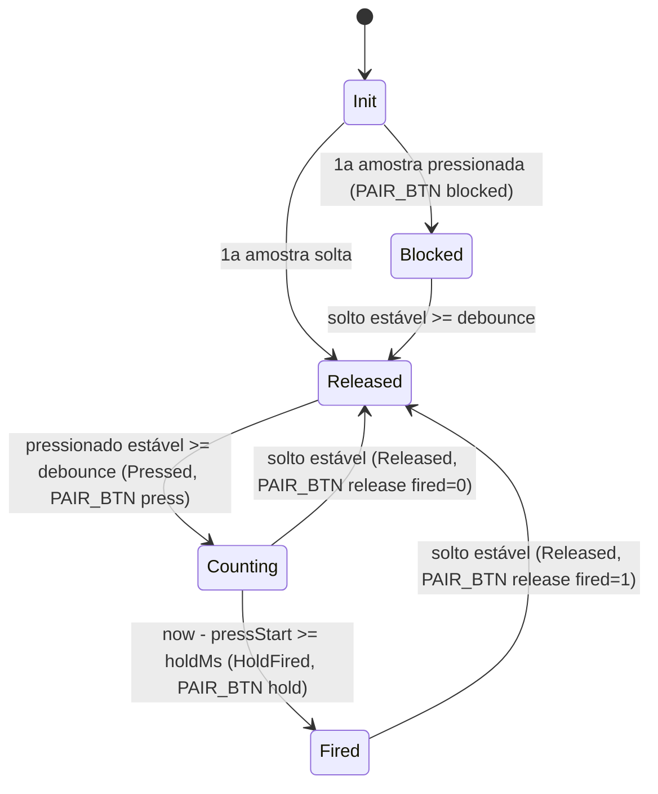
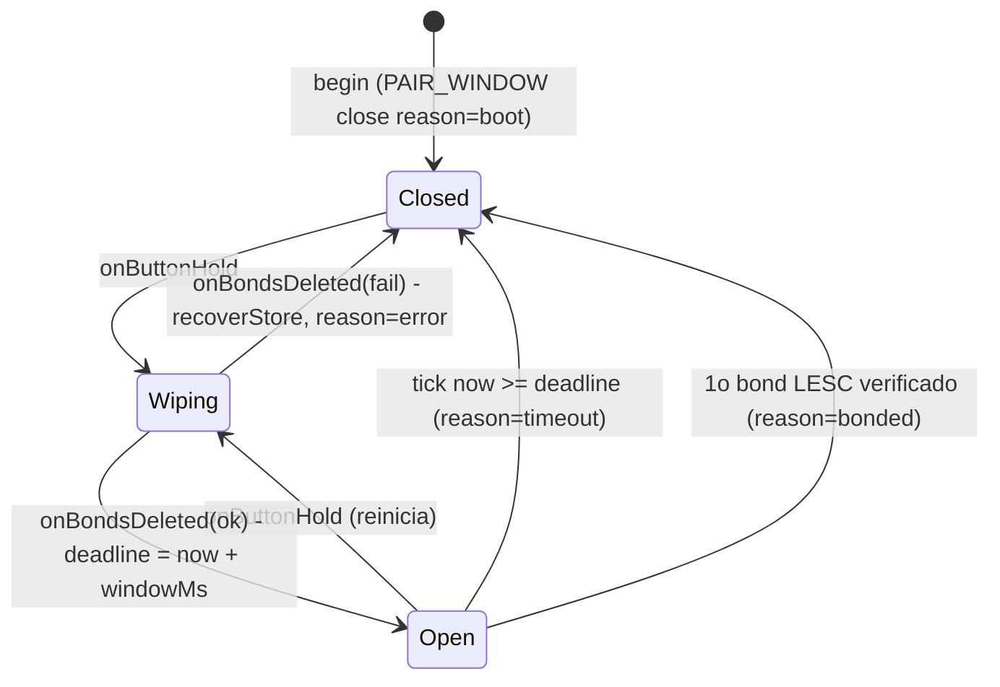

# 02 — Firmware: botão, janela de pareamento e política de enlace

Estado implementado do controle físico de pareamento: segurar o botão BOOT
(GPIO0) por 5 s derruba todas as conexões, apaga todos os bonds e abre uma
janela de 45 s em que o dongle aceita **um** novo bond; fora da janela só o
celular já pareado é aceito. Código em `esp32-firmware/src/connectivity/pairing/`
e `src/tasks/PairingTask.*`.

## Componentes

| Peça | Arquivo | Responsabilidade |
|---|---|---|
| `PairButton` | `connectivity/pairing/PairButton.{h,cpp}` | Detector com debounce por estabilidade e disparo único do *hold*; puro. |
| `PairingPolicy` | `connectivity/pairing/PairingPolicy.{h,cpp}` | Janela, tabela de conexões e regra de autorização; devolve `Actions`; puro, `now` entra como parâmetro. |
| `PairTime.h` | idem | `elapsedMs`/`reached` com diferença com sinal (seguro na virada do `millis()`). |
| `ILinkControl` | `connectivity/pairing/ILinkControl.h` | Operações sobre o enlace que a política pede. |
| `PairingController` | `connectivity/pairing/PairingController.{h,cpp}` | Cola política ↔ RTOS: mutex, executa as `Actions` fora do mutex. |
| `PairingConfig.h` | idem | Padrões e `static_assert` dos build flags; `PairingTaskConfig`, `timingsFromConfig()`. |
| `PairingTask` | `tasks/PairingTask.{h,cpp}` | Lê o GPIO a cada 20 ms, alimenta `PairButton` e `tick()`, controla o LED. |

## Build flags (`PairingConfig.h`, faixas por `static_assert`)

| Flag | Padrão | Faixa | Uso |
|---|---|---|---|
| `PAIR_BUTTON_PIN` | 0 | 0–39 | GPIO do botão (BOOT) |
| `PAIR_BUTTON_ACTIVE_LOW` | 1 | 0/1 | Nível ativo |
| `PAIR_BUTTON_HOLD_MS` | 5000 | 1000–30000 | Tempo para abrir a janela |
| `PAIR_DEBOUNCE_MS` | 50 | 10–200 | Debounce |
| `PAIR_WINDOW_MS` | 45000 | 10000–300000 | Duração da janela |
| `PAIR_AUTH_TIMEOUT_MS` | 35000 | 10000–60000 | Prazo para cifrar, conexão admitida na janela |
| `LINK_AUTH_TIMEOUT_MS` | 5000 | 1000–30000 | Prazo para cifrar, conexão fora da janela |
| `PAIR_LED_PIN` | -1 | -1 ou 0–33 | LED de status; -1 desliga |
| `CONFIG_BT_NIMBLE_MAX_BONDS` | 1 | `== 1` | Um bond por vez |
| `MYNEWT_VAL_BLE_SM_MAX_PROCS` | 3 | — | Procedimentos de segurança simultâneos |

`platformio.ini` tem a seção `[pairing]` (`PAIR_BUTTON_HOLD_MS=5000`,
`PAIR_WINDOW_MS=45000`, `MAX_BONDS=1`, `SM_MAX_PROCS=3`), incluída em
`collector_mock`, `collector_twai` e `collector_mcp2515`; o
`platformio_local.ini.example` mostra como encurtar (2000/20000). Timers:
amostragem do botão 20 ms; reenvio da recusa `rejectRetryMs` = 2000 ms.

## Botão (`PairButton`)

GPIO0 é pino de *strapping*: o botão deve ser apertado com o dongle já ligado.
`pinMode(pin, INPUT_PULLUP)`.

`HoldFired` dispara uma vez por pressão. Boot com o botão pressionado bloqueia
o detector até soltar (não apaga bonds por defeito mecânico).

LED (`PAIR_LED_PIN >= 0`): 5 Hz enquanto conta o *hold*, 2 Hz com a janela
aberta, aceso com sessão autorizada, apagado nos demais casos.

## Janela (`PairingPolicy`)

- `bondingAllowed() == (window == Open)`: com a janela fechada nenhum bond é criado.
- Janela estrita: fechar zera `sm_bonding` na hora; pareamento já iniciado termina com bond e é aceito (`PAIR_RESULT late=1`).
- Sem janela automática no boot: todo pareamento passa pelo botão.
- `onButtonHold`: todas as conexões viram `Rejecting(0x13)` (preservando `wasAuthorized`); `Actions`: `advertisingOffFirst`, `disconnectAll`, `deleteAllBonds`, `setBonding(false)`.
- `onBondsDeleted(ok)`: `ok` ⇒ `Open`, `deadline = now + windowMs`, `consumed = false`, `hasBond = false`, conexões `Pending` viram `admittedInWindow`; falha (o controlador já tentou 2×) ⇒ `Closed` + `recoverStore`.

## Conexões (`PairingPolicy`)

Tabela fixa de `kMaxLinks` = 4 posições `{conn, state, connectedAt, rejectAt, rejectHci, admittedInWindow, wasAuthorized}`; estados `Free`, `Pending`, `Authorized`, `Rejecting`.

`onLinkUp`: janela em `Wiping` ou já existe `Authorized` ⇒ `Rejecting(0x09)` + `CONN_REJECT reason=busy`; sem slot ⇒ só recusa; senão `Pending` com `admittedInWindow = (janela Open)`.

`onEncryptionChange` em `Pending` (primeira condição verdadeira vale):

| # | Condição | Resultado | Eventos |
|---|---|---|---|
| 1 | `status ≠ 0` ou `!encrypted` | recusa `0x05` | `LINK_ENC up=0 reason=pairing\|other`; `PAIR_RESULT ok=0 reason=<classe>` se o status é de pareamento; `CONN_REJECT enc_fail` |
| 2 | `keySize < 16` | recusa `0x05`; apaga o bond se `bonded` | `CONN_REJECT key_size` |
| 3 | sem bond | recusa `0x05` | `PAIR_RESULT ok=0 reason=window_closed\|not_bonded`; `CONN_REJECT not_bonded` |
| 4 | com bond, `!lesc` | recusa `0x05`; apaga o bond | `PAIR_RESULT reason=legacy` (se admitida na janela); `BOND_DELETE reason=policy` |
| 5 | com bond, `!admittedInWindow` (restauração) | `Authorized` (recusa `0x09` se já há outra autorizada) | `LINK_ENC fresh=0` |
| 6 | com bond, na janela, `consumed` | recusa `0x09`; apaga o bond | `PAIR_RESULT reason=busy` |
| 7 | com bond, na janela, `!persisted` | recusa `0x05`; apaga o bond; janela não consumida | `BOND_VERIFY ok=0`; `PAIR_RESULT reason=not_persisted` |
| 8 | com bond, na janela, `persisted` | `Authorized`; `consumed`, `hasBond`; fecha a janela | `BOND_VERIFY ok=1`; `PAIR_RESULT ok=1 reason=ok late=<…>`; `PAIR_WINDOW close reason=bonded` |

Demais transições:

| Estado | Evento | Resultado |
|---|---|---|
| `Authorized` | `onEncryptionChange` ok | permanece (renovação de chave); falha ⇒ `Rejecting(0x05)` |
| `Rejecting` | `onEncryptionChange` com `bonded` e `admittedInWindow` | apaga o bond dessa conexão (`BOND_DELETE reason=policy`); demais ignorados |
| `Pending` | `tick`: `waited ≥ admittedInWindow ? pairAuthTimeoutMs : linkAuthTimeoutMs` | `Rejecting(0x05)`, `CONN_REJECT auth_timeout` |
| `Rejecting` | `tick`: `now − rejectAt ≥ rejectRetryMs` | reemite o `reject` |
| qualquer ≠ `Free` | `onLinkDown` | `Free`; `deauthorize` se `Authorized` ou `wasAuthorized` |
| `Free` | evento de `conn` desconhecida | ignorado |

Classe do `PAIR_RESULT reason` a partir do `status` (`classify`): `0x500–0x5FF`
`peer_reject`; `0x400–0x4FF` `local_reject`; `13` (`BLE_HS_ETIMEOUT`) `timeout`;
outros ⇒ `LINK_ENC reason=other`, sem `PAIR_RESULT`.

Restauração sem LTK no dongle e recusa de pareamento no store (`BOND_FULL`)
não geram `ENC_CHANGE`: aparecem como `LINK_UP` seguido de `CONN_REJECT
auth_timeout` (ou queda iniciada pelo celular). Quem detecta "bond perdido" é o
app.

Por que a regra é correta: fora da janela `sm_bonding = 0` e, havendo bond,
todo Pairing Request é recusado no `FULL` ⇒ um enlace cifrado com bond numa
conexão admitida fora da janela só pode ser restauração; durante `Wiping`
conexões são recusadas; ao abrir a janela não há bond a restaurar; `consumed` +
`MAX_BONDS = 1` garantem um bond por janela; só vale bond LESC (`sc == 1`, 16 B)
confirmado no store.

### Advertising (`advMode`)

| Condição (em ordem) | Modo |
|---|---|
| Janela `Wiping` | `Off` |
| Existe `Authorized` | `Off` |
| Conexões ≠ `Free` ≥ `maxConnections` | `Off` |
| Janela `Open` | `Pairing` |
| Senão | `Normal` |

`finish()` preenche `Actions.setAdvertising` só quando modo, `windowOpen` ou `hasBond` mudam.

## `PairingController`

Toda entrada trava o mutex, chama a política, copia as `Actions`, destrava e as
**executa** pela `ILinkControl` (evita segurar o lock próprio enquanto a NimBLE
pega o dela). Ordem de `execute`:

1. `advertisingOffFirst` ⇒ `applyAdvertising(Off)`
2. `disconnectAll` ⇒ `CONN_DROP reason=button count=<n>`
3. `deleteAllBonds` (até `kDeleteAttempts` = 2 tentativas) ⇒ `BOND_DELETE reason=button`; em seguida `policy.onBondsDeleted(ok)` e execução recursiva das novas ações (o resto das ações antigas é descartado)
4. `deleteBond[]`, `reject[]`
5. `authorize` ⇒ `setAuthorized`; `deauthorize` ⇒ `clearAuthorized`
6. `setBonding`
7. `setAdvertising` ⇒ `applyAdvertising`
8. `recoverStore` (último; não retorna)

## `PairingTask`

Núcleo 0, prioridade 2, pilha 4096 B, período 20 ms (`vTaskDelayUntil`).
Laço: lê o GPIO ⇒ `PairButton::update` ⇒ se `HoldFired`,
`controller.onButtonHold()` ⇒ `controller.tick()` ⇒ LED.

## Inicialização (`CollectorApp.cpp`)

1. `PairingController pairing(ble, timingsFromConfig(), CONFIG_BT_NIMBLE_MAX_CONNECTIONS)`
2. `ble.setPairingController(&pairing)`, `ble.setConnectionCallback(...)`, `ble.setSyncLink(...)`
3. `Elm327Task` (registra o callback do RX)
4. `ble.begin()` (init, `BleSecurity::configure()`, serviços); **não** inicia o anúncio
5. `BleSecurity::sanitizeBondsAtBoot()`
6. `pairing.begin()` ⇒ `bondCount() > 0`, `setBonding(false)`, anúncio `Normal`
7. `PairingTask` criada junto das demais tarefas (`eventLog.watch("pairing", …)`)

## Testes

`pio test -e native -f test_pairing` (`esp32-firmware/test/test_pairing/test_main.cpp`,
`test/support/CaptureSink.h`; `[env:native]` compila só `PairButton.cpp` e
`PairingPolicy.cpp`): casos BTN-01…11 (debounce, *hold* único, bloqueio no
boot, virada do `millis()`) e POL-01…32 (janela, restauração, estranho
dentro/fora da janela, um bond por janela, legado, bond não persistido,
pareamento tardio, recusa repetida a cada 2 s, falha de apagamento ⇒
`recoverStore`, virada do relógio, propriedade pseudoaleatória POL-25 com
invariantes: `bondingAllowed ⇒ Open`, no máximo um `ok=1` por janela, uma só
autorizada, anúncio `Off` com autorizada).
