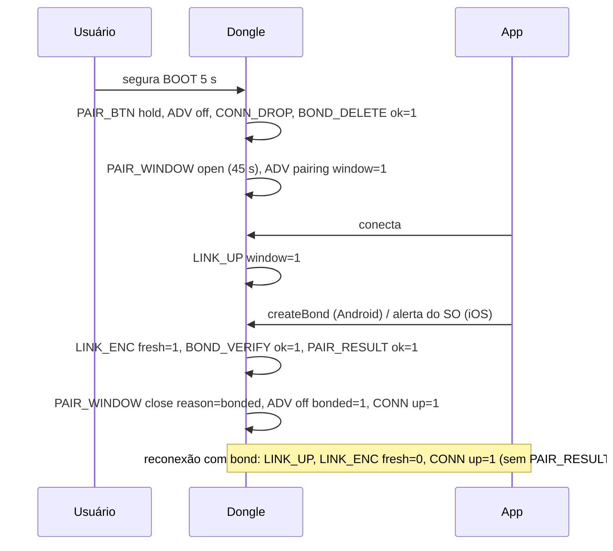

# 03 — Firmware: eventos de pareamento, testes nativos e roteiro de bancada

Estado implementado da observabilidade do enlace seguro (eventos), da suíte
nativa da política e do botão, e o roteiro de bancada que valida a fase. O
catálogo vigente dos eventos está em `esp32-firmware/docs/eventos.md` §3.9
(e na especificação do formato, `docs/debug-events.md`); esta spec resume
o contrato e as receitas.

## Convenções

- Formato `EV n t NOME k=v`; `conn` é o *connection handle* da NimBLE (igual em todos os eventos da conexão; reutilizável depois de `LINK_DOWN`).
- `FORMAT v` não muda com esta fase (eventos aditivos).
- `CONN up` significa **sessão autorizada** (enlace cifrado com bond LESC válido) aberta/fechada; uma conexão recusada nunca gera `CONN`.
- `STACK task` ganha `pairing`.
- Eventos emitidos no callback do NimBLE só copiam a linha para o *ring buffer*.

## Catálogo

| Evento | Campos (ordem) | Origem | Significado |
|---|---|---|---|
| `PAIR_BTN` | `action` (press, hold, release, blocked), `held`, `fired` | `PairButton` | Transição do botão; `blocked` = firmware subiu com o botão apertado. |
| `PAIR_WINDOW` | `state` (open, close), `reason` (boot, button, timeout, bonded, error), `deadline`, `dur` | `PairingPolicy` | Janela. `open` sempre `reason=button`; `close` traz `dur` aberta (`-` em `boot`). |
| `BOND_DELETE` | `reason` (button, policy, recover), `count`, `ok`, `attempts`, `dur` | `PairingController`, `PairingPolicy`, `BleSecurity` | Bonds apagados. |
| `BOND_VERIFY` | `conn`, `ok`, `lesc`, `persisted` | `PairingPolicy` | Conferência do bond novo no store. `ok=0` recusa a conexão e mantém a janela. |
| `BOND_FULL` | `event` (full, overflow), `action` (reject, allow), `obj`, `conn`, `window` | `BondStoreGuard` | Store cheio / segundo bond. |
| `NVS` | `free`, `used`, `total` | `BleSecurity::sanitizeBondsAtBoot` | Entradas da partição `nvs` no boot. |
| `CONN_DROP` | `reason` (button), `count` | `PairingController` | Todas as conexões derrubadas (`0x13`). |
| `ADV` | `mode` (off, normal, pairing), `window`, `bonded` | `BleConnectivity::applyAdvertising` | Anúncio reconfigurado (só quando muda). |
| `LINK_UP` | `conn`, `addr`, `atype` (pub, rnd), `window` | `BleConnectivity::onConnect` | Enlace aceito, ainda **não** autorizado; `addr` no ar (RPA em celulares). |
| `LINK_ENC` | `conn`, `up`, `bonded`, `fresh`, `key`, `reason` (ok, pairing, other), `rc`, `dur` | `PairingPolicy` | Resultado do `ENC_CHANGE`; `fresh=1` pareamento novo, `0` LTK restaurada. |
| `PAIR_RESULT` | `conn`, `ok`, `reason` (ok, window_closed, not_bonded, legacy, not_persisted, busy, peer_reject, local_reject, timeout, other), `late`, `rc`, `dur` | `PairingPolicy` | Fim de tentativa que chegou ao SM (não em restauração nem em recusa por `BOND_FULL`). `dur` inclui o diálogo do SO. |
| `CONN_REJECT` | `conn`, `reason` (not_bonded, enc_fail, key_size, auth_timeout, busy), `hci`, `dur` | `PairingPolicy` | O dongle derrubou a conexão (`05` recusa, `09` ocupado). |
| `LINK_DOWN` | `conn`, `rc`, `hci`, `auth`, `dur` | `BleConnectivity::onDisconnect` | Enlace caiu; `hci = rc − 0x200` para erros HCI (`13` remoto, `16` local, `08` timeout). |
| `WRITE_DROP` | `conn`, `chr` (nus_rx, sync_rx), `len` | `BleConnectivity` | Escrita de conexão não autorizada descartada. |

## Sequência típica de eventos

Receitas para análise do log: tempo de pareamento = `PAIR_RESULT ok=1 dur`
(desde o botão: `PAIR_RESULT.t − PAIR_BTN(hold).t`); tempo de restauração =
`LINK_ENC fresh=0 dur`; até a sessão = `CONN(up=1).t − LINK_UP.t`; janela
desperdiçada = `PAIR_WINDOW close reason=timeout` sem `PAIR_RESULT ok=1`;
tentativas indevidas = `CONN_REJECT` por `reason` e `WRITE_DROP` por `conn`.

## Testes nativos

`pio test -e native -f test_pairing` — `esp32-firmware/test/test_pairing/test_main.cpp`
(Unity, `CaptureSink` de `test/support/CaptureSink.h` para conferir linhas de
evento; a classe é compartilhada com `test_events`). 44 casos.

`PairButton` (debounce 50 ms, hold 5000 ms): BTN-01 solto silencioso; 02 pulso
de 30 ms é ruído; 03 pressão estável emite `Pressed`; 04 `HoldFired` único aos
5 s; 05 soltar antes não dispara; 06 pressão longa dispara uma vez; 07 soltar
após o *hold* reporta `fired=1`; 08 boot pressionado bloqueia; 09 repique na
soltura conta uma vez; 10 virada do `millis()`; 11 o tempo vem do construtor.

`PairingPolicy` (`Timings{45000, 5000, 35000}`, `maxConnections = 3`):

| Caso | Cobre |
|---|---|
| POL-01/02 | boot sem/com bond |
| POL-03/04/05 | *hold* derruba tudo, `onBondsDeleted` abre a janela, sessão antiga é desautorizada no `LinkDown` |
| POL-06 | janela fecha por *timeout* |
| POL-07/08 | 1º bond da janela autoriza e fecha; restauração fora da janela autoriza sem `PAIR_RESULT` |
| POL-09/10 | sem bond fora/dentro da janela é recusado |
| POL-11/12 | *timeouts* de autenticação (5 s fora, 35 s na janela) |
| POL-13 | pareamento iniciado na janela termina depois (`late=1`) |
| POL-14/15 | só um bond por janela; sessão autorizada ocupa (`0x09`) |
| POL-16/17/18 | classes de erro de pareamento; erro HCI não é resultado de pareamento; chave curta |
| POL-19..22 | renovação de chave; anúncio `Off` com tabela cheia; conexão desconhecida ignorada; recusa reemitida a cada 2 s |
| POL-23/24 | falha de apagamento ⇒ `recoverStore`; segundo *hold* reinicia |
| POL-25 | propriedade: 10 000 passos pseudoaleatórios (semente fixa), invariantes de janela/bond/autorização/anúncio |
| POL-26 | virada do relógio |
| POL-27/27b | conexões durante `Wiping` não viram bond |
| POL-28..32 | bond legado, bond não persistido, pareamento concluído após recusa, segundo bond apagado sem tocar o primeiro, restauração com outra autorizada |

## Roteiro de bancada (B1–B16)

Material: ESP32 DevKit (botão BOOT/GPIO0), `collector_mock_debug` ou
`collector_twai_debug` com a serial a 921 600 baud em arquivo, Android ≥ 10 e
iPhone com o app, nRF Connect/LightBlue; opcional nRF52840 + nRF Sniffer.
Antes da primeira gravação: `pio run -t erase` (apaga também `nvs_key`/`secnvs`
no `dev`; reprovisionar ou usar as chaves fixas) e esquecer o dongle nos celulares.

| # | Cenário | Esperado no dongle |
|---|---|---|
| B1 | Boot sem bond | `PAIR_WINDOW close reason=boot`; `ADV mode=normal window=0 bonded=0` |
| B2 | Toque curto (3 s) | `PAIR_BTN press` / `release fired=0` |
| B3 | Abrir janela (5 s) | `PAIR_BTN hold`, `ADV off`, `CONN_DROP`, `BOND_DELETE ok=1`, `PAIR_WINDOW open`, `ADV pairing` |
| B4 | Parear Android | `LINK_UP window=1` → `LINK_ENC fresh=1` → `PAIR_RESULT ok=1` → `PAIR_WINDOW close reason=bonded` → `CONN up=1` |
| B5 | Janela expira | `PAIR_WINDOW close reason=timeout dur≈45000` |
| B6 | Estranho fora da janela | com bond: `BOND_FULL event=full action=reject` + `CONN_REJECT auth_timeout`, bond intacto; sem bond: `PAIR_RESULT reason=window_closed` + `CONN_REJECT not_bonded` |
| B7 | Acesso sem pareamento | escrita com resposta ⇒ ATT `0x05`; sem resposta ⇒ nenhum `CMD`; inscrição ⇒ `0x05`; `CONN_REJECT auth_timeout` em 5 s |
| B8 | Reconexão Android | `LINK_ENC fresh=0 up=1` (sem `PAIR_RESULT`), `CONN up=1` |
| B9 | Parear e reconectar iOS | como B4 e B8 |
| B10 | Botão com Android conectado | `CONN_DROP`, `BOND_DELETE`, `PAIR_WINDOW open`; reconexão do celular sem LTK não gera `LINK_ENC` (só `CONN_REJECT auth_timeout`/queda); depois pareamento novo |
| B11 | Botão com iPhone conectado | idem; o app mostra as instruções de esquecer |
| B12 | Sniffer | LESC (`SC=1`, Pairing Public Key), PDUs cifrados após `LL_START_ENC`; firmware anterior: `010C` legível |
| B13 | DoS de conexões | `CONN_REJECT` repetidos do estranho; o pareado obtém `CONN up=1` |
| B14 | Falta de energia na janela | boot com `PAIR_WINDOW close reason=boot`, bonds apagados |
| B15 | Usuário cancela | `PAIR_RESULT ok=0 reason=peer_reject` |
| B16 | Central sem LESC (opcional) | `PAIR_RESULT reason=legacy`, `BOND_DELETE reason=policy` |

Métricas (N = 10 por SO): `PAIR_RESULT dur`, `LINK_ENC dur` com `fresh=0`,
`CONN(up=1).t − LINK_UP.t`.
