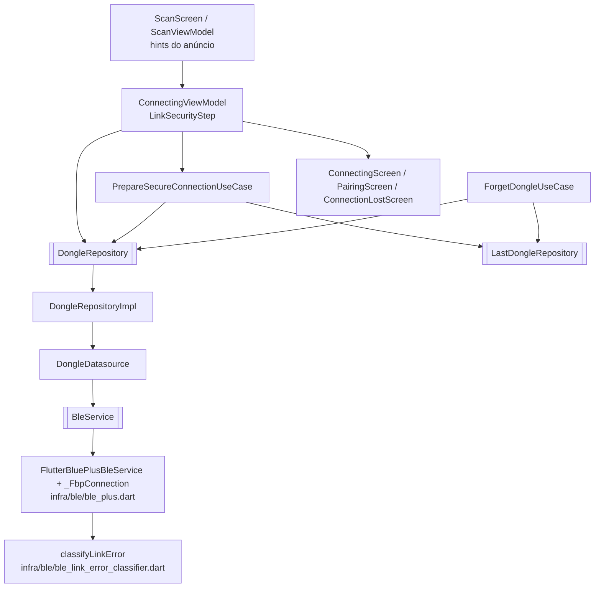
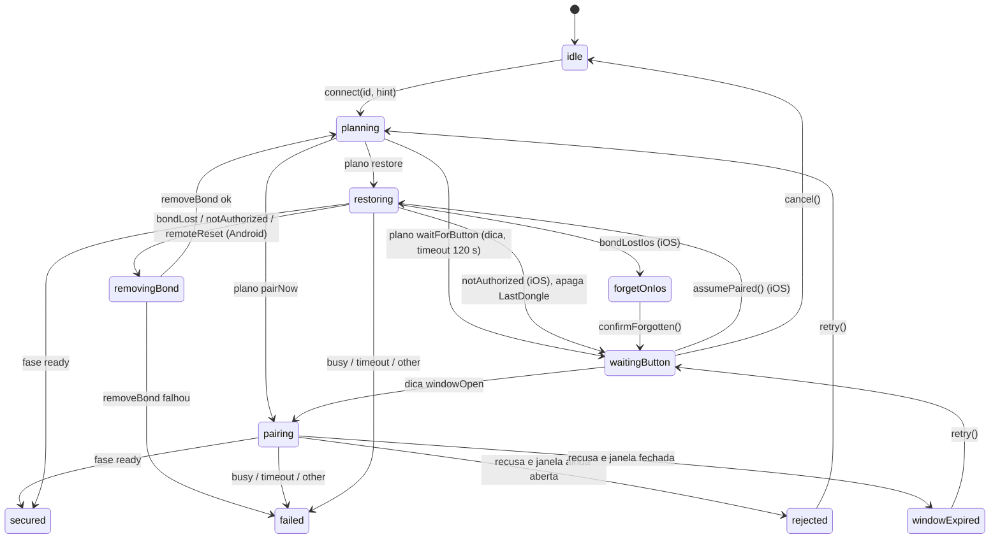

# 04 — App: pareamento LESC Just Works fim a fim

Estado implementado no app (`mobile-app/lib/src/`) do pareamento conduzido
pelo SO: plano automático (restaurar, parear agora, esperar o botão), tratamento
de bond perdido (Android remove e pareia de novo; iOS orienta esquecer),
telas e classificação de erros de enlace. A camada PSK legada foi removida na
Fase 1 (sem referência no caminho de conexão; `main.dart` ainda limpa
`psk_hex` e `security_mode` das preferências).

## Componentes

| Peça | Arquivo | Responsabilidade |
|---|---|---|
| `BleBondState` | `domain/ble/ble_bond_state.dart` | `none`, `bonding`, `bonded`, `unknown` (iOS) |
| `BleLinkError` | `domain/ble/ble_link_error.dart` | `pairingRejected`, `pairingTimeout`, `notAuthorized`, `bondLost`, `bondLostIos`, `remoteReset`, `busy`, `timeout`, `other`; `isPairingLost` = `bondLost`/`bondLostIos`/`notAuthorized`/`remoteReset` |
| `DonglePairingHint` | `domain/ble/dongle_pairing_hint.dart` | Interpreta os dados de fabricante `0xFFFF`: versão `0x01`, bit 0 janela aberta, bit 1 há bond; senão `null` |
| `BleDevice.manufacturerData` | `domain/ble/ble_device.dart` | Dados de fabricante do anúncio |
| `BleConnectionPhase.securing` + `BleConnection.lastError` | `domain/ble/ble_connection.dart` | Fase entre `connecting` e `optimizingLink`; motivo do último `failed` |
| `BleService` | `services/ble/ble_service.dart` | `canManageBonds`, `bondState`, `removeBond`, `scan(withRemoteIds)`, `connect(securingTimeout)` |
| Adapter | `infra/ble/ble_plus.dart` | `createBond`, `bondState`, `removeBond` (só Android), sequência de conexão |
| `classifyLinkError` | `infra/ble/ble_link_error_classifier.dart` | Função pura tabelada; `LinkFailureKind` |
| `DongleDatasource` | `data/datasources/dongle_datasource.dart` | `canManageBonds`, `bondState`, `removeBond`, `watchDongle`; `connect` passa `securingTimeout` = 30 s |
| `DongleRepository(Impl)` | `domain/repositories/`, `data/repositories/` | + `watchPairingHint`, `lastLinkError`, `canManageBonds`, `bondState`, `removeBond` (`BleBondFailure`, `BleBondUnsupportedFailure` em `core/errors/ble_failure.dart`) |
| `PrepareSecureConnectionUseCase` | `application/connection/` | Decide o `SecureConnectionPlan` |
| `ForgetDongleUseCase` | `application/connection/` | Desconecta, remove o bond (Android) e apaga `LastDongle`; devolve `ForgetDongleResult {bondRemoved, needsManualForget}` |
| `ConnectingViewModel` | `ui/connection/view_model/connecting_view_model.dart` | Máquina de estados `LinkSecurityStep` |
| `PairingScreen` | `ui/connection/view/pairing_screen.dart` (rota `AppRoutes.pairing = '/pairing'`) | Instruções por estado |

## Sequência de conexão no adapter (`_FbpConnection._doConnectAndSetup`)

| Passo | Fase | Android | iOS |
|---|---|---|---|
| 1 | `connecting` | `device.connect(license: nonprofit, timeout, mtu: null)` | idem |
| 2 | `securing` | `bondState.first`; se ≠ `bonded`: `createBond(timeout: securingTimeout)` (30 s, menor que o `PAIR_AUTH_TIMEOUT_MS` de 35 s do firmware). Com bond: o *Security Request* do dongle dispara a cifra | só informa a UI (o alerta vem no passo 5) |
| 3 | `optimizingLink` | `requestMtu` | — |
| 4 | `discovering` | `discoverServices` | idem |
| 5 | `enablingNotify` | `listen` antes de `setNotifyValue(true)` (15 s) | `setNotifyValue(true, timeout: securingTimeout)`: é onde o iOS espera o alerta |
| 6 | `ready` | canais extras (SYNC) configurados | idem |

Qualquer exceção nos passos 1–5: `_lastError = classify(...)`, `device.disconnect()`
e `failed`. Reconexão após queda: erros de segurança **não** são repetidos;
só `busy` tem até 3 tentativas (2 s, 4 s, 8 s).

### Classificação (`classifyLinkError`)

| Plataforma | Sinal | `BleLinkError` |
|---|---|---|
| ambas | `createBond` falhou (bond terminou em `none`) | `pairingRejected` |
| ambas | `createBond`/notify de segurança estourou o prazo | `pairingTimeout` |
| ambas | `timeout` do `connect` | `timeout` |
| Android | queda com código `5` | `notAuthorized` |
| Android | queda com `6` (*PIN or Key Missing*) ou `61` (*MIC failure*) | `bondLost` |
| Android | queda com `9` | `busy` |
| Android | queda com `19` em `connecting`/`securing` | `remoteReset` (outra fase ⇒ `other`) |
| Android | erro GATT `5`/`15`/`137` | `notAuthorized` |
| iOS | `CBError` `14` (`peerRemovedPairingInformation`) | `bondLostIos` |
| iOS | `CBError` `15` (`encryptionTimedOut`) | `pairingTimeout` |
| iOS | erro ATT `5`/`15` | `notAuthorized` |
| iOS | queda `7` em `securing`/`discovering`/`enablingNotify` | `notAuthorized` (ambíguo; o VM desambigua pelo anúncio) |
| ambas | demais | `other` |

No iOS o `disconnectReason.code` é o `error.code` do CoreBluetooth, sem o
motivo HCI: `remoteReset` e `busy` não se distinguem de `notAuthorized`.

## Plano de conexão (`PrepareSecureConnectionUseCase`)

| `canManageBonds` | Bond conhecido | `hint.windowOpen` | Plano |
|---|---|---|---|
| Android | `bondState == bonded` | qualquer | `restore` |
| Android | não | `true` | `pairNow` |
| Android | não | `false` / sem dica | `waitForButton` |
| iOS | `LastDongle.id == deviceId` | qualquer | `restore` |
| iOS | não | `true` | `pairNow` |
| iOS | não | `false` / sem dica | `waitForButton` (tela oferece "Já pareei este iPhone") |

O anúncio nunca decide sozinho uma ação destrutiva: só uma falha real de
cifração (`isPairingLost`) leva a remover bond ou orientar o usuário.

## Máquina de estados (`ConnectingViewModel`, `LinkSecurityStep`)

- **Recusa × janela fechada:** em `pairing`, `pairingRejected`/`pairingTimeout`/`notAuthorized` dispara `_resolveRefusal`, que espera um anúncio novo (`refusalProbe` = 4 s): `windowOpen=true` ⇒ `rejected`, senão `windowExpired`.
- **`removingBond`:** `disconnect()` da conexão antiga, `removeBond(id)`, e `connect(id)` de novo (agora sem bond ⇒ `pairNow` ou `waitForButton`).
- **Queda após `secured`:** vai a `failed` com `linkError`; a `ConnectionLostScreen` mostra "O dongle não reconhece mais este aparelho" e "Parear novamente" (`repair()`: Android desconecta e remove o bond; iOS apaga `LastDongle` e vai a `forgetOnIos`).
- Campos extras do estado: `watching` (assinando a dica), `dongleSeen` (anúncio chegando), `canManageBonds`.
- Ao `ready`: `_rememberDevice()` grava `LastDongle` e `_prepare()` inicializa o ELM327.

Navegação: `planning`, `pairing`, `restoring`, `removingBond`, `secured` (até a preparação) ficam em `/connecting`; `waitingButton`, `rejected`, `windowExpired`, `forgetOnIos` vão a `/pairing`; `secured` com preparação pronta vai a `/connected`; `failed` vai a `/connection-lost`. `ConnectionGuard` inclui `AppRoutes.pairing` nas rotas de fluxo.

## Telas

| Tela | Conteúdo |
|---|---|
| `ConnectingScreen` | Passo "Pareando com segurança · LESC" dirigido pela fase `securing`; navega a `/pairing` nos estados acima |
| `PairingScreen` | `waitingButton`: "Coloque o dongle em modo de pareamento", passos (segurar 5 s, janela de 45 s, pareamento automático), badge "Procurando o dongle…" / "Dongle encontrado — aguardando o botão", "Tentar de novo" (prazo esgotado), "Já pareei este iPhone" (só iOS), "Cancelar". `windowExpired`: "O tempo para parear acabou". `rejected`: "Pareamento recusado". `forgetOnIos`: "Este iPhone guarda um pareamento antigo" com passos de Ajustes, "Abrir Ajustes" (`AppSettings.openAppSettings(type: bluetooth)`) e "Já esqueci" |
| `ConnectionLostScreen` | Variante "O dongle não reconhece mais este aparelho" / "Parear novamente" quando `linkError.isPairingLost`; senão "Reconectar" |
| `ScanScreen` | `StatusBadge` "PRONTO PARA PAREAR" quando a dica tem `windowOpen`; toque vai a `AppRoutes.connecting` |
| `forget_dongle_action` | Usa `ForgetDongleResult`; se `needsManualForget`, mostra os passos de esquecer no iOS |

## Testes

| Arquivo | Cobre |
|---|---|
| `test/domain/ble/dongle_pairing_hint_test.dart` | formatos do anúncio |
| `test/infra/ble/ble_link_error_classifier_test.dart` | tabela de classificação |
| `test/application/connection/prepare_secure_connection_use_case_test.dart` | tabela do plano |
| `test/application/connection/forget_dongle_use_case_test.dart` | remoção de bond, falha, iOS |
| `test/data/repositories/dongle_repository_impl_test.dart` | `watchPairingHint`, falhas de bond, `lastLinkError` |
| `test/ui/connection/connecting_view_model_test.dart` | restore, pairNow, waitForButton, bond perdido (Android/iOS), recusa × janela, `assumePaired`, falha genérica, passos da tela |
| `test/ui/connection/pairing_screen_test.dart` | estados da `PairingScreen` e navegação |
| `test/ui/connection/connection_lost_screen_test.dart`, `scan_screen_test.dart`, `scan_view_model_test.dart`, `widgets/connection_guard_test.dart` | variantes da perda de conexão, badge, `hints`, rota `/pairing` |
| `test/support/fake_ble_service.dart` | `FakeBleService` com `canManageBonds`, `bondStates`, `removeBondCalls`, `linkError`, quadros de anúncio |
