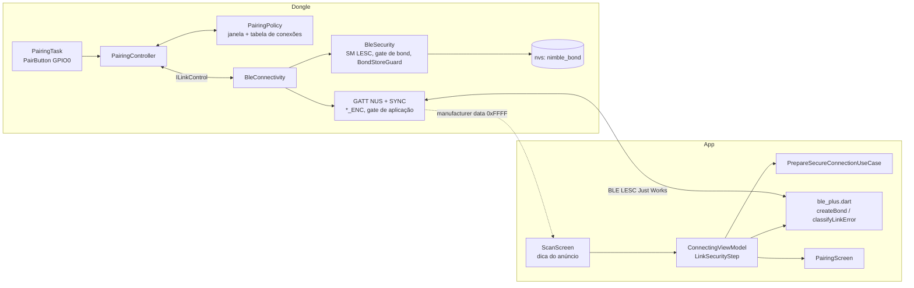

# Fase 2 — Firmware + App: pareamento BLE LESC Just Works

Documentação do estado implementado da camada de enlace entre app e dongle
com **BLE LE Secure Connections (LESC) e bond**
(`latex/aux-docs/seguranca-dongle-server/segunraca-dongle-server.tex`, §3.1 e
início da §5). Código em `esp32-firmware/src/connectivity/` e `mobile-app/`.
Divergências em relação ao plano original:
[`DESVIOS-E-MELHORIAS.md`](DESVIOS-E-MELHORIAS.md).

## O que a fase entrega

- O dongle só aceita enlaces cifrados por LTK de pareamento **LESC Just Works** guardada como bond (verificado no bond: `sc == 1`, chave de 16 B); NUS e SYNC só entregam e notificam à **conexão autorizada**.
- Pareamento **só** na janela de 45 s aberta pelo botão BOOT (GPIO0) segurado 5 s; **um bond por vez**; o botão derruba todas as conexões e apaga todos os bonds.
- Anúncio com dados de fabricante (`0xFFFF`: janela aberta, há bond) usados pelo app só como dica.
- Eventos de toda transição (`PAIR_*`, `BOND_*`, `LINK_*`, `CONN_REJECT`, `ADV`) e testes nativos da política com relógio falso.
- App: pareamento conduzido pelo SO (Android `createBond`; iOS alerta do sistema), telas para segurar o botão, janela expirada, recusa, bond perdido (Android remove e pareia de novo; iOS orienta esquecer) e reconexão automática com bond.

## Arquitetura

## Índice

| # | Documento | Conteúdo |
|---|---|---|
| 01 | [`01-firmware-lesc-nimble.md`](01-firmware-lesc-nimble.md) | Security Manager, gate de bond, flags, autorização por conexão, anúncio, `BondStoreGuard`, bonds na NVS |
| 02 | [`02-firmware-botao-e-janela-de-pareamento.md`](02-firmware-botao-e-janela-de-pareamento.md) | `PairButton`, `PairingPolicy` (janela e conexões), `PairingController`, `PairingTask`, build flags |
| 03 | [`03-firmware-eventos-e-testes.md`](03-firmware-eventos-e-testes.md) | Eventos, suíte nativa, roteiro de bancada B1–B16 |
| 04 | [`04-app-pareamento-just-works.md`](04-app-pareamento-just-works.md) | Adapter BLE, classificação de erros, plano e máquina de estados, telas |
| — | [`DESVIOS-E-MELHORIAS.md`](DESVIOS-E-MELHORIAS.md) | Desvios do plano e melhorias possíveis |

## Fronteira com a Fase 1

- O protocolo SYNC (`7A3C0001-…`) e o NUS não mudam; a fase só muda a camada de enlace: flags `WRITE_ENC`/`READ_ENC`, CCCD cifrado, descarte de escrita e notificação para conexão não autorizada, e o significado de `APP_CONNECTED`/`CONN up` ("sessão autorizada").
- O SYNC não vai no anúncio; o listener de GAP é único e pertence ao `BleSecurity`; `BleSyncLink` notifica só à conexão autorizada e reinicia a sessão do `SyncEngine` na autorização.
- Em `devsec`/`prod` a NVS encryption cobre a `nvs` (bonds incluídos); no `dev` a `nvs` fica em claro (risco residual aceito).

## Invariantes

| Id | Invariante |
|---|---|
| D1 | "LESC-only" é verificado no bond (`sc == 1`, 16 B), não pelo `sm_sc_only` (que exigiria MITM no ATT e quebraria Just Works) |
| D2 | Anuncia sempre que não há sessão autorizada (sem whitelist: celulares usam RPA); autoriza no `ENC_CHANGE` |
| D3 | `sm_bonding` só liga com a janela aberta; com bond gravado, todo Pairing Request fora da janela é recusado no `BLE_STORE_EVENT_FULL` |
| D4 | Motivos de desconexão: `0x05` recusa, `0x09` ocupado/transitório, `0x13` botão |
| D5 | Uma sessão autorizada por vez; anúncio desligado enquanto ela existe |
| D6 | Estado janela/bond nos dados de fabricante; só dica de UX, nunca dispara ação destrutiva no app |
| D7 | Botão amostrado a 20 ms em tarefa (sem ISR); boot com botão pressionado bloqueia o detector |
| D8 | Janela estrita; pareamento já iniciado termina (`late=1`) |
| D9 | Sem janela automática no boot |
| D21 | *Security Request* só para peer que já tem bond |
| D22 | Bond conferido no store antes de valer; falha ao apagar bonds ⇒ apagar o namespace `nimble_bond` e reiniciar |
| App | Pareamento dentro do `ConnectingViewModel`; plano automático; sem novas tentativas após erro de segurança (só `busy`) |
