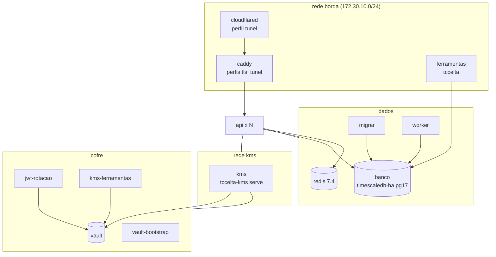

# 01 — Infraestrutura em Docker Compose

Estado implementado em `backend/compose.yaml` (dev), `compose.prodlike.yaml`
(sobreposição), `compose.test.yaml` (stack isolada do `make e2e`),
`deploy/kms/compose.yaml` (Vault + KMS em outro host), `Dockerfile`, `Makefile`
e `deploy/`. O guia dos alvos do Makefile e a comparação dev/prodlike/prod estão
em `backend/README.md` e `backend/docs/ambientes.md`.

## Topologia

## Serviços (`compose.yaml`, projeto `tccelta`)

| Serviço | Imagem / alvo | Redes | Observações |
|---|---|---|---|
| `banco` | `${IMG_TIMESCALE:-timescale/timescaledb-ha:pg17}` | dados | `shared_preload_libraries=timescaledb`, `max_connections=200`; monta só `deploy/postgres/init/00-roles.sh` como `900-roles.sh`; porta `127.0.0.1:5432` |
| `redis` | `redis:7.4-alpine` | dados | sem persistência, `maxmemory 64mb`, senha de segredo |
| `vault` | `hashicorp/vault:${VAULT_VERSAO:-1.18}` | cofre | modo dev, token raiz de segredo; porta `127.0.0.1:8200` |
| `vault-bootstrap` | idem | cofre | executa `deploy/kms/vault/scripts/bootstrap.sh` (`PERFIL=dev`) e sai |
| `migrar` | imagem `tccelta-backend` | dados | `tccelta migrate`, papel `tccelta_owner` |
| `kms` | `tccelta-kms:local` (alvo `kms`) | kms, cofre | `serve`; HTTP `:8300`, métricas e saúde `:9300`; AppRole `tccelta-kms` |
| `api` | `tccelta-backend:local` | borda, dados, kms | `API_REPLICAS` (2), portas `127.0.0.1:8080-8081`; só conhece `KMS_URL`; healthcheck `/saude/pronta` |
| `worker` | idem | dados | healthcheck `:8090/saude/viva` |
| `jwt-rotacao` | `tccelta-kms` | cofre | `jwt schedule`; AppRole `tccelta-rotacao-jwt` |
| `caddy` | `caddy:2.8-alpine` | borda | perfis `tls`, `tunel`; `API_PORTA_TLS` (8443) é a única porta publicada em todas as interfaces |
| `cloudflared` | `cloudflare/cloudflared:${CLOUDFLARED_VERSAO}` | borda | perfil `tunel`; token em segredo |
| `ferramentas` | alvo `ferramentas` | borda, dados | perfil `ferramentas`; `tccelta` (provision register, simulator, reprocess) |
| `kms-ferramentas` | alvo `kms-tools` | cofre | perfil `ferramentas`; `tccelta-kms provision` com token do provisionador |
| `prometheus`, `grafana` | `prom/prometheus:v2.55.1`, `grafana/grafana:11.3.0` | — | perfil `observabilidade` (`127.0.0.1:9099`, `:3000`) |

Contêineres do backend/KMS: `read_only`, `tmpfs /tmp`, usuário `65532`, `cap_drop: ALL`, `no-new-privileges`. No dev as redes `dados`, `kms` e `cofre` não são `internal`. A API não tem credencial do Vault nem está na rede `cofre`.

### Segredos e volumes

Segredos Compose em `backend/deploy/segredos/` (gerados por `make segredos`, fora do git): `pg_senha_superusuario`, `pg_senha_dono`, `pg_senha_api`, `pg_senha_worker`, `pg_senha_provisionador`, `vault_dev_root_token`, `redis_senha`, `cloudflared_token`.

Volumes: `banco_dados`, `vault_dados`, `vault_init`, `vault_approle_kms`, `vault_approle_ferramentas`, `vault_approle_rotacao`, `vault_auditoria`, `caddy_dados`, `prometheus_dados`, `grafana_dados`. As credenciais do Vault ficam em volumes separados por consumidor (KMS, ferramentas, rotação).

### Papéis do banco (`deploy/postgres/init/00-roles.sh`)

`tccelta_owner` (dono; migrations, reprocessamento, simulador), `tccelta_api` (limite de 120 conexões), `tccelta_worker` (20), `tccelta_provisioner` (5), `tccelta_reader` (sem login). Cria também as extensões `timescaledb` e `postgis`.

## Níveis de execução

| Nível | Como sobe | Diferenças |
|---|---|---|
| dev | `make up` | tudo em HTTP; Vault dev; portas em `127.0.0.1` |
| dev + TLS | `make up-tls` | `caddy` na porta 8443 (`CADDY_TLS=internal`, CA local do Caddy) |
| dev + túnel | `make up-tunel` | `caddy` (HTTP `:8081` interno) + `cloudflared`; IP real em `Cf-Connecting-Ip` |
| prodlike | `make up-prodlike` | Vault em modo servidor (raft, TLS, auditoria, `vault-unseal` automático de laboratório); `banco`/`vault`/`api` sem portas; redes `dados`, `kms`, `cofre` `internal: true`; `AMBIENTE=prodlike`; KMS com mTLS (certificados de `make certs`); API com `KMS_URL=https://kms:8300`, `KMS_CACERT`, `KMS_CLIENT_CERT`, `KMS_CLIENT_KEY` |
| prod | `AMBIENTE=producao` | proíbe dongles de teste, `alg none` e perfil `none`; só há `deploy/kms/compose.yaml` (Vault + KMS num host atrás de VPN, `KMS_BIND_IP:8300`) |
| teste | `compose.test.yaml` (projeto `tccelta-teste`) | `banco`, `vault`, `vault-bootstrap`, `kms`, `redis`, `migrar`, `api`, `worker`, `ferramentas`, `kms-ferramentas`; sem Caddy; usado por `make e2e` |

## Caddy (`deploy/caddy/Caddyfile`)

`{$API_HOST}:8443` com `tls {$CADDY_TLS}`, `request_body max_size 64KB`, `reverse_proxy` dinâmico para `api:8080` (`round_robin`, `health_uri /saude/pronta`, `X-Real-IP {remote_host}`); `:8081` atrás do túnel com `X-Real-IP {header.Cf-Connecting-Ip}`. HTTP/3 desligado (`protocols h1 h2`). A API só confia em `X-Real-IP` vindo de `PROXIES_CONFIAVEIS` (padrão `172.30.10.0/24`).

## Dockerfile (multi-stage)

Estágio `build` (`golang:${GO_VERSAO}-bookworm`) compila os dois binários. Alvos: `ferramentas` (distroless, `/tccelta`), `kms-tools` (`python:3.12-slim` + `/tccelta-kms` + gerador de NVS da Fase 1), `kms` (distroless, `/tccelta-kms`) e o estágio final (distroless, API/worker/migrate).

## Makefile (resumo)

| Grupo | Alvos |
|---|---|
| subir/derrubar | `env`, `segredos`, `certs`, `build`, `up`, `up-tls`, `up-tunel`, `up-prodlike`, `down`, `limpar`, `down-tudo`, `limpar-tudo`, `ps`, `logs S=` |
| banco | `migrar`, `migracao-nova NOME=`, `sqlc`, `sqlc-verificar`, `psql` |
| Vault | `vault-bootstrap`, `vault-unseal`, `vault-unseal-manual` |
| dongles | `seed-dev`, `provisionar [N= HW=]`, `kms-wrapping`, `kms-importar ARQ=`, `saida-dir` |
| dados | `reprocessar DONGLE= [DESDE= APLICAR=1]`, `ca-exportar` |
| qualidade | `teste`, `teste-integracao`, `vetores`, `lint`, `build-ferramentas`, `build-kms`, `docker-kms` |
| simulação | `cenario C= [N= ARGS=]`, `e2e`, `carga [N=]` |

Ferramentas em contêiner descartável com versões fixas (Go 1.24, sqlc 1.27.0, golangci-lint v1.64.8, goose v3.22.1, Python 3.12); nada é instalado no host. O `Makefile` exporta `MSYS_NO_PATHCONV=1` (Git Bash no Windows).

## Variáveis do `.env` (`.env.example`)

`AMBIENTE`, `IMG_TIMESCALE`, `VAULT_VERSAO`, `API_REPLICAS`, `API_HOST`, `API_PORTA_TLS`, `CADDY_TLS`, `JWT_ROTACAO_PERIODO`, `CLOUDFLARED_VERSAO`, `TUNEL_HOSTNAME` (sem uso no compose nem no Caddyfile), `PROXIES_CONFIAVEIS`, `LOG_NIVEL`, `LOG_FORMATO`, `JWT_VALIDADE`, `JWT_FOLGA`. As demais variáveis da API/worker estão em `03`.

## PKI de laboratório

`make certs` (`scripts/gerar-certs.sh`) gera em `deploy/kms/certs/` uma CA, o certificado do Vault, do KMS e o certificado de cliente da API (CN `tccelta-api`), ECDSA P-256, 1 ano.
