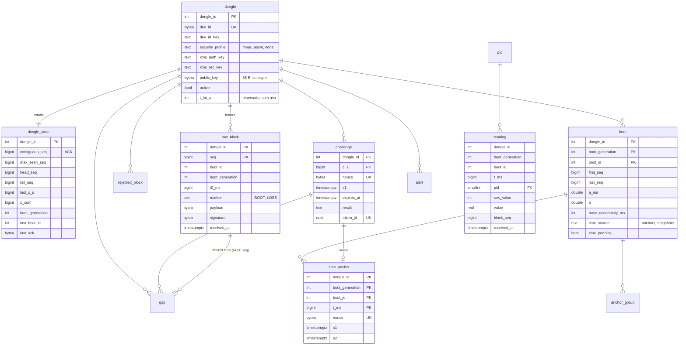

# 02 — Banco de dados e migrations

Estado implementado do esquema PostgreSQL (TimescaleDB + PostGIS), das migrations
goose e do código gerado pelo sqlc. Tudo em `backend/internal/database/`:
`migrations/` (SQL embutido), `queries/` (fonte do sqlc), `dbgen/` (gerado),
`pool.go`, `tx.go`, `listen.go`, `migrations.go`. Nomes de tabelas e colunas em inglês.

## Ferramentas

| Peça | Uso |
|---|---|
| goose v3 (`NewProvider`) | `tccelta migrate [up\|down-to N\|status]`, migrations embutidas; `make new-migration NAME=` cria o arquivo |
| sqlc 1.27 (`backend/sqlc.yaml`) | lê `migrations/` como esquema e `queries/` como consultas; saída `dbgen`, `pgx/v5`, `emit_interface`; `uuid`→`uuid.UUID`, `timestamptz`→`time.Time`, `geography`→`[]byte`. `make sqlc` / `make sqlc-check` (`sqlc diff`, usado na CI) |
| `database.InTransaction` | `SET LOCAL lock_timeout` (3 s) e `statement_timeout` (10 s); `55P03`, `57014` viram `port.ErrDatabaseBusy`; `40P01`/`40001` repetem a função uma vez |
| `database.Listen` | `LISTEN` com reconexão (canais `pid_changed` e `boot_pending`) |

## Migrations

| Arquivo | Conteúdo |
|---|---|
| `00001_extensions.sql` | extensões |
| `00002_dongle.sql` | `dongle` |
| `00003_bronze.sql` | `dongle_state`, `raw_block` (+ 16 partições), `rejected_block` |
| `00004_context.sql` | `boot`, `challenge`, `time_anchor`, `anchor_group`, `gap`, `alert` |
| `00005_pid.sql` | `pid` (+ semente de 7 PIDs e gatilho `pid_changed`) |
| `00006_silver.sql` | `reading`, `position` (hypertables) |
| `00007_extra_roles.sql` | cria papéis ausentes (bancos de teste) |
| `00008_permissions.sql` | `GRANT`s por papel |

## Modelo

### Tabelas

| Tabela | Papel e regras |
|---|---|
| `dongle` | cadastro; `dev_id` (8 B) único; `dev_id_hex` gerada; `kms_auth_key`/`kms_rec_key` = nomes das chaves no Transit; `asym` exige `public_key` (65 B, `04‖X‖Y`); `requested_diag_min` e `t_lat_s` reservados |
| `dongle_state` | `contiguous_seq` (ACK), `max_seen_seq`, `head_seq`, `tail_seq`, `last_c_s`, `c_conf`, `boot_generation`, `last_boot_id`, `last_ack` (TLV 0x04 assinado). `CHECK`s de ordem; gatilho `dongle_state_monotonic` proíbe regressão de `contiguous_seq`, `head_seq`, `last_c_s`, `c_conf`, `max_seen_seq`, geração e `boot_id` |
| `raw_block` | bronze; PK `(dongle_id, seq)` (idempotência); particionada por hash de `dongle_id` em 16 partições `raw_block_p0..15`; `payload` 17–1024 B; `signature` 0/32/64 B; `epoch` = `c_S` do JWT; gatilho `raw_block_immutable` bloqueia `UPDATE`; a API só tem `SELECT`/`INSERT` |
| `rejected_block` | blocos recusados; `reason` ∈ `invalid_tag`, `unknown_pid`, `invalid_marker`, `malformed_record`; `UNIQUE (dongle_id, content_hash)` (reenvio só incrementa `occurrences`) |
| `boot` | PK `(dongle_id, boot_generation, boot_id)`; faixa observada (`first_seq`, `last_seq`, `first_t_ms`, `last_t_ms`, `max_offset_ms`); reta `a_ms`, `b`, `base_uncertainty_ms`, `time_source`; fila do worker (`time_pending`, `pending_since`); `gold_pending` (gancho sem consumidor); `config` sempre nula |
| `challenge` | um desafio por `(dongle_id, c_s)`; `nonce` único; `s1`, `expires_at`; preenchida na resposta (`answered_at` = S2, `boot_*`, `t_ms`, `head_seq`, `tail_seq`, `result` ∈ `accepted`, `accepted_no_anchor`, `invalid_tag`, `inconsistent`, `expired`, `invalid_tag_attempts`, `ack_seq`, `loss_*`, `token_jti`) |
| `time_anchor` | uma linha por handshake com RTT ≤ 2 s: `t_ms` (desembrulhado), `s1`, `s2`, `nonce` |
| `anchor_group` | grupos de âncoras do boot (`ordinal`, `first_t_ms`, `last_t_ms`, `t_center_ms`, `lo_ms`, `hi_ms`, `n_anchors`), regravados a cada recálculo |
| `gap` | lacunas `BOOT`/`LOSS` (com `block_seq`) e `OVERFLOW` (com `c_s`); `UNIQUE (dongle_id, from_seq)` |
| `alert` | `type` ∈ `excessive_drift`, `empty_intersection`, `server_clock_regressed`, `unknown_pid`, `invalid_tag`, `invalid_marker`, `boot_generation_advanced`, `invariant_violated`, `reprocessing` |
| `pid` | catálogo: `value = raw·factor + value_offset`, `raw = A` ou `256·A + B`, faixa válida `min_value`/`max_value`; semente: PIDs 4, 5, 12, 13, 16, 47, 73; gatilho `pid_changed` (NOTIFY) |
| `reading` | hypertable por `received_at` (chunk 1 dia); índice `(dongle_id, boot_generation, boot_id, pid, t_ms)`; compressão `segmentby dongle_id, pid`, após 7 dias (`tccelta.compression_after` configurável) |
| `position` | hypertable idem; `geom geography(PointZ, 4326)`; `source` padrão `app` |

## Permissões (`00008_permissions.sql`)

| Papel | Acesso |
|---|---|
| `tccelta_api` | `SELECT` em `dongle`, `pid`, `anchor_group`; `SELECT, UPDATE` em `dongle_state`; `SELECT, INSERT` em `raw_block`, `time_anchor`, `reading`, `position`, `gap`, `alert`; `SELECT, INSERT, UPDATE` em `rejected_block`, `challenge`, `boot` |
| `tccelta_worker` | `SELECT` em `dongle`, `dongle_state`, `raw_block`, `time_anchor`, `gap`, `pid`; `SELECT, UPDATE` em `boot`; `SELECT, UPDATE (result)` em `challenge`; `SELECT, INSERT` em `alert`; `SELECT, INSERT, DELETE` em `anchor_group` |
| `tccelta_provisioner` | `SELECT, INSERT` em `dongle`, `dongle_state` |
| `tccelta_reader` | `SELECT` em tudo |
| `tccelta_owner` | dono; migrations, `worker reprocess` (`DELETE` em `reading`/`position`) e simulador |

## Consultas (`queries/*.sql`)

`dongle.sql`, `pid.sql`, `state.sql` (`LockDongle` = `pg_advisory_xact_lock(1, dongle_id)`, `ReadState`, `UpdateHandshakeState`, `ReadLastAck`), `challenge.sql` (`IssueChallenge`, `FindChallenge`, `MarkInvalidTag`, `ConsumeChallenge`, `FinalizeChallenge`, `ExpireChallenges`), `blocks.sql` (`ReadStateSnapshot`, `ReadLastBootTMs`, `InsertRawBlocks`, `CopyReadings`/`CopyPositions` em COPY binário, `RegisterRejected`, `UpdateIngestionState`, `UpdateIngestionBoots`), `context.sql`, `worker.sql` (ver `06`), `reprocess.sql`, `verification.sql` (leituras do simulador). Posições geográficas são gravadas por EWKB (`pid.PointZ.EWKB`).

## Mecanismos transversais

- Advisory lock por dongle (`LockDongle`) no início da transação do handshake e do lote, e na TX2 do worker.
- Identidade do boot `(dongle_id, boot_generation, boot_id)`: a volta do `boot_id` (u16) avança `boot_generation` (ver `05`).
- `NOTIFY pid_changed` (catálogo recarregado pela API) e `NOTIFY boot_pending` (acorda o worker).
