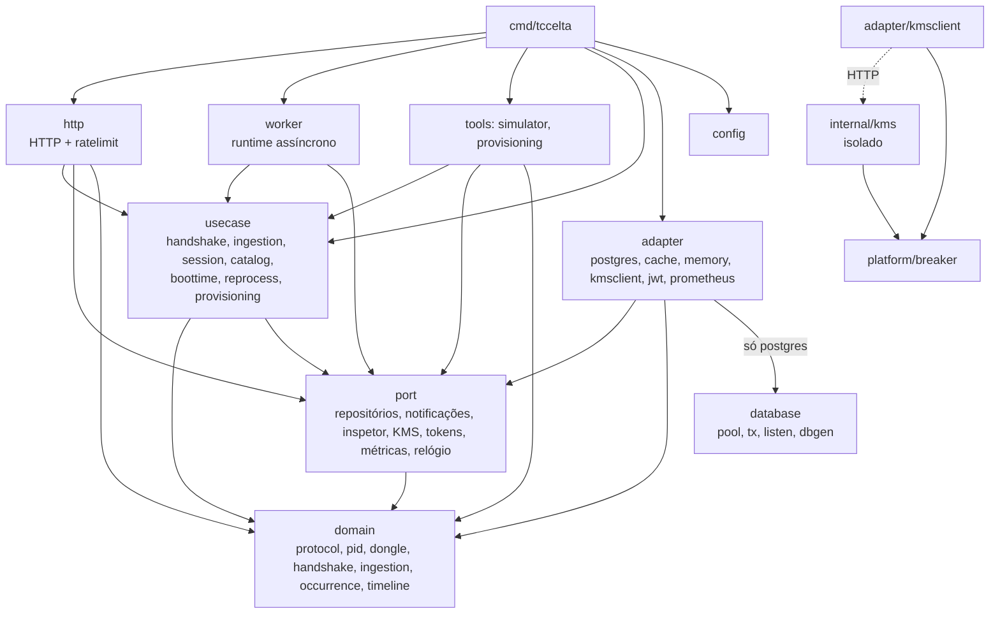

# 03 — Arquitetura da API em Go e pacote `protocol`

Estado implementado de `backend/` (módulo `tccelta/backend`, Go 1.24): camadas
de `internal/`, o pacote de domínio `protocol`, a configuração, a camada HTTP e as
métricas. `cmd/tccelta` é a raiz de composição (`api.go`, `worker.go`, `provision.go`,
`simulator.go`, `main.go`); `cmd/tccelta-kms` compõe o KMS (ver `07`).

## Camadas e dependências

As regras são impostas pelo `depguard` em `backend/.golangci.yml` (`make lint`).

| Camada | Regra |
|---|---|
| `domain` | puro: sem I/O nem dependência de outras camadas |
| `usecase` | só enxerga `domain` e `port`; um caso de uso por arquivo (`Run`) |
| `http` | só enxerga `usecase`, `port` e `domain` |
| `adapter` | implementa `port`; não conhece `usecase` nem `http` |
| `internal/kms` | não importa nenhum outro pacote do projeto (só `platform/breaker`); nada fora dele o importa |
| `worker`, `tools/*` | só enxergam `usecase`, `port` e `domain`; os adaptadores chegam por injeção em `cmd` |
| `pgx`, `database`, `dbgen` | só `adapter/postgres`, `database` e `cmd` os importam |

### Portas (`internal/port/`)

| Arquivo | Interfaces |
|---|---|
| `repository.go` | `Dongles` (`FindByDevID`, `Lock`, `Register`), `Challenges`, `States`, `Boots`, `AnchorGroups`, `Blocks`, `Occurrences`, `Pids`, `Repositories`, `Transactor.InTransaction`, `Notifications` (LISTEN) |
| `inspector.go` | `Inspector`: leitura somente-consulta das verificações do simulador |
| `kms.go` | `Authenticator` (`HMACAuth`, `VerifyBlocks`), `JWTSigner` (`Sign`, `PublicKeys`), `ErrKMSUnavailable` |
| `token.go` | `TokenIssuer`, `TokenValidator`, `Session`, `IssuedToken`, `ErrInvalidToken`, `ErrTokenExpired` |
| `metrics.go` | `MetricsHTTP`, `MetricsHandshake`, `MetricsIngestion`, `MetricsKMS`, `MetricsWorker`, `MetricsReprocess` |
| `phase.go` | `WithKMSPhase`/`KMSPhaseFrom`: fase `pre` (fora da transação) ou `tx` (dentro) como rótulo das métricas do KMS |
| `clock.go`, `errors.go` | `Clock`, `ErrDatabaseBusy` |
| `porttest/` | dublês para testes |

Adaptadores: `postgres` (um arquivo por repositório + `transactor.go`, `notifications.go`, `inspector.go`), `cache` (decorator de `Dongles`: 10 000 entradas, TTL 60 s; só na raiz de composição, dentro de transação vale o banco direto), `memory` (testes), `kmsclient` (HTTP para o KMS; timeout, semáforo, uma nova tentativa para falha de rede, disjuntor 5 falhas/10 s), `jwt` (emissor e validador), `prometheus`.

## Pacote `domain/protocol`

Todos os inteiros são little-endian; os 2 bytes de valor de PID são `A`, `B` crus.

| Constante | Valor |
|---|---|
| `Label` | `"MALCONG"` |
| tipos | `ChallengeType` 0x01, `ResponseType` 0x02, `BlockType` 0x03, `AckType` 0x04 |
| `AuthTagSize` / `RecTagSize` / `NonceSize` | 16 / 32 / 16 |
| `BlockHeaderSize` / `MinDataSize` / `MaxDataSize` / `MarkerSize` / `MarkerBlockSize` | 12 / 17 / 1024 / 11 / 23 |
| `L` por tipo | desafio 45 (ou 47 com diagnóstico), resposta 50, ACK 25, bloco `tamanho + BlockTagSize` |
| `RegLoss` / `RegBoot` / `RegGPS` | 0xFD / 0xFE / 0xFF |

Funções principais: `ReadTLV`, `ReadBatch(body, max)` (lote de TLVs concatenados), `AppendTLV`, `TagInput(tipo, devId, payload)` = `"MALCONG" ‖ tipo ‖ DevId ‖ payload`, `CompareTag` (tempo constante), `DecodeChallenge`/`Challenge.Build`, `DecodeResponse`/`Response.Build`, `DecodeAck`/`Ack.Build`, `DecodeBlock(v, Profile)`, `ReadRecords` (PID 5 B, GPS 15 B, marcador 11 B; marcador não pode vir com outros registros), `BuildMarker`, `BlockBuilder` (usado pelo simulador). `Profile` (`hmac` 32 B, `asym` 64 B, `none` 0 B) define só o tamanho da tag do **bloco**; a do handshake é sempre 16 B. Vetores: `domain/protocol/testdata/vetores.json` (gerado por `scripts/gerar_vetores.py`, independente) e `vetores_firmware.json` (do `vectors.py` da Fase 1).

Decodificação de leituras (`domain/pid.Decode`): `raw = A` ou `256·A + B`; `value = raw·factor + offset`, `NULL` fora de `[min, max]`; GPS: `lat/lon = E7 / 1e7`, `alt = mm / 1000`; `t_ms = t0 + Δt`.

## Configuração (`internal/config`, variáveis de ambiente)

Segredos por arquivo: `<NOME>_ARQUIVO`.

| Grupo | Variável (padrão) |
|---|---|
| geral | `AMBIENTE` (`dev`), `LOG_NIVEL` (`info`), `LOG_FORMATO` (`json`; `texto`), `PERMITIR_PERFIL_NONE` (falso; inválido em `producao`) |
| HTTP | `HTTP_ENDERECO` (`:8080`), `METRICAS_ENDERECO` (`:9090`), `SAUDE_ENDERECO_WORKER` (`:8090`), `PROXIES_CONFIAVEIS` |
| banco | `BANCO_URL`, `BANCO_SENHA`, `BANCO_POOL_MAX` (40), `BANCO_POOL_MIN` (4) |
| KMS | `KMS_URL`, `KMS_CACERT`, `KMS_CLIENT_CERT`, `KMS_CLIENT_KEY`, `KMS_TIMEOUT` (2s), `KMS_MAX_CONCORRENCIA` (32), `KMS_VERIFY_LOTE` (32), `KMS_VERIFY_PARALELO` (1) |
| JWT | `JWT_EMISSOR` (`tccelta-api`), `JWT_AUDIENCIA` (`tccelta-ingestao`), `JWT_VALIDADE` (1h), `JWT_FOLGA` (30s) |
| protocolo | `DESAFIO_VALIDADE` (60s), `DESAFIO_MAX_PENDENTES` (3), `ANCORA_RTT_MAX` (2s), `LOTE_MAX_BLOCOS` (32), `T_LAT_SUGERIDO` (60s) |
| limites | `LIMITE_DESAFIO_MIN` (6), `LIMITE_RESPOSTA_MIN` (12), `LIMITE_BLOCOS_MIN` (120), `LIMITE_IP_MIN` (120), `INGESTAO_MAX_SIMULTANEAS` (32), `INGESTAO_ESPERA_VAGA` (100ms), `RETRY_AFTER_SOBRECARGA` (5), `REDIS_ENDERECO`, `REDIS_SENHA`, `REDIS_TIMEOUT` (50ms) |
| worker | `WORKER_CONCORRENCIA` (4), `WORKER_INTERVALO_POLL` (30s), `WORKER_INTERVALO_EXPIRACAO` (60s), `ANCORA_JANELA_GRUPO` (10m), `DERIVA_MAX_PPM` (40), `ANCORA_SPAN_MIN` (1h), `MEIA_LARGURA_MIN_MS` (0,5) |

## HTTP (`internal/http`)

`http.ServeMux` da stdlib. Servidor: `ReadHeaderTimeout` 5 s, `ReadTimeout` 15 s, `WriteTimeout` 30 s, `IdleTimeout` 120 s.

| Rota | Cadeia de middlewares (de fora para dentro) |
|---|---|
| `POST /v1/dongles/{id}/desafio` | recover, instrument, `limitIP`, `limitDevID` (`LIMITE_DESAFIO_MIN`) |
| `POST /v1/dongles/{id}/desafio/resposta` | recover, instrument, `annotateS2`, `limitIP`, `limitDevID` (`LIMITE_RESPOSTA_MIN`) |
| `POST /v1/dongles/blocos` | recover, instrument, `limitIP`, `authenticateJWT(false)`, `limitDevID` (`LIMITE_BLOCOS_MIN`), `limitConcurrency`, `limitBody(LOTE_MAX_BLOCOS·1059 + 64)` |
| `GET /v1/dongles/{id}/confirmacao` | recover, instrument, `limitIP`, `authenticateJWT(true)` (sub = `{id}`), `limitDevID` (60/min) |
| `GET /saude/viva`, `GET /saude/pronta` | `pronta`: banco, KMS, catálogo de PIDs e chaves públicas do JWT; 503 `nao_pronto` em encerramento ou dependência fora |

Rate limit (`http/ratelimit`): janela por minuto por escopo e chave (IP, DevId); `LocalLimiter` em memória, `RedisLimiter` (script Lua) e `LimiterWithFallback` (falha do Redis nunca vira 503; conta `tccelta_limiter_redis_failures_total`); semáforo `Concurrency` para a ingestão (`INGESTAO_MAX_SIMULTANEAS`, espera `INGESTAO_ESPERA_VAGA`, senão 503 `sobrecarga`). IP do cliente: `RemoteAddr`, ou `X-Real-IP` se vier de `PROXIES_CONFIAVEIS`.

### Erros (`problem+json`, RFC 9457)

Corpo `{"type":"https://tccelta.local/erros/<codigo>","title","status","codigo","detail"}`; `Retry-After` quando aplicável.

| Status | `codigo` | Origem |
|---|---|---|
| 400 | `devid_invalido`, `corpo_malformado`, `base64_invalido`, `tlv_invalido`, `lote_malformado` | requisição |
| 401 | `token_ausente`, `token_invalido`, `token_expirado` | JWT |
| 403 | `dongle_inativo`, `perfil_nao_permitido`, `token_outro_dongle` | acesso |
| 404 | `dongle_desconhecido`, `sem_confirmacao` | cadastro / confirmação |
| 409 | `desafio_invalido`, `c_s_antigo` | resposta ao desafio |
| 413 / 415 | `corpo_grande` / `tipo_conteudo` | corpo |
| 422 | `tag_invalida`, `resposta_inconsistente`; lote sem progresso (corpo = ACK `octet-stream`) | resposta / lote |
| 429 | `limite_taxa`, `desafios_pendentes`, `lote_grande` | limites |
| 503 | `kms_indisponivel`, `banco_ocupado`, `sobrecarga`, `nao_pronto` | dependências (`Retry-After` com jitter) |
| 500 | `erro_interno` | bug |

Regra para o cliente: o corpo é um ACK se e só se o `Content-Type` é `application/octet-stream`.

## Logs e métricas

`log/slog` (JSON ou texto), eventos como `handshake.desafio_emitido`, `handshake.aceito`, `lote.interrompido`. Métricas Prometheus em `METRICAS_ENDERECO/metricas` (registro próprio, sem `go_*`): `tccelta_http_requests_total`, `tccelta_http_duration_seconds`, `tccelta_blocks_total`, `tccelta_batches_total`, `tccelta_ingestion_tx_duration_seconds`, `tccelta_inserted_rows_total`, `tccelta_handshakes_total`, `tccelta_anchor_rtt_seconds`, `tccelta_gaps_total`, `tccelta_kms_calls_total`, `tccelta_kms_duration_seconds`, `tccelta_kms_breaker_open`, `tccelta_rejections_total`, `tccelta_limiter_redis_failures_total`, `tccelta_reprocessing_rows_total`, `tccelta_worker_*`, `tccelta_pool_*`. Descrição completa em `backend/docs/metricas.md`.
