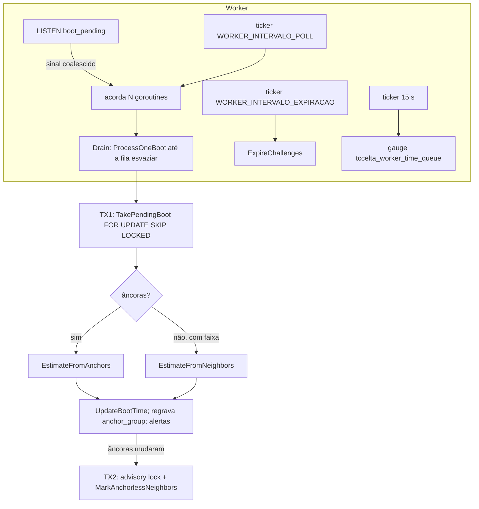

# 06 — Worker assíncrono (âncora de tempo por boot)

Estado implementado: `internal/worker/worker.go` (runtime assíncrono),
`internal/usecase/boottime/boottime.go` (cálculo e transações),
`internal/domain/timeline/timeline.go` (algoritmo puro), consultas em
`internal/database/queries/worker.sql`, composição em `cmd/tccelta/worker.go`.
O worker acessa o banco só pelas portas de `internal/port` (ligadas em `cmd/tccelta/worker.go`) e não tem acesso ao Vault.

## Processo

- `WORKER_CONCORRENCIA` (4) goroutines; cada uma drena a fila e espera o sinal de `NOTIFY boot_pending` ou o `WORKER_INTERVALO_POLL` (30 s). A conexão `LISTEN` reconecta (`tccelta_worker_listen_reconnections_total`).
- Expiração: a cada `WORKER_INTERVALO_EXPIRACAO` (60 s) marca `challenge.result = 'expired'` nos desafios vencidos sem resposta.
- Saúde: `GET /saude/viva` em `SAUDE_ENDERECO_WORKER` (`:8090`); métricas em `METRICAS_ENDERECO`.
- Uma unidade de trabalho = um boot = uma transação (`statement_timeout` 10 s). `TakePendingBoot`: `ORDER BY pending_since LIMIT 1 FOR UPDATE SKIP LOCKED`.

## Algoritmo (`domain/timeline`)

`hora_real_ms(t) = a_ms + (1 + b) · t_ms`.

| Etapa | Regra |
|---|---|
| Âncora | `(t_ms, S1, S2)`; deslocamento `o = hora_real − t_ms` ∈ `[S1 − t_ms, S2 − t_ms]` |
| `GroupAnchors` | ordena por `t_ms`; janela `ANCORA_JANELA_GRUPO` (10 min) contada da **primeira** âncora do grupo; interseção `[Lo, Hi]` dos intervalos; interseção vazia fecha o grupo e gera alerta `empty_intersection` |
| Ajuste | um grupo ⇒ `a` = centro, `b = 0`; vários ⇒ mínimos quadrados ponderados por `1/h²` (meia largura mínima `MEIA_LARGURA_MIN_MS` = 0,5 ms); `b ≠ 0` só se o intervalo entre centros ≥ `ANCORA_SPAN_MIN` (1 h) e `|b| > σ_b` |
| Alerta de deriva | `excessive_drift` se `|b| − 2σ_b > DERIVA_MAX_PPM` (40 ppm) |
| Incerteza base | `ceil(menor meia largura dos grupos)` ms; `Uncertainty(t)` = meia largura do grupo mais próximo + `DERIVA_MAX_PPM · |t − TCentro|` |
| Sem âncora | `EstimateFromNeighbors`: usa o boot ancorado **anterior** (obrigatório) e o **seguinte** (por `first_seq`); `lo = (fim do anterior − incerteza) − first_t_ms do boot`, `hi = (início do seguinte + incerteza) − last_t_ms`, limitado também por `max_offset_ms` (menor `received_at − t_ms`); `lo > hi` ⇒ `empty_intersection`; resultado `b = 0`, `a = (lo+hi)/2`, `time_source = 'neighbors'` |
| `Unwrap` | `t32 + k·2³²` mais próximo da referência (último `t_ms` do boot) |

Configuração padrão em `timeline.DefaultConfig()`: 10 min, 40 ppm, 0,5 ms, 1 h.

## Efeitos por boot

1. `UpdateBootTime` grava `a_ms`, `b`, `base_uncertainty_ms`, `time_source`, `time_updated_at` e zera `time_pending`.
2. `DeleteAnchorGroups` + `CopyAnchorGroups` (COPY) regravam os grupos quando a origem é `anchors`.
3. `InsertAlertIfNew`: um alerta por boot e tipo em 24 h.
4. Se a reta por âncoras mudou (ou não existia), a TX2 toma `pg_advisory_xact_lock` do dongle (`lock_timeout` 3 s) e `MarkAnchorlessNeighbors` marca `time_pending = true` nos boots sem âncora entre o boot ancorado anterior e o seguinte (por `first_seq`); falha só adia (`worker.vizinhos_adiados`).

## Permissões do papel `tccelta_worker`

`SELECT` em `dongle`, `dongle_state`, `raw_block`, `time_anchor`, `gap`, `pid`; `SELECT, UPDATE` em `boot`; `UPDATE (result)` em `challenge`; `INSERT` em `alert`; `INSERT, DELETE` em `anchor_group`. Não escreve em `reading`/`position`.

## Métricas

`tccelta_worker_processed_boots_total{source}` (`anchors`, `neighbors`, `no_estimate`), `tccelta_worker_duration_seconds`, `tccelta_worker_time_queue`, `tccelta_worker_alerts_total{type}`, `tccelta_worker_expired_challenges_total`, `tccelta_worker_listen_reconnections_total`, `tccelta_worker_anchor_groups_written_total`. Logs `worker.boot_recalculado`, `worker.erro`, `worker.expiracao_falhou`.

## Testes

`domain/timeline` (grupos, reta, vizinhos, desenrolar do `t_ms`), cenário `time` do simulador (4 âncoras, `time_source = anchors`, incerteza ≤ 2000 ms, hora reconstruída a menos de 10 s do relógio), cenário `e2e` (verificação 6) e `generation`.
