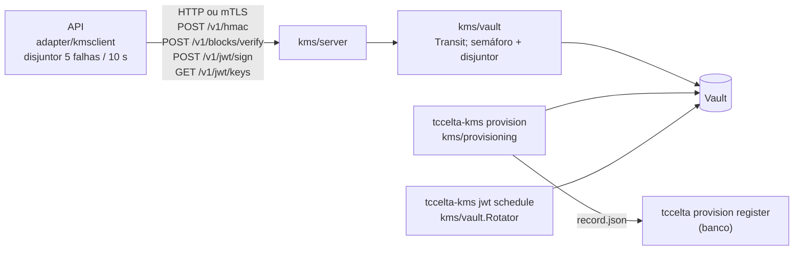
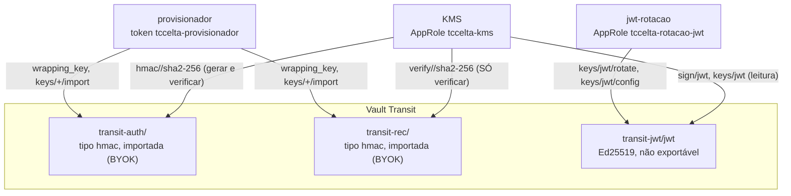

# 07 — KMS e Vault (Transit)

Estado implementado do serviço KMS (`cmd/tccelta-kms`, `internal/kms/`), do
Vault (`deploy/kms/vault/`), do cliente na API (`internal/adapter/kmsclient/`) e do
provisionamento. O KMS é um binário e uma imagem próprios, no mesmo módulo Go da
API, e é o **único** cliente do Vault em runtime. Contratos de referência:
`backend/docs/kms.md`, `kms-http-contract.md` e `kms-dongle-record.md`.

## Componentes

| Pacote | Papel |
|---|---|
| `internal/kms/server` | um arquivo por endpoint (`hmac.go`, `verify_blocks.go`, `sign_jwt.go`, `public_keys.go`), `auth.go` (mTLS), `health.go`, `problem.go`, `body.go` |
| `internal/kms/vault` | cliente do Vault (`client.go`: AppRole/token, renovação, `Ready`), operações Transit (`vault.go`), rotação do JWT (`rotation.go`), `vaulttest/fake.go` |
| `internal/kms/provisioning` | importação BYOK (`wrap.go`), `record.json`, teste dourado, material NVS (`material.go`) |
| `internal/kms/config`, `internal/kms/metrics` | variáveis de ambiente; séries `tccelta_kmssvc_*` |
| `adapter/kmsclient` | implementa `port.Authenticator` e `port.JWTSigner` por HTTP |

## Contrato HTTP API ↔ KMS (nomes em inglês; erros em português)

| Rota | Função |
|---|---|
| `POST /v1/hmac` | `{key, inputs[]}` ⇒ `{macs[]}`: HMAC-SHA256 completo (32 B) com `K_auth`; a API trunca para 16 B e compara em tempo constante |
| `POST /v1/blocks/verify` | `{key, inputs[], tags[]}` ⇒ `{valid[]}`: verifica a tag de 32 B com `K_rec`, numa só chamada ao Vault (`batch_input`); tag errada é `false`, não erro |
| `POST /v1/jwt/sign` | `{input}` (signing string) ⇒ `{signature (64 B), version}` |
| `GET /v1/jwt/keys` | `{"<versão>": "<chave pública Ed25519 em base64>"}` das versões ainda válidas |
| `GET /saude/viva`, `GET /saude/pronta` | pronta = token do Vault válido e disjuntor fechado; também em `KMS_METRICAS_ENDERECO` (`:9300`) junto com `/metricas` |

Convenções: JSON UTF-8, `Content-Type: application/json`, campos desconhecidos recusados, base64 padrão, corpo ≤ 1 MiB, listas de 1 a 256 itens e itens de 1 a 4096 B, `key` com `[A-Za-z0-9_-]{1,64}`. Erros `problem+json`: `corpo_malformado`, `chave_invalida`, `entradas_invalidas` (400), `cliente_nao_autenticado` (401), `cliente_nao_autorizado` (403), `corpo_grande` (413), `tipo_conteudo` (415), `kms_indisponivel` (503, com `Retry-After`), `nao_pronto`, `erro_interno`. Na API, erro de rede/timeout/429/5xx vira `ErrKMSUnavailable` (503 `kms_indisponivel`); outros 4xx são bug de contrato (500). Cliente da API: `KMS_TIMEOUT` 2 s, `KMS_MAX_CONCORRENCIA` 32, uma nova tentativa para falha de rede.

Segurança de transporte: fora de `AMBIENTE=dev` o KMS exige TLS com certificado de cliente assinado por `KMS_TLS_CLIENT_CA` **e** CN igual a `KMS_TLS_CLIENTE_CN` (padrão `tccelta-api`); outro CN da mesma CA recebe 403.

## Uso das chaves

| Chave | Operações permitidas ao KMS | Negadas |
|---|---|---|
| `K_auth` (`transit-auth`) | `hmac/*` (Desafio 0x01, ACK 0x04, tag da Resposta 0x02) | `keys/*`, `export/*`, `backup/*`, `byok-export/*` |
| `K_rec` (`transit-rec`) | `verify/*` | `hmac/*`, `keys/*`, `export/*`, `backup/*`, `restore*`, `byok-export/*` |
| JWT (`transit-jwt/jwt`) | `sign/jwt`, leitura de `keys/jwt` | `keys/jwt/*`, `export/*`, `backup/*` |
| tudo | — | `sys/*` |

As políticas estão em `deploy/kms/vault/policies/` e são aplicadas por `deploy/kms/vault/scripts/bootstrap.sh` (idempotente), que habilita os três mounts, cria a chave Ed25519 do JWT (`exportable=false`, `allow_plaintext_backup=false`), grava as políticas `tccelta-kms`, `tccelta-provisionador`, `tccelta-rotacao-jwt` (e `tccelta-teste-dourado`, só no perfil dev), cria os AppRoles `tccelta-kms` e `tccelta-rotacao-jwt` e emite o token do provisionador (24 h) em volumes separados, de propriedade `65532`, modo `0400`. A garantia de que o KMS não gera MAC com `K_rec` vem da role ter uma única política, que não concede o caminho, mais os testes negativos; os `deny` documentam a intenção.

A política do provisionador permite `transit-auth|rec/keys/+/import` apenas com `type=hmac` e `ciphertext`, negando `exportable`, `allow_plaintext_backup`, `allow_rotation` e `derived`.

Perfis de bloco: o caminho de verificação implementado é o HMAC `K_rec` (perfil `hmac`). Ver `DESVIOS-E-MELHORIAS.md` para `asym` e `none`.

## Provisionamento (`tccelta-kms provision`, `internal/kms/provisioning`)

Em duas etapas, nesta ordem: KMS importa as chaves e grava `<out>/<devid>/record.json` (`tccelta.dongle.record.v1`); depois `tccelta provision register --file` (arquivo ou diretório) cadastra `dongle` + `dongle_state`. Ambos idempotentes; nunca existe dongle no banco sem chave no Vault.

| Subcomando | Efeito |
|---|---|
| `new --count N [--profile hmac\|asym\|none] [--hw dev\|devsec] [--no-material] [--csv-out F]` | gera dongles de teste (DevId livre consultando o Vault), importa `K_auth`/`K_rec` por BYOK, grava o material NVS (`secnvs.bin` por `esp_idf_nvs_partition_gen` na imagem `kms-tools`, CSV só em memória; `devsec` cifra e grava `nvs_keys.bin`) e `bench_keys.json`; recusado em `producao` |
| `import --file dongles.csv` | importa chaves de teste (`dev_id_hex,k_auth_hex,k_rec_hex,perfil`) e roda o teste dourado (só dev); recusado em `producao` |
| `import-record --file kms_record.json` | consome o envelope do firmware (`tccelta.kms.v1`): `alg` `vault-byok-rsa-oaep-sha256-aes-kwp` (confere o `kid` da wrapping key atual) ou `none` (fora de `producao`); perfil `asym` exige `k_sig_public` (65 B) |
| `export-wrapping --out F` | grava `kms_wrapping.json` (`tccelta.kms.wrapping.v1`) com `{auth, rec}: {kid, pem}` das wrapping keys RSA dos mounts |
| `verify --file CSV` ou `--dev-id` | teste dourado: HMAC do Vault = HMAC local; `verify` aceita a tag certa e recusa a errada |

`Wrap` implementa o BYOK do Transit: `RSA-OAEP-SHA256(K_e) ‖ AES-KWP(K_e, chave)` (RFC 5649). `record.json`: `schema`, `dev_id`, `profile`, `kms_auth_key`, `kms_rec_key`, `public_key` (só `asym`), `description`.

## Rotação da chave do JWT

`Rotator` (`kms/vault/rotation.go`) sobre `transit-jwt/keys/jwt`: `Check(force)` rotaciona se a versão mais nova tem idade ≥ `JWT_ROTACAO_PERIODO` (720 h) ou com `--now`, e depois expurga (sobe `min_decryption_version`) as versões cujo sucessor tem mais que `JWT_VALIDADE` (+ folga) de idade, para que tokens ainda válidos continuem aceitos. `tccelta-kms jwt rotate [--now]` roda uma vez; `jwt schedule` (serviço `jwt-rotacao`) repete a cada `JWT_ROTACAO_VERIFICACAO` (1 h). A API não rotaciona nem expurga; ela revalida as chaves públicas (ver `08`). Métricas `tccelta_kmssvc_jwt_rotations_total` e `tccelta_kmssvc_jwt_last_check_ok`.

## Configuração do KMS

Variáveis: `AMBIENTE`, `KMS_ENDERECO`, `KMS_METRICAS_ENDERECO`, `KMS_TLS_CERT`, `KMS_TLS_KEY`, `KMS_TLS_CLIENT_CA`, `KMS_TLS_CLIENTE_CN`, `VAULT_ADDR`, `VAULT_CACERT`, `VAULT_CLIENT_CERT`, `VAULT_CLIENT_KEY`, `VAULT_APPROLE_ROLE_ID_ARQUIVO`, `VAULT_APPROLE_SECRET_ID_ARQUIVO`, `VAULT_TOKEN_ARQUIVO`, `VAULT_TIMEOUT` (2 s), `VAULT_RETENTATIVAS` (1), `VAULT_MAX_SIMULTANEAS` (32), `VAULT_MOUNT_AUTH|REC|JWT`, `VAULT_CHAVE_JWT`, `JWT_VALIDADE`, `JWT_FOLGA`, `JWT_ROTACAO_PERIODO`, `JWT_ROTACAO_VERIFICACAO`. Tabela completa em `backend/docs/kms.md`.

## Testes

`kms/server`, `kms/vault` (com `vaulttest` fake), `kms/provisioning` (inclui conferir que o `record.json` gravado é exatamente o aceito pelo `tools/provisioning`), `kms/config`, `platform/breaker`, `adapter/kmsclient` (exemplos do contrato palavra por palavra). O teste dourado contra um Vault real roda em `provision import` (`make seed-dev`) e em `provision verify`.
