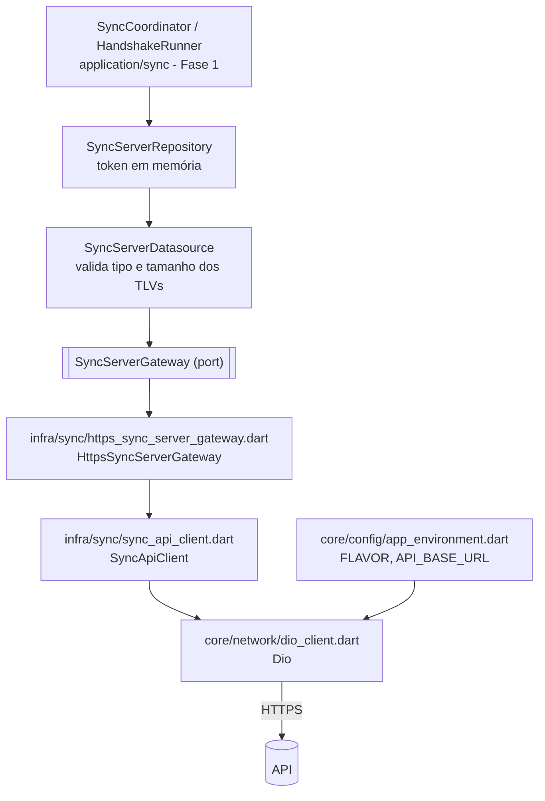

# 09 — Integração HTTPS no app Flutter

Estado implementado em `mobile-app/`: o adapter `HttpsSyncServerGateway` (sobre
`dio`) que implementa o port `SyncServerGateway` da Fase 1 (`services/sync/`),
mais ambiente, cliente HTTP e seleção do gateway. Token, handshake, buffer,
gatilhos e política de reenvio estão na Fase 1 (`fase-1/07` e `09`); esta fase não os
redefine.

## Camadas

## Ambiente (`core/config/app_environment.dart`)

`AppEnvironment.fromDefines()` lê `--dart-define` `FLAVOR` (`dev`, `prodlike`, `producao`; padrão `dev`) e `API_BASE_URL` (padrão `https://10.0.2.2:8443`). A URL deve ser `https`; `http` só no flavor `dev` (`permiteHttpSemTls`); valor inválido lança `SyncLinkFailure`. `appEnvironmentProvider` expõe o objeto.

Arquivos `mobile-app/env/`: `dev.json` (`https://api.seudominio.com.br`, caminho do túnel), `lan.json` (`https://192.168.0.10:8443`, CA do Caddy), `prodlike.json`; `env/*.local.json` fica no `.gitignore`. Execução: `fvm flutter run --dart-define-from-file=env/dev.json`. O servidor embutido de bancada continua selecionável em *debug* por `--dart-define=SYNC_SERVER=bench|stub` (ver `fase-1/09`).

## Cliente HTTP (`core/network/dio_client.dart`)

`createSyncDio(env, {trustedCa})`: `baseUrl` da `API_BASE_URL`; timeouts de conexão 10 s, envio 30 s e recepção 30 s; `responseType: bytes`; `validateStatus` aceita 200–599 (o status é tratado pelo cliente, porque o 422 do lote traz o ACK no corpo). Com `trustedCa` usa `IOHttpClientAdapter` com `SecurityContext(withTrustedRoots: true)` mais a CA informada; em *debug* um interceptor (`SecretFreeLogInterceptor`) registra método, caminho, status e tempo, sem corpo nem cabeçalhos. `syncTrustedCaProvider` (padrão `null`) é sobrescrito em `main.dart` com o conteúdo de `assets/dev/caddy-root.crt`, se existir (plano B na LAN); `syncDioProvider` monta o `Dio`.

Rede nativa: o manifesto de *debug* (`android/app/src/debug/res/xml/network_security_config.xml`) confia na CA do usuário e permite HTTP puro para `10.0.2.2`; o release confia só nas CAs do sistema e não permite HTTP.

## `SyncApiClient` (`infra/sync/sync_api_client.dart`)

| Método | Requisição | Retorno |
|---|---|---|
| `requestChallenge(devIdHex)` | `POST /v1/dongles/<hex>/desafio`, `Accept: application/json` | `(desafio, expiraEm)` |
| `submitResponse(devIdHex, respostaB64)` | `POST .../desafio/resposta`, JSON `{"resposta": ...}` | `(ack, token, tokenValidadeS, tLatS?)` |
| `postBlocks(body, token)` | `POST /v1/dongles/blocos`, `application/octet-stream`, `Authorization: Bearer` | `BinaryResponse(status, body, headers)` |
| `latestConfirmation(devIdHex, token)` | `GET .../confirmacao`, Bearer | `BinaryResponse` |

`SyncApiException(status, code, retryAfter)` carrega o `codigo` do `problem+json` e o `Retry-After` (segundos inteiros). `BinaryResponse.isOctetStream` decide se o corpo é um ACK.

## Adapter (`HttpsSyncServerGateway`, `mode = 'https'`)

| Operação | Comportamento |
|---|---|
| `requestChallenge` | `Base64Bytes.decode` do `desafio`; exige TLV tipo 0x01 com `L` 45 ou 47; `expiresAt` = `expira_em` |
| `submitResponse` | envia `Base64Bytes.encode(response.toTlv())`; exige TLV 0x04 com `L` 25; `tokenExpiresAt` = agora (relógio local, UTC) + `token_validade_s`; `suggestedLatency` = `t_lat_s` |
| `postBlocks` | corpo = concatenação exata de `toTlv()` dos blocos; se `Content-Type` é `octet-stream` e o status é 200, devolve o ACK; se 422, lança `ServerBatchNoProgress(ack)`; senão converte o erro |
| `latestConfirmation` | 404 ⇒ `null`; senão ACK |
| erros | `DioException`/`TimeoutException` ⇒ `ServerUnavailable`; `FormatException` ⇒ `ServerMalformed('resposta_fora_do_contrato')` |

Mapeamento de status/`codigo` para as exceções do port:

| Status | Exceção |
|---|---|
| 401 | `ServerUnauthorized(codigo)` |
| 403 | `token_outro_dongle` ⇒ `ServerForbiddenOtherDongle`; demais ⇒ `ServerDongleBlocked(codigo)` |
| 404 | `sem_confirmacao` ⇒ `ServerNoConfirmation`; demais ⇒ `ServerDongleBlocked` |
| 409 | `ServerChallengeRejected` |
| 422 | `ServerResponseRejected(inconsistent: codigo == resposta_inconsistente)` |
| 429 | `ServerRateLimited(retryAfter, padrão 1 s)` |
| 400 / 413 / 415 | `ServerMalformed(codigo)` |
| ≥ 500 | `ServerUnavailable(retryAfter)` |

Os bytes dos TLVs passam sem alteração entre BLE e HTTP. Sem novas tentativas dentro do adapter: a política (backoff 1 s a 5 min, `Retry-After`, lote pela metade, token que expira) é do `SyncCoordinator` (`fase-1/07`), que reage a cada `PostResult`. Os cabeçalhos `X-Lote-*` **não** são lidos pelo app; o coordenador decide pelo ACK devolvido (cursor) e pelos erros.

## Gatilhos de handshake

Implementados no `SyncCoordinator` (`HandshakeTrigger`): `noticeNoSession` (aviso com bit 0 ou sessão fechada), `noticeNoBootAnchor` (bit 1), `tokenExpiring` (token a menos de `kTokenRenewMargin` = 5 min de expirar, antes do POST), `unauthorized` (401/403), `dongleNoSession` (erro 0x05), `dongleRejected` (erros 0x01/0x02), `manual`. O gatilho `anchorFailed` existe no enum mas não é disparado.

## Providers (`ui/sync/sync_providers.dart`)

`kSyncServerMode` = `--dart-define=SYNC_SERVER` (padrão `https`). `syncServerGatewayProvider`: em *debug*, `bench` ⇒ `BenchSyncServerGateway`, `stub` ⇒ `UnavailableSyncServerGateway`; qualquer outro caso (incluindo *release*) ⇒ `HttpsSyncServerGateway(SyncApiClient(syncDioProvider))`. Token só em memória (`SyncServerRepositoryImpl`).

## Testes

| Arquivo | Cobre |
|---|---|
| `test/infra/sync/https_sync_server_gateway_test.dart` | `dio` dublado: bytes do TLV preservados, `L` do desafio, corpo do POST, ACK do lote (200/422), mapeamento de status/`codigo`, 404 da confirmação, `AppEnvironment` (https sempre, http só no dev) |
| `test/core/network/dio_client_test.dart` | opções do `Dio` e CA confiável |
| `test/core/encoding/base64_bytes_test.dart` | codec base64 estrito |
| `test/data/repositories/sync_server_repository_impl_test.dart`, `test/application/sync/*` | repository, coordenador e `HandshakeRunner` (Fase 1) |
