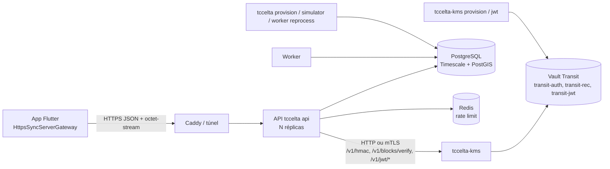

# Fase 3 — Servidor (API Go + PostgreSQL + KMS) e integração HTTPS do app

Documentação do estado implementado do lado servidor (`backend/`) e da ponte
HTTPS no app (`mobile-app/`). Divergências em relação ao plano original:
[`DESVIOS-E-MELHORIAS.md`](DESVIOS-E-MELHORIAS.md). O `backend/README.md` e
`backend/docs/*.md` complementam (Makefile, ambientes, métricas, contrato do KMS,
cenários do simulador).

## O que a fase entrega

- API HTTP em Go (`cmd/tccelta api`): handshake (desafio 0x01 → resposta 0x02 → ACK 0x04 + JWT, com âncora de tempo de Cristian), ingestão de lotes de blocos 0x03 em Go-Back-N estrito com marcadores BOOT/LOSS, e confirmação.
- Worker (`cmd/tccelta worker`) que recalcula a reta de tempo de cada boot e expira desafios; `worker reprocess` refaz `reading`/`position` a partir de `raw_block`.
- KMS (`cmd/tccelta-kms`): único cliente do Vault (Transit) em runtime; HMAC `K_auth`, verificação `K_rec`, assinatura Ed25519 do JWT, rotação da chave do JWT, provisionamento (BYOK).
- PostgreSQL + TimescaleDB + PostGIS (bronze, contexto, silver), Redis (rate limit), Caddy/túnel, Docker Compose (dev, prodlike, teste).
- Simulador de dongles e apps virtuais (`cmd/tccelta simulator`) e `make e2e`.
- App: `HttpsSyncServerGateway` sobre `dio`, atrás do port `SyncServerGateway` (Fase 1).

Um único módulo Go (`tccelta/backend`), dois binários: `cmd/tccelta` (api, worker, migrate, provision register, simulator, health) e `cmd/tccelta-kms` (serve, jwt, provision, health).

## Arquitetura



## Índice

| # | Documento | Conteúdo |
|---|---|---|
| 01 | [`01-infra-docker-compose.md`](01-infra-docker-compose.md) | Compose (dev, prodlike, teste), redes, volumes, segredos, Caddy, Dockerfile, Makefile |
| 02 | [`02-banco-migrations.md`](02-banco-migrations.md) | Esquema, migrations, papéis e permissões, sqlc |
| 03 | [`03-api-go-arquitetura.md`](03-api-go-arquitetura.md) | Camadas de `internal/`, pacote `protocol`, configuração, HTTP, métricas |
| 04 | [`04-endpoints-handshake.md`](04-endpoints-handshake.md) | Desafio e resposta |
| 05 | [`05-endpoint-ingestao-blocos.md`](05-endpoint-ingestao-blocos.md) | Lote, regras BOOT/LOSS, ACK, `X-Lote-*`, confirmação, reprocessamento |
| 06 | [`06-worker-assincrono.md`](06-worker-assincrono.md) | Âncoras, reta de tempo, vizinhos, expiração |
| 07 | [`07-kms-vault.md`](07-kms-vault.md) | Serviço KMS, Vault, políticas, provisionamento, rotação do JWT |
| 08 | [`08-jwt-e-autenticacao-app.md`](08-jwt-e-autenticacao-app.md) | Emissão e validação do JWT |
| 09 | [`09-app-integracao-https.md`](09-app-integracao-https.md) | Ponte HTTPS no app |
| 10 | [`10-simulador-e-testes-de-carga.md`](10-simulador-e-testes-de-carga.md) | Simulador, cenários, testes, CI |
| — | [`DESVIOS-E-MELHORIAS.md`](DESVIOS-E-MELHORIAS.md) | Desvios do plano e melhorias possíveis |

## Mapa de pastas de `backend/`

```
cmd/tccelta/  cmd/tccelta-kms/        raízes de composição (finas)
internal/domain/{protocol,pid,dongle,handshake,ingestion,occurrence,timeline}   regras puras
internal/port/                        todas as portas (+ porttest)
internal/usecase/{catalog,handshake,ingestion,session,boottime,reprocess,provisioning}
internal/adapter/{postgres,cache,memory,kmsclient,jwt,prometheus}
internal/http/ (+ratelimit)            transporte HTTP
internal/worker/                      runtime assíncrono do recálculo de tempo
internal/tools/{simulator,provisioning}
internal/database/                    pool, tx, listen, migrações, queries, dbgen (sqlc)
internal/kms/{server,vault,provisioning,config,metrics}   serviço KMS isolado
internal/platform/breaker/  internal/config/  internal/version/
deploy/{caddy,postgres,observability,segredos,kms/{vault,certs,compose.yaml}}
docs/  scripts/  testdata/  compose*.yaml  Dockerfile  Makefile  sqlc.yaml
```

## Convenções de nomes

Identificadores de código, tabelas, colunas, CLI e métricas estão em inglês. Ficam em português por serem contrato de fio ou de operação: rotas (`/v1/dongles/{id}/desafio`...), campos JSON do handshake (`desafio`, `resposta`, `expira_em`, `token_expira_em`, `token_validade_s`), códigos de erro `problem+json` (`codigo`), cabeçalhos `X-Lote-*`, variáveis de ambiente, alvos do Makefile e serviços do compose.

## Contratos com a Fase 1

Ver a tabela de contratos cruzados em [`../README.md`](../README.md): TLV e entradas de tag, regras de marcadores, TAIL efetivo, `c_S = max(último + 1, segundos Unix)`, vetores de teste (`vetores_firmware.json`), port do app.

## Como verificar

```
cd backend
make up && make seed-dev       # stack dev + 3 dongles de teste
make e2e                       # stack isolada, 4 cenários do simulador
make test                      # go test -race ./... em contêiner
```

Estado de verificação (do próprio `backend/README.md`): os alvos foram lidos, mas não reexecutados por completo depois dos refactors; `make lint`, `reconnection`, `load` e `knee` não foram rodados depois da reorganização, e a carga (metas M1–M6) nunca foi medida.
