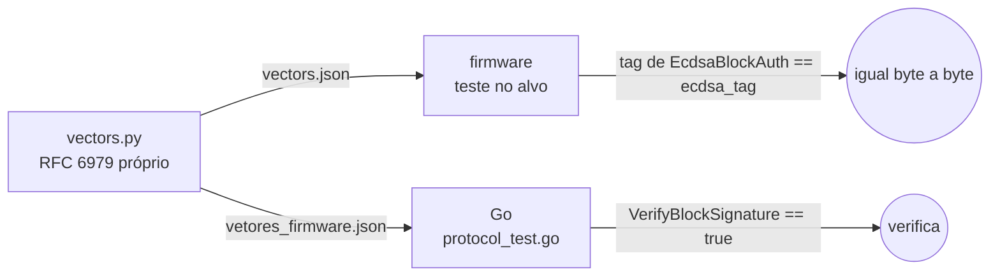

# 01 — Verificação ECDSA no protocolo e vetores cruzados

Função pura de verificação da tag `asym` em `backend/internal/domain/protocol`,
e um vetor de assinatura gerado fora do Go que firmware e servidor conferem.

## Contrato da tag `asym`

| Item | Valor |
|---|---|
| Curva | P-256 (secp256r1) |
| Entrada assinada | `SHA-256("MALCONG" ‖ 0x03 ‖ DevId(8) ‖ dados(tamanho))`, a mesma `protocol.TagInput(BlockType, dev, data)` do HMAC |
| Tag | `r(32) ‖ s(32)`, inteiros **big-endian**, com zeros à esquerda (exceção à regra little-endian, `.spec/README.md` inv. 1) |
| Chave pública | 65 B não comprimida `04 ‖ X(32) ‖ Y(32)` (`dongle.public_key`) |
| Assinatura no firmware | determinística (RFC 6979, `mbedtls_ecdsa_sign_det_ext`); o verificador não depende disso |
| `s` alto | aceito (D4) |

## Mudanças

| Arquivo | Mudança |
|---|---|
| `backend/internal/domain/protocol/signature.go` (novo) | `ParsePublicKey(raw []byte) (*ecdsa.PublicKey, error)`: exige 65 B, prefixo `0x04` e ponto na curva (validar via `crypto/ecdh.P256().NewPublicKey`, depois montar o `ecdsa.PublicKey` com X/Y). `VerifyBlockSignature(pub, input, tag []byte) bool`: tag com exatamente 64 B, `r` e `s` em `[1, n-1]`, `ecdsa.Verify` sobre `sha256(input)`. Erro de parse vira `ErrInvalidPublicKey`. Sem I/O, permitido pelo depguard do `domain` |
| `backend/internal/domain/protocol/protocol_test.go` | casos: vetor do firmware válido; 1 bit trocado em dados, `r` ou `s` inválido; `s' = n − s` válido (D4); tag de 63/65 B inválida; `r = 0`/`s = 0` inválidos; chave com prefixo `0x02`, 64 B ou ponto fora da curva recusada |
| `esp32-firmware/tools/provision/vectors.py` | gera o vetor ECDSA: `k_sig` fixo, `public_key(d)` (a aritmética P-256 já está no script) e assinatura RFC 6979 implementada no próprio script (HMAC-DRBG da RFC 6979 §3.2, sem biblioteca), sobre o bloco 0 dos vetores. Acrescenta `self_check` com um vetor publicado da RFC 6979 (A.2.5, P-256/SHA-256, mensagem "sample") |
| `esp32-firmware/tools/provision/vectors.json` e `backend/internal/domain/protocol/testdata/vetores_firmware.json` | novos campos no bloco 0: `k_sig`, `k_sig_public`, `ecdsa_tag` (hex, maiúsculas, como os demais) |
| Cabeçalho C gerado (`emit_header`) | `VEC_BLK_0_K_SIG`, `VEC_BLK_0_K_SIG_PUBLIC`, `VEC_BLK_0_ECDSA_TAG` |
| `esp32-firmware/tools/provision/verify_block.py` (novo, previsto na fase 1) | verifica, no host, um bloco extraído (hex ou dump do `event-viewer`) com a `k_sig_public`; usado no roteiro de bancada |

## Interoperabilidade

- **Firmware:** as classes mbedTLS não rodam no ambiente `native`
  (`fase-1/01`), então a igualdade `EcdsaBlockAuth::sign(bloco 0) == ecdsa_tag`
  é um teste Unity no alvo, numa placa com `pio test -e collector_mock_debug_asym`.
  O `sign_det_ext` com cegamento continua determinístico, então a tag tem que
  bater byte a byte.
- **Go:** basta verificar a assinatura. A igualdade byte a byte fica a cargo do
  firmware.

## Aceite

- O `self_check` de `vectors.py` passa com o vetor da RFC 6979.
- `go test ./internal/domain/protocol/...` cobre os casos acima.
- O teste no alvo confere `ecdsa_tag` (roteiro de bancada, registrado no
  `DESVIOS-E-MELHORIAS.md` da fase se não puder rodar).
