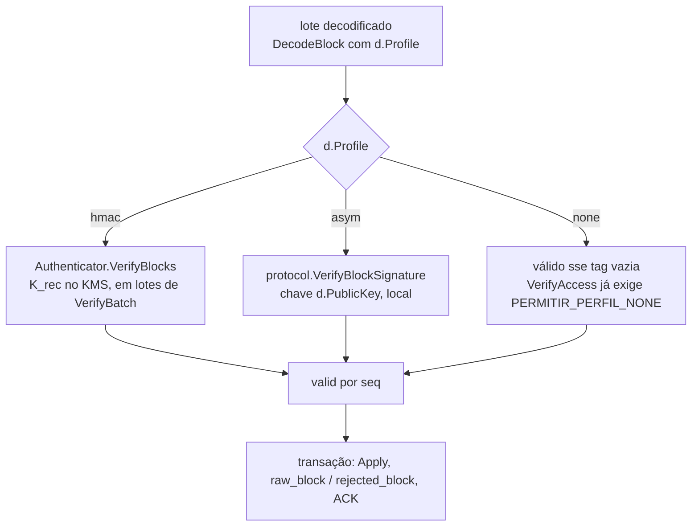

# 02 — Verificação de blocos por perfil na ingestão

`usecase/ingestion.ReceiveBatch` passa a escolher o verificador pelo perfil do
dongle, em vez de mandar todo lote ao KMS com `K_rec`.

## Despacho

O resto do fluxo não muda: snapshot, deduplicação por `seq`, pré-assinatura do
ACK provável com `HMACAuth(K_auth)` em paralelo, transação, `X-Lote-*` e
métricas de resultado.

## Mudanças

| Arquivo | Mudança |
|---|---|
| `backend/internal/usecase/ingestion/receive_batch.go` | O passo 3 extrai a verificação para `verifyBlocks(ctx, d, inputs, tags) ([]bool, error)`, com um `switch d.Profile.Name`. `asym`: `ParsePublicKey(d.PublicKey)` uma vez por lote (chave inválida faz todos os blocos verificados ficarem inválidos, com log de erro `ingestion.public_key_invalida`, sem 5xx) e verifica em goroutines limitadas por `VerifyParallel`, no mesmo `errgroup` do ACK. `none`: válido se `len(tag) == 0`. `hmac`: o código atual. O `asym` e o `none` não chamam o KMS para verificar |
| `backend/internal/port/metrics.go` | `MetricsIngestion` ganha `BlockVerifyDuration(profile string, d time.Duration)`, medido por lote verificado |
| `backend/internal/adapter/prometheus/metrics.go` | histograma `tccelta_block_verify_duration_seconds{profile}`, para comparar `hmac` e `asym` no servidor (benchmark do TCC) |
| `backend/internal/port/porttest`, `backend/internal/adapter/memory` | implementam o método novo (no-op/contador) |
| `backend/internal/usecase/ingestion/ingestion_test.go` | casos: dongle `asym` com bloco assinado aceito; tag adulterada vira `invalid_tag`; o fake do KMS registra **zero** `VerifyBlocks` no `asym`; `public_key` inválida vira tudo inválido sem erro; `none` com tag vazia aceito; repetição de `seq` herda o resultado do primeiro (já existe para `hmac`, repetir para `asym`) |
| `backend/docs/metricas.md` | métrica nova |

Nada muda em `http/`, nos códigos `problem+json` ou nos cabeçalhos `X-Lote-*`.

## Custo

A verificação P-256 em Go custa dezenas de µs por bloco num núcleo. Com
`VerifyBatch` = 32 e `VerifyParallel` ≥ 1, um lote cheio fica abaixo do RTT de
uma chamada ao KMS. Isso é para confirmar com a métrica nova, não é meta.

## Aceite

- Os testes do caso de uso acima passam.
- `make lint` passa (o `usecase` continua sem importar adaptadores).
- No e2e (04), `tccelta_kms_calls_total{operation="verify_rec"}` não cresce
  com os dongles `asym`.
