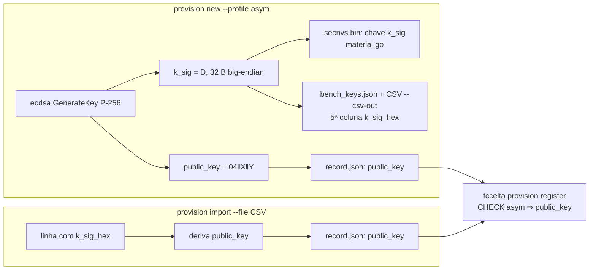

# 03 — Provisionamento de dongles `asym` pelo KMS

`tccelta-kms provision new|import` passa a gerar ou ler `k_sig` no perfil
`asym`. Isso vale para os dongles de teste e de bancada; o caminho do firmware
(`provision.py` → `kms_record.json` → `provision import-record`) já funciona e
não muda.

## Fluxos

`K_auth` e `K_rec` continuam importados no Transit em todos os perfis (D5).

## Mudanças

| Arquivo | Mudança |
|---|---|
| `backend/internal/kms/provisioning/provision.go` | `NewDongle(profile)`: no `asym`, gera o par P-256 (`crypto/ecdsa`, `crypto/rand`), preenche `Dongle.KSig` (escalar de 32 B, big-endian, como `mbedtls_mpi_read_binary` lê no firmware) e `Dongle.PublicKey`. `ImportWithKeys` grava `Record.PublicKey` (hex, maiúsculas, como em `import-record`) quando o perfil é `asym`, e recusa `asym` sem `KSig`. `ImportCSV` aceita 4 ou 5 colunas: `FieldsPerRecord = -1`, validando 4 ou 5, com `k_sig_hex` obrigatória no `asym` e proibida nos outros perfis |
| `backend/internal/kms/provisioning/material.go` | sem mudança de formato (a linha `k_sig,data,hex2bin` já existe), só passa a receber `KSig` |
| `backend/cmd/tccelta-kms/provision.go` | `appendCSV` escreve a 5ª coluna `k_sig_hex` (vazia fora do `asym`). `bench_keys.json` inclui `k_sig` e `k_sig_public` no `asym` |
| `backend/internal/kms/provisioning/*_test.go` | `new` `asym` gera `KSig` válido (escalar em `[1, n-1]`) e `PublicKey` coerente com ele; CSV de 4 colunas continua aceito; `asym` sem `k_sig_hex` recusado; `hmac` com `k_sig_hex` recusado |
| `backend/testdata/test-dongles.csv` | cabeçalho comentado com a 5ª coluna; acrescenta 1 dongle `asym` com `k_sig` de teste fixo (público, como os demais) para o `make seed-dev` |
| `backend/docs/kms-dongle-record.md`, `backend/docs/kms.md` | formato do CSV e do `bench_keys.json` |

O `--profile` já existe em `provision new`; o `record.json`
(`tccelta.dongle.record.v1`) não muda de schema, só passa a ter `public_key`
preenchida no `asym`.

## Aceite

- `make provision PROFILE=asym` (parâmetro novo, ver 04) produz
  NVS com `k_sig`, e `tccelta provision register` aceita o `record.json`.
- `make seed-dev` cadastra o dongle `asym` do CSV de teste.
- Os testes do pacote `kms/provisioning` cobrem os casos acima.
- O depguard de isolamento do KMS continua passando (o gerador de chaves usa só a biblioteca padrão).
