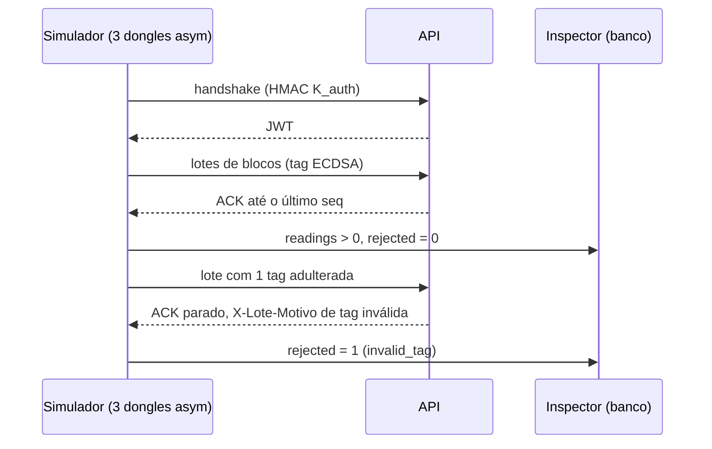

# 04 — Simulador e e2e com o perfil `asym`

Dongle virtual que assina blocos com ECDSA e um cenário `asym` no `make e2e`.

## Mudanças

| Arquivo | Mudança |
|---|---|
| `backend/internal/tools/simulator/dongle.go` | `Keys` ganha `Profile protocol.Profile` e `KSig *ecdsa.PrivateKey`. `DongleVirtual.sign` escolhe pelo perfil: `hmac` é o atual; `asym` usa `ecdsa.Sign` sobre `sha256(TagInput)` e escreve `r‖s` com `FillBytes` (32 B cada, big-endian); `none` devolve a tag vazia. O handshake (`macAuth`) não muda |
| `backend/internal/tools/simulator/keys.go` (novo) | leitura do CSV de chaves, movida de `cmd/tccelta/provision.go` (`readKeysCSV`): aceita 4 ou 5 colunas e monta `KSig` a partir de `k_sig_hex` |
| `backend/cmd/tccelta/simulator.go`, `provision.go` | passam a usar `simulator.ReadKeysCSV` |
| `backend/internal/tools/simulator/scenarios.go` | cenário novo `asym`. Pré-condição: todos os dongles do CSV são `asym`. Roda o fluxo do `e2e` (handshake, lotes, ACK); confere pelo `Inspector` que `reading`/`position` cresceram e que `rejected` = 0; depois envia um lote com 1 bloco de tag adulterada (1 bit) e confere `rejected` = 1 com motivo `invalid_tag` e o ACK parado no `seq` anterior |
| `backend/Makefile` | `E2E_NEW_DONGLES` recebe o perfil como 2º argumento (padrão `hmac`) e repassa `--profile` ao `provision new`; o `e2e` acrescenta `$(call E2E_NEW_DONGLES,asym,asym) && $(call E2E_SIMULATE,asym)`. `provision` e `scenario` aceitam `PROFILE=` (`hmac`, `asym` ou `none`) (padrão `hmac`) |
| `backend/docs/cenarios-simulador.md` | cenário `asym` e a verificação do e2e |

## Cenário `asym`

## Aceite

- `make e2e` passa com 5 cenários (`e2e`, `negative-protocol`, `time`,
  `generation`, `asym`).
- `make scenario C=asym` funciona na stack de desenvolvimento.
- O CSV de 4 colunas (`hmac`) continua funcionando nos cenários existentes.
