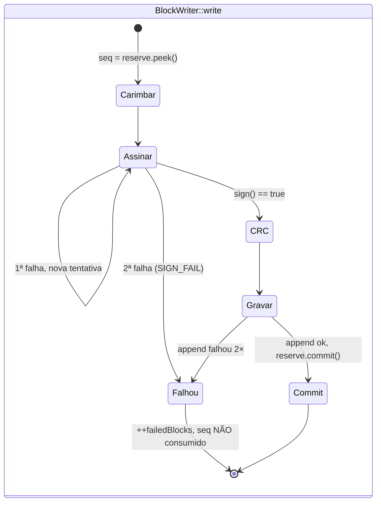

# 05 — Falha de assinatura explícita no firmware

Hoje `EcdsaBlockAuth::sign` grava uma tag de zeros quando
`mbedtls_ecdsa_sign_det_ext` falha. O bloco vai para a flash, é enviado e só
o servidor o rejeita como `invalid_tag`, sem pista no dongle. O mesmo vale para
o marcador LOSS assinado em `SyncEngine::sendLoss`. A falha passa a ser tratada
como as falhas de gravação que já existem.

## Comportamento alvo

- **Bloco de dados** (`collector/BlockWriter.cpp`): a falha de assinatura segue
  o caminho que a falha de `append` já usa. `write` devolve `false`, incrementa
  `failedBlocks` e não chama `reserve.commit()`, então o próximo bloco reusa o
  mesmo `seq` e não há lacuna nem LOSS. Os registros do bloco se perdem, como
  numa falha de gravação; o contador `failedBlocks` já aparece em
  `ICollectorControl` e no `Elm327`.
- **Marcador LOSS** (`sync/SyncEngine.cpp`, `sendLoss`): com falha de
  assinatura, não envia. Emite `SIGN_FAIL` e devolve `false`, o mesmo efeito de
  uma falha de envio, então o cursor não avança e o LOSS é remontado na próxima
  tentativa do lote.

## Mudanças

| Arquivo | Mudança |
|---|---|
| `esp32-firmware/src/collector/IMessageAuth.h` | `sign` passa a devolver `bool`; `NoAuth::sign` devolve `true` |
| `esp32-firmware/src/security/BlockAuth.*` (`HmacBlockAuth`) | devolve o resultado do HMAC |
| `esp32-firmware/src/security/mbed/EcdsaBlockAuth.cpp` | devolve `rc == 0`; não grava mais a tag de zeros |
| `esp32-firmware/src/collector/BlockWriter.{h,cpp}` | até 2 tentativas de `sign`; na falha, sai pelo mesmo caminho de `++_failedBlocks; return false`. `WriteReport` ganha `signOk` |
| `esp32-firmware/src/sync/SyncEngine.cpp` | `sendLoss` confere o retorno de `lossAuth.sign` antes de montar o TLV |
| Evento `SIGN_FAIL` | campos `kind` (`block`/`loss`), `seq`, `attempt`, `rc` (código mbedTLS, quando houver), no padrão de `esp32-firmware/docs/eventos.md` |
| `esp32-firmware/docs/eventos.md` | evento novo |
| `esp32-firmware/test/support/Fakes.h` (`FakeAuth`) | modo que falha N vezes |
| `esp32-firmware/test/test_block_format`, `test/test_sync_engine` | `write` com o falso que falha 1× grava e faz o commit; com o que falha 2×, devolve `false`, não faz o commit e o próximo bloco usa o mesmo `seq`; `sendLoss` com falha não envia e não avança o cursor; os eventos são emitidos |

## Aceite

- Os testes `native` acima passam e os existentes continuam passando.
- O build dos ambientes `*_none`, `*_hmac` e `*_asym` compila.
- Nenhuma tag de zeros sai mais do firmware.
