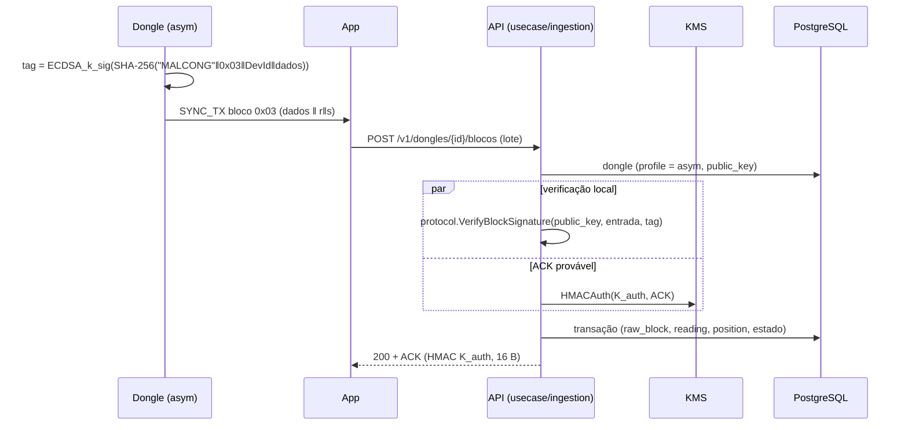

# Fase 4 — Perfil `asym` (ECDSA P-256) fim a fim

Leva a assinatura ECDSA dos blocos, que hoje para no firmware, até o servidor:
verificação na ingestão, provisionamento de dongles `asym` pelo KMS, simulador e
e2e com o perfil, vetores cruzados firmware ↔ servidor e falha de assinatura
explícita no firmware. De quebra, o mesmo despacho por perfil faz o `none`
(bancada) funcionar.

## Estado de partida

| Parte | Já existe | Falta |
|---|---|---|
| Firmware | `EcdsaBlockAuth` (P-256 determinística, `r‖s` 64 B), builds `*_asym`, `provision.py --security asym` (`k_sig` na NVS, `k_sig_public` no `kms_record.json`) | falha de `sign_det_ext` grava tag de zeros em silêncio; sem vetor de assinatura |
| App | bloco opaco no caminho HTTPS | — (bancada `bench_sync_server.dart` aceita `asym` sem verificar; fora do escopo) |
| KMS | `provision import-record` exige `k_sig_public` no `asym` | `provision new --profile asym` não gera `k_sig` nem `public_key` |
| Cadastro / banco | `dongle.public_key` (65 B, CHECK no `asym`), `Dongle.PublicKey` carregado | — |
| Ingestão | `protocol.ProfileAsym` separa dados e tag de 64 B | verificação sempre HMAC `K_rec` no KMS: todo bloco `asym` vira `invalid_tag` |
| Simulador / e2e | dongles `hmac` | assinatura ECDSA, CSV com `k_sig`, cenário `asym` |

## Fluxo alvo

O handshake (desafio, resposta, ACK) continua HMAC-SHA256 de 16 B com `K_auth`
no Vault em todos os perfis. Só a tag do **bloco** muda.

## Decisões

| # | Decisão | Motivo |
|---|---|---|
| D1 | ECDSA só nos blocos; handshake segue HMAC `K_auth` | invariante 5 de `.spec/README.md`; mudar o handshake mexe no formato das mensagens, firmware e KMS |
| D2 | Verificação ECDSA **local na API**, em `domain/protocol`, com a `public_key` do cadastro | a chave pública não é segredo; função pura, sem I/O; tira o KMS do caminho de verificação do `asym` |
| D3 | Despacho por perfil no caso de uso de ingestão: `hmac` → `Authenticator.VerifyBlocks` (KMS), `asym` → local, `none` → tag vazia aceita | um ponto só de decisão; `none` continua barrado por `VerifyAccess` fora de bancada |
| D4 | Aceitar `s` alto e baixo (sem normalização low-S) | o mbedTLS não normaliza; `raw_block` deduplica por `seq`, não pela tag, então a maleabilidade não cria duplicata aceita |
| D5 | `K_rec` continua provisionado e importado no `asym`, sem uso nos blocos | não muda o cadastro, o `record.json` nem o `kms_record.json` do firmware |
| D6 | `public_key` fica na linha `dongle` do PostgreSQL | escrita só pelo papel `tccelta_provisioner`; risco aceito e registrado (quem escreve no banco troca a chave). Mover a chave para o KMS fica como melhoria |
| D7 | CSV de chaves de teste ganha 5ª coluna opcional `k_sig_hex` | `test-dongles.csv`, `--csv-out` do KMS e o leitor do simulador continuam lendo os arquivos de 4 colunas |

## Specs

| # | Arquivo | Entrega |
|---|---|---|
| 01 | `01-protocolo-assinatura-e-vetores.md` | `protocol.VerifyBlockSignature`, parse da chave pública, vetores cruzados com o firmware |
| 02 | `02-ingestao-por-perfil.md` | despacho por perfil em `ReceiveBatch`, métrica por perfil, perfil `none` |
| 03 | `03-kms-provisionamento-asym.md` | `provision new --profile asym`, `import` do CSV com `k_sig`, `record.json` com `public_key` |
| 04 | `04-simulador-e-e2e.md` | dongle virtual `asym`, cenário `asym`, `make e2e` com o perfil |
| 05 | `05-firmware-falha-de-assinatura.md` | `IMessageAuth::sign` com resultado, evento e descarte do bloco |

Ordem: 01 → 02 → 03 → 04 → 05. A 05 é independente e pode ir em paralelo.

## Critérios de aceite da fase

- `make e2e` roda o cenário `asym`: blocos válidos aceitos, tag adulterada
  rejeitada como `invalid_tag`, ACK correto, e nenhuma chamada a
  `/v1/blocks/verify` para dongles `asym`.
- O vetor ECDSA gerado no firmware (01) verifica no Go, e 1 bit trocado não
  verifica.
- `tccelta-kms provision new --profile asym` gera NVS com `k_sig` e um
  `record.json` com `public_key`, aceitos por `tccelta provision register`.
- Um dongle físico `collector_*_asym` provisionado por `provision.py` sincroniza
  pelo app com o servidor, com blocos aceitos (roteiro de bancada).
- Os blocos `none` são aceitos só com `PERMITIR_PERFIL_NONE` ligado.
- `make sqlc-check`, `make test`, `make lint` e `make e2e` passam. As specs
  da fase 3 (`05`, `07`, `DESVIOS-E-MELHORIAS.md`) e `.spec/README.md` são
  atualizadas.

## Fora do escopo

- Handshake assimétrico.
- Chave pública guardada ou verificada no KMS (D6).
- Verificação ECDSA no servidor de bancada do app.
- Rotação de `k_sig`.
