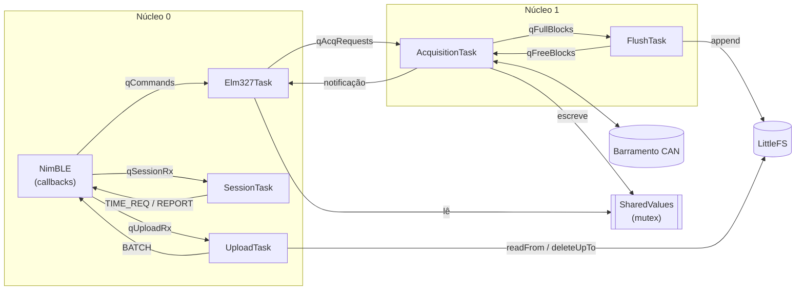

# Plano de implementação — Coleta de telemetria (firmware)

Plano para implementar no `esp32-firmware/` a estratégia descrita no documento
*Estratégia da Coleta do TCCELTA* (Investigação, 18/10/2026). As seções citadas
(§x.y) referem-se a esse documento.

## 1. Escopo

**Dentro**
- Firmware do Dongle: modos Coletor e Diagnóstico, escalonador sobre a CVT,
  formato em blocos com leitura antecipada (§2.6), log em flash, upload com
  cursor de ACK, sincronização de relógio (Cristian), comandos AT/AT#.
- Testes unitários nativos (`pio test -e native`) das partes sem hardware.

**Fora**
- Aplicativo, servidor e simulador/HIL (planos próprios, depois).
- Segurança: autenticação Dongle↔Servidor, MAC dos blocos, ACK e hora. O
  plano só deixa **pontos de encaixe** explícitos (ver §5.8). As implementações
  `Secure*BleConnectivity` atuais ficam intocadas.

## 2. Decisões já tomadas

| Tema | Decisão |
|---|---|
| Leitura no barramento | Pior caso: **1 PID por requisição, estritamente sequencial**. Arquitetura preparada para trocar por leitura de vários PIDs por requisição sem mexer no escalonador (§5.2). |
| Endereçamento | **Físico, direto ao motor** (`0x7E0` → `0x7E8`; em 29 bits `0x18DA10F1` → `0x18DAF110`). Evita respostas de várias ECUs. O diagnóstico continua usando o funcional (`0x7DF`). |
| `Tmax` | Padrão **50 ms**, medido em campo (§5.9). Piso de 20 ms para `AT ST`. |
| Períodos | `Pᵢ = max(kᵢ·Tmax, 100 ms)`; `Pᵢᵐⁱⁿ ≥ 100 ms`. |
| Formato | **Blocos** de 1 KB (§2.6.4) com **leitura antecipada** (`Pᵢ`/`Pᵢᵐⁱⁿ`, §2.6.5) já na primeira versão. |
| GPS | Registro `0xFF` gerado sempre que o app envia `AT#GPS`, com ou sem Internet no app. |
| Persistência | Offline-first: todo dado passa pela flash; servidor confirma o maior `seq` de bloco recebido sem lacunas. |

## 3. Estado atual relevante (o que muda)

| Ponto | Hoje | Necessário |
|---|---|---|
| `TwaiCan` | Bitrate fixo em 250 kbps (`TODO: Parametrizar`) | 250/500 kbps conforme `AT SP` |
| `CanFrame` / `Obd2Can` | Só IDs de 11 bits (`0x7DF`/`0x7E8`) | Também 29 bits (`0x18DB33F1` / `0x18DAF1xx`) |
| Casamento de resposta | `IsoTpClient` confere só o SID (`0x41`); o PID é filtrado depois, em `Obd2Can`. Com `expectedResponses = 1`, uma resposta atrasada do PID anterior encerra a espera e a resposta certa é perdida | Conferir **SID + PID** dentro da espera do ISO-TP (prefixo esperado), descartando o resto e continuando a esperar |
| Acesso ao barramento | `Elm327Task` chama `IObd2` direto | Só a tarefa de Aquisição toca o barramento; diagnóstico entra por fila |
| Partições | Padrão do `esp32dev` (sem LittleFS de 2 MB) | `partitions.csv` com partição de dados de 2 MB |
| Testes nativos | Só `IsoTpClient` | Núcleo da coleta em C++ puro, sem `Arduino.h` |

## 4. Arquitetura: classes, tarefas e filas

Princípios:
- **Um único dono por recurso.** Só a Aquisição usa o barramento CAN e escreve
  no bloco aberto. Só a Flush grava blocos. As outras tarefas pedem por fila.
- **Lógica em C++ puro, tarefas como cascas.** Tudo em `collector/` não inclui
  Arduino nem FreeRTOS e é testado no `native`. Cada tarefa só espera em
  filas/eventos e chama essas classes.
- **O ELM327 atual não muda por dentro.** O diagnóstico continua chamando um
  `IObd2`, só que agora é um `QueuedObd2` que encaminha o pedido à Aquisição.

### 4.1 Visão geral



### 4.2 Arquivos

```
src/
  collector/                    # C++ puro — testável no env native
    Clock.h                     # IClock (ms desde o boot)
    PidReader.h                 # IPidReader, ReadResult
    SequentialPidReader.*       # 1 PID por requisição, sobre IObd2
    Scheduler.*                 # estado de escalonamento e regra da §5.3
    CurrentValues.*             # último valor de cada PID (sem lock)
    Utilization.*               # U = Σ T/Pᵢ, validação U ≤ Umax
    CollectorConfig.h           # Tabela 6: protocolo, Tmax, PIDs e períodos
    BlockFormat.h               # layout e constantes (Tabelas 7 e 12)
    BlockBuilder.*              # monta um bloco
    IBlockStore.h               # interface do log de blocos
    UploadCursor.*              # janela, ACK, retransmissão
    TimeSync.*                  # lado Dongle do algoritmo de Cristian
    TmaxMeter.*                 # amostras, p99, Tmax sugerido
    SeqCounter.*                # dono do seq (peek/commit/recuperação)
    DataProtocol.*              # codifica/decodifica mensagens de dados
    IMessageAuth.h              # ponto de encaixe da segurança + NoAuth
    AtHashParser.*              # parsing dos comandos AT# (std::string)
  storage/
    LittleFsBlockStore.*        # IBlockStore sobre LittleFS (segmentos)
    NvsStore.*                  # config, boot_id, último seq
  connectivity/
    IDataChannel.h              # canal binário de dados
    ble/BleConnectivity.*       # + par de características de dados
    ble/BleDataChannel.*        # IDataChannel com fragmentação por MTU
  rtos/
    CollectorContext.h          # handles de filas, eventos, mutexes; tipos das mensagens
    QueuedObd2.*                # IObd2 que encaminha à Aquisição
    CollectorControl.*          # ICollectorControl: AT# → config/fila
    SharedValues.*              # CurrentValues + mutex
  tasks/
    AcquisitionTask.*
    FlushTask.*
    UploadTask.*
    SessionTask.*
    Elm327Task.*                # existente, recebe as novas dependências
  elm327/
    Elm327.*                    # + AT SP/RV, AT# e modo coletor
test/
  test_isotp/                   # existente
  test_collector/               # testes das classes de collector/
  support/MemoryBlockStore.h    # IBlockStore em memória
  support/FakeClock.h, FakeObd2.h
```

### 4.3 Classes

**Núcleo da coleta (`collector/`, C++ puro)**

| Classe | Responsabilidade | Usada por |
|---|---|---|
| `IClock` | `nowMs()` desde o boot | Aquisição, `TimeSync` |
| `IPidReader` / `SequentialPidReader` | Lê até `maxPidsPerRequest()` PIDs com prazo `Tmax`; devolve `ReadResult` por PID | Aquisição |
| `Scheduler` | Guarda `Pᵢ`, `Pᵢᵐⁱⁿ`, `nextDue`, `lastRead` de cada PID; decide o próximo PID e quanto esperar; aplica o reagendamento | Aquisição (dona exclusiva) |
| `CurrentValues` | Valor e `updatedMs` de cada PID | `SharedValues` |
| `Utilization` | `U = Σ Tmax/Pᵢ` e `isFeasible` | `CollectorControl`, testes |
| `CollectorConfig` | Struct da Tabela 6, com validação de pisos | `NvsStore`, `CollectorControl`, Aquisição |
| `BlockBuilder` | Abre, adiciona registros (PID/GPS), fecha preenchendo `t_ms` inicial e tamanho. **Não** conhece `seq` nem `boot_id` | Aquisição |
| `SeqCounter` | Dono do `seq`: `peek()`, `commit()` (incrementa só após gravação bem-sucedida), recuperação no boot | Flush (dona exclusiva) |
| `IBlockStore` | `append`, `readFrom`, `deleteUpTo`, `oldestSeq`, `newestSeq`, `freeBytes` | Flush, Upload |
| `UploadCursor` | `ackSeq`, blocos em trânsito, janela N, quando retransmitir | Upload |
| `TimeSync` | Gera `TIME_REQ`, marca `t₂`, gera `TIME_REPORT` | Sessão |
| `TmaxMeter` | Acumula tempos, calcula p99 por PID e `1,3 · max p99` | Aquisição |
| `DataProtocol` | Formato binário de `BATCH`, `ACK`, `TIME_*` | Upload, Sessão |
| `IMessageAuth` / `NoAuth` | `sign` / `verify`; hoje não faz nada | Upload, Sessão |
| `AtHashParser` | Converte texto `AT#…` em comando estruturado | `Elm327` |

Interfaces principais:

```cpp
// Scheduler
struct Decision { enum Kind { Read, Wait } kind; uint8_t pids[6]; size_t n; bool early; uint32_t waitMs; };
Decision next(uint32_t nowMs, uint32_t blockDeadlineMs) const;
void onRead(const uint8_t* pids, size_t n, bool early, uint32_t nowMs);
void apply(const CollectorConfig& cfg);

// BlockBuilder
bool addPid(uint8_t pid, const uint8_t* value, uint8_t len, uint32_t tMs);  // false = não cabe
bool addGps(int32_t lat, int32_t lon, int32_t alt, uint32_t tMs);  // Δt = max(tMs, tStart) − tStart
bool empty() const;  uint32_t deadlineMs() const;   // tStart + T_flush
void close();                                       // grava t_ms inicial e tamanho no cabeçalho
void reset();

// Na Flush, antes do append:
void stampHeader(Block& b, uint32_t seq, uint16_t bootId);
```

**Plataforma (`storage/`, `connectivity/`, `rtos/`)**

| Classe | Responsabilidade | Observações |
|---|---|---|
| `LittleFsBlockStore` | Segmentos de 64 blocos; remove o mais antigo quando cheio; recupera `newestSeq` no boot | Mutex interno: Flush e Upload acessam ao mesmo tempo |
| `NvsStore` | `loadConfig/saveConfig`, `nextBootId()`, `loadLastSeq/saveLastSeq` | API da NVS já é thread-safe |
| `IDataChannel` / `BleDataChannel` | `send(type, payload)` com fragmentação por MTU; entrega mensagens recebidas às filas | Mutex no envio: Upload e Sessão enviam |
| `BleConnectivity` | Passa a criar também o par de características de dados e a ligar/desligar `APP_CONECTADO` | `Secure*` continuam embrulhando como hoje |
| `QueuedObd2` | Implementa `IObd2` montando um `AcqRequest` e esperando a notificação | Mantém o `Elm327` de diagnóstico intacto |
| `CollectorControl` | Implementa `ICollectorControl`: valida config (pisos, `Utilization`), grava na NVS e envia à Aquisição; trata `AT#NET` direto no grupo de eventos | Guarda cópia da config para `AT#LIST` |
| `SharedValues` | `CurrentValues` + mutex; `update` (Aquisição) e `get` (Elm327) | Seção crítica curta: copia e solta |

**`Elm327`** recebe `IObd2*` (o `QueuedObd2`), `ICollectorControl*` e
`const SharedValues*`. Fora do modo diagnóstico, pedido de PID presente na
config responde com `SharedValues::get`; outro pedido responde `?`.

### 4.4 Tarefas

| Tarefa | Núcleo | Prio. | Pilha | Espera em | Faz |
|---|---|---|---|---|---|
| `AcquisitionTask` | 1 | 6 | 8 KB | `qAcqRequests` com timeout = `Decision.waitMs` | Atende pedidos; senão, lê PIDs, atualiza `SharedValues`, adiciona ao bloco, fecha bloco por tamanho/prazo |
| `FlushTask` | 1 | 4 | 6 KB | `qFullBlocks` | Carimba `seq` e `boot_id`, `store.append` (sincronizado), `nvs.saveLastSeq`, `seqCounter.commit()`, devolve buffer em `qFreeBlocks`, liga `BLOCOS_PENDENTES` |
| `Elm327Task` | 0 | 5 | 8 KB | `qCommands` | Existente; agora com `QueuedObd2` e `CollectorControl` |
| `SessionTask` | 0 | 3 | 4 KB | `APP_CONECTADO` + `INTERNET`, depois `qSessionRx` | (handshake do colega) liga `SESSAO_OK`; sincroniza a hora |
| `UploadTask` | 0 | 2 | 6 KB | `APP_CONECTADO` + `INTERNET` + `SESSAO_OK` + `BLOCOS_PENDENTES`, depois `qUploadRx` | Envia janela, trata ACK, retransmite |

- O NimBLE já roda sua própria tarefa no núcleo 0. Os callbacks dele só
  copiam e enfileiram, sem processar nada.
- A pilha da Aquisição é de 8 KB porque `Obd2ResponseSet`/`IsoTp::ResponseSet`
  ocupam ~2 KB cada na pilha. Medir com `uxTaskGetStackHighWaterMark` e ajustar.
- O laço da Aquisição usa a própria espera na fila como temporizador:
  ```
  loop:
    d = scheduler.next(now, block.deadlineMs())
    if d.kind == Wait and xQueueReceive(qAcqRequests, &req, d.waitMs): handle(req); continue
    if d.kind == Wait: closeIfDeadline(); continue          // acordou pelo prazo
    results = reader.read(d.pids, d.n, Tmax); scheduler.onRead(...)
    sharedValues.update(results); appendToBlock(results)
    drain qAcqRequests sem bloquear                         // pedidos não esperam mais que 1 leitura
  ```
  No modo diagnóstico, `scheduler` fica suspenso e a tarefa só atende a fila.
- Durante a medição de `Tmax` (§5.9), a Aquisição executa as requisições de
  medição em vez do escalonador e, entre elas, esvazia a fila: `Gps` é
  aceito; os demais pedidos são recusados na hora (`result = OCUPADO`,
  responde `?`).

### 4.5 Filas

| Fila | Produtor → Consumidor | Item | Prof. | Se cheia |
|---|---|---|---|---|
| `qCommands` | Callback BLE (NUS) → `Elm327Task` | `CommandMessage` (128 B, existente) | 8 | Descarta (como hoje) |
| `qAcqRequests` | `Elm327Task` (`QueuedObd2`, `CollectorControl`) → Aquisição | `AcqRequest` | 4 | Espera até 100 ms e responde `?`; GPS é descartado e contado |
| `qFullBlocks` | Aquisição → Flush | `Block*` | 2 | Não enche (só existem 2 buffers) |
| `qFreeBlocks` | Flush → Aquisição | `Block*` | 2 | Não enche; vazia = registros descartados e contados |
| `qUploadRx` | Callback BLE (dados) → Upload | `DataMessage` (≤ 64 B: `ACK`) | 4 | Descarta; a retransmissão por prazo cobre |
| `qSessionRx` | Callback BLE (dados) → Sessão | `DataMessage` (`TIME_RESP`) | 2 | Descarta; a Sessão repete o pedido |

Pedidos à Aquisição:

```cpp
enum class AcqOp : uint8_t { DiagPid, DiagDtc, DiagFreezeFrame, ApplyConfig, SetMode, Stop, MeasureTmax, Gps };
struct AcqRequest {
    AcqOp op;
    uint8_t service, pid; uint32_t timeoutMs; size_t expectedResponses;  // Diag*
    CollectorConfig config;                                              // ApplyConfig
    bool diag;                                                           // SetMode
    int32_t lat, lon, alt; uint32_t tMs;                                 // Gps (tMs marcado no Elm327Task)
    Obd2ResponseSet* out;      // buffer de quem pediu (não copia 2 KB pela fila)
    int* result;
    TaskHandle_t requester;    // xTaskNotifyGive ao terminar; nullptr = sem resposta
};
```

O `Elm327Task` é síncrono (um comando por vez), então espera a resposta com
`ulTaskNotifyTake`. Quem espera e quem não espera:

| Operação | Espera confirmação? | Observação |
|---|---|---|
| `Diag*` | Sim | Resposta em `out` |
| `ApplyConfig` | Sim | A Aquisição fecha o bloco antes de aplicar |
| `SetMode` | **Sim** | A Aquisição liga/desliga `MODO_DIAG` **antes** de notificar, então o próximo comando já vê o modo novo |
| `Stop` | Sim | Fecha e envia o bloco aberto à Flush e para de coletar (usado antes de `esp_restart()`) |
| `MeasureTmax` | Não | Assíncrono; progresso e resultado em `TmaxStatus` (§5.9) |
| `Gps` | Não | Descartado e contado se a fila estiver cheia |

**Pool de blocos:** dois buffers estáticos (`Block` = 1 KB + metadados), os
dois inicialmente em `qFreeBlocks`. A Aquisição pega um buffer **só quando
chega o primeiro registro** de um bloco novo e, ao fechar, envia para
`qFullBlocks` sem pegar outro. Se não houver buffer livre ao chegar um
registro, ele é descartado e contado. Consequência útil: os dois buffers
estarem em `qFreeBlocks` significa que tudo o que foi coletado já está na
flash.

### 4.6 Eventos e dados compartilhados

Grupo de eventos `collectorEvents`:

| Bit | Liga | Desliga | Quem espera/consulta |
|---|---|---|---|
| `APP_CONECTADO` | `onConnect` | `onDisconnect` | Sessão, Upload |
| `INTERNET` | `AT#NET 1` | `AT#NET 0`, `onDisconnect` | Sessão, Upload |
| `SESSAO_OK` | Sessão | `onDisconnect` | Upload |
| `MODO_DIAG` | Aquisição, ao aplicar `SetMode` | idem | `Elm327` |
| `BLOCOS_PENDENTES` | Flush, após `append` | Upload, ao alcançar `newestSeq` (ver abaixo) | Upload |

Para não perder o aviso da Flush, o Upload **desliga o bit primeiro e depois
confere `store.newestSeq()` de novo**. Se surgiu bloco novo nesse meio tempo,
continua enviando em vez de dormir.

Dados compartilhados e proteção:

| Dado | Escreve | Lê | Proteção |
|---|---|---|---|
| `SharedValues` | Aquisição | `Elm327` | Mutex |
| Cópia da config | `CollectorControl` | `AT#LIST` | Mutex do `CollectorControl` |
| Log de blocos | Flush | Upload | Mutex do `LittleFsBlockStore` |
| Envio no canal de dados | Upload, Sessão | — | Mutex do `BleDataChannel` |
| Contadores (descartes, timeouts, perdas) | Várias | `AT#LIST` | `std::atomic<uint32_t>` |
| `TmaxStatus` (estado, progresso, resultado) | Aquisição | `AT#TMAX?` | Mutex |

`Scheduler`, `BlockBuilder`, `IPidReader` e `TmaxMeter` pertencem só à
Aquisição, e `SeqCounter` só à Flush; nenhum precisa de lock.

### 4.7 Fluxos

1. **Leitura agendada:** Aquisição → `scheduler.next` → `reader.read` (CAN) →
   `scheduler.onRead` → `sharedValues.update` → `block.addPid`; se não coube ou
   passou o prazo: `block.close` → `qFullBlocks` → Flush → `stampHeader(seq,
   boot_id)` → `append` sincronizado → `saveLastSeq(seq)` → `commit()` →
   `qFreeBlocks` + `BLOCOS_PENDENTES`.
2. **App pede PID no modo coletor:** BLE → `qCommands` → `Elm327` →
   `sharedValues.get` → resposta. O barramento não é usado.
3. **Diagnóstico:** `AT#DIAG 1` → `CollectorControl` → `SetMode` → Aquisição
   fecha o bloco, suspende o escalonador, liga `MODO_DIAG` → notifica →
   `OK`. Só então o `Elm327Task` lê o próximo comando. Depois, `01 0C`
   → `Elm327` → `QueuedObd2` → `DiagPid` → Aquisição lê → notifica →
   resposta ELM327.
4. **Mudança de configuração:** `AT#PID 0C 250` → `AtHashParser` →
   `CollectorControl` valida pisos e `U` → `NvsStore.saveConfig` →
   `ApplyConfig` → Aquisição fecha o bloco e chama `scheduler.apply`.
   `AT SP` grava a config → `Stop` (espera confirmação) → espera os dois
   buffers voltarem a `qFreeBlocks` (prazo de 2 s) → `esp_restart()`.
5. **GPS:** `AT#GPS …` → `Elm327Task` marca `tMs` ao receber → `Gps` (sem
   resposta) → Aquisição → `block.addGps`, com Δt limitado a ≥ 0 caso o bloco
   tenha sido aberto depois do `tMs`.
6. **Upload:** Upload acorda pelos 4 bits → `cursor.resync(oldestSeq)` →
   `cursor` diz o que enviar → `store.readFrom` → `auth.sign` →
   `BATCH(oldestSeq, …)` → espera `qUploadRx`; `ACK(n)` → `auth.verify` →
   `cursor.onAck` → `store.deleteUpTo(n)`. 5 s sem ACK ou `APP_CONECTADO`
   desligado → `cursor.rewind()`.
7. **Hora:** Sessão acorda com `APP_CONECTADO` + `INTERNET` → `TIME_REQ(boot_id, t₁)`
   → `qSessionRx` recebe `TIME_RESP` → `auth.verify` → marca `t₂` →
   `TIME_REPORT`.
8. **Medição de `Tmax`:** `AT#TMAX` → `MeasureTmax` (sem esperar) → `OK`.
   `AT#TMAX?` lê `TmaxStatus`: `RUNNING k/n` ou o resultado (§5.9).

### 4.8 Ordem de inicialização (`main`, com `USE_COLLECTOR`)

1. `NvsStore`: carrega config e `nextBootId()`.
2. LittleFS monta; `LittleFsBlockStore` recupera `newestSeq`;
   `SeqCounter` começa em `max(nvs.lastSeq, store.newestSeq) + 1` e é
   entregue à Flush.
3. CAN (bitrate e tamanho de ID da config) e `Obd2Can`.
4. `CollectorContext`: cria filas, grupo de eventos, mutexes, pool de blocos.
5. Objetos: `SharedValues`, `QueuedObd2`, `CollectorControl`, `Scheduler`,
   `SequentialPidReader`, `BleDataChannel`.
6. BLE `begin()` (callbacks já com as filas prontas).
7. Tarefas, na ordem: Flush, Aquisição, Elm327, Sessão, Upload.

## 5. Etapas

Cada etapa termina com build verde em `mock` e `twai` e testes nativos passando.

### 5.1 Infraestrutura
- `partitions.csv`: app + NVS + LittleFS de 2 MB (`F` da §2.4.6); referenciar
  em `env:base`.
- Novos envs `collector_mock` e `collector_twai` (flag `-DUSE_COLLECTOR`),
  mantendo os envs atuais funcionando.
- `env:native`: incluir `src/collector/*.cpp` no `build_src_filter`; criar
  `test/test_collector/`.
- `IClock` com implementação `millis()` e fake para teste.

**Pronto quando:** firmware sobe com LittleFS montado e `pio test -e native`
roda a nova suíte vazia.

### 5.2 Leitura de PIDs extensível
- `IPidReader`:
  ```cpp
  struct ReadResult { uint8_t pid; bool ok; uint8_t value[2]; uint8_t len; uint32_t tMs; };
  virtual size_t maxPidsPerRequest() const = 0;           // 1 hoje
  virtual size_t read(const uint8_t* pids, size_t n, ReadResult* out, uint32_t timeoutMs) = 0;
  ```
- `SequentialPidReader`: `maxPidsPerRequest() == 1`; requisição física ao
  motor com prazo `Tmax`, retornando assim que chega a resposta válida.
- **Casamento de resposta:** `IsoTp::Client::request/requestAll` passa a
  receber um prefixo esperado (`[SID, PID]`) em vez de só o marcador de SID,
  conferido tanto em Single Frame quanto em First Frame. Resposta com PID
  diferente (sobra atrasada da requisição anterior) é descartada e a espera
  continua. `Obd2Can` mantém a conferência atual como segunda barreira.
- O escalonador pede até `maxPidsPerRequest()` PIDs vencidos por vez. Um
  futuro `MultiPidReader` (até 6 PIDs, resposta ISO-TP multiframe — já
  suportada pelo `IsoTpClient`) entra só trocando a instância no `main`.

**Testes:** fake `IObd2` com latência/timeout configuráveis; no
`test_isotp`, uma resposta atrasada do PID anterior chegando durante a espera
não pode encerrar a transação nem ser gravada.

### 5.3 CVT e escalonador
- Linha da CVT: `pid`, `periodMs (Pᵢ)`, `minIntervalMs (Pᵢᵐⁱⁿ)`, `nextDueMs`,
  `lastReadMs`, `value[2]`, `valueLen`, `updatedMs`. Capacidade 16 (Tabela 7).
- Regra (§2.6.2):
  1. Se há PIDs vencidos (`now ≥ nextDue`), lê o vencido há mais tempo.
  2. Senão, **só se o próximo vencimento estiver a mais de `Tmax`**, lê
     antecipadamente o de `nextDue` mais próximo entre os que têm
     `now − lastRead ≥ Pᵢᵐⁱⁿ`. Assim uma leitura antecipada nunca atrasa uma
     agendada.
  3. Senão, devolve quanto esperar: o menor entre o próximo vencimento, o
     próximo PID elegível para antecipação e o **prazo de fechamento do bloco
     aberto** (§5.4).
- Reagendamento (com ou sem resposta; `lastRead = now` sempre):
  - **Leitura vencida:** `nextDue += Pᵢ`; se cair no passado, `nextDue = now`.
    Mantém a fase de cada PID, então PIDs com o mesmo período (RPM,
    velocidade, pedal) continuam sendo lidos em sequência.
  - **Intervalo garantido:** como as leituras são sequenciais, um PID que
    vence enquanto outros estão na frente espera por eles. O intervalo entre
    leituras de um PID é no máximo `Pᵢ + Σⱼ≠ᵢ Tⱼ` (com `Tⱼ ≤ Tmax`), e não `Pᵢ`.
    A regra 2 garante que uma leitura antecipada não aumenta esse limite.
  - **Leitura antecipada:** `nextDue = now + Pᵢ`.
  - Só resposta válida atualiza `value`/`updatedMs`.
- Pisos: `Pᵢ = max(kᵢ·Tmax, 100 ms)`; `Pᵢᵐⁱⁿ` padrão `max(Pᵢ/2, 100 ms)` para
  PIDs rápidos e `= Pᵢ` para os lentos (Tabela 13); configurável por PID,
  nunca abaixo de 100 ms.
- A CVT da §2.4.2 fica dividida em duas classes: `Scheduler` (campos de
  escalonamento, só da Aquisição) e `CurrentValues` (valor e `updatedMs`,
  compartilhado via `SharedValues`). Ver §4.3.
- `Utilization::isFeasible(cvt, Tmax)` com `Tᵢ = Tmax` e `Umax = 0,8`.

**Testes:** com clock fake, conferir ordem de leitura, leitura antecipada só
quando o próximo vencimento está a mais de `Tmax`, intervalo entre leituras
de cada PID `≤ Pᵢ + Σⱼ≠ᵢ Tⱼ` (inclusive com todas as respostas no prazo
máximo), fase mantida entre PIDs de
mesmo período, retorno do prazo do bloco quando todos os PIDs dão timeout,
rejeição de `U > 0,8`, e os números da Tabela 11 (`U ≈ 0,78` para os 7 PIDs).

### 5.4 Formato em blocos (`BlockBuilder`)
Implementa a abordagem combinada:
- **Ao abrir um bloco:** registra `tStartMs` (instante do primeiro registro).
- **Ao adicionar um registro:** grava `tipo (1) + Δt (2) + valor (2)` para PID
  ou `0xFF + Δt (2) + lat, lon, alt (12)` para GPS, com
  `Δt = tMs − tStartMs`. Para GPS, o `tMs` vem do momento em que o
  `Elm327Task` recebeu o comando e pode ser anterior ao `tStart`; nesse caso
  `Δt = 0` (nunca negativo, que daria a volta no `uint16`).
- **Ao fechar:** a Aquisição preenche `t_ms inicial (4)` e `tamanho (2)`.
- **Na Flush:** carimba `seq (4)` e `boot_id (2)` logo antes do `append`
  (`H = 12` no total). Um único dono do `seq` evita lacunas no meio da
  sequência, que o `oldestSeq` não cobre (§5.5).
- Fecha quando: o próximo registro não cabe (`S = 1024`), passou
  `T_flush = 10 s` desde a abertura (garante `Δt` em 16 bits), ou o modo /
  a configuração mudou. Bloco vazio não é gravado.
- O fechamento por tempo é verificado pela Aquisição, que acorda também no
  prazo do bloco aberto (§5.3, regra 3). Sem isso, com todos os PIDs dando
  timeout ou o motor desligado, o bloco nunca fecharia.
- Inteiros em little-endian; layout documentado em `BlockFormat.h` para o
  servidor fazer o parse.

**Testes:** serialização byte a byte, fechamento por tamanho e por tempo,
`Δt` nunca estourando, GPS com `tMs` anterior ao `tStart` gravado com `Δt = 0`.

### 5.5 Buffer duplo, flush e log

> **Substituído pela Fase 1 de segurança (specs `.spec/fase-1-seguranca-telemetria/02`, `03`, `05`):** o `last_seq` gravado a cada bloco deu lugar à reserva de `seq` (`seq_rsv`, a cada N blocos) e a um bloco BOOT em todo boot; o log passou ao formato v2 (`dados | tag | CRC32`, segmentos `TCS2`); o envio com janela e *timeout* de ACK (`UploadTask`, `UploadCursor`) e a sincronização de hora (Cristian) foram trocados pelo handshake e pelo cursor do `SyncEngine`. Ver `docs/debug-events.md` v2.
- Buffer duplo como pool de dois blocos circulando entre `qFreeBlocks` e
  `qFullBlocks` (§4.5). Se não houver bloco livre ao fechar, os registros
  seguintes são descartados e contados (contador exposto em `AT#LIST`).
- `IBlockStore`: `append(block)`, `readFrom(seq, …)`, `deleteUpTo(seq)`,
  `oldestSeq()`, `newestSeq()`, `freeBytes()`.
- `LittleFsBlockStore`: arquivos de segmento com N blocos (ex.: 64 → 64 KB);
  apagar = remover segmento inteiro. Partição cheia → remove o segmento mais
  antigo (a perda aparece como lacuna de `seq` no servidor, §1.3).
- Gravação de um bloco, na Flush, nesta ordem:
  1. `seq = seqCounter.peek()`; carimba `seq` e `boot_id`.
  2. `store.append(block)` **terminando com o arquivo sincronizado**
     (`flush()`/`close()` do LittleFS). Só depois disso o bloco existe.
  3. `nvs.saveLastSeq(seq)`.
  4. `seqCounter.commit()`.
  Se o `append` falhar, tenta mais uma vez; se falhar de novo, o bloco é
  descartado e contado, e o `seq` **não** é consumido, então não aparece
  lacuna no meio da sequência.
- Persistência de contadores:
  - `boot_id` incrementado na NVS no boot.
  - A NVS guarda o **último `seq` gravado** (não o próximo). No boot:
    `próximo = max(NVS, último seq no log) + 1`. Guardar o próximo e somar 1
    de novo criaria uma lacuna falsa a cada reinício. Corte de energia entre
    os passos 2 e 3 é coberto pelo `max` com o log.
  - Perda real de blocos (partição cheia) é informada ao servidor pelo
    `oldestSeq` de cada `BATCH` (§5.8).

**Testes:** `IBlockStore` em memória para a lógica de ciclo, incluindo
`append` que falha (o `seq` não avança e o próximo bloco recebe o mesmo
número); teste em placa para o LittleFS (gravar, reiniciar, reler).

**Teste de recuperação (em placa):** gravar continuamente e cortar a energia
em momentos variados (durante o flush, logo depois, durante a escrita da NVS),
reiniciar e conferir que o `seq` continua sem lacunas e sem repetição, e que
o log segue legível. É o teste que valida a regra acima.

### 5.6 Modos, comandos e configuração
- `Elm327` passa a receber `QueuedObd2`, `ICollectorControl` e `SharedValues`
  (§4.3):
  - **Coletor:** pedido de PID da config → responde com `SharedValues` no
    formato ELM327; outro pedido → `?`; `AT#DIAG 1` é aceito sempre (decisão
    de demonstração, §2.1). `AT#DIAG` só responde `OK` depois que a
    Aquisição confirma a troca de modo (§4.5).
  - **Diagnóstico:** o código atual de diagnóstico não muda; o `QueuedObd2`
    leva o pedido pela `qAcqRequests` à Aquisição, que suspende o
    escalonamento e executa. A whitelist atual continua valendo.
- Comandos novos (Tabela 8): `AT SP h`, `AT DP` (ajustar), `AT RV`,
  `AT#PID pp mmmm`, `AT#DEL pp`, `AT#LIST`, `AT#DIAG b`, `AT#NET b`,
  `AT#GPS lat lon alt`, e `AT#TMAX` / `AT#TMAX?` (§5.9). Inválido ou
  inviável → `?`, incluindo `AT ST` abaixo de 20 ms (`hh < 05`) e `AT#PID`
  com período abaixo do piso.
- `NvsStore` (Tabela 6): protocolo (6–9), `Tmax`, lista de PIDs e
  períodos. Mudança de PIDs reconstrói a CVT e fecha o bloco corrente.
- `AT SP` grava a config, envia `Stop` à Aquisição, espera os dois buffers
  voltarem a `qFreeBlocks` (prazo de 2 s) e só então chama `esp_restart()`
  (novo `boot_id`). Sem essa espera, até 10 s de dados seriam perdidos.
- CAN: `CanFrame` ganha flag `extended`; `TwaiCan`/`Mcp2515Can` recebem
  bitrate e tipo de ID; `Obd2Can` escolhe os IDs de 11 ou 29 bits.

**Testes:** parser dos comandos AT# no native (separar o parsing da `String`
do Arduino ou usar `std::string`).

### 5.7 Tarefas e ligação no `main`
- `CollectorContext` com filas, grupo de eventos, mutexes e pool de blocos
  (§4.5, §4.6).
- `AcquisitionTask`, `FlushTask`, `SessionTask`, `UploadTask` conforme §4.4;
  `Elm327Task` com as novas dependências.
- `main` com o ramo `USE_COLLECTOR` seguindo a ordem da §4.8; os envs atuais
  continuam no caminho antigo.
- Sem a parte de segurança, a Sessão liga `SESSAO_OK` assim que o app conecta
  com Internet.

**Pronto quando:** no `collector_mock`, as cinco tarefas rodam juntas por 1 h
sem estouro de pilha (high-water mark registrado) e sem descarte de registros.

### 5.8 Canal de dados, upload e hora
- O NUS atual é texto ELM327. Proposta: **segundo par de características BLE**
  (binário) para blocos, ACK e mensagens de hora, separado dos comandos.
- Mensagens: `BATCH(oldestSeq, blocos)`, `ACK(seq)`, `TIME_REQ(boot_id, t₁)`,
  `TIME_RESP`, `TIME_REPORT(boot_id, t₁, t₂)`.
- **Lacunas reais:** todo `BATCH` leva o `oldestSeq` disponível no Dongle. O
  servidor marca como perdido tudo abaixo dele e avança seu cursor. Sem isso,
  um segmento apagado por falta de espaço faria o servidor esperar para
  sempre e o ACK nunca avançaria.
- `UploadCursor`:
  - Envia a partir de `ackSeq + 1`, com **no máximo N blocos sem
    confirmação** (janela; N = 8 inicialmente).
  - `ACK(n)` → `deleteUpTo(n)` e libera a janela. ACK menor ou igual ao atual
    é ignorado.
  - Sem ACK em **5 s** (constante `UPLOAD_ACK_TIMEOUT_MS`), ou na reconexão
    do app, recomeça de `ackSeq + 1` (o servidor descarta duplicados pelo
    `seq`).
  - `ackSeq` só existe em RAM: no boot recomeça de `oldestSeq − 1`.
  - **Antes de cada envio**, `resync(oldestSeq)`: se `ackSeq + 1 < oldestSeq`
    (a partição encheu e o Dongle apagou blocos durante a conexão), salta
    para `oldestSeq`. Sem isso, `readFrom(ackSeq + 1)` apontaria para um
    bloco que não existe mais.
- Fim do envio: desligar `BLOCOS_PENDENTES` e conferir `newestSeq` de novo
  (§4.6).
- `TimeSync`: guarda `t₁`, marca `t₂` ao receber a resposta e envia o
  relatório; nova sincronização a cada boot/conexão.
- **Pontos de encaixe para segurança** (implementação no-op hoje):
  `IMessageAuth { sign(…); verify(…); }`, aplicado a `BATCH`/`TIME_REPORT`
  (assinar) e a `ACK`/`TIME_RESP` (verificar antes de agir).

### 5.9 Medição de `Tmax`
- Comandos novos (não estão na Tabela 8), **assíncronos**, porque a medição
  leva até `nPIDs · 100 · Tmax` (~35 s com 7 PIDs e 50 ms) e travaria o
  `Elm327Task`, enchendo a fila de comandos:
  - `AT#TMAX`: dispara a medição e responde `OK` na hora (`?` se já houver
    uma em andamento ou se estiver no modo diagnóstico).
  - `AT#TMAX?`: responde `RUNNING k/n` durante a medição; ao terminar, o p99
    de cada PID, o número de timeouts e `Tmax = 1,3 · max p99`.
- A medição suspende a coleta, faz **100 requisições** de cada PID
  configurado e depois retoma o escalonador. A aplicação do valor é feita
  depois com `AT ST`. Durante a medição, valem as regras da §4.4.
- **Diverge do documento:** a §2.5.1 fala em 20 requisições, mas com 20
  amostras o percentil 99 é o próprio máximo, e uma única resposta lenta
  define o prazo. O documento deve ser atualizado para 100. O fator 1,3 é o
  do documento e foi mantido.
- Respostas sem retorno (timeout) entram na contagem como falha e são
  reportadas à parte, não no percentil.

## 6. Ordem e marcos

1. 5.1 + 5.2 + 5.3 → escalonador rodando no `mock`, valores visíveis via log serial.
2. 5.4 + 5.5 → blocos gravados na flash, sobrevivendo a reinício.
3. 5.6 + 5.7 → modos e comandos AT# pelo app atual (NUS).
4. 5.8 → upload/ACK/hora com um cliente de teste.
5. 5.9 → medição de `Tmax` na bancada com o simulador.

## 7. Pendências

- **Canal de dados BLE:** confirmar o segundo par de características (5.8)
  com quem fizer o app.
- **`AT RV`:** precisa de um pino de ADC com divisor de tensão no hardware.
- **Desgaste da NVS:** `seq` gravado a cada flush (~0,1–0,17/s); aceitável,
  mas confirmar o tamanho da partição NVS.
- **Partições no `esp32dev` (4 MB):** 2 MB de LittleFS + NVS deixam ~1,9 MB
  para **um único** app. Conferir o tamanho do binário com `pio run`
  (NimBLE + LittleFS) antes de fixar a tabela. Atualização remota de
  firmware (duas partições de app) não cabe com 2 MB de dados; se for
  desejada, reduzir `F` e refazer as contas da Tabela 14.
- **Escrita na flash e o CAN:** gravar ou apagar a flash desliga o cache nos
  dois núcleos, então a Aquisição também para por alguns ms (apagar um setor
  pode levar dezenas de ms). A FIFO de hardware do TWAI segura alguns frames,
  e uma resposta de Single Frame sobrevive. Conferir se o Arduino-ESP32 usado
  permite `CONFIG_TWAI_ISR_IN_IRAM` (citado na §2.4.10); senão, medir a
  perda de respostas durante o flush.
- **Documento de Investigação:** atualizar §2.5.1 (100 amostras) e registrar
  o endereçamento físico, os pisos e o `oldestSeq` no `BATCH`.
