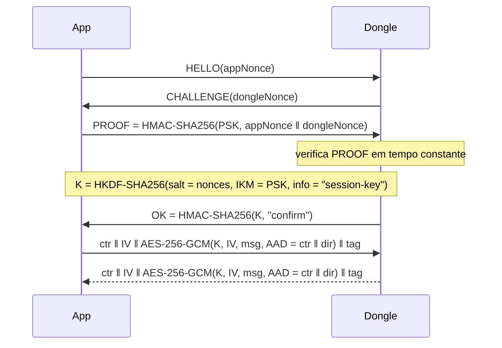

# Segurança do canal BLE: modelagem de ameaças e comparação com recursos nativos

Documento-base para a seção de modelagem de ataques e segurança do TCC.
Consolida: (i) o modelo de ameaça do canal app ↔ dongle, (ii) os mecanismos
nativos de segurança do Bluetooth Low Energy, (iii) a camada de segurança
implementada em `esp32-firmware/src/connectivity/secure/` e (iv) a comparação
entre as duas abordagens, incluindo uma proposta de avaliação experimental.

> Itens marcados com **[verificar]** são afirmações que devem ser conferidas
> na fonte primária antes de entrarem no texto final.

---

## 1. Escopo e motivação

O dongle (ESP32) expõe um serviço GATT estilo Nordic UART (características RX
e TX) por onde o app envia comandos ELM327 e recebe respostas OBD-II. O canal
transporta dados do veículo (VIN, DTCs, parâmetros em tempo real) que permitem
rastrear e perfilar o motorista.

A motivação para tratar a segurança desse canal vem de
**Wen et al., "FirmXRay: Detecting Bluetooth Link Layer Vulnerabilities from
Bare-Metal Firmware" (USENIX Security 2020)**. Ao analisar firmwares de
dispositivos BLE em larga escala, o trabalho mostra que a segurança da camada
de enlace é sistematicamente mal configurada: dispositivos que não exigem
pareamento, uso predominante de *Just Works* (sem proteção contra MITM) e
passkeys estáticas embutidas no firmware, recuperáveis por análise do binário.

**Escopo deste documento:** confidencialidade e integridade do canal BLE,
com foco em **escuta (eavesdropping)** e **ataques de repetição (replay)**.
Escrita no barramento CAN pelo dongle está fora de escopo (o dongle opera
com *whitelist* de comandos, ver `esp32-firmware/src/elm327/whitelist/`).

---

## 2. Modelo de ameaça

### 2.1 Ativos

| Ativo | Por que importa |
|---|---|
| Dados OBD-II em trânsito (VIN, DTCs, PIDs) | Privacidade: identificam o veículo, revelam padrão de uso e localização indireta |
| Integridade dos comandos app → dongle | Um comando adulterado/repetido produz leitura errada ou ação indevida |
| Segredo de longo prazo (PSK ou LTK do bond) | Comprometê-lo quebra todas as outras propriedades |
| Disponibilidade da sessão | O usuário perde o diagnóstico em tempo real |

### 2.2 Adversários

| Adversário | Capacidade | Exemplo |
|---|---|---|
| **A1 – Passivo** | Captura todo o tráfego BLE no alcance, inclusive o pareamento | Sniffer (nRF Sniffer, Ubertooth) num estacionamento |
| **A2 – Ativo no rádio** | A1 + injeta, repete, descarta pacotes; conecta-se ao dongle; faz MITM | Atacante com dois rádios intermediando app e dongle |
| **A3 – Com acesso físico** | Extrai a flash do ESP32 de *um* dongle | Comprou um dongle igual, ou teve acesso ao veículo |

**Fora de escopo:** celular comprometido (malware com root), ataques ao
barramento CAN diretamente, canais laterais de energia/tempo.

### 2.3 Ameaças (escopo principal em negrito)

| ID | Ameaça | Adversário | Propriedade violada |
|---|---|---|---|
| **T1** | **Escuta do tráfego OBD** | A1 | Confidencialidade |
| **T2** | **Replay de quadros dentro da mesma sessão** | A2 | Integridade / atualidade |
| **T3** | **Replay de quadros de uma sessão anterior** | A2 | Integridade / atualidade |
| T4 | MITM durante o estabelecimento da chave | A2 | Confidencialidade + integridade |
| T5 | Conexão não autorizada ao dongle (consulta direta de dados) | A2 | Controle de acesso / privacidade |
| T6 | Extração do segredo do firmware e reuso em outros dongles | A3 | Todas, em escala |
| T7 | Decifração retroativa de tráfego gravado após vazamento do segredo | A1 + A3 | Confidencialidade (forward secrecy) |
| T8 | Derrubar/reiniciar a sessão legítima | A2 | Disponibilidade |
| T9 | Rastreamento do dispositivo pelo endereço BLE | A1 | Privacidade de localização |

---

## 3. Segurança nativa do BLE

A segurança do BLE é definida pelo *Security Manager* (Bluetooth Core
Specification, Vol 3, Part H) e se divide em duas etapas: **pareamento**
(estabelecer uma chave de longo prazo) e **cifração do enlace** (usar essa
chave em cada conexão).

### 3.1 LE Legacy Pairing (BLE 4.0 / 4.1)

A chave de curto prazo (STK) é derivada de uma *Temporary Key* (TK):

- **Just Works:** TK = 0.
- **Passkey Entry:** TK = número de 6 dígitos (~20 bits de entropia).
- **OOB:** TK de 128 bits trocada fora do rádio.

Com Just Works ou Passkey, um adversário **passivo** que grava o pareamento
testa todos os TK possíveis offline e recupera a STK/LTK, decifrando toda a
comunicação posterior (Mike Ryan, "Bluetooth: With Low Energy Comes Low
Security", USENIX WOOT 2013; ferramenta *crackle*). **Legacy não protege
nem contra A1.**

### 3.2 LE Secure Connections — LESC (BLE 4.2+)

Introduzido no Bluetooth 4.2 (2014), substitui a derivação por TK por
**ECDH sobre a curva P-256**:

```
Fase 1  Troca de características: IO Capabilities, flags (Bonding, MITM, SC)
Fase 2  Troca de chaves públicas P-256  →  DHKey = ECDH(priv_local, pub_remota)
        Estágio de autenticação 1 (depende do método de associação),
        baseado em commitments AES-CMAC (funções f4)
        Estágio 2: derivação de MacKey e LTK a partir da DHKey (f5),
        verificação mútua DHKey check (f6)
Fase 3  Distribuição de chaves adicionais (IRK, CSRK) se houver bonding
```

Propriedade central: **mesmo em Just Works, a LTK não é derivável por quem
apenas observa o pareamento** (exigiria resolver o logaritmo discreto em
curva elíptica). O método de associação decide apenas se há proteção contra
**MITM ativo**.

### 3.3 Métodos de associação e o caso do dongle

O método é escolhido cruzando as *IO Capabilities* dos dois lados:

| Método | Requisito de E/S | Proteção MITM | Viável no dongle? |
|---|---|---|---|
| Just Works | nenhum | ❌ | ✅ (único automático) |
| Numeric Comparison | tela + sim/não nos dois lados | ✅ | ❌ sem tela |
| Passkey Entry | tela num lado, teclado no outro | ✅ (se a passkey for aleatória por pareamento) | ⚠️ só com passkey estática na etiqueta |
| OOB | canal externo (NFC, QR) | ✅ | ⚠️ limitado pelas APIs móveis |

O dongle é `NoInputNoOutput`, logo o pareamento é **LESC Just Works**.

- **Passkey estática:** é o anti-padrão apontado pelo FirmXRay. A passkey é
  recuperável do firmware (A3), e no protocolo LESC Passkey Entry ela é
  comprometida bit a bit em 20 rodadas, de modo que um MITM ativo a obtém
  após uma tentativa e a reutiliza nas seguintes **[verificar: referência
  sobre reuso de passkey estática em LESC]**.
- **OOB:** o iOS não expõe OOB BLE para apps de terceiros, e no Android a
  API `createBondOutOfBand` não está disponível para apps comuns
  **[verificar na documentação atual do Android]**.

### 3.4 Cifração do enlace

Após o pareamento (e a cada reconexão, se houver bond):

1. Central e periférico trocam valores aleatórios `SKD` (diversificador) e `IV`.
2. Chave de sessão: `SK = AES-128(LTK, SKDm ‖ SKDs)`.
3. Cada PDU é cifrado com **AES-128-CCM**, com MIC de 4 bytes.
4. O nonce do CCM inclui um **contador de pacotes por direção** (39 bits)
   e o bit de direção.

Consequências:

- **T2 (replay intra-sessão):** um pacote reinjetado tem contador inválido →
  falha no MIC → a conexão é encerrada.
- **T3 (replay entre sessões):** cada conexão tem `SK` nova (SKD aleatório),
  pacotes de sessões anteriores não autenticam.
- A cifração é executada **no controlador de rádio, em hardware**; o custo
  para a aplicação é praticamente nulo.

### 3.5 Outros recursos nativos relevantes

- **Bonding:** a LTK é armazenada; reconexões não refazem o pareamento.
- **Níveis de segurança GATT:** uma característica pode exigir link cifrado
  (`WRITE_ENC`, `READ_ENC`) ou autenticado (`*_AUTHEN`). Sem isso, um
  atacante conecta **sem cifração** e o LESC nunca é acionado.
- **Modo "Secure Connections Only":** recusa pareamento legado, impedindo
  *downgrade* para 3.1 **[verificar nome exato da opção no ESP-IDF/NimBLE,
  algo como `CONFIG_BT_NIMBLE_SM_SC_ONLY`]**.
- **Endereço privado resolvível (RPA) + IRK:** mitiga rastreamento (T9).

### 3.6 Suporte

ESP32 (BT 4.2) suporta LESC tanto no NimBLE quanto no Bluedroid. Android e
iOS suportam LESC em praticamente todos os aparelhos com controlador 4.2+
(lançados nos últimos ~8 anos) **[verificar versões mínimas de SO]**. O
problema observado na prática (FirmXRay) não é falta de suporte, e sim
**configuração**: periféricos que não exigem pareamento, aceitam *fallback*
para legacy ou usam passkey fixa. Dongles ELM327 BLE comerciais baratos
tipicamente não usam segurança de enlace alguma.

### 3.7 Limitações estruturais da segurança nativa

1. **Just Works não autentica:** qualquer um no alcance pareia (T5), e um
   MITM no primeiro pareamento (T4) lê e altera tudo daquela relação.
2. **Escopo do SO:** o bond pertence ao celular, não ao app. No Android,
   qualquer app com permissão Bluetooth usa o link já pareado.
3. **Sem forward secrecy após o bond:** quem obtiver a LTK (ex.: dump de um
   dos lados) decifra conexões gravadas, pois SKD/IV trafegam em claro.
4. **Ataques de reconexão:** trabalhos como BLESA (Wu et al., USENIX WOOT
   2020) exploram falhas no fluxo de reconexão de implementações BLE
   **[verificar escopo exato antes de citar]**.

### 3.8 Estado atual do firmware

`esp32-firmware/src/connectivity/ble/BleConnectivity.cpp` **não configura
nenhuma segurança de enlace**: não há `NimBLEDevice::setSecurityAuth(...)`
e as características RX/TX não exigem cifração. Hoje, a única proteção do
canal é a camada de aplicação descrita a seguir.

Configuração mínima para habilitar LESC Just Works obrigatório:

```cpp
NimBLEDevice::setSecurityAuth(/*bond*/ true, /*mitm*/ false, /*sc*/ true);
NimBLEDevice::setSecurityIOCap(BLE_HS_IO_NO_INPUT_OUTPUT);
// RX
NIMBLE_PROPERTY::WRITE | NIMBLE_PROPERTY::WRITE_NR | NIMBLE_PROPERTY::WRITE_ENC
// TX: o descritor CCCD deve exigir cifração para que o notify só ocorra em link cifrado
```

---

## 4. Camada de segurança na aplicação (implementação própria)

Decorador `SecureBleConnectivity` sobre o transporte BLE: recebe quadros
brutos numa fila FreeRTOS, autentica/decifra numa task dedicada, e só entrega
texto claro autenticado ao `Elm327Task`. Três variantes, selecionadas por
build flag:

| Modo | Flag | Chave de cifração | Anti-replay |
|---|---|---|---|
| `psk` | `USE_SECURE_PSK` | PSK estática (AES-256-GCM) | ❌ |
| `handshake` | `USE_SECURE_HANDSHAKE` | Chave de sessão via HKDF | Só entre sessões |
| `handshake_replay` | `USE_SECURE_HANDSHAKE_REPLAY` | Chave de sessão via HKDF | Entre sessões + contador por direção |

### 4.1 Protocolo `handshake_replay`



- **Autenticação mútua:** o app prova posse da PSK com o PROOF; o dongle
  prova com o OK (só quem tem a PSK deriva K).
- **Atualidade:** nonces novos a cada HELLO → K nova por sessão (T3).
- **Anti-replay intra-sessão:** contador de 64 bits estritamente crescente
  por direção, autenticado na AAD junto com o byte de direção; o contador só
  avança após o GCM verificar o quadro (T2). A direção na AAD impede refletir
  um quadro do dongle de volta para ele.
- **Formato de fio:** hex ASCII terminado em `\n`. Overhead fixo de
  8 (ctr) + 12 (IV) + 16 (tag) = 36 bytes, que viram **72 caracteres**, e o
  payload também dobra de tamanho.

### 4.2 Gestão da PSK

`SECURE_PSK_HEX` (256 bits) é injetada em tempo de compilação via build flag
(`platformio_secrets.ini`). O valor padrão em `platformio.ini` é um
placeholder (`deadbeef…`) e o mesmo valor serve a todos os ambientes. Do
lado do app, a mesma PSK precisa estar embutida.

A PSK funciona como um **segredo OOB na camada de aplicação**: é combinada
fora do rádio e dá ao handshake a autenticação que o Just Works não tem.

---

## 5. Comparação

### 5.1 Propriedades de segurança

| Propriedade | LESC Just Works (configurado corretamente) | `handshake_replay` |
|---|---|---|
| T1 – Escuta passiva | ✅ ECDH + AES-128-CCM | ✅ AES-256-GCM |
| T2 – Replay intra-sessão | ✅ contador no nonce do CCM | ✅ contador na AAD |
| T3 – Replay entre sessões | ✅ SKD aleatório por conexão | ✅ nonces por handshake |
| T4 – MITM no estabelecimento | ❌ no primeiro pareamento | ✅ se a PSK for secreta |
| T5 – Acesso não autorizado | ❌ qualquer um pareia | ✅ exige a PSK |
| Autentica o *app* (não só o celular) | ❌ bond é do SO | ✅ |
| T6 – Extração de firmware | Expõe a LTK de um par | Expõe a PSK, que é **global*** |
| T7 – Forward secrecy | ❌ | ❌ (K depende só da PSK + nonces em claro) |
| T8 – Disponibilidade | Mantida pelo controlador | ⚠️ ver 6.3 |
| T9 – Rastreamento | ✅ com RPA | ❌ não trata |
| Tag de integridade | 4 bytes | 16 bytes |
| Downgrade | ⚠️ exige modo SC-only | N/A |
| Independência de transporte | ❌ | ✅ (serviria para Wi-Fi/serial) |
| Maturidade | Padronizado, implementado no controlador | Código próprio (risco de bug de implementação) |

\* No estado atual, em que todos os dongles compartilham a mesma PSK.

### 5.2 Leitura da comparação

- **Contra o escopo principal (T1, T2, T3), as abordagens são equivalentes.**
  Com LESC + SC-only + características com `*_ENC`, a camada própria é
  redundante para escuta e replay.
- **A camada própria se justifica quando o modelo inclui A2 no primeiro
  contato (T4) ou exige controle de acesso (T5)**, que o LESC sem E/S não
  oferece.
- **Nenhuma das duas oferece forward secrecy.**
- **Defesa em profundidade:** usar as duas camadas combina a proteção do LESC
  contra *downgrade* e rastreamento com a autenticação mútua via PSK.

---

## 6. Riscos residuais e recomendações

### 6.1 PSK global no firmware (T6)

Uma PSK única para todos os dongles reproduz em escala o problema que o
FirmXRay aponta: o dump de um dispositivo compromete todos.

- PSK **por dispositivo**, provisionada ao app por QR code impresso no dongle.
- **Flash Encryption + Secure Boot** do ESP32 para dificultar a extração.

### 6.2 Ausência de forward secrecy (T7)

K = HKDF(PSK, nonces) e os nonces trafegam em claro: tráfego gravado é
decifrável se a PSK vazar no futuro. Correção: ECDH efêmero autenticado pela
PSK (padrão semelhante ao TLS 1.3 PSK-DHE), ao custo de uma operação de curva
elíptica por sessão.

### 6.3 HELLO reinicia a sessão (T8)

`handleHello` aceita HELLO em qualquer estado e zera a sessão estabelecida.
Se um segundo central conseguir se conectar (ou injetar escrita no RX), ele
derruba a sessão legítima sem conhecer a PSK. Mitigações: limitar a uma
conexão simultânea, ignorar HELLO não vindo da conexão atual, ou exigir
autenticação antes de descartar a sessão vigente.

### 6.4 Janela de pareamento (T4/T5 no LESC)

Se o LESC for habilitado, restringir quando pareamentos novos são aceitos:
somente por alguns segundos após um botão físico ou após energizar o dongle;
fora disso, apenas centrais já com bond. Reduz o MITM no primeiro contato a
um evento raro e iniciado pelo dono.

### 6.5 Modos `psk` e `handshake`

- `psk`: sem chave de sessão nem contador → vulnerável a T2 e T3.
- `handshake`: sem contador → vulnerável a T2.

Devem ser tratados como etapas didáticas/incrementais; em produção, apenas
`handshake_replay`.

### 6.6 Estouro de contador e IV

O contador de 64 bits recusa envio ao esgotar (inalcançável na prática). O IV
de 96 bits é aleatório sob a mesma K; o limite seguro de mensagens por chave
para IV aleatório em GCM é da ordem de 2^32 (NIST SP 800-38D), muito acima de
uma sessão de diagnóstico.

---

## 7. Proposta de avaliação experimental

### 7.1 Cenários

| # | Enlace | Aplicação |
|---|---|---|
| C0 | Sem segurança | Texto claro (`env` sem flag de segurança) |
| C1 | LESC Just Works, SC-only, `WRITE_ENC` | Texto claro |
| C2 | Sem segurança | `handshake_replay` |
| C3 | LESC Just Works | `handshake_replay` (defesa em profundidade) |

### 7.2 Métricas

- **Tempo de estabelecimento:** pareamento LESC inicial; reconexão com bond;
  handshake de 4 mensagens.
- **Latência por comando** (ex.: `010C`, RPM) do envio no app até a
  resposta, com N repetições, reportando média e percentis.
- **Overhead em bytes por quadro** e efeito no MTU (fragmentação).
- **CPU/RAM no ESP32:** tempo de GCM/HKDF em software (mbedTLS) e pilha da
  `SecureTask` versus cifração feita no controlador.

### 7.3 Validação das propriedades

- **T1:** capturar com sniffer BLE em C0, C1, C2 e mostrar que só C0 expõe o
  payload; em C1, tentar o *crackle* contra a captura do pareamento.
- **T2/T3:** reinjetar quadros capturados (mesma sessão e sessão anterior) e
  registrar o descarte nos logs (`Replay/out-of-order counter … dropped`,
  `GCM auth failed`).
- **T4/T5:** demonstrar que em C1 um central não autorizado pareia e consulta
  dados; em C2/C3, que ele não passa do HELLO/PROOF.

---

## 8. Referências

- WEN, H.; LIN, Z.; ZHANG, Y. *FirmXRay: Detecting Bluetooth Link Layer
  Vulnerabilities from Bare-Metal Firmware*. USENIX Security Symposium, 2020.
  **[verificar autoria completa]**
- BLUETOOTH SIG. *Bluetooth Core Specification*, Vol 3, Part H (Security
  Manager Specification) e Vol 6, Part E (Low Energy Security).
- RYAN, M. *Bluetooth: With Low Energy Comes Low Security*. USENIX WOOT, 2013.
- WU, J. et al. *BLESA: Spoofing Attacks against Reconnections in Bluetooth
  Low Energy*. USENIX WOOT, 2020. **[verificar]**
- PADGETTE, J. et al. *NIST SP 800-121 Rev. 2: Guide to Bluetooth Security*.
  2017.
- DWORKIN, M. *NIST SP 800-38D: Recommendation for Block Cipher Modes of
  Operation: GCM and GMAC*. 2007.
- KRAWCZYK, H.; ERONEN, P. *RFC 5869: HMAC-based Extract-and-Expand Key
  Derivation Function (HKDF)*. 2010.

## Atualização (Fase 2): LESC Just Works no firmware

- O modo "SC-only" da NimBLE (`sm_sc_only`) exige enlace autenticado (MITM) no ATT e não serve a Just Works; o firmware
  usa `sm_sc=1` e verifica no bond (`sc == 1`, chave de 16 B) que o pareamento foi LESC, apagando bond legado.
- Pareamento só na janela de 45 s aberta pelo botão BOOT (5 s); um bond por vez; fora da janela todo Pairing Request é
  recusado (`BLE_STORE_EVENT_FULL`) e nada é gravado. NUS e SYNC exigem enlace cifrado e sessão autorizada.
- A §4 (camada `connectivity/secure/`) é **histórica**: foi removida do firmware. O cenário C1 da §7 passa a ser o padrão.
- Risco residual aceito: no perfil `dev` a NVS fica em claro, então os bonds são legíveis na flash.
