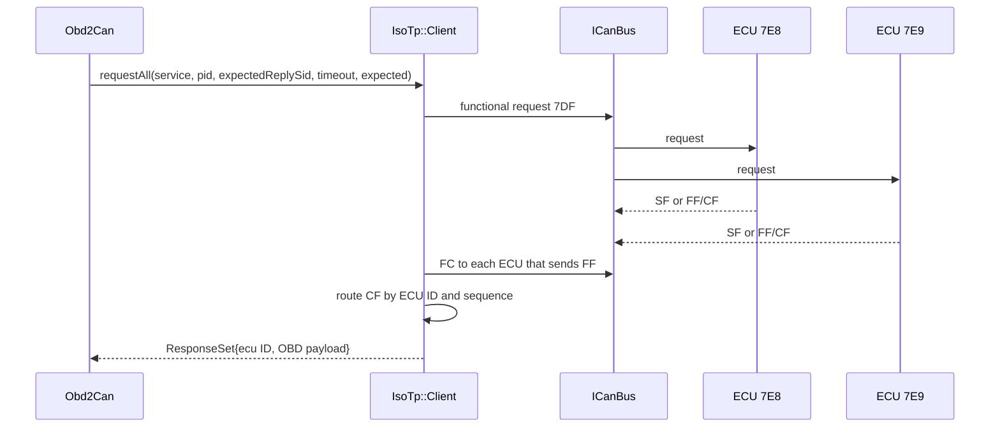

# Real OBD-II over CAN

`Obd2Can` maps the ELM327 OBD operations to functional request ID `0x7DF` and
response IDs `0x7E8`–`0x7EF`. `IsoTp::Client` owns ISO-TP framing and collects
responses independently by ECU ID — it is fully generic, with no knowledge of
OBD-II/UDS. `Obd2Can` holds one `IsoTp::Client` instance (member `_isoTp`),
constructed once with the negative-response marker (`0x7F`), the function
that targets Flow Control frames and the identifier size — all taken from
`ObdAddressing` (11 or 29 bits). Only the expected reply prefix varies per
call: SID + PID for modes 01/02, so a late reply to a previous PID is skipped
instead of ending the wait; SID alone for DTC services.

Diagnostics use the functional request ID. The collector uses
`readEnginePid`, a physical request to the engine ECU (`0x7E0` / `0x18DA10F1`),
so only one ECU answers.

The collector resets the quiet-response timer after valid activity. It stops
early when the optional response count is complete; otherwise it returns after
the quiet timeout. ISO-TP `N_CR` remains independent, so an incomplete
multi-frame ECU response cannot extend the global wait indefinitely.

The fixed-size response set avoids heap allocation on the ESP32 and supports
up to eight response ECUs with up to 256 reassembled payload bytes each.
`request()` remains as a single-response compatibility wrapper over
`requestAll()`.
