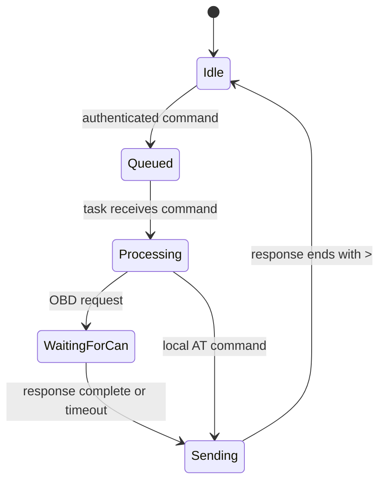

# ELM327 task

`Elm327Task` is the concurrency boundary. BLE callbacks only copy incoming
data into a FreeRTOS queue; the task calls `Elm327::process()` synchronously.
That preserves the strict rule that a new request cannot start while the
previous response is still being collected, formatted, or sent.

## PairingTask (Fase 2)

Núcleo 0, prioridade 2, pilha 4096 B, período 20 ms (`vTaskDelayUntil`). Lê o GPIO0 (BOOT),
alimenta o `PairButton` e, ao segurar `PAIR_BUTTON_HOLD_MS`, chama
`PairingController::onButtonHold()` (derruba conexões, apaga bonds, abre a janela). Também
dá o `tick()` da política (prazos da janela e de autenticação) e anima o LED opcional
(`PAIR_LED_PIN`).
